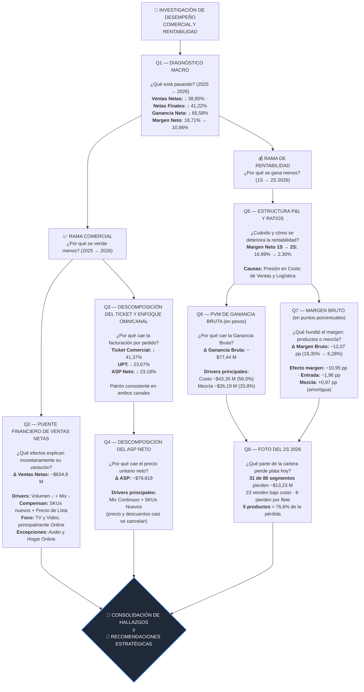

# 🔎 Investigación Analítica SQL

Esta investigación forma parte de un proyecto analítico End-to-End que se puede ver completo en el [repositorio de GitHub](https://github.com/manticafacundoelian/dbt_elt_analytics).

---

### TL;DR

En 2026 las Ventas Netas Finales cayeron 41,2% y la Ganancia Neta 65,6% ($295,7 M → $101,8 M). Pero el año promedia dos semestres muy distintos: el margen neto fue de 16,89% en el 1S y de 2,30% en el 2S.

* **Ventas (Q2–Q4):** se vendió menos y con un ticket más bajo, por volumen y mezcla, no por precios. TV y Video explica cerca del 68% de la caída.
* **Rentabilidad (Q5–Q7):** del 1S al 2S la Ganancia Bruta cayó $77,44 M, sobre todo por el costo (56,0%): el costo unitario subió en los 78 segmentos continuos (mediana +13,9%) y el precio casi no se movió (+0,2%).
* **Hoy (Q8):** 31 de los 86 segmentos pierden −$13,23 M en el 2S, contra +$8,67 M de toda la empresa. 23 venden por debajo de su costo y 8 pierden por el flete. Cinco productos concentran el 76,6% de la pérdida.
* **Qué hacer:** corregir esos cinco productos, poner un piso de margen a los lanzamientos, trasladar el costo al precio, rediseñar el envío Online de ticket bajo y seguir la cartera por cuadrantes.

[Ver Conclusiones Generales →](#-conclusiones-generales) 

---

## 📌 Introducción

Esta investigación analiza la evolución comercial y económica de un retail de tecnología entre **2024 y 2026**, con el objetivo de identificar los principales factores asociados al deterioro observado en **ventas, comportamiento comercial y rentabilidad**.

El análisis parte de un **diagnóstico macro** y avanza progresivamente desde la variación agregada de las ventas hacia sus principales determinantes comerciales y económicos.

A partir de este diagnóstico, la investigación se estructura en dos grandes ramas:

* **Rama comercial:** analiza la evolución de las Ventas Netas desde una perspectiva financiera y comercial, descomponiendo monetariamente su variación y profundizando en el comportamiento del **Ticket Comercial, el UPT y el ASP**.

* **Rama de rentabilidad:** analiza el deterioro económico del negocio a través de la **estructura del P&L**, la evolución de los costos y la descomposición de la variación de la **Ganancia Bruta mediante un puente PVM ampliado (Price–Volume–Mix-Costo-Cambios en el Portfolio)**, complementando el análisis con la rentabilidad por categoría y SKU.

El objetivo no es únicamente cuantificar la caída observada, sino **reconstruir sus principales mecanismos**, desde la evolución de las ventas y el comportamiento de los clientes hasta su impacto final sobre la rentabilidad.

---

## 🗺️ Hoja de Ruta Ejecutiva & Resumen de Diagnóstico

---

## 🔎 Investigación y Desarrollo

La investigación busca responder **siete preguntas principales de diagnóstico**, complementadas por **un análisis operativo de profundización (*Deep Dives*)**:

### Preguntas Core del Diagnóstico

#### ┌─ 🔹 Q1 — Diagnóstico Macro: ¿Qué cambió en el desempeño general del negocio?

<strong>Ver desarrollo de Q1</strong>

 

#### 🔹 Síntesis

En 2026, el negocio registró una fuerte contracción de las ventas y del ticket comercial, a pesar de que aumentó la cantidad de pedidos. El incremento de las devoluciones profundizó la caída de las ventas finales. En paralelo, la rentabilidad se deterioró aún más que la facturación: cayeron tanto la Ganancia Bruta como la Ganancia Neta y se redujeron sus respectivos márgenes. 

 

[Ver Consulta SQL →](./sql_business_analysis/q1_diagnostico_macro_yoy.sql)

 

#### 🔹 Resultados

| Métrica                  |       2025 |       2026 | Variación YoY |
| :----------------------- | ---------: | ---------: | ------------: |
| **Pedidos**              |      1.581 |      1.649 |    **+4,30%** |
| **Ventas Brutas**        | $1.684,4 M | $1.064,0 M |   **−36,83%** |
| **Tasa de Descuento**    |      3,00% |      6,10% |  **+3,10 pp** |
| **Ventas Netas**         | $1.633,9 M |   $999,1 M |   **−38,85%** |
| Devoluciones ($)         |    $53,7 M |    $70,3 M |   **+30,90%** |
| **Tasa de Devolución**   |      3,28% |      7,03% |  **+3,75 pp** |
| **Ventas Netas Finales** | $1.580,3 M |   $928,9 M |   **−41,22%** |
| **Ganancia Bruta**       |   $310,2 M |   $124,9 M |   **−59,75%** |
| **Margen Bruto**         |     19,63% |     13,44% |  **−6,19 pp** |
| **Ganancia Neta**        |   $295,7 M |   $101,8 M |   **−65,58%** |
| **Margen Neto**          |     18,71% |     10,96% |  **−7,75 pp** |
| **Ticket Comercial**     | $1.033.477 |   $605.891 |   **−41,37%** |

> *Nota: El Ticket Comercial se calcula sobre las Ventas Netas, antes de devoluciones, para analizar el comportamiento comercial de los pedidos independientemente de las devoluciones posteriores.*

#### 🔹 Hallazgos

#### Diagnóstico Comercial

**1. Más pedidos, pero menor facturación por pedido**

En 2026 se registraron **1.649 pedidos (+4,30% interanual)**, mientras que las Ventas Netas cayeron un **38,85%**. Al mismo tiempo, el Ticket Comercial disminuyó un **41,37%**, pasando de $1.033.477 a $605.891. El negocio recibió más pedidos, pero cada uno generó, en promedio, muchos menos ingresos. 

**2. Mayor incidencia de las devoluciones**

La Tasa de Devolución aumentó del **3,28% al 7,03% (+3,75 pp)**. Como consecuencia, la caída de las Ventas Netas Finales alcanzó el **41,22% interanual**, por encima del retroceso de las Ventas Netas (−38,85%).

#### Diagnóstico de Rentabilidad

**3. La rentabilidad se deteriora más que la facturación**

En 2026, la Ganancia Bruta cayó un **59,75%**, frente a una disminución del **38,85%** en las Ventas Netas. El Margen Bruto retrocedió del **19,63% al 13,44% (−6,19 pp)**, evidenciando un deterioro significativo de la rentabilidad antes de los costos logísticos y otros componentes posteriores.

La caída se profundizó al considerar el resultado final: la Ganancia Neta disminuyó un **65,58%** y el Margen Neto pasó del **18,71% al 10,96% (−7,75 pp)**. Estos resultados justifican investigar tanto los factores que erosionaron la ganancia bruta como su impacto en la rentabilidad final.

 

#### 🔹 Puente analítico → Ramas Comercial y de Rentabilidad

El diagnóstico identifica dos problemas relacionados, pero diferentes: una fuerte contracción de las **Ventas Netas (−38,85%)** y un deterioro aún mayor de la **Ganancia Neta (−65,58%)**. A partir de ellos, la investigación se divide en dos ramas complementarias:

**La Rama Comercial (Q2–Q4)** descompone la caída de las ventas para cuantificar el aporte de sus distintos factores y profundiza en el comportamiento del ticket mediante sus componentes: unidades por pedido (UPT) y precio promedio de venta (ASP).

**La Rama de Rentabilidad (Q5–Q8)** investiga los factores detrás del deterioro económico, con foco en la descomposición de la Ganancia Bruta y en el efecto de los costos y la composición de las ventas. Finalmente, Q8 amplía el análisis a la rentabilidad neta de los productos, incorporando los costos logísticos.

 

#### ├─ 🔹 Q2 — Puente Financiero de Ventas Netas: ¿Qué efectos explican monetariamente su variación?

<strong>Ver desarrollo de Q2</strong>
  

 

#### 🔹 Síntesis

Las **Ventas Netas disminuyeron $634,8 M (−38,85 %) entre 2025 y 2026**. El deterioro estuvo impulsado principalmente por Volumen y Mix, mientras que los SKUs nuevos y el Precio de Lista compensaron parcialmente la caída. Los Descuentos también tuvieron un impacto negativo, aunque menor.

La pérdida monetaria se concentró en **Online**, mientras que **Físico presentó la contracción proporcional más pronunciada**. Por categoría × canal, el mayor foco de deterioro fue **TV y Video**; **Audio Online y Hogar Online** fueron las principales excepciones positivas.

 

#### 🔸 Q2.1 — Puente de Ventas Netas: Nivel Empresa

[Ver Consulta SQL →](./sql_business_analysis/q2.1_puente_ventas_netas_total.sql)

#### Contexto financiero y operativo

| Indicador                |       2025 |     2026 | Variación absoluta |  Variación % |
| :----------------------- | ---------: | -------: | -----------------: | -----------: |
| **Ventas Netas**         | $1.633,9 M | $999,1 M |      **−$634,8 M** | **−38,85 %** |
| Unidades comercializadas |      4.746 |    3.778 |               −968 |     −20,40 % |

#### Descomposición de la variación

| Efecto              | Impacto 2025 → 2026 | Participación en la caída neta |
| :------------------ | ------------------: | -----------------------------: |
| **Δ Ventas Netas**  |       **−$634,8 M** |                    **100,0 %** |
| Volumen             |           −$614,9 M |                         96,9 % |
| Mix                 |           −$161,3 M |                         25,4 % |
| Precio de Lista     |            +$37,8 M |                         −6,0 % |
| Descuentos          |            −$26,8 M |                          4,2 % |
| SKUs Nuevos         |           +$130,5 M |                        −20,6 % |
| SKUs Descontinuados |             −$0,2 M |                          0,0 % |
| **Impacto total**   |       **−$634,8 M** |                    **100,0 %** |

> *Nota: El puente atribuye la variación de Ventas Netas entre 2025 y 2026 a efectos de Volumen y Mix sobre SKUs continuos, Precio de Lista, Descuentos y cambios en el portafolio. Los SKUs Nuevos y Descontinuados se consideran efectos directos. La participación se calcula respecto de la caída neta total: los efectos positivos presentan porcentajes negativos porque compensan parcialmente el deterioro. El puente concilia con la variación observada; los importes de las tablas están redondeados.*

#### 🔹 Hallazgos

**1. La contracción de unidades es el principal factor del deterioro**

Las Ventas Netas cayeron **38,85 %**, mientras que las unidades comercializadas disminuyeron **20,40 %**. El efecto Volumen fue de **−$614,9 M**, un importe equivalente al **96,9 % de la caída neta total**. Esto lo identifica como el principal componente negativo del puente, aunque el resultado final depende de la combinación de todos los efectos.

**2. El Mix profundizó la caída**

El Mix de los SKUs continuos tuvo un impacto de **−$161,3 M**, equivalente al **25,4 % de la caída neta**. Por lo tanto, el deterioro no se explica únicamente por la menor cantidad de unidades vendidas, sino también por cambios desfavorables en la composición de las ventas.

**3. Los SKUs nuevos compensaron parcialmente la contracción**

La incorporación de SKUs nuevos aportó **+$130,5 M**, equivalente a una compensación del **20,6 % de la caída neta**. Sin este aporte, el descenso de las Ventas Netas habría sido mayor.

**4. El Precio de Lista también amortiguó el deterioro**

El efecto Precio de Lista fue de **+$37,8 M**, compensando aproximadamente un **6,0 % de la caída neta**.

**5. Los Descuentos profundizaron la caída**

El efecto Descuentos fue de **−$26,8 M**, equivalente al **4,2 % de la caída neta**. En términos agregados, este impacto negativo redujo parcialmente el beneficio aportado por el Precio de Lista.

**6. Los SKUs descontinuados tuvieron un impacto marginal**

Su efecto fue de apenas **−$0,2 M**, por lo que su incidencia sobre la variación total fue prácticamente nula.

 

#### 🔸 Q2.2 — Puente de Ventas Netas por Canal

[Ver Consulta SQL →](./sql_business_analysis/q2.2_puente_ventas_netas_canal.sql)

#### Contexto financiero y operativo

| Canal      |    Ventas 2025 |  Ventas 2026 | Variación ($) | Variación (%) | Contribución a la caída total | Unidades 2025 | Unidades 2026 | Variación de unidades | Variación (%) |
| :--------- | -------------: | -----------: | ------------: | ------------: | ----------------------------: | ------------: | ------------: | --------------------: | ------------: |
| **Online** |     $1.178,4 M |     $794,0 M |     −$384,4 M |      −32,62 % |                   **60,55 %** |         3.368 |         3.009 |                  −359 |      −10,66 % |
| **Físico** |       $455,5 M |     $205,1 M |     −$250,4 M |      −54,98 % |                   **39,45 %** |         1.378 |           769 |                  −609 |      −44,19 % |
| **Total**  | **$1.633,9 M** | **$999,1 M** | **−$634,8 M** |  **−38,85 %** |                  **100,00 %** |     **4.746** |     **3.778** |              **−968** |  **−20,40 %** |

#### Descomposición de efectos y distribución por canal

Los importes muestran el impacto de cada efecto en las Ventas Netas. Los porcentajes indican qué proporción del efecto global corresponde a cada canal según la metodología del puente.

| Efecto                              | Online: impacto (% del efecto global) | Físico: impacto (% del efecto global) | Efecto global |
| :---------------------------------- | ------------------------------------: | ------------------------------------: | ------------: |
| **Volumen**                         |                    −$443,5 M (72,1 %) |                    −$171,4 M (27,9 %) | **−$614,9 M** |
| **Mix**                             |                     −$51,4 M (31,9 %) |                    −$109,8 M (68,1 %) | **−$161,3 M** |
| **Precio de Lista**                 |                     +$30,2 M (80,0 %) |                      +$7,6 M (20,0 %) |  **+$37,8 M** |
| **Descuentos**                      |                     −$21,0 M (78,3 %) |                      −$5,8 M (21,7 %) |  **−$26,8 M** |
| **SKUs Nuevos**                     |                    +$101,3 M (77,6 %) |                     +$29,2 M (22,4 %) | **+$130,5 M** |
| **SKUs Descontinuados**             |                        $0,0 M (0,0 %) |                     −$0,2 M (100,0 %) |   **−$0,2 M** |
| **Variación total de Ventas Netas** |                         **−$384,4 M** |                         **−$250,4 M** | **−$634,8 M** |

> *Nota metodológica: los porcentajes de la segunda tabla representan la distribución de cada efecto global entre los canales, no la participación de cada efecto en la caída total. El puente se calcula globalmente a nivel de producto × canal y sus efectos se agrupan posteriormente por canal. Las unidades corresponden a `SUM(quantity)`, sin ajuste por devoluciones.*

#### 🔹 Hallazgos

**1. Online concentra la mayor pérdida monetaria, pero Físico experimenta la contracción proporcional más fuerte**

Online explica el **60,55 % de la caída total**, con una reducción de $384,4 M (−32,62 %). Físico representa el 39,45 % restante, pero sus ventas retrocedieron un **54,98 %**, frente al 32,62 % de Online.

La evolución de las unidades refuerza esta diferencia: Online pasó de 3.368 a 3.009 unidades (−10,66 %), mientras que Físico cayó de 1.378 a 769 (−44,19 %). Por lo tanto, el canal físico sufrió la contracción más pronunciada tanto en ventas relativas como en unidades respecto de su nivel inicial.

**2. Volumen es el principal efecto negativo, mientras que el Mix perjudica especialmente al canal Físico**

El efecto global de Volumen fue de **−$614,9 M**, el mayor impacto negativo del puente. De ese importe, el 72,1 % se asigna a Online y el 27,9 % a Físico.

Por su parte, el efecto Mix alcanzó **−$161,3 M**. En este caso, el 68,1 % corresponde a Físico y el 31,9 % a Online. Esto muestra que los segmentos de producto × canal asociados al canal físico concentran una proporción especialmente importante del impacto negativo de la composición de las ventas.

**3. La incorporación de SKUs nuevos y el Precio de Lista amortiguaron parcialmente la caída**

De los **+$130,5 M** aportados por los SKUs nuevos, el **77,6 % corresponde a Online**. El efecto positivo del Precio de Lista (+$37,8 M) también se concentró en ese canal, al que se asigna el 80,0 % del impacto.

En cambio, los Descuentos restaron **−$26,8 M**, de los cuales el 78,3 % se asigna a Online. En conjunto, los factores positivos amortiguaron parcialmente los efectos negativos de Volumen y Mix, pero no alcanzaron para revertir la caída de las Ventas Netas.

 

#### 🔹 Q2.3 — Puente de Ventas Netas por categoría × canal

[Ver Consulta SQL →](./sql_business_analysis/q2.3_puente_ventas_netas_categoria_canal.sql)

#### 🔹 Resultados

| Categoría       | Canal  | Δ Ventas Netas | Variación % | Participación en caída global | Δ Unidades (variación %) | Efecto destacado         |
| :-------------- | :----- | -------------: | ----------: | ----------------------------: | -----------------------: | :----------------------- |
| **TV y Video**  | Online |  **−$302,3 M** |    −47,96 % |                       47,62 % |          −259 (−44,58 %) | Volumen −$237,2 M        |
| **TV y Video**  | Físico |  **−$132,1 M** |    −60,88 % |                       20,81 % |          −130 (−61,90 %) | Volumen −$81,7 M         |
| **Telefonía**   | Online |       −$73,1 M |    −56,19 % |                       11,52 % |          −113 (−59,16 %) | Volumen −$49,0 M         |
| **Computación** | Físico |       −$50,1 M |    −63,33 % |                        7,89 % |           −96 (−39,83 %) | Volumen −$29,8 M         |
| **Computación** | Online |       −$45,9 M |    −27,99 % |                        7,23 % |            +19 (+3,61 %) | Volumen −$61,7 M         |
| **Telefonía**   | Físico |       −$31,5 M |    −63,68 % |                        4,96 % |           −44 (−64,71 %) | Volumen −$18,6 M         |
| **Accesorios**  | Online |       −$19,1 M |    −27,71 % |                        3,00 % |          −258 (−29,83 %) | Volumen −$25,9 M         |
| **Accesorios**  | Físico |       −$12,9 M |    −44,94 % |                        2,04 % |          −182 (−50,98 %) | Volumen −$10,8 M         |
| **Hogar**       | Físico |       −$12,7 M |    −39,47 % |                        2,00 % |          −122 (−41,08 %) | Volumen −$12,1 M         |
| **Audio**       | Físico |       −$11,1 M |    −22,64 % |                        1,75 % |           −35 (−17,07 %) | Volumen −$18,4 M         |
| **Hogar**       | Online |        +$8,9 M |    +11,50 % |                       −1,41 % |            +62 (+8,82 %) | **Mix +$37,5 M**         |
| **Audio**       | Online |       +$47,1 M |    +43,76 % |                       −7,41 % |          +190 (+37,85 %) | **SKUs nuevos +$64,3 M** |

> *Nota metodológica: la participación se calcula sobre la variación global de Ventas Netas. Por eso, los cruces con crecimiento presentan una participación negativa: compensan parcialmente la caída total. El puente se calcula globalmente a nivel de producto × canal y sus efectos se agrupan luego por categoría y canal; por lo tanto, los importes representan la distribución del puente global, no puentes independientes para cada cruce. La columna «Efecto destacado» muestra el principal efecto negativo en los cruces con caída y el principal aporte positivo en los cruces con crecimiento. Las unidades corresponden a `SUM(quantity)`, sin ajuste por devoluciones.*

#### 🔹 Hallazgos

**1. TV y Video concentra la mayor parte del deterioro comercial**

TV y Video perdió aproximadamente **$434,4 M** entre ambos canales, lo que representa el **68,43 % de la caída global de Ventas Netas**.

El deterioro se concentra principalmente en Online, con **−$302,3 M**, mientras que Físico registró **−$132,1 M**. Ambos canales presentan contracciones importantes de unidades: **−44,58 % en Online y −61,90 % en Físico**.

El puente muestra que la caída combina efectos negativos de Volumen y Mix. En TV y Video Online, estos alcanzaron **−$237,2 M y −$68,9 M**, respectivamente. En Físico, fueron de **−$81,7 M y −$52,5 M**.

**2. Telefonía y Computación constituyen el siguiente foco de deterioro**

Telefonía perdió aproximadamente **$104,6 M** entre ambos canales, mientras que Computación disminuyó cerca de **$96,0 M**.

En Telefonía, la contracción es generalizada: las Ventas Netas cayeron **56,19 % en Online y 63,68 % en Físico**, acompañadas por reducciones de unidades de **59,16 % y 64,71 %**, respectivamente.

Computación presenta un comportamiento diferente según el canal. En Físico, las Ventas Netas disminuyeron **63,33 %**. En Online, la caída fue menor, del **27,99 %**, y las unidades incluso aumentaron **3,61 %**.

En Computación Online, el efecto Volumen calculado sobre los SKUs continuos fue de **−$61,7 M** y el efecto Mix, de **−$18,5 M**. Estos impactos fueron compensados parcialmente por los SKUs nuevos (**+$33,1 M**), entre otros efectos positivos, pero no alcanzaron para revertir la caída. Así, el crecimiento de las unidades totales no se tradujo en un aumento de las Ventas Netas.

**3. Volumen es el principal efecto negativo recurrente, aunque el Mix también resulta relevante**

En los cruces que presentan caídas, Volumen es el principal efecto negativo identificado. Sin embargo, en TV y Video y Telefonía también se observan impactos importantes del Mix.

Esta combinación indica que el deterioro comercial no se limita a una menor cantidad de unidades: también intervienen cambios en la composición de los productos vendidos.

Accesorios Online presenta un matiz adicional: aunque las Ventas Netas cayeron **27,71 %**, el efecto Mix fue positivo, con **+$4,1 M**, compensando parcialmente el impacto negativo de Volumen.

**4. Audio Online y Hogar Online son las principales excepciones positivas**

Audio Online aumentó sus Ventas Netas en **$47,1 M (+43,76 %)**, con un crecimiento de unidades del **37,85 %**. El principal aporte positivo del puente fueron los **SKUs nuevos (+$64,3 M)**, acompañados por un efecto Mix favorable de **+$21,4 M**. Ambos compensaron el efecto negativo de Volumen (**−$40,5 M**).

Hogar Online también creció, con **+$8,9 M (+11,50 %)** y un aumento de unidades del **8,82 %**. En este caso, el principal aporte positivo fue el Mix, con **+$37,5 M**, que compensó principalmente el efecto Volumen de **−$29,2 M**.

 

#### 🔹 Puente analítico → Q3

Q2 descompone la variación de las Ventas Netas a nivel empresa, canal y categoría × canal, identificando los principales efectos asociados al cambio.

**Q3 cambia la unidad de análisis:** pasa del valor monetario total al comportamiento por pedido, examinando la evolución del **Ticket Comercial** mediante **órdenes, UPT y ASP**, y profundizando además en la evolución de cada canal.

 

#### ├─ 🔹 Q3 — Descomposición del Ticket y Comportamiento Omnicanal: ¿Por qué cae la facturación por pedido?

<strong>Ver desarrollo de Q3</strong>
  

 

#### 🔹 Síntesis

La **facturación por pedido cayó** entre 2025 y 2026 porque los clientes compraron **menos unidades por pedido** y cada unidad generó un **menor valor promedio**, dando como resultado una caída del Ticket Comercial.

Ambos fenómenos se reprodujeron transversalmente en **Online y Físico**, lo que indica que el deterioro responde principalmente a un **cambio en el comportamiento comercial**, más que a un problema asociado exclusivamente a un canal.

 

#### 🔸 Q3.1 — Descomposición del Ticket (UPT vs. ASP)

[Ver Consulta SQL →](./sql_business_analysis/q3.1_descomposicion_ticket.sql) 
 

#### 🔹 Resultados

| Métrica                       |       2024 |       2025 |    YoY 2025 |     2026 |    YoY 2026 |
| :---------------------------- | ---------: | ---------: | ----------: | -------: | ----------: |
| **Pedidos**                   |      1.365 |      1.581 | **+15,82%** |    1.649 |  **+4,30%** |
| **Unidades Totales**          |      3.946 |      4.746 | **+20,27%** |    3.778 | **−20,41%** |
| **Ventas Netas**              | $1.290,5 M | $1.633,9 M | **+26,62%** | $999,1 M | **−38,85%** |
| **Unidades por Pedido (UPT)** |       2,89 |       3,00 |  **+3,81%** |     2,29 | **−23,67%** |
| **ASP Comercial**             |   $327.032 |   $344.275 |  **+5,27%** | $264.456 | **−23,18%** |
| **Ticket Comercial**          |   $945.397 | $1.033.477 |  **+9,32%** | $605.891 | **−41,37%** |

> *Nota: **Ticket Comercial = UPT × ASP**, donde UPT representa las unidades promedio por pedido y ASP el valor promedio por unidad.*

#### 🔹 Hallazgos

**1. El ticket cae por dos vías simultáneas**

Entre 2025 y 2026, el Ticket Comercial disminuyó **41,37%**. La descomposición muestra una caída prácticamente equivalente en sus dos componentes: **UPT −23,67%** y **ASP −23,18%**.

Esto indica que en 2026 los clientes compraron **menos unidades por pedido y, además, a un menor valor promedio por unidad**.

 

#### 🔸 Q3.2 — Comportamiento Omnicanal

[Ver Consulta SQL →](./sql_business_analysis/q3.2_comportamiento_omnicanal.sql) 
 

#### 🔹 Resultados

| Canal | Pedidos 2025 | Pedidos 2026 | YoY Pedidos | Part. Pedidos 2025 | Part. Pedidos 2026 | Ticket 2025 | Ticket 2026 | YoY Ticket | ASP 2025 | ASP 2026 | YoY ASP | Tasa Descto. 2025 | Tasa Descto. 2026 | Δ Descto. (pp) |
| --- | --- | --- | --- | --- | --- | --- | --- | --- | --- | --- | --- | --- | --- | --- |
| **Online** | 1.116 | 1.318 | **+18,10%** | 70,59% | 79,93% | $1.055.898 | $602.436 | **−42,95%** | $349.876 | $263.879 | **−24,58%** | 2,98% | 6,04% | **+3,06 pp** |
| **Físico** | 465 | 331 | **−28,82%** | 29,41% | 20,07% | $979.667 | $619.651 | **−36,75%** | $330.584 | $266.716 | **−19,32%** | 3,03% | 6,31% | **+3,29 pp** |

#### 🔹 Hallazgos

**1. El deterioro del ticket se reproduce en ambos canales**

El Ticket Comercial cayó **42,95% en Online** y **36,75% en Físico**. La magnitud es diferente, pero el patrón es consistente: **ambos canales pierden valor por pedido**.

**2. UPT y ASP caen simultáneamente en ambos canales**

En Online, el UPT disminuyó **24,35%** y el ASP **24,58%**. En Físico, las caídas fueron de **21,60%** y **19,32%**, respectivamente.

Esto refuerza el hallazgo de Q3.1: la contracción del ticket no responde a un único componente ni a un único canal.

**3. El mix de canales cambia, pero no explica por sí solo el deterioro**

La participación de Online aumentó de **70,59% a 79,93%**, mientras Físico cayó de **29,41% a 20,07%**. Sin embargo, el ticket se deterioró dentro de **ambos canales**, por lo que el cambio de participación no explica por sí solo la caída del ticket total.

**4. Los descuentos aumentaron en ambos canales de manera similar**

La tasa de descuento aumentó **+3,06 pp en Online** y **+3,29 pp en Físico**.

 

#### 🔹 Puente analítico → Q4

Q3 identifica **qué está pasando con el valor por pedido**: los clientes compran menos unidades y cada unidad genera un menor valor promedio.

**Q4 profundiza el segundo componente —el ASP Neto— para determinar qué factores explican la caída del valor promedio por unidad.**

 

#### ├─ 🔹 Q4 — Descomposición del ASP Neto: ¿Por qué cae el valor promedio por unidad?

<strong>Ver desarrollo de Q4</strong>
  

 

#### 🔹 Síntesis

La caída del **ASP** responde principalmente a un cambio en la **composición de los productos vendidos** y a la incorporación de **SKUs nuevos con valores unitarios inferiores al promedio previo**.

Los efectos de **Precio de Lista y Descuentos** tuvieron un impacto secundario en términos netos, por lo que el deterioro del valor promedio por unidad se concentra principalmente en el **mix y la renovación del portafolio**.

 

#### 🔸 Q4.1 — Puente Agregado (Mix + Precio + Descuento + Nuevos + Descontinuados)

[Ver Consulta SQL →](./sql_business_analysis/q4_1_descomposicion_asp_agregada.sql) 
 

#### 🔹 Resultados

| Métrica                    |       2025 |       2026 |            Δ |
| :-------------------------- | ---------: | ---------: | -----------: |
| **ASP Comercial**           |   $344.275 |   $264.456 | **−$79.819** |
| **SKUs Continuos**          |         37 |         37 |             — |
| **SKUs Nuevos**             |          — |         11 |             — |
| **SKUs Descontinuados**     |          0 |          — |             — |

**Descomposición del Δ ASP ($79.819 de caída):**

| Efecto                          |    Impacto ($) | % del Δ Total |
| :------------------------------- | --------------: | -------------: |
| **Mix**         |     −$54.180,70 |    **67,9%** |
| **SKUs Nuevos**                  |     −$29.328,29 |    **36,7%** |
| **Precio**                       |      $12.778,52 |   **−16,0%** |
| **Descuentos**                   |      −$9.088,17 |    **11,4%** |
| **SKUs Descontinuados**          |           $0,00 |        0,0% |
| **Chequeo de Residuo y % Total**   |     **$0,00** ✅ |      100,0% |

> *Nota metodológica: el efecto Mix se valúa a precio del año base (2025) y los efectos Precio y Descuento se ponderan con el volumen del año actual (2026). Esta convención asegura que el puente cierre exacto (residuo $0), a costa de que la interacción entre cambio de mix y cambio de precio quede incluida dentro del efecto Precio.*

#### 🔹 Hallazgos

**1. La caída del ASP es principalmente un problema de mix, no de precios**

El efecto **Mix explica el 67,9%** de la caída, y los **SKUs Nuevos otro 36,7%**. Juntos superan el 100% del Δ, porque **Precio (+$12.778,52) y Descuento (−$9.088,17) casi se cancelan entre sí** (saldo neto: +$3.690,35). En otras palabras: la política de precios y descuentos, en neto, no explica la caída; el problema está en qué se vendió, no en cuánto se cobró por lo mismo.

**2. No hubo bajas de catálogo**

Los **0 SKUs descontinuados** confirman que toda la caída se explica por mix y por lanzamientos, no por pérdida de líneas existentes.

 

#### 🔸 Q4.2 — Puente por Categoría

[Ver Consulta SQL →](./sql_business_analysis/q4_2_descomposicion_asp_categoria.sql) 
 

#### 🔹 Resultados

| Categoría | Unid. 2025 | Unid. 2026 | Part. 2025 | Part. 2026 | Δ Part. (pp) | Mix | Precio | Descuento | Nuevos | Total | % contribución al Δ ASP |
| :--- | ---: | ---: | ---: | ---: | ---: | ---: | ---: | ---: | ---: | ---: | ---: |
| **TV y Video** | 791 | 402 | 16,67% | 10,64% | **−6,03** | −40.717,38 | 5.642,40 | −4.004,87 | 0,00 | **−39.079,85** | **49,0%** |
| **Computación** | 767 | 690 | 16,16% | 18,26% | +2,10 | −15.885,31 | 1.348,05 | −971,26 | −17.671,74 | **−33.180,25** | **41,6%** |
| **Telefonía** | 259 | 102 | 5,46% | 2,70% | −2,76 | −13.908,97 | 830,43 | −300,51 | 438,49 | **−12.940,57** | **16,2%** |
| **Audio** | 707 | 862 | 14,90% | 22,82% | +7,92 | 3.587,54 | 2.000,85 | −1.397,46 | −9.056,35 | **−4.865,42** | **6,1%** |
| **Accesorios** | 1.222 | 782 | 25,75% | 20,70% | −5,05 | 338,66 | 1.115,33 | −851,29 | −3.038,69 | **−2.435,99** | **3,1%** |
| **Hogar** | 1.000 | 940 | 21,07% | 24,88% | +3,81 | 12.404,76 | 1.841,45 | −1.562,78 | 0,00 | **+12.683,43** | **−15,9%** |
| **Total (chequeo)** | — | — | — | — | — | — | — | — | — | **−79.818,65** ✅ | 100,0% |

#### 🔹 Hallazgos

**1. Dos categorías explican el 90,6% de la caída, por mecanismos opuestos**

**TV y Video** (−49,0%) presenta una caída dominada por el efecto Mix: perdió 6 puntos de share, sin ningún SKU nuevo, y ni precio ni descuento lo compensan. **Computación** (−41,6%), en cambio, **ganó participación** (+2,10 pp) pero ven presionado su ASP por la incorporación de SKUs nuevos, que entraron por debajo del promedio (−$17.671,74). El mismo patrón se repite en **Audio**, que ganó +7,92 pp de share (la mayor suba de todas) y aun así cae, arrastrada por sus lanzamientos.

**2. Hogar es la única categoría que empuja el ASP hacia arriba**

Ganó share (+3,81 pp) con mix positivo (+$12.404,76) y sin lanzamientos, el espejo exacto de TV y Video.
 

#### 🔸 Q4.3 — Bridge por SKU (Detalle y Ranking de Impacto)

[Ver Consulta SQL →](./sql_business_analysis/q4_3_descomposicion_asp_sku.sql) 
 

#### 🔹 Resultados — Top 5 Mayor Impacto Negativo

| Producto | Categoría | Estado | Δ Part. (pp) | Mix | Precio | Descuento | Nuevos | Total |
| :--- | :--- | :--- | ---: | ---: | ---: | ---: | ---: | ---: |
| TCL Monitor TV 21 | TV y Video | Continuo | −2,616 | −20.173,53 | 2.265,13 | −1.530,49 | 0,00 | **−19.438,89** |
| Acer Memoria RAM 2 | Computación | Continuo | −3,132 | −11.108,52 | 197,11 | −95,52 | 0,00 | **−11.006,93** |
| Lenovo Mouse 1 | Computación | Continuo | −4,073 | −10.436,40 | 332,19 | −189,48 | 0,00 | **−10.293,69** |
| TCL Chromecast 25 | TV y Video | Continuo | −1,342 | −9.111,00 | 1.173,26 | −905,27 | 0,00 | **−8.843,01** |
| Acer Notebook 7 | Computación | Nuevo 2026 | +4,579 | 0,00 | 0,00 | 0,00 | −8.347,11 | **−8.347,11** |

#### 🔹 Resultados — Top 5 Mayor Impacto Positivo

| Producto | Categoría | Estado | Δ Part. (pp) | Mix | Precio | Descuento | Nuevos | Total |
| :--- | :--- | :--- | ---: | ---: | ---: | ---: | ---: | ---: |
| Liliana Cafetera 46 | Hogar | Continuo | +6,315 | 12.338,22 | 1.171,32 | −1.043,51 | 0,00 | **12.466,03** |
| ASUS Webcam 6 | Computación | Continuo | +1,167 | 7.423,10 | 406,13 | −391,52 | 0,00 | **7.437,70** |
| Philips Barra de Sonido 28 | Audio | Continuo | +0,013 | 3.595,60 | 793,89 | −469,45 | 0,00 | **3.920,04** |
| Samsung Monitor TV 23 | TV y Video | Continuo | +0,365 | 3.313,49 | 487,24 | −353,18 | 0,00 | **3.447,55** |
| Logitech Funda 40 | Accesorios | Continuo | +0,561 | 1.273,05 | 121,81 | −90,70 | 0,00 | **1.304,16** |

> *Detalle completo de los 48 SKUs disponible en la salida de la consulta SQL vinculada arriba.*

#### 🔹 Hallazgos

**1. El impacto está muy concentrado, y el caso extremo confirma Q3.2**

Los 5 productos de mayor impacto negativo explican el **72,6%** de la caída total. El más extremo, **TCL Monitor TV 21**, perdió más de la mitad de sus unidades (295 → 136) y explica por sí solo el **24,4%** de la caída del ASP — la manifestación a nivel producto de la pérdida de mix que ya vimos en TV y Video.  
 

#### 🔹 Puente analítico → Cierre de la Rama Comercial

Q4 completa el diagnóstico comercial: la caída del ASP se explica principalmente por **Mix** y por la incorporación de **SKUs nuevos a precios por debajo del promedio**, no por la política de precios o descuentos.

Con esto, la **Rama Comercial queda completa**. La **Rama de Rentabilidad (Q5–Q7)**, abierta en paralelo desde el diagnóstico inicial, analiza cómo estos mismos fenómenos de ventas se tradujeron en el deterioro del resultado económico.

 

#### ├─ 🔹 Q5 — Estructura de Rentabilidad y Ratios P&L: ¿Cómo se deterioró la rentabilidad?

<strong>Ver desarrollo de Q5</strong>

 

#### 🔹 Síntesis

La rentabilidad se deterioró por una **mayor absorción de las Ventas Netas Finales por parte del Costo de Ventas**, acompañada por un incremento del peso de los costos logísticos. Aunque el deterioro se observa en la comparación interanual, **la crisis se profundizó especialmente entre S1 y S2 de 2026**, cuando el Margen Neto cayó de 16,89% a 2,30%.

La **Ganancia Bruta es el principal foco de investigación**: cayó un 76,56% entre ambos semestres, reflejando el fuerte deterioro de la relación entre ingresos y costo de ventas. La mayor presión logística agravó posteriormente la caída de la Ganancia Neta.

 

#### 🔸 Q5.A — Evolución Interanual: ¿Cómo cambió la rentabilidad entre 2025 y 2026?

[Ver Consulta SQL →](./sql_business_analysis/q5_a_rentabilidad_interanual.sql)  

##### 🔹 Resultados

| Métrica                   |       2025 |     2026 | Variación 2026 |
| :------------------------ | ---------: | -------: | -------------: |
| **Ventas Netas Finales**  | $1.580,3 M | $928,9 M |    **−41,22%** |
| **Costo de Ventas**       | $1.270,0 M | $804,0 M |    **−36,69%** |
| **Costo de Ventas / VNF** |     80,37% |   86,56% |   **+6,19 pp** |
| **Ganancia Bruta**        |   $310,2 M | $124,9 M |    **−59,75%** |
| **Margen Bruto**          |     19,63% |   13,44% |   **−6,19 pp** |
| **Costo Logístico**       |    $14,5 M |  $23,1 M |    **+59,02%** |
| **Costo Logístico / VNF** |      0,92% |    2,49% |   **+1,57 pp** |
| **Ganancia Neta**         |   $295,7 M | $101,8 M |    **−65,58%** |
| **Margen Neto**           |     18,71% |   10,96% |   **−7,75 pp** |

> Para el análisis de rentabilidad se toma como base la **Venta Neta Final (VNF)**, es decir, la venta después de devoluciones aprobadas. Los ratios se calculan sobre el ingreso económico efectivamente retenido por la empresa.

##### 🔹 Hallazgos

**1. El Costo de Ventas absorbe una proporción creciente del ingreso**

Entre 2025 y 2026, el ratio Costo de Ventas / VNF aumentó **6,19 pp**, pasando de 80,37% a 86,56%. Como consecuencia, el Margen Bruto descendió de 19,63% a 13,44%.

La Ganancia Bruta cayó **59,75%**, una contracción superior a la de las Ventas Netas Finales (−41,22%). El deterioro, por lo tanto, no se limita a una menor escala de ventas: el ingreso retenido también genera una ganancia bruta proporcionalmente menor.

**2. La presión logística aumenta en un contexto de contracción comercial**

El Costo Logístico pasó de $14,5 M a $23,1 M, un incremento del **59,02%**. Su peso sobre las Ventas Netas Finales subió de 0,92% a 2,49%, es decir, **1,57 pp**.

Este incremento agrega presión sobre el resultado después de que el Costo de Ventas ya absorbió una proporción mayor del ingreso.

**3. La Ganancia Neta cae más que las ventas**

La Ganancia Neta disminuyó **65,58%**, frente a una caída del 41,22% en las Ventas Netas Finales. El Margen Neto pasó de 18,71% a 10,96%, con una reducción de **7,75 pp**.

La evolución interanual confirma un deterioro significativo de la rentabilidad, pero todavía no muestra cómo se distribuyó ese deterioro a lo largo de 2026.

 

#### 🔸 Q5.B — Evolución Semestral: ¿Cuándo se profundizó la crisis de rentabilidad en 2026?

[Ver Consulta SQL →](./sql_business_analysis/q5_b_rentabilidad_semestral.sql)  

##### 🔹 Resultados

| Métrica                   |  2026-S1 |  2026-S2 | Variación S2 vs. S1 |
| :------------------------ | -------: | -------: | ------------------: |
| **Ventas Netas Finales**  | $551,2 M | $377,6 M |         **−31,49%** |
| **Costo de Ventas**       | $450,1 M | $353,9 M |         **−21,36%** |
| **Costo de Ventas / VNF** |   81,65% |   93,72% |       **+12,07 pp** |
| **Ganancia Bruta**        | $101,1 M |  $23,7 M |         **−76,56%** |
| **Margen Bruto**          |   18,35% |    6,28% |       **−12,07 pp** |
| **Costo Logístico**       |   $8,1 M |  $15,0 M |         **+86,65%** |
| **Costo Logístico / VNF** |    1,46% |    3,98% |        **+2,52 pp** |
| **Ganancia Neta**         |  $93,1 M |   $8,7 M |         **−90,68%** |
| **Margen Neto**           |   16,89% |    2,30% |       **−14,59 pp** |

> S1 comprende enero-junio de 2026 y S2, julio-diciembre. La comparación permite identificar en qué tramo del año se intensificó el deterioro de la rentabilidad.

##### 🔹 Hallazgos

**1. El segundo semestre concentra el deterioro más severo**

Entre S1 y S2, las Ventas Netas Finales disminuyeron **31,49%**, pero la Ganancia Bruta cayó **76,56%**, pasando de $101,1 M a $23,7 M.

El Costo de Ventas pasó de representar el 81,65% al 93,72% de las ventas, un aumento de **12,07 pp**. En consecuencia, el Margen Bruto se redujo de 18,35% a 6,28%.

Al cierre de S2, por cada $100 de ingreso retenido, quedaban apenas **$6,28 de ganancia bruta** antes de cubrir los costos logísticos.

**2. El incremento de la carga logística agrava el deterioro**

El Costo Logístico aumentó de $8,1 M a $15,0 M, una suba del **86,65%**, pese a la contracción de las ventas.

Su participación sobre las Ventas Netas Finales pasó de 1,46% a 3,98%, un incremento de **2,52 pp**. Así, la logística ejerció una presión adicional sobre un margen bruto que ya se había reducido drásticamente.

**3. La rentabilidad neta queda prácticamente desarticulada**

La Ganancia Neta cayó de $93,1 M a $8,7 M, una disminución del **90,68%**. El Margen Neto pasó de 16,89% a 2,30%, perdiendo **14,59 pp**.

La magnitud de la caída evidencia que el problema no es solamente la reducción de los ingresos: en S2, la combinación de un margen bruto mucho menor y una carga logística más elevada dejó una capacidad muy limitada para generar Ganancia Neta.

 

#### 🔹 Puente analítico → Q6

El deterioro de la rentabilidad se concentra en la **Ganancia Bruta**, que cayó un 76,56% entre ambos semestres de 2026. El siguiente análisis descompone esta variación para cuantificar la contribución de los distintos componentes económicos que explican el cambio en el resultado.

 

#### ├─ 🔹 Q6 — Puente de Ganancia Bruta 1S → 2S 2026: ¿Por qué cayó la Ganancia Bruta?

<strong>Ver desarrollo de Q6</strong>
  

 

#### 🔹 Síntesis

Q5 mostró que el resultado no se deteriora parejo: **la caída real de la rentabilidad está en el 2S de 2026**. **Q6 explica por qué cayó la Ganancia Bruta entre el 1S y el 2S** descomponiendo la variación en seis efectos (volumen, mezcla, precio, costo, productos nuevos y discontinuados) y la abre en cuatro niveles: empresa, canal, categoría × canal y producto × canal. Se lee en cuatro pasos:

- **Cuánto y por qué (Q6.A):** la Ganancia Bruta cayó **76,6%**, de **$101,15 M a $23,71 M (−$77,44 M)**, y el margen bruto de **18,35% a 6,28%**. El **costo explica el 56,0%** (−$43,35 M) y la **mezcla de productos el 33,8%** (−$26,19 M); el precio no compensó nada (**+$0,72 M**) y el **volumen total casi no cuenta entre semestres** (−$0,34 M, 0,4%). Sobre los mismos productos y canales, el **costo unitario subió 15,5% y el precio 0,2%**.
- **En qué canal (Q6.B):** **Online explica el 77,7%** de la caída (−$60,17 M) y **Físico el 22,3%** (−$17,26 M), casi en proporción a su peso. En los dos canales el costo es el efecto principal (subió **+15,6% en Online y +15,1% en Físico**) y el margen bruto cae **−11,8 pp en Online y −13,1 pp en Físico**.
- **En qué categorías (Q6.C):** **TV y Video explica el 53,1%** de la caída: su Ganancia Bruta se evaporó (**de $41,25 M a $0,14 M**). Con Computación y Telefonía, las tres categorías que más dejaban por unidad en el 1S concentran el **83,0%**.
- **En qué productos (Q6.D):** el costo unitario **subió en los 78 segmentos producto × canal que vendieron en ambos semestres** (mediana **+13,9%**) y el precio casi no se movió (mediana **+0,2%**). La mezcla negativa viene de **5 productos Online** que perdieron la mayor parte de sus unidades, y **dos lanzamientos** (Edifier Auriculares 32 y Dell Teclado 3) salieron con precio por debajo del costo.

**Conclusión:** la Ganancia Bruta se desplomó por dos causas distintas. Una es **generalizada: el costo unitario subió en toda la cartera y el precio no lo acompañó (56%)**. La otra es **puntual: cayeron las unidades de unos pocos productos de alto margen por unidad, sobre todo en TV y Video Online (mezcla, 34%)**. **Entre el 1S y el 2S** el volumen total no explica la caída: las unidades crecieron, pero en productos que dejan poco margen por unidad. Esto no contradice el puente anual (2025 vs 2026), donde la pérdida de volumen de los productos establecidos sí es el efecto principal: son dos comparaciones distintas, y en la de semestres la base (1S 2026) ya tiene ese volumen más bajo.

> *Notas de lectura: (1) Todo es 2026, pedidos entregados y neto de devoluciones; 1S = enero–junio y 2S = julio–diciembre. Las unidades son efectivas (1.719 en el 1S y 1.816 en el 2S, 3.535 en total). El "precio" es el precio realizado (Ventas Netas Finales ÷ unidades efectivas), es decir, neto de descuentos y devoluciones, y el "costo" es el COGS final por unidad. (2) La unidad de análisis es el **segmento producto × canal** (94 en total). Es **continuo** si vendió unidades en ambos semestres (78 segmentos), **nuevo en 2S** si solo vendió en el 2S (8 segmentos: 3 SKUs nuevos en sus dos canales y 2 canales nuevos de SKUs que ya existían) y **discontinuado en 2S** si solo vendió en el 1S (8 segmentos: 1 SKU en sus dos canales y 6 canales de SKUs que siguen vendiéndose). Un segmento nuevo puede ser un SKU nuevo o un canal nuevo de un SKU que ya existía; la consulta lo aclara en la columna `origen_segmento`. (3) Precio, costo, volumen y mezcla se calculan solo con los continuos; los nuevos y discontinuados tienen su propio efecto, para que no contaminen a los demás. (4) La Ganancia Bruta no incluye logística: el costo de envío entra recién en Q8. (5) Este puente compara **semestres de 2026**: el 1S ya parte con el volumen bajo respecto de 2025, por eso el volumen casi no pesa acá aunque sí pese en el puente anual. (6) Los efectos son aditivos: Q6.B y Q6.C son la suma de las filas de Q6.D, y en cada nivel los seis efectos suman exactamente la variación de la Ganancia Bruta (residuo $0,00). (7) La variación de precio y de costo unitario se mide "like-for-like": compara el mismo producto en el mismo canal (segmentos continuos) y, al agregar, pondera por las unidades del 2S, igual que el puente. Así el porcentaje y el efecto en pesos tienen siempre el mismo signo.*

**Cómo se calcula cada efecto** (por segmento continuo; u = unidades, p = precio unitario, c = costo unitario, m = margen unitario = p − c; 1 = 1S, 2 = 2S):

| Efecto | Qué mide | Fórmula |
| :--- | :--- | :--- |
| **Precio** | Cuánto ganó o perdió el segmento por cobrar distinto con las mismas unidades del 2S | u₂ × (p₂ − p₁) |
| **Costo** | Cuánto ganó o perdió por pagar distinto cada unidad | u₂ × (c₁ − c₂) |
| **Volumen** | Efecto de que cambie el total de unidades de los continuos, repartido según el peso de cada segmento en el 1S, valuado al margen unitario del 1S | (U₂ − U₁) × (u₁ ÷ U₁) × m₁ |
| **Mezcla** | Efecto de que las unidades cambien de un producto a otro, valuado al margen unitario del 1S | U₂ × (u₂ ÷ U₂ − u₁ ÷ U₁) × m₁ |
| **Nuevos** | Ganancia bruta que aportan los segmentos sin ventas en el 1S | u₂ × m₂ |
| **Discontinuados** | Ganancia bruta que dejaron de aportar los segmentos sin ventas en el 2S | −u₁ × m₁ |

 

#### 🔸 Q6.A — Puente Semestral de Ganancia Bruta: Total Empresa

[Ver Consulta SQL →](./sql_business_analysis/q6a_pvm_ganancia_bruta_semestral_agregado.sql)  

#### 🔹 Resultados

#### Contexto Financiero y Operativo

| Indicador                      |   1S 2026 |   2S 2026 |  Variación | Variación % |
| :----------------------------- | --------: | --------: | ---------: | ----------: |
| **Unidades Efectivas Totales** |     1.719 |     1.816 |        +97 |  **+5,64%** |
| └ Segmentos continuos          |     1.687 |     1.681 |         −6 |      −0,36% |
| └ Segmentos nuevos             |         0 |       135 |       +135 |           — |
| └ Segmentos discontinuados     |        32 |         0 |        −32 |    −100,00% |
| **Ventas Netas Finales**       | $551,22 M | $377,64 M | −$173,58 M | **−31,49%** |
| **Ganancia Bruta**             | $101,15 M |  $23,71 M |  −$77,44 M | **−76,56%** |
| **Margen Bruto (%)**           |    18,35% |     6,28% |  −12,07 pp |           — |

#### Desglose de Efectos de la Caída

| Concepto | Monto | % Variación Total |
| :--- | ---: | ---: |
| **Ganancia Bruta 1S** | **$101,15 M** | |
| Efecto Costo | −$43,35 M | 56,0% |
| Efecto Mezcla | −$26,19 M | 33,8% |
| Efecto Descontinuados | −$6,06 M | 7,8% |
| Efecto Nuevos | −$2,22 M | 2,9% |
| Efecto Volumen | −$0,34 M | 0,4% |
| Efecto Precio | +$0,72 M | −0,9% |
| **Ganancia Bruta 2S** | **$23,71 M** | |
| **Variación Ganancia Bruta** | **−$77,44 M** | **100,0%** |

#### Precio y Costo Unitario (segmentos continuos, 1S → 2S)
| | Variación ponderada | Mediana por segmento | Segmentos con aumento |
| :--- | ---: | ---: | ---: |
| **Precio unitario** | **+0,21%** | +0,22% | 40 de 78 |
| **Costo unitario** | **+15,48%** | +13,93% | 78 de 78 |

> *Se comparan los 78 segmentos producto × canal presentes en ambos semestres (segmentos continuos). La variación ponderada considera las unidades vendidas en el 2S y permite medir el cambio de precio o costo manteniendo constante ese volumen. La mediana refleja la variación central entre los segmentos, sin ponderar por unidades. Ver el detalle por segmento en Q6.D.*

#### 🔹 Hallazgos

**1. La Ganancia Bruta cayó 76,6%, muy por encima de las ventas**

La Ganancia Bruta pasó de **$101,15 M a $23,71 M (−$77,44 M)**, mientras las ventas netas finales cayeron **31,5%**, pese a que las unidades vendidas crecieron **5,6%** (Q5).

**2. El costo explica el 56% de la caída y el precio apenas compensó su impacto**

El efecto costo fue de **−$43,35 M**, frente a un efecto precio de apenas **+$0,72 M**: por cada peso recuperado mediante precios, el aumento de costos restó **$60**. En los mismos productos y canales presentes en ambos semestres, el costo unitario subió **15,5%**, mientras que el precio unitario apenas aumentó **0,2%**. El costo subió en los **78 segmentos continuos**, con variaciones de entre **+2,4% y +32,5%** (mediana: **+13,9%**); el precio aumentó en solo **40 de los 78**. En los otros 38 segmentos, permaneció igual o bajó mientras el costo aumentaba.

**3. El volumen apenas explica la caída: el principal impacto estuvo en la mezcla de productos vendidos**

Las unidades vendidas aumentaron **97** (de 1.719 a 1.816), pero los segmentos continuos registraron **6 unidades menos**, de ahí un efecto volumen de apenas **−$0,34 M**. El crecimiento neto provino de **135 unidades en segmentos nuevos**, parcialmente compensadas por las **32 unidades perdidas en segmentos discontinuados**. En cambio, el efecto mezcla restó **$26,19 M (33,8% de la caída de la Ganancia Bruta)**, lo que señala un cambio en la composición de las ventas hacia segmentos menos favorables para la rentabilidad (Q6.C).

 

#### 🔸 Q6.B — Puente por Canal

[Ver Consulta SQL →](./sql_business_analysis/q6b_pvm_ganancia_bruta_semestral_canal.sql)  

#### 🔹 Resultados

### Contexto financiero y operativo

| Canal             | Unidades 1S | Unidades 2S | Var. unidades (%) | GB 1S ($M) | GB 2S ($M) | Var. GB ($M) | Var. GB (%) | Margen 1S | Margen 2S | Var. margen (pp) | Participación en la caída |
| ----------------- | ----------: | ----------: | ----------------: | ---------: | ---------: | -----------: | ----------: | --------: | --------: | ---------------: | ------------------------: |
| **Total Empresa** |       1.719 |       1.816 |           +5,64 % |     101,15 |      23,71 |       −77,44 |    −76,56 % |   18,35 % |    6,28 % |           −12,07 |                   100,0 % |
| **Online**        |       1.349 |       1.465 |           +8,60 % |      79,60 |      19,43 |       −60,17 |    −75,60 % |   18,28 % |    6,47 % |           −11,81 |                    77,7 % |
| **Físico**        |         370 |         351 |           −5,14 % |      21,55 |       4,29 |       −17,26 |    −80,11 % |   18,60 % |    5,52 % |           −13,08 |                    22,3 % |

### Puente de Ganancia Bruta por canal

| Canal         | Volumen ($M) | Mezcla ($M) | Precio ($M) | Costo ($M) | Nuevos ($M) | Discontinuados ($M) | Efecto total ($M) | Participación en la caída de GB |
| ------------- | -----------: | ----------: | ----------: | ---------: | ----------: | ------------------: | ----------------: | ------------------------------: |
| Total Empresa |        −0,34 |      −26,19 |       +0,72 |     −43,35 |       −2,22 |               −6,06 |            −77,44 |                         100,0 % |
| Online        |        −0,28 |      −22,70 |       +0,66 |     −34,74 |       −1,82 |               −1,30 |            −60,17 |                          77,7 % |
| Físico        |        −0,06 |       −3,49 |       +0,06 |      −8,61 |       −0,39 |               −4,76 |            −17,26 |                          22,3 % |

### Variación de precio y costo unitario

| Canal         | Variación ponderada del precio unitario | Variación ponderada del costo unitario |
| ------------- | --------------------------------------: | -------------------------------------: |
| Total Empresa |                                 +0,21 % |                               +15,48 % |
| Online        |                                 +0,24 % |                               +15,57 % |
| Físico        |                                 +0,08 % |                               +15,11 % |

### Variación de unidades por tipo de segmento

| Canal  | Tipo de segmento                     | Unidades 1S | Unidades 2S | Variación de unidades | Variación de unidades (%) |
| ------ | ------------------------------------ | ----------: | ----------: | --------------------: | ------------------------: |
| Online | **TOTAL CANAL**                      |   **1.349** |   **1.465** |              **+116** |               **+8,60 %** |
| Online | Continuos                            |       1.343 |       1.361 |                   +18 |                   +1,34 % |
| Online | SKU nuevo                            |           0 |         104 |                  +104 |                         — |
| Online | SKU discontinuado                    |           2 |           0 |                    −2 |                 −100,00 % |
| Online | Canal discontinuado de SKU existente |           4 |           0 |                    −4 |                 −100,00 % |
| Físico | **TOTAL CANAL**                      |     **370** |     **351** |               **−19** |               **−5,14 %** |
| Físico | Continuos                            |         344 |         320 |                   −24 |                   −6,98 % |
| Físico | SKU nuevo                            |           0 |          26 |                   +26 |                         — |
| Físico | Canal nuevo de SKU existente         |           0 |           5 |                    +5 |                         — |
| Físico | SKU discontinuado                    |           1 |           0 |                    −1 |                 −100,00 % |
| Físico | Canal discontinuado de SKU existente |          25 |           0 |                   −25 |                 −100,00 % |

> *Cada fila es la suma de los efectos de sus productos. El % de la caída es la variación de cada canal sobre la variación total (−$77,44 M). Precio y costo unit. son la variación like-for-like de los segmentos continuos, ponderada por unidades del 2S: explican los efectos precio y costo de la tabla anterior.*

#### 🔹 Hallazgos

**1. La caída afecta a ambos canales, pero el deterioro relativo fue mayor en Físico.**

Online concentra el 77,7 % de la caída total de la Ganancia Bruta (−$60,17 M), mientras que Físico explica el 22,3 % restante (−$17,26 M). La distribución es similar a la participación de cada canal en la GB del primer semestre, por lo que la mayor contribución de Online a la caída responde principalmente a su mayor peso en el negocio.

Sin embargo, la evolución relativa fue más desfavorable en Físico: su GB cayó un 80,1 %, frente al 75,6 % de Online, y su margen bruto se contrajo 13,08 puntos porcentuales, frente a 11,81 pp en Online. Además, las unidades evolucionaron en direcciones opuestas: Online creció un 8,6 %, mientras que Físico cayó un 5,1 %. Por lo tanto, la caída de la GB no puede explicarse únicamente por una reducción del volumen vendido.

**2. El aumento del costo unitario es el principal factor de deterioro en ambos canales, mientras que la mezcla perjudica especialmente a Online.**

El efecto costo representa el 57,7 % de la caída de la GB de Online (−$34,74 M) y el 49,9 % de la de Físico (−$8,61 M). En paralelo, la variación ponderada del costo unitario fue similar en ambos canales: +15,57 % en Online y +15,11 % en Físico. Los precios unitarios, en cambio, prácticamente no variaron (+0,24 % y +0,08 %, respectivamente), por lo que su contribución positiva fue insuficiente para compensar el encarecimiento de los costos.

La mezcla de productos vendidos fue el segundo factor de mayor impacto en Online, con −$22,70 M, equivalentes al 37,7 % de su caída de GB. En Físico, el efecto mezcla fue menor (−$3,49 M; 20,2 %). Esto indica que, además del costo, la composición de las unidades vendidas perjudicó especialmente el resultado de Online.

**3. En Físico, la discontinuación de canales de venta de productos existentes agravó la caída.**

Los segmentos discontinuados generaron un impacto de −$4,76 M en la GB de Físico, equivalente al 27,6 % de la caída de ese canal. La tabla auxiliar permite contextualizar este resultado: se dejaron de vender 25 unidades correspondientes a canales discontinuados de SKU que continuaron vendiéndose en algún otro canal, además de una unidad de un SKU discontinuado.

En Online, los segmentos discontinuados tuvieron un impacto menor (−$1,30 M). Allí, las unidades perdidas por discontinuaciones fueron seis en total, frente a las 26 de Físico. Por lo tanto, las discontinuaciones tuvieron un peso económico considerablemente mayor en el canal físico.

**4. La incorporación de nuevos productos y canales aportó unidades, pero no se tradujo en una contribución positiva a la Ganancia Bruta.**

Online sumó 116 unidades, de las cuales 104 correspondieron a SKU nuevos y 18 al crecimiento de los segmentos continuos. En Físico, la incorporación de SKU nuevos y de un nuevo canal para un producto existente aportó 31 unidades, pero no alcanzó para compensar la reducción de 24 unidades en los segmentos continuos y las 26 unidades asociadas a segmentos discontinuados.

Además, el efecto económico de los segmentos nuevos fue negativo en ambos canales: −$1,82 M en Online y −$0,39 M en Físico. Esto muestra que el aporte de unidades nuevas no implicó una mejora de la GB durante el segundo semestre. La expansión del volumen, por sí sola, no garantizó una contribución económica favorable.

 

#### 🔸 Q6.C — Puente por Categoría × Canal

[Ver Consulta SQL →](./sql_business_analysis/q6c_pvm_ganancia_bruta_semestral_categoria_canal.sql)  

#### 🔹 Resultados

| Categoría | Canal | GB 1S | GB 2S | Variación | MB 1S → 2S | Volumen | Mezcla | Precio | Costo | Nuevos y discont. | % de la caída |
| :--- | :--- | ---: | ---: | ---: | :---: | ---: | ---: | ---: | ---: | ---: | ---: |
| **TV y Video** | Online | $32,62 M | $0,46 M | **−$32,16 M** | 15,60% → 0,51% | −$0,11 M | −$18,89 M | −$0,04 M | −$12,43 M | −$0,68 M | 41,5% |
| **Computación** | Online | $18,93 M | $5,09 M | **−$13,85 M** | 25,25% → 14,05% | −$0,07 M | −$9,29 M | +$0,60 M | −$4,79 M | −$0,30 M | 17,9% |
| **TV y Video** | Físico | $8,62 M | −$0,32 M | **−$8,94 M** | 15,15% → −1,31% | −$0,02 M | −$2,31 M | +$0,03 M | −$3,57 M | −$3,07 M | 11,5% |
| **Audio** | Online | $11,40 M | $6,06 M | **−$5,34 M** | 21,68% → 6,77% | −$0,04 M | +$5,05 M | +$0,50 M | −$9,20 M | −$1,64 M | 6,9% |
| **Telefonía** | Online | $6,17 M | $0,91 M | **−$5,26 M** | 14,03% → 9,92% | −$0,02 M | −$3,63 M | −$0,21 M | −$0,90 M | −$0,50 M | 6,8% |
| **Computación** | Físico | $4,01 M | $1,12 M | **−$2,89 M** | 24,97% → 10,89% | −$0,01 M | −$0,54 M | −$0,18 M | −$1,04 M | −$1,12 M | 3,7% |
| **Accesorios** | Online | $3,46 M | $1,26 M | **−$2,20 M** | 16,82% → 4,92% | −$0,01 M | +$0,75 M | +$0,08 M | −$3,02 M | — | 2,8% |
| **Audio** | Físico | $3,54 M | $1,48 M | **−$2,06 M** | 23,18% → 7,48% | −$0,01 M | +$0,11 M | −$0,05 M | −$1,63 M | −$0,48 M | 2,7% |
| **Accesorios** | Físico | $1,72 M | $0,21 M | **−$1,51 M** | 18,10% → 3,65% | −$0,01 M | −$0,82 M | +$0,10 M | −$0,77 M | −$0,02 M | 2,0% |
| **Hogar** | Online | $7,01 M | $5,64 M | **−$1,37 M** | 20,56% → 11,67% | −$0,02 M | +$3,32 M | −$0,26 M | −$4,40 M | — | 1,8% |
| **Telefonía** | Físico | $1,91 M | $0,71 M | **−$1,20 M** | 19,01% → 10,37% | −$0,01 M | −$0,42 M | +$0,27 M | −$0,57 M | −$0,46 M | 1,5% |
| **Hogar** | Físico | $1,74 M | $1,08 M | **−$0,66 M** | 21,78% → 10,34% | −$0,01 M | +$0,48 M | −$0,12 M | −$1,02 M | — | 0,9% |
| **Total Empresa** | **—** | **$101,15 M** | **$23,71 M** | **−$77,44 M** | **18,35% → 6,28%** | −$0,34 M | −$26,19 M | +$0,72 M | −$43,35 M | −$8,28 M | **100,0%** |

> *"Nuevos y discont." suma los dos efectos de los segmentos que solo vendieron en uno de los semestres. En esta vista, el signo de la mezcla de cada fila solo dice si la categoría ganó o perdió unidades (Audio Online y Hogar Online ganaron unidades; TV y Video Online las perdió): se lee en el total, no fila por fila.*

**Qué hay detrás de cada efecto: unidades, margen por unidad y variación de precio y costo** (mismo orden):

| Categoría | Canal | Unid. 1S → 2S (var.) | Margen unit. 1S → 2S | Precio unit. | Costo unit. |
| :--- | :--- | :---: | :---: | ---: | ---: |
| **TV y Video** | Online | 201 → 97 (−51,7%) | $162.291 → $4.753 | −0,05% | +15,88% |
| **Computación** | Online | 308 → 206 (−33,1%) | $61.474 → $24.696 | +1,79% | +19,74% |
| **TV y Video** | Físico | 53 → 24 (−54,7%) | $162.731 → −$13.282 | +0,14% | +17,82% |
| **Audio** | Online | 225 → 410 (+82,2%) | $50.686 → $14.788 | +0,70% | +16,96% |
| **Telefonía** | Online | 59 → 13 (−78,0%) | $104.599 → $70.345 | −2,43% | +13,61% |
| **Computación** | Físico | 71 → 62 (−12,7%) | $56.507 → $18.092 | −1,95% | +15,09% |
| **Accesorios** | Online | 255 → 311 (+22,0%) | $13.584 → $4.058 | +0,30% | +14,13% |
| **Audio** | Físico | 64 → 92 (+43,8%) | $55.305 → $16.115 | −0,30% | +13,52% |
| **Accesorios** | Físico | 98 → 70 (−28,6%) | $17.589 → $3.038 | +1,81% | +15,93% |
| **Hogar** | Online | 301 → 428 (+42,2%) | $23.274 → $13.171 | −0,54% | +11,48% |
| **Telefonía** | Físico | 13 → 9 (−30,8%) | $146.793 → $78.815 | +4,60% | +11,92% |
| **Hogar** | Físico | 71 → 94 (+32,4%) | $24.523 → $11.472 | −1,10% | +12,31% |
| **Total Empresa** | **—** | **1.719 → 1.816 (+5,6%)** | **$58.842 → $13.057** | **+0,21%** | **+15,48%** |

> *Cómo leerla junto a la tabla anterior: la **mezcla** sale de cuántas unidades ganó o perdió la categoría y cuánto dejaba cada una por unidad en el 1S (columnas de unidades y de margen unit. 1S): perder unidades de un segmento de $162 mil por unidad pesa mucho más que perder unidades de uno de $14 mil. El **costo** y el **precio** salen de las dos últimas columnas. El margen unit. del 2S es el resultado de todo eso junto. Margen unit. = Ganancia Bruta ÷ unidades efectivas: a nivel categoría es un promedio que ya incluye la mezcla de productos y las unidades de segmentos nuevos y discontinuados; el efecto mezcla del puente usa el margen de cada segmento producto × canal (Q6.D), por eso la relación es de orden de magnitud y no exacta. Precio y costo unit. son la variación like-for-like de los segmentos continuos, ponderada por unidades del 2S.*

#### 🔹 Hallazgos

**1. TV y Video explica más de la mitad de la caída y su Ganancia Bruta se evaporó**

TV y Video (Online más Físico) pierde **$41,10 M, el 53,1% de la caída**: su Ganancia Bruta pasa de **$41,25 M a $0,14 M**. En Online el margen bruto baja de 15,60% a **0,51%** y en Físico de 15,15% a **−1,31%**: el Físico del 2S pierde plata incluso antes de cualquier flete. El margen por unidad pasa de unos **$162 mil** a **$4.753** en Online y a **−$13.282** en Físico.

**2. Las tres categorías que más dejaban por unidad concentran el 83% de la caída**

TV y Video, Computación y Telefonía pasan de **$72,27 M a $7,98 M** de Ganancia Bruta (**83,0% de la caída**); Accesorios, Audio y Hogar pasan de **$28,88 M a $15,74 M** (17,0%). Las primeras vendieron **42% menos unidades** (705 a 411) y las segundas **39% más** (1.014 a 1.405). Son además las tres con mayor margen por unidad en el 1S, en los dos canales: TV y Video deja unos **$162 mil** por unidad, Telefonía **$105 a $147 mil** y Computación **$57 a $61 mil**, contra **$51 a $55 mil** de Audio, **$23 a $25 mil** de Hogar y **$14 a $18 mil** de Accesorios. Lo que cuenta es el margen en pesos por unidad y no el precio ni el margen porcentual: Computación tiene el margen porcentual más alto del 1S (25%) pero deja bastante menos por unidad que TV y Video (15%), y está solo levemente por encima de Audio.

**3. La mezcla negativa se concentra en pocas combinaciones Online**

TV y Video Online (**−$18,89 M**), Computación Online (**−$9,29 M**) y Telefonía Online (**−$3,63 M**) suman **−$31,81 M** de mezcla, que Audio Online (**+$5,05 M**) y Hogar Online (**+$3,32 M**) compensan en parte porque ganaron unidades.

**4. El costo golpea a todas las categorías y el precio no lo acompañó**

El efecto costo es negativo en **las 12 combinaciones**, de −$0,57 M (Telefonía Físico) a −$12,43 M (TV y Video Online). El costo unitario subió en todas, entre **+11,5%** (Hogar Online) y **+19,7%** (Computación Online), mientras que el precio varió entre **−2,4%** (Telefonía Online) y **+4,6%** (Telefonía Físico). En Audio Online el efecto costo es el más grande (**−$9,20 M**) y supera la caída total de esa combinación (−$5,34 M), porque la mezcla (+$5,05 M) la compensa.

 

#### 🔸 Q6.D — Puente por Producto × Canal (detalle)

[Ver Consulta SQL →](./sql_business_analysis/q6d_pvm_ganancia_bruta_semestral_producto_canal.sql)  

#### 🔹 Resultados

**Los 10 segmentos con mayor caída** (de 94):

| Categoría | Producto | Canal | Unid. 1S → 2S | Efecto Volumen | Efecto Mezcla | Efecto Precio | Efecto Costo | Efecto Descont. | **Efecto total** | % de la caída |
| :--- | :--- | :--- | :---: | ---: | ---: | ---: | ---: | ---: | ---: | ---: |
| TV y Video | **TCL Monitor TV 21** | Online | 72 → 28 | −$0,05 M | −$8,92 M | −$0,99 M | −$3,69 M | — | **−$13,65 M** | 17,6% |
| TV y Video | **TCL Chromecast 25** | Online | 56 → 14 | −$0,04 M | −$8,35 M | +$0,06 M | −$1,36 M | — | **−$9,69 M** | 12,5% |
| Computación | **Acer Memoria RAM 2** | Online | 40 → 3 | −$0,02 M | −$4,53 M | +$0,01 M | −$0,08 M | — | **−$4,62 M** | 6,0% |
| Computación | **ASUS Webcam 6** | Online | 34 → 16 | −$0,02 M | −$3,10 M | −$0,01 M | −$0,96 M | — | **−$4,10 M** | 5,3% |
| TV y Video | **TCL Monitor TV 19** | Online | 9 → 13 | ≈ $0 | +$0,42 M | +$0,78 M | −$4,61 M | — | **−$3,41 M** | 4,4% |
| TV y Video | **TCL Monitor TV 21** | Físico | 17 → 9 | −$0,01 M | −$1,77 M | −$0,16 M | −$1,23 M | — | **−$3,16 M** | 4,1% |
| Computación | **Lenovo Mouse 1** | Online | 68 → 11 | −$0,01 M | −$2,62 M | +$0,07 M | −$0,37 M | — | **−$2,93 M** | 3,8% |
| TV y Video | **TCL Chromecast 25** | Físico | 13 → 0 | — | — | — | — | −$2,78 M | **−$2,78 M** | 3,6% |
| TV y Video | **Samsung Monitor TV 23** | Online | 44 → 28 | −$0,01 M | −$0,90 M | +$0,29 M | −$1,56 M | — | **−$2,18 M** | 2,8% |
| Telefonía | **Apple Cargador 12** | Online | 8 → 2 | −$0,01 M | −$1,78 M | −$0,05 M | −$0,29 M | — | **−$2,13 M** | 2,7% |
| **Subtotal 10 segmentos** | | | | | | | | | **−$48,65 M** | **62,8%** |

> *Los 94 segmentos están en la consulta, ordenados por efecto total. "% de la caída" es el efecto total del segmento sobre la variación total de Ganancia Bruta (−$77,44 M). El efecto "Nuevos" de estos 10 segmentos es cero.*

**Segmentos nuevos en el 2S** (8: 3 SKUs nuevos, cada uno en Online y Físico, y 2 canales nuevos de SKUs que ya vendían):

| Categoría | Producto | Canal | Origen | Unid. 2S | Precio unit. | Costo unit. | Margen unit. | GB 2S |
| :--- | :--- | :--- | :--- | ---: | ---: | ---: | ---: | ---: |
| Audio | **Edifier Auriculares 32** | Online | SKU nuevo | 90 | $203.784 | $222.058 | −$18.275 | −$1,64 M |
| Audio | **Edifier Auriculares 32** | Físico | SKU nuevo | 21 | $201.842 | $220.638 | −$18.796 | −$0,39 M |
| Computación | **Dell Teclado 3** | Online | SKU nuevo | 13 | $134.404 | $157.256 | −$22.852 | −$0,30 M |
| Computación | **Dell Teclado 3** | Físico | SKU nuevo | 4 | $131.547 | $161.818 | −$30.271 | −$0,12 M |
| Telefonía | **Apple Smartphone 16** | Físico | SKU nuevo | 1 | $790.057 | $755.295 | $34.762 | $0,03 M |
| Computación | **ASUS Mouse 4** | Físico | Canal nuevo de un SKU que ya vendía | 4 | $164.382 | $153.963 | $10.420 | $0,04 M |
| TV y Video | **Samsung Chromecast 24** | Físico | Canal nuevo de un SKU que ya vendía | 1 | $1.095.772 | $1.049.348 | $46.424 | $0,05 M |
| Telefonía | **Apple Smartphone 16** | Online | SKU nuevo | 1 | $874.526 | $755.295 | $119.232 | $0,12 M |

#### 🔹 Hallazgos

**1. Diez segmentos explican el 62,8% de la caída**

Los 10 segmentos con mayor deterioro acumulan **−$48,65 M**, el 62,8% de la caída total de −$77,44 M, y pertenecen a TV y Video, Computación y Telefonía. El caso más significativo es **TCL Monitor TV 21 Online**, con un efecto total de **−$13,65 M**: pasó de vender 72 unidades en el 1S a 28 en el 2S, mientras su margen unitario cayó de $203.986 a $36.931.

**2. El aumento del costo fue generalizado**

El costo unitario aumentó en los **78 segmentos producto × canal continuos**, con variaciones de entre **+2,4% y +32,5%** y una mediana del **+13,9%**. En cambio, el precio realizado tuvo una mediana de apenas **+0,2%** y aumentó en 40 de los 78 segmentos. Los 10 segmentos con mayor efecto costo concentran el **52,3%** del efecto costo total: es un fenómeno de toda la cartera, no de un puñado de productos. En **TCL Monitor TV 19 Online**, por ejemplo, el costo unitario subió un 26,7%, frente a un aumento del precio del 4,2%: pasó a vender cada unidad **$189.530 por debajo de su costo** y su margen bruto pasó del 7,3% al −12,7%.

*La variación de cada segmento está en las columnas `lfl_precio_pct` y `lfl_costo_pct` de la consulta. La mediana, el rango y los conteos están en Q6.A.*

**3. La mezcla negativa se concentra en cinco productos Online**

TCL Monitor TV 21 (72 a 28 unidades), TCL Chromecast 25 (56 a 14), Acer Memoria RAM 2 (40 a 3), ASUS Webcam 6 (34 a 16) y Lenovo Mouse 1 (68 a 11) acumulan **−$27,53 M de efecto mezcla**, equivalente al 105% del efecto mezcla neto total (−$26,19 M, Q6.A). El resto de los segmentos, en conjunto, suma **+$1,35 M** y compensa parcialmente ese impacto. La pérdida se relaciona con la fuerte reducción de las unidades vendidas de estos cinco productos entre semestres.

**4. Dos lanzamientos generaron pérdidas desde su incorporación**

**Edifier Auriculares 32** vendió 111 unidades entre Online y Físico, con precios unitarios inferiores a sus costos, y aportó aproximadamente **−$2,04 M** de Ganancia Bruta. **Dell Teclado 3** vendió 17 unidades bajo la misma condición y aportó **−$0,42 M**. En conjunto, ambos lanzamientos generaron **−$2,46 M**, mientras que los otros segmentos nuevos compensaron parcialmente esa pérdida. Edifier concentró el 82% de las unidades de los segmentos nuevos (111 de 135), por lo que una parte importante de las nuevas ventas se originó en un producto con margen unitario negativo.

**5. Los segmentos discontinuados no necesariamente representan productos retirados**

De los ocho segmentos discontinuados, seis corresponden a canales en los que un producto dejó de venderse, aunque continuó comercializándose por otro canal. Estos concentran **−$5,04 M** de los **−$6,06 M** del efecto discontinuados. El único SKU que dejó de venderse por completo fue LG Chromecast 22, en ambos canales, con un efecto de **−$1,02 M**. Como estos segmentos registraban entre 1 y 13 unidades en el 1S, la ausencia de ventas en el 2S no demuestra por sí sola una decisión comercial de discontinuación.

> *Cómo se conecta con Q7: Q6 mide la caída **en pesos**, donde pesa la mezcla porque perder unidades de un producto que deja $200 mil por unidad cuesta mucho. Q7 mide la caída **en puntos de margen**, donde la mezcla juega a favor (+0,97 pp: esos mismos productos tenían un margen porcentual menor al promedio). Son dos lecturas de la misma caída y no se contradicen: la plata se perdió por el costo y por unos pocos productos que dejaron de venderse; el margen se perdió sobre todo por el margen propio de los productos (90,8%) y por lanzamientos que entraron a pérdida (16,2%).*

**Límites de la lectura**

* **Alcance explicativo:** Q6 identifica dónde se concentra el deterioro, pero no determina las causas comerciales u operativas del aumento de costos ni de la caída de unidades.
* **Valuación de la mezcla:** el efecto se mide en pesos usando los márgenes unitarios del 1S, por lo que los productos de mayor contribución por unidad tienen más peso. Q7 complementa esta lectura desde los puntos de margen.
* **Volúmenes reducidos:** algunos segmentos nuevos o discontinuados registran pocas unidades. Sus resultados deben interpretarse con cautela y no como evidencia suficiente de una tendencia o decisión comercial.
* **Precio realizado:** incorpora descuentos y devoluciones, por lo que no permite distinguir por sí solo entre cambios en el precio de lista y variaciones en los descuentos.
* **Alcance del puente:** el análisis corresponde a la Ganancia Bruta y no incluye la logística, cuyo impacto se estudia en Q8.

 

#### 🔹 Puente analítico → Q7

Q6 respondió **por qué cayó la Ganancia Bruta en pesos**: un costo unitario que subió en toda la cartera sin que el precio lo acompañara, y la caída de unidades de unos pocos productos de alto margen por unidad, sobre todo en TV y Video Online. **Q7 vuelve sobre el margen bruto y lo mide en puntos porcentuales: ¿qué hundió el margen, los productos o la mezcla?**

 

#### ├─ 🔹 Q7 — Margen Bruto 1S → 2S 2026: ¿Qué hundió el margen, los productos o la mezcla?

<strong>Ver desarrollo de Q7</strong>
  

 

#### 🔹 Síntesis

Q6 explicó la caída de la Ganancia Bruta **en términos monetarios**. Q7 analiza el mismo deterioro desde la perspectiva del **margen bruto porcentual**: ¿cuánto aportaron los cambios en los márgenes de los segmentos, las variaciones en la composición de las ventas y la entrada o salida de segmentos?

El margen bruto global cayó **12,07 pp, del 18,35% al 6,28%** entre el primer y el segundo semestre de 2026. La descomposición identifica cuatro contribuciones:

* **Efecto margen:** −10,95 pp. Explica el 90,8% de la caída y refleja el deterioro de los márgenes de los segmentos que vendieron en ambos semestres. En conjunto con los resultados de Q6, este efecto se asocia principalmente con la presión de los costos.
* **Efecto entrada:** −1,96 pp. Los segmentos que comenzaron a vender en el 2S redujeron el margen global, principalmente por los lanzamientos de Edifier Auriculares 32 y Dell Teclado 3, que registraron márgenes brutos negativos.
* **Efecto salida:** −0,13 pp. La desaparición de ventas de ocho segmentos tuvo una incidencia negativa reducida sobre el margen global.
* **Efecto mezcla:** +0,97 pp. Los cambios en la participación de los segmentos compensaron parcialmente el deterioro, porque la composición de las ventas evolucionó favorablemente respecto del margen global del 1S.

**¿Dónde se concentra la caída?**

* **Q7.A — Total empresa:** cuantifica las contribuciones de los cuatro efectos y explica la variación global.
* **Q7.B — Canal:** Online concentra el 77,7% de la caída, en línea con su peso en las ventas, aunque Físico registra una reducción mayor de su margen propio.
* **Q7.C — Categoría × canal:** seis combinaciones explican el 86,6% de la caída. TV y Video Online y Audio Online son las de mayor contribución negativa.
* **Q7.D — Producto × canal:** identifica los segmentos con mayor deterioro y los casos que requieren atención. Al cierre del 2S, 23 segmentos registraron margen bruto negativo y representaron el 26% de las ventas del semestre.

**Conclusión:** el deterioro del margen bruto se explica principalmente por la pérdida de rentabilidad de los segmentos que continuaron vendiendo, acompañada por el aporte negativo de los nuevos segmentos. La mezcla amortiguó parcialmente la caída, pero no alcanzó para compensarla. Q6 aporta evidencia de que el costo fue el principal factor negativo en términos monetarios, mientras que Q7 cuantifica cómo se distribuye el deterioro del margen porcentual.

> **Notas de lectura:** El análisis considera pedidos entregados y ventas netas finales, netas de devoluciones. El margen bruto se calcula como Ganancia Bruta dividida por Ventas Netas Finales. La unidad de análisis es el segmento producto × canal. Los efectos se expresan en puntos porcentuales y su suma reconcilia con la variación del margen bruto global. El efecto margen combina las variaciones de precio y costo; su interpretación económica se complementa con Q6. La logística no está incluida en Q7 y se incorpora en Q8.

 

#### 🔸 Q7.A — Descomposición Agregada del Margen Bruto: Total Empresa

[Ver Consulta SQL →](./sql_business_analysis/q7a_efecto_margen_mix_agregado.sql)  

#### 🔹 Resultados

#### Contexto Financiero y Operativo
| Indicador | 1S 2026 | 2S 2026 | Variación |
| :--- | ---: | ---: | ---: |
| **Ventas Netas Finales** | $551,22 M | $377,64 M | **−31,49%** |
| **Ganancia Bruta** | $101,15 M | $23,71 M | **−76,56%** |
| **Margen Bruto** | 18,35% | 6,28% | **−12,07 pp** |

#### Desglose de Efectos en el Margen Bruto (en puntos porcentuales)
| Componente del Margen | Puntos de Margen (pp) | % de la Caída Total |
| :--- | ---: | ---: |
| **Margen Bruto 1S 2026** | **18,35%** | — |
| **Efecto Margen** (deterioro propio de costo/precio continuo) | **−10,95 pp** | 90,8% |
| **Efecto Mezcla** (reorganización de participación en ventas) | **+0,97 pp** | −8,1% |
| **Efecto Nuevos** (incorporación de SKUs/canales nuevos) | **−1,96 pp** | 16,2% |
| **Efecto Descontinuados** (pérdida de SKUs/canales discontinuados) | **−0,13 pp** | 1,1% |
| **Margen Bruto 2S 2026** | **6,28%** | — |
| **Variación Margen Global** | **−12,07 pp** | **100,0%** |

#### 🔹 Hallazgos

**1. El margen bruto cayó 12,07 pp, de 18,35% a 6,28%**

Las ventas bajaron **31,5%** y la Ganancia Bruta **76,6%**: la Ganancia Bruta cae más que las ventas porque además de vender menos, cada peso vendido deja menos. Visto desde el costo, es el mismo movimiento que muestra Q5.B: el costo de ventas pasó de **81,65% a 93,72%** de las ventas (+12,07 pp).

**2. El 91% de la caída es margen propio de los productos, y es esencialmente costo**

El efecto margen es de **−10,95 pp (90,8%)**. Los **78 productos que se vendieron en ambos semestres perdieron margen**, ninguno quedó igual o mejor. Q6 mostró que el precio realizado casi no se movió (+$0,72 M) y que el costo unitario subió en los 78: el efecto margen es ese costo no trasladado a precio.

**3. La mezcla no empeoró el margen: lo amortiguó (+0,97 pp)**

Las ventas se movieron de productos de margen bajo el promedio de referencia (18,35%), sobre todo de **Telefonía Online (+0,71 pp)** y **TV y Video Online (+0,57 pp)**. Por eso la mezcla, que en Q6 era la segunda causa de la caída **en pesos** (−$26,19 M), acá **ayuda**: perder unidades de un producto de ticket alto cuesta plata, pero si ese producto tenía un margen porcentual bajo, mejora la tasa de margen.

**4. Los lanzamientos que entraron a pérdida restan 1,96 pp**

Los 8 segmentos nuevos restan **−1,96 pp (16,2%)**: **Edifier Auriculares 32 (−1,64 pp)** y **Dell Teclado 3 (−0,22 pp)** explican el **95%**; los otros cuatro suman −0,10 pp porque entraron con margen positivo pero menor al de referencia. La salida de los segmentos sin ventas en el 2S resta apenas **−0,13 pp**.

 

#### 🔸 Q7.B — Descomposición del Margen Bruto por Canal

[Ver Consulta SQL →](./sql_business_analysis/q7b_efecto_margen_mix_canal.sql)  

#### 🔹 Resultados

| Canal | Participación ventas | MB 1S → 2S | Var. MB (%) | Efecto Margen | Efecto Mezcla | Efecto Nuevos | Efecto Descontinuados | **Contribución Total** | % de la caída |
| :--- | :---: | :---: | ---: | ---: | ---: | ---: | ---: | ---: | ---: |
| **Online** | 78,99% → 79,46% | 18,28% → 6,47% | −64,59% | −8,85 pp | +1,03 pp | −1,50 pp | −0,06 pp | **−9,38 pp** | 77,7% |
| **Físico** | 21,01% → 20,54% | 18,60% → 5,52% | −70,31% | −2,11 pp | −0,05 pp | −0,46 pp | −0,07 pp | **−2,69 pp** | 22,3% |
| **Total Empresa** | **100,00% → 100,00%** | **18,35% → 6,28%** | **−65,78%** | **−10,95 pp** | **+0,97 pp** | **−1,96 pp** | **−0,13 pp** | **−12,07 pp** | **100,0%** |

> *Nota: La columna "Var. MB (%)" refleja la variación porcentual relativa de la tasa de margen de cada canal, mientras que las columnas de efectos expresan los puntos porcentuales (pp) aportados a la variación del margen global de la empresa (−12,07 pp).*

#### Hallazgos

1. **Online concentra el 77,7% de la caída global del margen bruto.** Su contribución fue de −9,38 pp, frente a −2,69 pp de Físico. Esta distribución es coherente con el peso de Online en las ventas, que aumentó del 78,99% al 79,46% entre semestres.

2. **Físico registró una caída mayor en su margen bruto propio.** Su margen pasó del 18,60% al 5,52%, una reducción de 13,08 pp. En Online, el margen bajó del 18,28% al 6,47%, una caída de 11,81 pp. Por lo tanto, aunque Online concentra la mayor parte del deterioro global, Físico experimentó una reducción más pronunciada de su margen porcentual.

3. **El deterioro se explica principalmente por la pérdida de margen dentro de los canales, no por una mezcla desfavorable entre ellos.** El efecto margen aportó −8,85 pp en Online y −2,11 pp en Físico. En cambio, el efecto mezcla fue favorable en Online (+1,03 pp) y prácticamente neutro en Físico (−0,05 pp). La composición de las ventas entre canales, por lo tanto, compensó parcialmente la caída en el canal Online, pero no logró revertir el resultado global.

4. **La entrada de nuevos segmentos también contribuyó negativamente, principalmente en Online.** El efecto entrada fue de −1,50 pp en este canal y de −0,46 pp en Físico. El efecto salida fue menor en ambos: −0,06 pp y −0,07 pp, respectivamente.

**Conclusión:** Online es el principal contribuyente a la caída global por su participación en las ventas, mientras que Físico experimenta un deterioro mayor de su margen propio. En ambos canales predomina el efecto margen; los cambios en la composición de las ventas entre canales no explican la caída y, en conjunto, la mezcla la amortigua parcialmente.

 

#### 🔸 Q7.C — Descomposición del Margen Bruto por Categoría y Canal

[Ver Consulta SQL →](./sql_business_analysis/q7c_efecto_margen_mix_categoria_canal.sql)  

#### 🔹 Resultados

| Categoría | Canal | Participación ventas | MB 1S → 2S | Var. MB (%) | Efecto Margen | Efecto Mezcla | Efecto Nuevos | Efecto Descontinuados | **Contribución Total** | % de la caída |
| :--- | :--- | :---: | :---: | ---: | ---: | ---: | ---: | ---: | ---: | ---: |
| **TV y Video** | Online | 37,95% → 24,14% | 15,60% → 0,51% | −96,76% | −3,78 pp | +0,57 pp | 0,00 pp | −0,06 pp | **−3,26 pp** | 27,0% |
| **Audio** | Online | 9,54% → 23,70% | 21,68% → 6,77% | −68,76% | −1,75 pp | +0,02 pp | −1,33 pp | 0,00 pp | **−3,06 pp** | 25,4% |
| **Computación** | Online | 13,60% → 9,59% | 25,25% → 14,05% | −44,37% | −1,24 pp | +0,05 pp | −0,16 pp | 0,00 pp | **−1,35 pp** | 11,2% |
| **Hogar** | Online | 6,18% → 12,79% | 20,56% → 11,67% | −43,23% | −0,91 pp | −0,08 pp | 0,00 pp | 0,00 pp | **−0,99 pp** | 8,2% |
| **TV y Video** | Físico | 10,33% → 6,45% | 15,15% → −1,31% | −108,63% | −0,98 pp | +0,03 pp | −0,04 pp | +0,05 pp | **−0,94 pp** | 7,8% |
| **Accesorios** | Online | 3,74% → 6,79% | 16,82% → 4,92% | −70,76% | −0,60 pp | −0,25 pp | 0,00 pp | 0,00 pp | **−0,86 pp** | 7,1% |
| **Audio** | Físico | 2,77% → 5,25% | 23,18% → 7,48% | −67,72% | −0,35 pp | −0,03 pp | −0,31 pp | −0,01 pp | **−0,70 pp** | 5,8% |
| **Computación** | Físico | 2,91% → 2,73% | 24,97% → 10,89% | −56,40% | −0,28 pp | +0,06 pp | −0,08 pp | −0,10 pp | **−0,40 pp** | 3,3% |
| **Hogar** | Físico | 1,45% → 2,76% | 21,78% → 10,34% | −52,51% | −0,23 pp | −0,05 pp | 0,00 pp | 0,00 pp | **−0,27 pp** | 2,2% |
| **Accesorios** | Físico | 1,73% → 1,54% | 18,10% → 3,65% | −79,85% | −0,18 pp | −0,05 pp | 0,00 pp | +0,01 pp | **−0,22 pp** | 1,8% |
| **Telefonía** | Físico | 1,82% → 1,81% | 19,01% → 10,37% | −45,46% | −0,09 pp | −0,01 pp | −0,03 pp | −0,03 pp | **−0,16 pp** | 1,3% |
| **Telefonía** | Online | 7,98% → 2,44% | 14,03% → 9,92% | −29,30% | −0,56 pp | +0,71 pp | −0,01 pp | −0,00 pp | **+0,14 pp** | −1,1% |
| **Total Empresa** | **Todos** | **100,00% → 100,00%** | **18,35% → 6,28%** | **−65,78%** | **−10,95 pp** | **+0,97 pp** | **−1,96 pp** | **−0,13 pp** | **−12,07 pp** | **100,0%** |

> *El efecto de cada fila es la suma de los efectos de sus productos. Por eso, por ejemplo, la mezcla de una combinación puede tener un signo distinto del que sugiere su margen promedio: depende de qué productos de la combinación ganaron o perdieron peso.*

#### Hallazgos

1. **La caída del margen bruto está concentrada en seis combinaciones de categoría y canal.** En conjunto, explican el 86,6% del deterioro global, con una contribución de −10,46 pp. Las principales son:

   * **TV y Video Online:** −3,26 pp.
   * **Audio Online:** −3,06 pp.
   * **Computación Online:** −1,35 pp.
   * **Hogar Online:** −0,99 pp.
   * **TV y Video Físico:** −0,94 pp.
   * **Accesorios Online:** −0,86 pp.

   Las dos primeras combinaciones, TV y Video Online y Audio Online, explican por sí solas el 52,4% de la caída global.

2. **TV y Video Online presenta el mayor aporte negativo, principalmente por el deterioro del margen de sus segmentos.** El margen bruto de la combinación pasó del 15,60% al 0,51%. Su efecto margen fue de −3,78 pp, parcialmente compensado por un efecto mezcla de +0,57 pp. El resultado total fue de −3,26 pp. Por lo tanto, el deterioro no se atribuye principalmente a un cambio desfavorable en la composición de sus ventas, sino a la pérdida de margen dentro de los segmentos.

3. **En Audio Online, la entrada de nuevos segmentos explica una parte importante del impacto negativo.** La contribución total fue de −3,06 pp. De ese resultado, −1,33 pp corresponden al efecto entrada, asociado principalmente a Edifier Auriculares 32. Los restantes −1,75 pp del efecto margen reflejan el deterioro de los segmentos que continuaron vendiendo. El margen bruto de Audio Online cayó del 21,68% al 6,77%.

4. **El efecto margen fue negativo en las doce combinaciones de categoría y canal.** Esto indica que el deterioro de los márgenes no se limitó a unas pocas categorías: estuvo presente en todas las combinaciones analizadas. Sin embargo, la contribución total no fue negativa en todos los casos, porque los efectos de mezcla, entrada y salida también influyen en el resultado.

5. **Telefonía Online fue la única combinación con una contribución total positiva.** Su aporte fue de +0,14 pp, a pesar de registrar un efecto margen negativo de −0,56 pp. El efecto mezcla, de +0,71 pp, compensó ese deterioro. La participación de Telefonía Online en las ventas bajó del 7,98% al 2,44%; como su margen en el primer semestre estaba por debajo del promedio global, la pérdida de participación favoreció el margen agregado.

**Conclusión:** el deterioro se concentra en TV y Video Online y Audio Online, aunque por mecanismos diferentes. En la primera predomina la pérdida de margen de los segmentos; en la segunda se suma el impacto de las nuevas incorporaciones, especialmente Edifier Auriculares 32. El efecto margen negativo en todas las combinaciones evidencia que el problema fue extendido, mientras que los efectos de mezcla explican algunas diferencias en la contribución final de cada categoría y canal.

 

#### 🔸 Q7.D — Descomposición por Producto × Canal (detalle)

[Ver Consulta SQL →](./sql_business_analysis/q7d_efecto_margen_mix_producto_canal.sql)  

#### 🔹 Resultados

**Los 10 segmentos con mayor contribución a la caída** (de 94):

| Categoría | Producto | Canal | Participación ventas | MB 1S → 2S | Efecto Margen | Efecto Mezcla | Efecto Nuevos | **Contribución** |
| :--- | :--- | :--- | :---: | :---: | ---: | ---: | ---: | ---: |
| TV y Video | **TCL Monitor TV 19** | Online | 2,34% → 5,15% | 7,34% → −12,67% | −0,75 pp | −0,59 pp | — | **−1,34 pp** |
| Audio | **Edifier Auriculares 32** | Online | 0,00% → 4,86% | — → −8,97% | — | — | −1,33 pp | **−1,33 pp** |
| TV y Video | **TCL Monitor TV 21** | Online | 16,52% → 9,12% | 16,13% → 3,00% | −1,68 pp | +0,65 pp | — | **−1,03 pp** |
| Hogar | **Liliana Cafetera 46** | Online | 3,68% → 7,75% | 23,74% → 14,67% | −0,52 pp | +0,03 pp | — | **−0,48 pp** |
| Audio | **Philips Barra de Sonido 28** | Online | 3,36% → 4,75% | 20,39% → 10,34% | −0,41 pp | −0,04 pp | — | **−0,45 pp** |
| Computación | **ASUS Webcam 6** | Online | 2,85% → 1,95% | 37,59% → 24,46% | −0,32 pp | −0,11 pp | — | **−0,43 pp** |
| Audio | **Sony Parlante Bluetooth 31** | Online | 2,07% → 3,22% | 26,32% → 10,39% | −0,42 pp | — | — | **−0,42 pp** |
| Accesorios | **Anker Hub USB 36** | Online | 0,61% → 1,74% | 2,56% → −9,52% | −0,14 pp | −0,25 pp | — | **−0,39 pp** |
| TV y Video | **TCL Monitor TV 19** | Físico | 2,09% → 1,86% | 7,76% → −13,22% | −0,41 pp | +0,05 pp | — | **−0,37 pp** |
| Audio | **Edifier Auriculares 29** | Online | 1,00% → 2,23% | 12,32% → −0,60% | −0,21 pp | −0,15 pp | — | **−0,36 pp** |
| **Subtotal 10 segmentos** | | | | | | | | **−6,60 pp** |

**Segmentos nuevos en el 2S** (8):

| Categoría | Producto | Canal | Participación ventas 2S | MB 2S | **Efecto entrada** |
| :--- | :--- | :--- | ---: | ---: | ---: |
| Audio | **Edifier Auriculares 32** | Online | 4,86% | −8,97% | **−1,33 pp** |
| Audio | **Edifier Auriculares 32** | Físico | 1,12% | −9,31% | **−0,31 pp** |
| Computación | **Dell Teclado 3** | Online | 0,46% | −17,00% | **−0,16 pp** |
| Computación | **Dell Teclado 3** | Físico | 0,14% | −23,01% | **−0,06 pp** |
| TV y Video | **Samsung Chromecast 24** | Físico | 0,29% | 4,24% | **−0,04 pp** |
| Telefonía | **Apple Smartphone 16** | Físico | 0,21% | 4,40% | **−0,03 pp** |
| Computación | **ASUS Mouse 4** | Físico | 0,17% | 6,34% | **−0,02 pp** |
| Telefonía | **Apple Smartphone 16** | Online | 0,23% | 13,63% | **−0,01 pp** |

> *Los 94 segmentos están en la consulta, ordenados por contribución. "Margen" = efecto del cambio de margen del propio segmento; los nuevos solo tienen efecto entrada. Un segmento nuevo resta aunque su margen sea positivo si es menor al de referencia (18,35%).*

#### Hallazgos

1. **La caída del margen está concentrada en un conjunto reducido de segmentos producto × canal.** Los diez segmentos con mayor contribución negativa acumulan −6,60 pp, equivalentes al 54,7% del deterioro global.

   | Segmento producto × canal           | Contribución al cambio del margen global |
   | ----------------------------------- | ---------------------------------------: |
   | TCL Monitor TV 19 — Online          |                                 −1,34 pp |
   | Edifier Auriculares 32 — Online     |                                 −1,33 pp |
   | TCL Monitor TV 21 — Online          |                                 −1,03 pp |
   | Liliana Cafetera 46 — Online        |                                 −0,48 pp |
   | Philips Barra de Sonido 28 — Online |                                 −0,45 pp |
   | ASUS Webcam 6 — Online              |                                 −0,43 pp |
   | Sony Parlante Bluetooth 31 — Online |                                 −0,42 pp |
   | Anker Hub USB 36 — Online           |                                 −0,39 pp |
   | TCL Monitor TV 19 — Físico          |                                 −0,37 pp |
   | Edifier Auriculares 29 — Online     |                                 −0,36 pp |
   | **Total**                           |                             **−6,60 pp** |

2. **Aumentó la presencia de segmentos con margen bruto negativo.** En el segundo semestre, 23 de los 94 segmentos analizados registraron margen bruto negativo. En conjunto, representaron el 26% de las ventas del período, aproximadamente $98,4 millones, y generaron una ganancia bruta de −$8,09 millones. Su contribución a la caída del margen global fue de −5,20 pp, equivalente al 43% del deterioro total.

   En el primer semestre solo había un segmento con margen bruto negativo: Lenovo Mouse 8 — Físico. Además, 18 segmentos continuos pasaron de un margen positivo en el primer semestre a uno negativo en el segundo.

3. **Algunos segmentos aumentaron su participación en las ventas pese a registrar márgenes negativos o cercanos a cero.** Entre los casos más relevantes se encuentran:

   * **TCL Monitor TV 19 — Online:** su participación subió del 2,34% al 5,15%, mientras que su margen pasó del 7,34% al −12,67%. El cambio de participación generó un efecto mezcla de −0,59 pp.
   * **Anker Hub USB 36 — Online:** su participación aumentó del 0,61% al 1,74%, con un margen de −9,52% en el segundo semestre. Su efecto mezcla fue de −0,25 pp.
   * **Edifier Auriculares 29 — Online:** su participación creció del 1,00% al 2,23%, pese a registrar un margen de −0,60%. Su efecto mezcla aportó −0,15 pp.

   Estos casos muestran que una mayor participación comercial no necesariamente mejora la rentabilidad: cuando crecen segmentos con márgenes negativos o muy bajos, la composición de las ventas puede deteriorar el margen global.

4. **TCL Monitor TV 21 — Online ilustra la diferencia entre perder margen y perder participación.** En Q6 fue el principal segmento en términos de pérdida monetaria de ganancia bruta, con una variación de aproximadamente −$13,65 millones; sus unidades vendidas bajaron de 72 a 28. En Q7, su contribución al cambio del margen global fue de −1,03 pp: el efecto margen aportó −1,68 pp, parcialmente compensado por un efecto mezcla de +0,65 pp. La participación de sus ventas cayó del 16,52% al 9,12%. Aunque el producto perdió participación, eso favoreció parcialmente el margen global porque su margen estaba por debajo del promedio de referencia. Sin embargo, ese efecto favorable no alcanzó para compensar su propio deterioro de margen.

5. **Las nuevas incorporaciones también explican parte de la caída, especialmente por los márgenes negativos de Edifier Auriculares 32 y Dell Teclado 3.** Los segmentos nuevos de Edifier aportaron en conjunto −1,64 pp, mientras que los de Dell contribuyeron con −0,22 pp.

   | Nuevo segmento producto × canal | Participación en ventas del 2S | Margen bruto del 2S | Efecto entrada |
   | ------------------------------- | -----------------------------: | ------------------: | -------------: |
   | Edifier Auriculares 32 — Online |                          4,86% |              −8,97% |       −1,33 pp |
   | Edifier Auriculares 32 — Físico |                          1,12% |              −9,31% |       −0,31 pp |
   | Dell Teclado 3 — Online         |                          0,46% |             −17,00% |       −0,16 pp |
   | Dell Teclado 3 — Físico         |                          0,14% |             −23,01% |       −0,06 pp |

   Edifier Auriculares 32 concentra la mayor parte del impacto negativo de las nuevas incorporaciones. Los demás segmentos nuevos tienen contribuciones individuales menores; incluso un segmento con margen positivo puede generar un efecto entrada negativo si su margen se encuentra por debajo del margen global de referencia del primer semestre.

6. **Los resultados de Q6 y Q7 se complementan, pero expresan dimensiones diferentes del deterioro.** Q6 identifica los factores detrás de la variación monetaria de la ganancia bruta: el efecto costo fue de −$43,35 millones, mientras que el efecto precio aportó +$0,72 millones. Q7 identifica cómo se distribuye el deterioro del margen porcentual entre los segmentos, la entrada y salida de segmentos y los cambios en la mezcla. La evidencia conjunta apunta a que la presión de costos fue un factor central, pero los puntos porcentuales de Q7 no deben interpretarse como equivalentes a los porcentajes de contribución monetaria de Q6. Q8 completa el análisis incorporando la logística y su impacto sobre el margen neto.

**Conclusión:** el análisis por producto y canal permite localizar los segmentos que más deterioran el margen y distinguir entre tres situaciones: pérdida de rentabilidad dentro de segmentos continuos, mayor participación de segmentos con márgenes negativos y nuevas incorporaciones que comienzan a vender por debajo del margen global de referencia. Estos casos no son equivalentes y requieren acciones distintas. En particular, los segmentos con margen negativo y participación creciente merecen una revisión prioritaria, mientras que TCL Monitor TV 21 — Online muestra que una contribución favorable de mezcla puede coexistir con un deterioro importante de la rentabilidad propia.

 

#### 🔹 Puente analítico → Q8

Q7 pasó la caída del 1S al 2S a **puntos de margen bruto**: el margen se hundió casi por completo por el costo (**−10,95 pp, 91%**) y por lanzamientos que entraron con margen negativo (**−1,96 pp**), mientras la mezcla lo amortiguó (**+0,97 pp**). **Q8 mira la cartera de 2026 con el flete incluido: qué parte pierde plata hoy, por qué vía y cuánto pesa la logística sobre el margen neto.**

 

#### ├─ 🔹 Q8 — Foto del 2S 2026: ¿Qué parte de la cartera pierde plata hoy?

<strong>Ver desarrollo de Q8</strong>
  

 

#### 🔹 Síntesis

Q5 mostró cómo se compone el resultado, Q6 por qué cayó la Ganancia Bruta en pesos y Q7 por qué cayó el margen bruto en puntos. **Q8 es la foto del 2S de 2026**, el semestre más reciente, y suma el flete que Q6 y Q7 no miran: **¿qué parte de la cartera pierde plata hoy, por qué vía y quién la explica?** El 1S se usa solo como punto de comparación. Se lee en tres pasos:

- **Cuánto y por qué vía (Q8.A):** **31 de los 86 segmentos producto × canal pierden plata** en el 2S. Facturan **$129,27 M (34,2% de las ventas)** y pierden **−$13,23 M**, más de lo que gana toda la empresa (**+$8,67 M**). Hay dos mecanismos: **23 segmentos venden por debajo de su costo** (C1, −$12,04 M, el 91% de la pérdida) y **8, todos Online, tienen margen bruto positivo pero el flete lo consume** (C2, −$1,20 M).
- **Dónde pesa el flete (Q8.B):** el flete pasó de **1,46% a 3,98% de las ventas** (+2,52 pp), todo en el canal Online (de 1,85% a 5,01% de sus ventas) y en las seis categorías. Solo **tres de las doce combinaciones categoría × canal** terminan en pérdida: **Accesorios Online** por el flete, **TV y Video Online y Físico** por margen bruto. Las **devoluciones subieron** (de 4,71% a 8,00% de las unidades), pero explican como máximo **0,34 pp** de esos 2,52 pp.
- **Quiénes son (Q8.C):** **seis segmentos explican el 71% de la pérdida**. **Dos lanzamientos** (Edifier Auriculares 32 y Dell Teclado 3) aportan el 27% y los **27 segmentos que ya se vendían en el 1S** el 73%; casi todos ganaban plata en el 1S. **Las devoluciones no explican C2**: 7 de los 8 productos de C2 siguen ahí aunque se les quite el flete de lo devuelto.

**Conclusión:** la pérdida del 2S está en el 36% de los segmentos y la explica sobre todo un **margen bruto negativo (91%)**, con el flete como agravante en Online. El resto de la cartera rinde como rendía la empresa entera antes: los segmentos sostenibles (C4) tienen un margen bruto de **18,90%**, frente al **18,35%** de toda la empresa en el 1S. El problema no está repartido parejo: está concentrado en pocos productos.

> *Notas de lectura: (1) Todo es 2026, pedidos entregados y neto de devoluciones; 1S = enero–junio y 2S = julio–diciembre. Se clasifica con el resultado del 2S y no con el del año, porque el año promedia un semestre sano con uno deteriorado. (2) La unidad de análisis es el segmento producto × canal, igual que en Q6 y Q7. Un mismo producto puede caer en cuadrantes distintos según el canal (TP-Link Hub USB 37 es C1 en Físico y C2 en Online), por eso se cuentan segmentos y no productos. (3) Las compras en el canal Físico no tienen costo de envío, por construcción del dataset: por eso C2 solo existe en Online. (4) El envío de cada pedido se reparte entre sus productos en proporción a su valor neto de descuentos (cantidad × precio unitario × (1 − descuento)). No se reduce por devoluciones (se pagó igual), mientras que las ventas son netas de devoluciones. (5) Un segmento con ventas netas menores a medio centavo no se clasifica (por ejemplo, un producto cuyas unidades del 2S fueron todas devueltas); evita que un residuo decimal lo mande a C1 con un margen sin sentido. (6) **Controles:** el Total Empresa de Q8.A y Q8.B coincide con Q5.B (costo de ventas 93,72%, margen bruto 6,28%, flete 3,98%, margen neto 2,30%), y C1 coincide con los 23 segmentos de margen bruto negativo de Q7.D (ventas $98,4 M, Ganancia Bruta −$8,09 M). (7) **Devoluciones:** el flete de una unidad devuelta se paga igual y queda cargado, mientras que sus ventas y su costo salen. Para ver si eso distorsiona los cuadrantes, Q8 calcula el flete de las unidades devueltas repartiendo el de cada línea parejo entre sus unidades (flete devuelto = flete × unidades devueltas ÷ unidades vendidas). No incluye el envío de vuelta, que el modelo no registra.*

**Criterio de los cuadrantes**, aplicado a cada segmento producto × canal con los montos del 2S sin redondear:

| Cuadrante | Condición |
| :--- | :--- |
| 🔴 **C1: Destructor Bruto** | Ganancia Bruta negativa: vende por debajo del costo, antes de cualquier flete |
| 🟠 **C2: Fuga Logística** | Ganancia Bruta positiva, pero Ganancia Neta (Bruta − flete) negativa |
| 🟡 **C3: Margen Neto Bajo** | Margen neto entre 0% y 10% |
| 🟢 **C4: Cartera Sostenible** | Margen neto mayor a 10% |

 

#### 🔸 Q8.A — Diagnóstico de Cartera del 2S: Cuadrantes de Salud

[Ver Consulta SQL →](./sql_business_analysis/q8a_cuadrantes_salud_2s.sql)  

#### 🔹 Resultados

| Cuadrante de Salud | Segmentos | Ventas Netas Finales | Costo de Ventas | Ganancia Bruta | Costo Logístico | Ganancia Neta | Margen Bruto % | Margen Neto % | Peso del flete | % Facturación | % del Flete | % de la Ganancia Neta |
| :--- | ---: | ---: | ---: | ---: | ---: | ---: | ---: | ---: | ---: | ---: | ---: | ---: |
| 🔴 **C1: Destructor Bruto** *(MB < 0%)* | 23 | $98,36 M | $106,45 M | −$8,09 M | $3,95 M | **−$12,04 M** | −8,23% | −12,24% | 4,01% | 26,05% | 26,25% | −138,80% |
| 🟠 **C2: Fuga Logística** *(MB ≥ 0% \| MN < 0%)* | 8 | $30,92 M | $29,19 M | +$1,73 M | $2,92 M | **−$1,20 M** | +5,58% | −3,87% | 9,45% | 8,19% | 19,43% | −13,79% |
| 🟡 **C3: Margen Neto Bajo** *(MN 0% a 10%)* | 25 | $169,93 M | $154,68 M | +$15,25 M | $6,17 M | **+$9,08 M** | +8,97% | +5,35% | 3,63% | 45,00% | 41,00% | 104,74% |
| 🟢 **C4: Cartera Sostenible** *(MN > 10%)* | 30 | $78,44 M | $63,61 M | +$14,83 M | $2,00 M | **+$12,82 M** | +18,90% | +16,35% | 2,55% | 20,77% | 13,32% | 147,85% |
| *Subtotal críticos (C1 + C2)* | 31 | $129,27 M | $135,64 M | −$6,37 M | $6,87 M | **−$13,23 M** | −4,92% | −10,24% | 5,31% | 34,23% | 45,68% | −152,59% |
| *Subtotal resto (C3 + C4)* | 55 | $248,37 M | $218,29 M | +$30,08 M | $8,17 M | **+$21,91 M** | +12,11% | +8,82% | 3,29% | 65,77% | 54,32% | 252,59% |
| **Total Empresa** | **86** | **$377,64 M** | **$353,93 M** | **+$23,71 M** | **$15,04 M** | **+$8,67 M** | **+6,28%** | **+2,30%** | **3,98%** | **100,00%** | **100,00%** | **100,00%** |

> *Los subtotales y los porcentajes de la derecha salen directo de la consulta. Los productos distintos no se suman entre cuadrantes: C1 reúne 13 productos y C2 8, y uno de ellos (TP-Link Hub USB 37) está en los dos. La Ganancia Bruta total ($23,71 M) es la misma que usa Q6 como punto de llegada.*

**Devoluciones por cuadrante**

| Cuadrante | Tasa de devolución | Flete devuelto | % del flete del cuadrante |
| :--- | ---: | ---: | ---: |
| 🔴 **C1: Destructor Bruto** *(MB < 0%)* | 8,70% | $0,34 M | 8,49% |
| 🟠 **C2: Fuga Logística** *(MB ≥ 0% \| MN < 0%)* | 6,41% | $0,21 M | 7,18% |
| 🟡 **C3: Margen Neto Bajo** *(MN 0% a 10%)* | 8,17% | $0,59 M | 9,52% |
| 🟢 **C4: Cartera Sostenible** *(MN > 10%)* | 7,80% | $0,17 M | 8,30% |
| *Subtotal críticos (C1 + C2)* | 7,84% | $0,54 M | 7,93% |
| *Subtotal resto (C3 + C4)* | 8,04% | $0,75 M | 9,22% |
| **Total Empresa** | **7,96%** | **$1,30 M** | **8,63%** |

> *Tasa de devolución = unidades devueltas ÷ unidades vendidas antes de devoluciones. Flete devuelto = parte del costo logístico que corresponde a unidades devueltas.*

#### 🔹 Hallazgos

**1. 31 de 86 segmentos pierden plata, y pierden más de lo que gana toda la empresa**

C1 y C2 son el **36% de los segmentos**, facturan **$129,27 M (34,2%)** y suman **−$13,23 M** de Ganancia Neta, contra **+$8,67 M** de toda la empresa. Los otros 55 segmentos (65,8% de las ventas) ganan **$21,91 M**, un **margen neto de 8,82%**: es **2,5 veces la ganancia neta que la empresa registró en el 2S** ($8,67 M), porque los segmentos críticos le restan $13,23 M.

**2. C1: vender por debajo del costo es el 91% de la pérdida**

Los **23 segmentos de C1 (13 productos)** pierden **−$8,09 M antes del flete**: su costo de ventas (**$106,45 M, el 108,2% de sus ventas**) supera a lo que facturan ($98,36 M), un margen bruto de −8,23%. El flete suma otros **$3,95 M** y deja una pérdida neta de **−$12,04 M (−12,24% de sus ventas)**. Son los mismos 23 segmentos con margen bruto negativo que detectó Q7.D.

**3. C2: el flete consume un margen que sí existía**

Los **8 segmentos de C2** tienen un margen bruto positivo pero flaco (**+5,58%**), y su flete equivale al **9,45% de sus ventas**: pierden **−$1,20 M (−3,87%)**. Es una pérdida chica (9% del total crítico), pero muestra que el margen no alcanzó para pagar el envío. Las devoluciones no lo explican (hallazgo 6).

**4. Casi la mitad del flete se gasta en segmentos que pierden plata**

C1 y C2 concentran el **34,2% de las ventas** y el **45,7% del costo logístico** ($6,87 M de $15,04 M): C1 usa el 26,2% y C2 el 19,4%.

**5. El núcleo sano rinde como la empresa entera rendía en el 1S, pero C3 está cerca de la línea**

**C4** (30 segmentos, 20,8% de las ventas) tiene un margen bruto de **18,90%** y uno neto de **16,35%** (el total de la empresa en el 1S fue 18,35% y 16,89%), y genera **$12,82 M, el 148% de la Ganancia Neta**. **C3**, el cuadrante más grande (**45,0% de las ventas**), deja solo **5,35% neto**: está lejos del problema de C1 pero cerca de la línea del 0%.

**6. Las devoluciones no son lo que define a C2**

C2 tiene la **tasa de devolución más baja de los cuatro cuadrantes (6,41%**, contra 7,96% de la empresa y 8,70% de C1) y solo el **7,18% de su flete ($0,21 M de $2,92 M)** corresponde a unidades devueltas. Sin ese flete, C2 pierde **−$0,99 M en lugar de −$1,20 M**. En C1 las devoluciones no cambian la clasificación, que se define antes del flete: su flete devuelto es de $0,34 M (8,49% de su flete).

 

#### 🔸 Q8.B — Peso Logístico por Categoría y Canal: 1S vs 2S

[Ver Consulta SQL →](./sql_business_analysis/q8b_logistica_categoria_canal.sql)  

#### 🔹 Resultados

| Categoría | Canal | Ventas Netas 2S | Var. ventas vs 1S | Costo Logístico 2S | Peso del flete 1S → 2S | Tasa de devolución 1S → 2S | Margen Bruto 1S → 2S | Margen Neto 1S → 2S | Ganancia Neta 2S |
| :--- | :--- | ---: | ---: | ---: | :---: | :---: | :---: | :---: | ---: |
| Accesorios | Físico | $5,83 M | −38,8% | $0,00 M | 0,00% → 0,00% | 2,97% → 5,41% | 18,10% → 3,65% | 18,10% → 3,65% | +$0,21 M |
| Accesorios | Online | $25,65 M | +24,6% | $2,65 M | 6,30% → 10,32% | 5,90% → 7,44% | 16,82% → 4,92% | 10,53% → −5,40% | **−$1,38 M** |
| Audio | Físico | $19,81 M | +29,7% | $0,00 M | 0,00% → 0,00% | 0,00% → 13,21% | 23,18% → 7,48% | 23,18% → 7,48% | +$1,48 M |
| Audio | Online | $89,52 M | +70,2% | $4,50 M | 2,57% → 5,02% | 4,66% → 10,09% | 21,68% → 6,77% | 19,11% → 1,75% | +$1,57 M |
| Computación | Físico | $10,30 M | −35,9% | $0,00 M | 0,00% → 0,00% | 8,97% → 7,46% | 24,97% → 10,89% | 24,97% → 10,89% | +$1,12 M |
| Computación | Online | $36,21 M | −51,7% | $2,03 M | 2,33% → 5,60% | 4,35% → 7,62% | 25,25% → 14,05% | 22,92% → 8,45% | +$3,06 M |
| Hogar | Físico | $10,43 M | +30,4% | $0,00 M | 0,00% → 0,00% | 5,33% → 6,00% | 21,78% → 10,34% | 21,78% → 10,34% | +$1,08 M |
| Hogar | Online | $48,31 M | +41,8% | $4,30 M | 4,59% → 8,90% | 4,75% → 4,68% | 20,56% → 11,67% | 15,97% → 2,77% | +$1,34 M |
| TV y Video | Físico | $24,37 M | −57,2% | $0,00 M | 0,00% → 0,00% | 0,00% → 11,11% | 15,15% → −1,31% | 15,15% → −1,31% | **−$0,32 M** |
| TV y Video | Online | $91,15 M | −56,4% | $1,34 M | 0,80% → 1,47% | 5,19% → 11,82% | 15,60% → 0,51% | 14,79% → −0,97% | **−$0,88 M** |
| Telefonía | Físico | $6,84 M | −31,9% | $0,00 M | 0,00% → 0,00% | 7,14% → 10,00% | 19,01% → 10,37% | 19,01% → 10,37% | +$0,71 M |
| Telefonía | Online | $9,22 M | −79,0% | $0,23 M | 0,95% → 2,45% | 4,84% → 18,75% | 14,03% → 9,92% | 13,09% → 7,48% | +$0,69 M |
| *Subtotal canal* | *Físico* | $77,58 M | −33,0% | $0,00 M | 0,00% → 0,00% | 3,90% → 8,59% | 18,60% → 5,52% | 18,60% → 5,52% | +$4,29 M |
| *Subtotal canal* | *Online* | $300,06 M | −31,1% | $15,04 M | 1,85% → 5,01% | 4,93% → 7,86% | 18,28% → 6,47% | 16,43% → 1,46% | +$4,39 M |
| **TOTAL EMPRESA** |  | **$377,64 M** | **−31,5%** | **$15,04 M** | **1,46% → 3,98%** | **4,71% → 8,00%** | **18,35% → 6,28%** | **16,89% → 2,30%** | **+$8,67 M** |

> *Peso del flete = costo logístico ÷ Ventas Netas Finales del grupo. El 1S incluye a todos los productos que vendieron en ese semestre, por eso la fila total coincide con Q5.B en las dos columnas. En negrita, las tres combinaciones con Ganancia Neta negativa. La tasa de devolución es sobre las unidades vendidas antes de devoluciones.*

#### 🔹 Hallazgos

**1. El flete casi se duplicó en pesos y pasó de 1,46% a 3,98% de las ventas**

Son **+2,52 pp** de margen neto que se van en envíos. Todo ocurre en Online, porque Físico no tiene flete: el peso del flete sobre las **ventas Online** pasó de **1,85% a 5,01%**. Mientras las ventas totales cayeron 31,5%, el flete pasó de **$8,06 M a $15,04 M** (+87%).

**2. Sube en las seis categorías Online: pesa más cuanto más barato es el producto**

El aumento va de **+0,67 pp (TV y Video)** a **+4,31 pp (Hogar)**. Hay dos razones, las dos visibles en la consulta: dentro de cada categoría el flete pesa más, y las ventas Online se movieron hacia categorías de ticket bajo (**Accesorios +24,6%, Audio +70,2%, Hogar +41,8%**, contra **TV y Video −56,4%, Computación −51,7%, Telefonía −79,0%**). El canal Online pesó lo mismo en las ventas (79,0% en el 1S y 79,5% en el 2S): no es un cambio de canal. Por unidad se paga un flete parecido (**$8.509 en Accesorios y $13.851 en TV y Video**), pero el ticket promedio va de **$82.476 a $939.738**: por eso el flete pesa **10,3%** de la venta en Accesorios, **8,9%** en Hogar y **1,5%** en TV y Video.

**3. Solo tres combinaciones pierden plata, por causas distintas**

**Accesorios Online (−$1,38 M, margen neto de −5,40%)** es un problema de flete: su margen bruto (4,92%) es menor que lo que pesa el envío (10,32%). **TV y Video Online (−$0,88 M)** y **TV y Video Físico (−$0,32 M)** son un problema de margen bruto: terminan en **0,51% y −1,31%**, con un flete de apenas 1,47% o nulo. Las tres suman **−$2,59 M**.

**4. La pérdida real no se ve a nivel categoría: se esconde dentro de combinaciones que ganan**

Nueve de las doce combinaciones tienen Ganancia Neta positiva, pero los 31 segmentos de Q8.A pierden **−$13,23 M**: el promedio de la categoría tapa a los productos que pierden. Por eso hace falta bajar al producto (Q8.C).

**5. El margen bruto cayó en las doce combinaciones; el flete agrega, no explica**

Físico, sin flete, perdió entre **8,64 y 16,46 pp** de margen neto, el mismo orden que Online (**5,61 a 17,36 pp**). El flete explica entre el **4%** (TV y Video Online) y el **33%** (Hogar Online) de la caída del margen neto de cada combinación Online, y a nivel empresa **2,52 de los 14,59 pp (17%)** (columna `pct_caida_margen_neto_por_flete`). El resto es el margen bruto de Q7.

**6. Las devoluciones subieron, pero explican poco del salto del flete**

La tasa de devolución pasó de **4,71% a 8,00% de las unidades** (Online de 4,93% a 7,86%, Físico de 3,90% a 8,59%) y subió en **10 de las 12 combinaciones**; es un hallazgo por sí mismo. Como el flete de lo devuelto se paga igual, infla el peso del flete: en el 2S es de **$1,30 M, el 8,63% del flete total**. Sin él, el peso del flete sería de **3,64% en lugar de 3,98%** (Online, 4,58% en lugar de 5,01%). Las devoluciones explican, **como máximo, 0,34 pp de los 2,52 pp** que subió el flete (13%): el resto no depende de ellas. Accesorios y Hogar Online siguen siendo los más pesados aun sin ese flete (**9,71%** y **8,34%**).

**7. TV y Video quedó sin margen**

Pasó de **48,3% de las ventas en el 1S a 30,6% en el 2S** (suma de las dos filas de la categoría) (sus ventas cayeron 56,6%) y su margen bruto cayó de cerca del 15% a **0,51% en Online y −1,31% en Físico**. Es la categoría que más pesaba en el 1S y la que ya no deja ganancia.

 

#### 🔸 Q8.C — Productos Críticos (C1 y C2) del 2S, con su 1S al Lado

[Ver Consulta SQL →](./sql_business_analysis/q8c_skus_criticos_2s.sql)  

#### 🔹 Resultados

| # | Cuadrante | Producto | Canal | Estado | Ventas Netas 2S | Margen Bruto 1S → 2S | Margen Neto 1S → 2S | Ganancia Neta 2S | % acumulado |
| ---: | :---: | :--- | :--- | :--- | ---: | :---: | :---: | ---: | ---: |
| 1 | 🔴 C1 | **TCL Monitor TV 19** | Online | Continuo | $19,44 M | 7,34% → −12,67% | 6,69% → −13,86% | **−$2,70 M** | 20,4% |
| 2 | 🔴 C1 | **Edifier Auriculares 32** | Online | Nuevo en 2S | $18,34 M | — → −8,97% | — → −14,44% | **−$2,65 M** | 40,4% |
| 3 | 🔴 C1 | **Anker Hub USB 36** | Online | Continuo | $6,59 M | 2,56% → −9,52% | −1,32% → −17,42% | **−$1,15 M** | 49,1% |
| 4 | 🔴 C1 | **Liliana Ventilador 47** | Online | Continuo | $6,45 M | 5,57% → −6,57% | 0,92% → −17,77% | **−$1,15 M** | 57,7% |
| 5 | 🔴 C1 | **TCL Monitor TV 19** | Físico | Continuo | $7,02 M | 7,76% → −13,22% | 7,76% → −13,22% | **−$0,93 M** | 64,7% |
| 6 | 🔴 C1 | **Edifier Auriculares 29** | Online | Continuo | $8,44 M | 12,32% → −0,60% | 7,19% → −10,36% | **−$0,87 M** | 71,3% |
| 7 | 🟠 C2 | **Anker Mousepad 34** | Online | Continuo | $3,64 M | 18,78% → 7,27% | 4,91% → −18,34% | **−$0,67 M** | 76,4% |
| 8 | 🔴 C1 | **JBL Parlante Bluetooth 27** | Online | Continuo | $3,26 M | 7,45% → −7,84% | 4,34% → −15,25% | **−$0,50 M** | 80,1% |
| 9 | 🔴 C1 | **Dell Teclado 3** | Online | Nuevo en 2S | $1,75 M | — → −17,00% | — → −25,09% | **−$0,44 M** | 83,4% |
| 10 | 🔴 C1 | **Edifier Auriculares 32** | Físico | Nuevo en 2S | $4,24 M | — → −9,31% | — → −9,31% | **−$0,39 M** | 86,4% |
| 11 | 🔴 C1 | **Samsung Smart TV 20** | Online | Continuo | $7,82 M | 13,87% → −2,44% | 12,32% → −4,53% | **−$0,35 M** | 89,1% |
| 12 | 🟠 C2 | **TP-Link Memoria USB 35** | Online | Continuo | $3,60 M | 19,11% → 5,76% | 14,48% → −5,20% | **−$0,19 M** | 90,5% |

> *Se muestran los 12 mayores de los 31 segmentos críticos, ordenados por Ganancia Neta del 2S; el % acumulado es sobre los −$13,23 M del total. Los otros 19 pierden menos de $0,18 M cada uno y suman el 9,5% restante. Las cifras por producto, por canal y por estado de los hallazgos suman filas de la consulta (columna `pct_de_la_perdida`). "Nuevo en 2S" = el segmento no tuvo unidades efectivas en el 1S, por eso no tiene margen del 1S.*

#### 🔹 Hallazgos

**1. Seis segmentos explican el 71% de la pérdida, y casi todos son Online**

**TCL Monitor TV 19 Online (−$2,70 M)**, **Edifier Auriculares 32 Online (−$2,65 M)**, **Anker Hub USB 36 Online (−$1,15 M)**, **Liliana Ventilador 47 Online (−$1,15 M)**, **TCL Monitor TV 19 Físico (−$0,93 M)** y **Edifier Auriculares 29 Online (−$0,87 M)** suman el **71,3%**. Sumando los dos canales, cinco productos explican el **76,6%**: TCL Monitor TV 19 (−$3,62 M, 27,4%), Edifier Auriculares 32 (−$3,04 M, 23,0%), Anker Hub USB 36 (10,0%), Liliana Ventilador 47 (9,4%) y Edifier Auriculares 29 (6,8%). **Online** reúne 20 de los 31 segmentos y el **84,8%** de la pérdida (−$11,23 M); **Físico**, 11 segmentos y **−$2,01 M** sin flete: la pérdida de Físico es de precio y costo.

**2. Dos lanzamientos entraron vendiendo por debajo del costo**

**Edifier Auriculares 32** y **Dell Teclado 3** (cuatro segmentos, Online y Físico) no se vendían en el 1S. Vendieron **128 unidades por $24,85 M** con margen bruto de **−8,97% y −9,31%** (Edifier) y **−17,00% y −23,01%** (Dell), y suman **−$3,60 M (27% de la pérdida)**. Son los mismos dos productos que Q6 y Q7 muestran con precio por debajo del costo.

**3. Los 27 segmentos que ya se vendían explican el 73%, y casi todos ganaban plata en el 1S**

Pierden **−$9,63 M**. **23 de los 27 tenían margen neto positivo en el 1S** y **26 de los 27 perdieron 10 pp o más** de margen neto entre semestres. El caso más grande, **TCL Monitor TV 19 Online**, pasó de un margen bruto de **7,34% a −12,67%** y de un margen neto de **6,69% a −13,86%**. Estos productos no estaban rotos: se rompieron en el 2S.

**4. C2 es flete caro sobre ticket bajo, no devoluciones**

Para descartar que algunos productos estén en C2 por devoluciones, se les quita el flete de las unidades devueltas y se vuelve a clasificar:

| Producto (Online) | Categoría | Ticket 2S | Peso del flete 2S | Tasa de devolución 2S | Flete devuelto 2S | Margen Neto 2S | Margen Neto sin flete devuelto | Cuadrante sin flete devuelto |
| :--- | :--- | ---: | ---: | ---: | ---: | ---: | ---: | :---: |
| **Anker Mousepad 34** | Accesorios | $31.388 | 25,61% | 7,94% | $37.154 | −18,34% | −17,32% | C2 |
| **TP-Link Memoria USB 35** | Accesorios | $112.347 | 10,96% | 3,03% | $24.615 | −5,20% | −4,52% | C2 |
| **Philips Ventilador 45** | Hogar | $130.703 | 8,85% | 4,35% | $45.719 | −2,18% | −1,39% | C2 |
| **TP-Link Hub USB 37** | Accesorios | $140.726 | 6,80% | 16,67% | $9.748 | −6,21% | −5,52% | C2 |
| **ASUS Mouse 4** | Computación | $162.268 | 10,37% | 6,67% | $23.412 | −1,94% | −0,91% | C2 |
| **Samsung Monitor TV 23** | TV y Video | $331.876 | 3,92% | 9,68% | $61.599 | −0,45% | 0,21% | **C3** |
| **Logitech Funda 40** | Accesorios | $131.254 | 4,78% | 5,00% | $7.434 | −1,41% | −1,11% | C2 |
| **Atma Aspiradora 44** | Hogar | $85.010 | 11,02% | 0,00% | $0 | −0,30% | −0,30% | C2 |

> *Los ocho segmentos de C2 son Online. "Sin flete devuelto" es el margen neto y el cuadrante que tendría el segmento si no se le cargara el flete de sus unidades devueltas.*

**7 de los 8 siguen en C2.** Solo **Samsung Monitor TV 23** pasa a C3 (pierde apenas −$0,04 M y devuelve el 9,68% de sus unidades). En conjunto, C2 pierde **−$0,99 M sin ese flete, contra −$1,20 M**. Cuatro son Accesorios y dos Hogar, de ticket bajo. El mayor es **Anker Mousepad 34**: ticket de **$31.388**, un flete que pasó de **13,9% a 25,6%** de la venta y solo **$37.154 de sus $932.630 de flete (4%)** corresponden a devoluciones; sin ellos sigue perdiendo −17,32% neto. En los ocho cayó el margen bruto (**entre 9,8 y 14,2 pp**) y subió el peso del flete (**entre 0,7 y 11,7 pp**, columnas `peso_logistico_1s_pct` y `peso_logistico_2s_pct`).

**Límites de la lectura**

- **Es la foto de un semestre.** Muestra a quién le va mal hoy, no si seguirá así. Varios segmentos de la lista mueven una o dos unidades (Liliana Cafetera 50 Online, TP-Link Hub USB 39 Online, Lenovo Mouse 8 Físico): lo que pesa es el comienzo de la tabla, no la cola.
- **El flete está asignado, no medido por producto.** Se reparte por valor dentro de cada pedido y no se reduce por devoluciones. El peso por categoría refleja sobre todo el ticket de los pedidos en que se vende. El flete de las unidades devueltas es una estimación: supone que el flete de cada línea se reparte parejo entre sus unidades.
- **Los cuadrantes dependen de umbrales** (0% y 10%). Un segmento en C3 con un margen neto de 1% o 2% está a un deterioro de pasar a C2.
- **No separa precio de costo.** Que el margen bruto caiga por costo es una conclusión de Q6, no de Q8.
- **Solo ve lo que se vende hoy.** Los segmentos sin ventas en el 2S no aparecen: ya dejaron la cartera.

 

#### 🔹 Puente analítico → Conclusiones Generales

Q8 cierra la rama de Rentabilidad. Q5 mostró que el margen neto cayó de 16,89% a 2,30% entre semestres, Q6 y Q7 explicaron que la causa es un costo unitario que subió sin que el precio lo acompañara, y **Q8 mostró dónde está la pérdida hoy: 31 segmentos que pierden −$13,23 M, concentrados en pocos productos, con el flete como agravante en Online.** Las **Conclusiones Generales** reúnen lo que dicen las tres ramas y lo traducen en recomendaciones.

 

### Profundización Operativa (Deep Dives)

#### ├─ 🔹 Deep Dive A — Devoluciones por Categoría: ¿Dónde se concentra el deterioro?

<strong>Ver desarrollo del Deep Dive B</strong>
  
 

[Ver Consulta SQL →](./sql_business_analysis/deep_dive_b_devoluciones_categoria.sql)  

Q1 mostró que la Tasa de Devolución consolidada casi se duplicó (3,28% → 7,03%). Este Deep Dive abre esa tasa por categoría para determinar si el deterioro es generalizado o está concentrado en categorías específicas.

#### 🔹 Resultados

| Categoría       | Devoluciones 2025 | Devoluciones 2026 | Tasa Dev. 2025 | Tasa Dev. 2026 | Δ Tasa (pp) | Tasa Dev. Unidades 2026 |
| :-------------- | -----------------: | -----------------: | --------------: | --------------: | -----------: | ------------------------: |
| **TV y Video**  |        $25,35 M |        $31,24 M |          2,99% |          7,57% |   **+4,57** |                     6,72% |
| **Audio**       |         $6,13 M |        $15,28 M |          3,91% |      **7,94%** |   **+4,02** |                 **8,24%** |
| **Computación** |         $8,22 M |         $9,55 M |          3,38% |          6,49% |   **+3,11** |                     6,23% |
| **Accesorios**  |         $3,36 M |         $3,99 M |          3,44% |          6,08% |   **+2,64** |                     6,14% |
| **Telefonía**   |         $7,07 M |         $4,90 M |          3,94% |          6,54% |   **+2,60** |                     7,84% |
| **Hogar**       |         $3,55 M |         $5,30 M |          3,23% |          5,00% |   **+1,77** |                     4,89% |
| **Total (chequeo)** | **$53,67 M** | **$70,26 M** | — | — | — | — |

> *Nota: "Tasa Dev." se mide como Devoluciones $ / Ventas Netas Comerciales de la categoría; "Tasa Dev. Unidades" mide unidades devueltas / unidades vendidas, para distinguir si el problema es de valor o de volumen devuelto.*

#### 🔹 Hallazgos

**1. TV y Video, ya la categoría más golpeada en ventas y ganancia, es también la que más empeoró en devoluciones**

Con **+4,57 pp**, TV y Video tiene el mayor deterioro de tasa de devolución de toda la empresa — un factor adicional, no cuantificado en Q3/Q5, que agrava su deterioro: no solo se vendió menos, sino que una porción creciente de lo vendido terminó devuelto.

**2. Audio tiene la tasa de devolución más alta en términos absolutos**

Con **7,94%** en 2026 (la más alta de todas las categorías) y **8,24% en unidades**, Audio confirma un problema de calidad o ajuste de expectativas que se suma a lo ya visto en Q3/Q5: es la categoría cuyo crecimiento de unidades resultó, en parte, engañoso — ahora se ve que también es la que más se devuelve.

**3. El deterioro de devoluciones es generalizado, pero de intensidad muy dispar**

Las 6 categorías empeoraron su tasa de devolución (entre +1,77 pp y +4,57 pp), sin excepciones — mismo patrón de deterioro transversal que ya se vio en Q6.1 con el margen neto.

---

## Conclusiones Generales 

---

## 🤝 Consolidación de Hallazgos

Las dos ramas responden preguntas distintas y conviene no mezclarlas. La Rama Comercial (Q2–Q4) compara 2025 con 2026 y explica por qué se vende menos y con menor ticket. La Rama de Rentabilidad (Q5–Q8) compara el 1S con el 2S de 2026 y explica por qué el mismo negocio dejó de ganar plata.

**1. El margen neto anual (10,96%) no describe al negocio: hubo un semestre sano y otro roto.**
El 1S cerró con 16,89% de margen neto y el 2S con 2,30%. La Ganancia Neta pasó de $93,1 M a $8,7 M (−90,7%) con ventas que cayeron 31,5% (Q5.B). El promedio anual esconde dónde está el problema.

**2. Las ventas cayeron por volumen y mezcla, no por precio.**
En el puente de Ventas Netas 2025 → 2026, el Volumen resta $614,9 M y el Mix $161,3 M; los SKUs nuevos (+$130,5 M) y el precio de lista (+$37,8 M) compensan una parte, y los descuentos restan $26,8 M (Q2.1). El ticket cayó 41,4% porque bajaron las unidades por pedido (−23,67%) y el valor por unidad (−23,18%) (Q3.1). A su vez, el ASP cayó sobre todo por mezcla (explica el 67,9% de la caída) y por SKUs nuevos de menor valor (36,7%), mientras que precio (+$12.779) y descuentos (−$9.088) casi se cancelan (Q4.1).

**3. Dentro de 2026 el problema es el margen, no el volumen: el costo subió y el precio no lo acompañó.**
Entre el 1S y el 2S las unidades efectivas (netas de devoluciones) subieron 5,6% (1.719 → 1.816) y, aun así, la Ganancia Bruta cayó $77,44 M. El efecto costo explica el 56,0% (−$43,35 M) y el efecto margen de los segmentos, el 90,8% de la caída del margen bruto (−10,95 de −12,07 pp) (Q6.A, Q7.A). El costo unitario subió en los 78 segmentos continuos (mediana +13,9%) y el precio realizado casi no se movió (mediana +0,2%) (Q6.D).

Esto no contradice a Q2, que señala al volumen como el gran problema: Q2 compara años (unidades vendidas −20,41%, Q3.1) y Q6 compara semestres de 2026.

**4. La mezcla cuesta pesos pero no margen, y lo que más crece es lo que menos deja.**
El mismo desplazamiento de ventas hacia productos de ticket bajo resta $26,19 M a la Ganancia Bruta (Q6.A) y suma 0,97 pp al margen (Q7.A): cada unidad deja menos pesos, pero los productos que perdieron peso tenían un margen bajo. Las unidades de TV y Video, Computación y Telefonía cayeron 41,7% y las de Accesorios, Audio y Hogar subieron 38,6% (Q6.C). Las tres categorías Online que más crecieron en ventas en el 2S (Audio +70,2%, Hogar +41,8%, Accesorios +24,6%) terminan con un margen neto de 1,75%, 2,77% y −5,40%, contra 19,11%, 15,97% y 10,53% en el 1S (Q8.B).

**5. La pérdida de hoy es concentrada y es sobre todo margen bruto negativo.**
31 de los 86 segmentos (34,2% de las ventas) pierden −$13,23 M. El 91% viene de 23 segmentos que venden por debajo del costo; el resto, de 8 segmentos Online donde el flete se come un margen bruto flaco (Q8.A). Cinco productos suman el 76,6%; los dos lanzamientos (Edifier Auriculares 32 y Dell Teclado 3), el 27%, y los otros 27 segmentos, que ya se vendían en el 1S, el 73%: 23 de esos 27 ganaban plata en el 1S (Q8.C). El resto de la cartera ($248,37 M de ventas) gana $21,91 M, que los segmentos críticos reducen a $8,67 M (Q8.A). No es un negocio roto: es una cartera con una parte rota.

TV y Video es el único foco que aparece en las dos ramas: explica cerca del 68% de la caída de ventas (Q2.3) y el 49,0% de la caída del ASP (Q4.2). En las tres preguntas de rentabilidad, los mismos focos se repiten:

| Foco | Q6 — Ganancia Bruta en pesos | Q7 — Margen bruto en puntos | Q8 — Foto del 2S |
|---|---|---|---|
| TV y Video (ambos canales) | −$41,10 M (53,1% de la caída) | −4,20 pp (Online −3,26; Físico −0,94) | Margen neto −0,97% Online y −1,31% Físico; pasó de 48,3% a 30,6% de las ventas |
| TCL Monitor TV 19 | Online −$3,41 M; costo +26,7% vs. precio +4,2% | Online −1,34 pp (1.º de 94); Físico −0,37 pp | −$3,62 M, 27,4% de la pérdida |
| Edifier Auriculares 32 + Dell Teclado 3 | −$2,46 M | −1,64 pp y −0,22 pp | −$3,60 M, 27% de la pérdida |

**6. El flete agrava pero no origina el problema, y las devoluciones no lo explican.**
El peso del flete subió de 1,46% a 3,98% de las ventas, todo en Online (1,85% → 5,01%): son 2,52 de los 14,59 pp que perdió el margen neto (17%); el resto es margen bruto (Q8.B). Las devoluciones subieron (4,71% → 8,00% de las unidades) pero explican a lo sumo 0,34 pp de esos 2,52, y 7 de los 8 segmentos de C2 siguen ahí aun sin el flete de lo devuelto (Q8.B, Q8.C). El flete es causa principal solo en Accesorios Online, donde pesa 10,32% de la venta contra un margen bruto de 4,92% (Q8.B).

**Conclusión:** en 2026 se vendió menos y con un ticket más bajo; eso es lo comercial y explica la caída de ventas. Lo que borró la ganancia fue otra cosa y ocurrió en el 2S: el costo subió en toda la cartera sin que el precio lo siguiera, y un grupo acotado de productos, con TV y Video como foco principal, pasó a vender por debajo del costo. El resto de la cartera sigue rindiendo ($21,91 M de ganancia neta, 8,82% de margen neto, Q8.A): el problema es localizable y se puede atacar producto por producto.

#### Límites del análisis

- **Describe dónde y cuánto, no por qué.** No explica por qué subió el costo ni por qué cayó el volumen: eso exige información externa (proveedores, tipo de cambio, competencia, campañas). Por eso cada recomendación indica qué validar antes.
- **"Ganancia Neta" es Ganancia Bruta menos costo logístico** (Q5.A). No incluye estructura, marketing, comisiones ni el envío de vuelta de las devoluciones, que el modelo no registra: un margen neto de 5% en este trabajo es, en términos contables, menor.
- **Compara el 2S con el 1S del mismo año** (Q5.B a Q8). No descarta estacionalidad; compararlo con el 2S de 2025 lo resolvería.
- **El deterioro previo de 2025 no se descompone.** Q1 muestra que en 2025 el margen neto ya había perdido 5,24 pp con ventas +26,62%, pero la rama de rentabilidad analiza solo 2026.
- **Flete asignado y segmentos chicos.** El flete se reparte por valor dentro de cada pedido, Físico no tiene flete por construcción y varios segmentos mueven pocas unidades (detalle en los límites de Q6 y Q8).

## 🎯 Recomendaciones Estratégicas

Están ordenadas por el tamaño del problema en el 2S. Como vara de comparación: cada punto de margen bruto equivale a $3,78 M por semestre con las ventas del 2S ($377,64 M), y la Ganancia Neta de ese semestre fue de $8,67 M. Los montos son órdenes de magnitud, no proyecciones: no consideran cómo reaccionaría la demanda.

**1. Decidir qué hacer con los cinco productos que concentran la pérdida**

- **Evidencia:** TCL Monitor TV 19 (−$3,62 M), Edifier Auriculares 32 (−$3,04 M), Anker Hub USB 36, Liliana Ventilador 47 y Edifier Auriculares 29 suman el 76,6% de los −$13,23 M (Q8.C). Todos tienen margen bruto negativo en el 2S. En TCL Monitor TV 19 Online el costo unitario subió 26,7% y el precio 4,2% (Q6.D).
- **Acción:** para cada producto, elegir entre subir el precio, renegociar el costo o discontinuar el segmento. El piso es el margen bruto de 0%: TCL Monitor TV 19 necesitaría un precio 12,67% mayor en Online y 13,22% en Físico solo para vender a su costo (es el valor absoluto de su margen bruto), antes de cubrir el flete.
- **Validar antes:** si vender bajo costo es una decisión (producto gancho, liquidación de stock) o un error de precio o de costo cargado, y cómo reaccionaría la demanda a una suba: en 2026 las unidades vendidas ya cayeron 20,41% (Q3.1).

**2. Poner un piso de margen en los lanzamientos**

- **Evidencia:** Edifier Auriculares 32 y Dell Teclado 3 entraron en el 2S con un margen bruto de −8,97% (Online) y −9,31% (Físico) el primero, y de −17,00% y −23,01% el segundo (Q7.D). Restan 1,64 pp y 0,22 pp al margen bruto global (Q7.A) y −$3,60 M de Ganancia Neta, el 27% de la pérdida (Q8.C). Edifier concentró el 82% de las unidades de los segmentos nuevos (Q6.D): una parte importante de lo nuevo se vendió con margen unitario negativo.
- **Acción:** exigir, antes del alta de un SKU, que el precio realizado esperado cubra su costo unitario. Si el lanzamiento es una apuesta de penetración, hacerla explícita, con un tope de pérdida y una fecha de revisión. Para llegar a un margen bruto de 0%, Edifier Auriculares 32 Online necesitaría un precio 8,97% mayor y Dell Teclado 3 Online, 17,00%.
- **Validar antes:** si el precio de entrada fue deliberado (penetración) o un error de carga.

**3. Trasladar el costo al precio y evitar que el aumento se devuelva en descuentos**

- **Evidencia:** el costo unitario subió en los 78 segmentos continuos (mediana +13,9%) y el precio realizado, +0,2% (Q6.D); el efecto costo explica el 56,0% de la caída de Ganancia Bruta (Q6.A) y TV y Video, Computación y Telefonía concentran el 83,0% de esa caída (Q6.C). En 2025 → 2026, la suba del precio de lista (+$37,8 M) se devolvió en gran parte en descuentos (−$26,8 M, neto +$11,0 M) y la tasa de descuento pasó de 3,00% a 6,10% (Q1, Q2.1).
- **Acción:** acordar con Compras el origen del aumento de costos y definir una regla de traslado a precio por segmento, empezando por esas tres categorías, y limitar los descuentos según el margen disponible de cada producto. Con las ventas del 2S, recuperar 2,3 pp de margen bruto (≈ $8,7 M) duplicaría la Ganancia Neta del semestre ($8,67 M).
- **Validar antes:** este análisis no mide por qué subió el costo (proveedor, tipo de cambio, error de carga) ni cuánto del aumento se puede trasladar sin perder volumen.

**4. Rediseñar el envío Online para el ticket bajo**

- **Evidencia:** el flete pasó de 1,85% a 5,01% de las ventas Online (Q8.B). Accesorios Online pierde −$1,38 M: su flete (10,32% de la venta) supera a su margen bruto (4,92%). Los 8 segmentos de C2 pierden −$1,20 M; cuatro son Accesorios y dos Hogar, y Anker Mousepad 34 tiene un ticket de $31.388 con un flete de 25,61% de la venta (Q8.C). Se paga un flete por unidad parecido entre categorías ($8.509 en Accesorios y $13.851 en TV y Video), pero el ticket va de $82.476 a $939.738 (Q8.B).
- **Acción:** probar un pedido mínimo o un envío gratis por monto, combos que sumen unidades al mismo envío, un cargo de envío en tickets muy bajos y una renegociación de tarifa con el operador logístico. El impacto es acotado: C2 es el 9% de la pérdida crítica (Q8.A), pero es el frente donde el flete es la causa principal.
- **Validar antes:** cómo responde la conversión a un mínimo o a un cargo, y que el flete por producto es asignado, no medido (Q8).

**5. Tratar las devoluciones como un frente propio**

- **Evidencia:** las devoluciones en pesos crecieron 30,90% ($53,7 M → $70,3 M) mientras las Ventas Netas caían 38,85% (Q1). La tasa pasó de 3,28% a 7,03% de las ventas en pesos (Q1) y, entre el 1S y el 2S, de 4,71% a 8,00% de las unidades, con aumento en 10 de las 12 combinaciones (Q8.B). TV y Video Online (11,82%) y Audio Online (10,09%) son las de mayor facturación Online y están entre las de tasa más alta (Q8.B).
- **Acción:** abrir las devoluciones por producto y por motivo (calidad, error de envío, arrepentimiento, descripción), empezando por esas dos combinaciones, y medir cuánto cuesta devolver, incluido el envío de vuelta, que hoy no se registra.
- **Validar antes:** este trabajo no analiza los motivos. Sí muestra que las devoluciones no explican C2 ni el grueso del salto del flete (a lo sumo 0,34 pp de 2,52 pp, Q8.B), por lo que su costo hay que medirlo por otra vía: ventas perdidas, reposición y envío de vuelta.

**6. Seguir la cartera por cuadrantes, con alerta temprana en C3**

- **Evidencia:** C3 (25 segmentos, 45,0% de las ventas) tiene un margen neto de 5,35% (Q8.A). Ese colchón es menor que el deterioro de margen propio de los segmentos continuos entre semestres (−10,95 pp, Q7.A).
- **Acción:** un tablero mensual con la clasificación C1–C4 de cada segmento (criterio de Q8), con revisión inmediata para margen bruto negativo y seguimiento para margen neto menor a 10%, junto con los indicadores de la tabla siguiente.
- **Validar antes:** definir con el negocio los umbrales; el 0% y el 10% son los de Q8, no un estándar.

Punto de partida para el seguimiento:

| Indicador | Punto de partida | Fuente |
|---|---|---|
| Segmentos con margen bruto negativo | 23 de 86 en el 2S (1 en el 1S) | Q8.A, Q7.D |
| Margen bruto | 18,35% (1S) → 6,28% (2S) | Q5.B |
| Costo unitario vs. precio realizado (mediana, segmentos continuos) | +13,9% vs. +0,2% | Q6.D |
| Tasa de descuento | 3,00% (2025) → 6,10% (2026) | Q1 |
| Peso del flete en Online | 1,85% → 5,01% | Q8.B |
| Tasa de devolución (unidades) | 4,71% → 8,00% | Q8.B |
| Ganancia Neta de C1 + C2 | −$13,23 M | Q8.A |

---

## 🧭 Metodología y criterios de análisis

Para mantener consistencia entre las distintas etapas se establecen los siguientes criterios:

### Universo de análisis

* Toda la investigación utiliza `order_status = 'delivered'` como filtro único y consistente en todas las consultas.
* Se eligió este criterio para garantizar comparabilidad entre etapas: todos los indicadores se calculan sobre el mismo universo de pedidos efectivamente entregados.
* ⚠️ **Nota sobre 2026:** a diferencia de 2024 y 2025 (años cerrados), 2026 es un año en curso y aún tiene pedidos en estados `processing` y `shipped` al momento del corte de datos. Estos pedidos no están incluidos en ninguna métrica. Por lo tanto, las variaciones interanuales reportadas para 2026 reflejan únicamente la porción de la actividad completada.

### Ventas y devoluciones

* **Ventas Brutas:** valor de los productos antes de descuentos.
* **Ventas Netas:** ventas después de descuentos y antes de devoluciones.
* **Ventas Netas Finales:** ventas netas después de devoluciones aprobadas.
* En los análisis de rentabilidad, las unidades, ingresos y costos asociados a devoluciones se ajustan para reflejar el resultado final de la operación.

### Rentabilidad

* **Ganancia Bruta** = Ventas netas finales − Costo de mercadería vendida (COGS).
* **Ganancia Neta** = Ganancia bruta − Costo logístico asignado.
* Los márgenes se calculan sobre las ventas netas finales.

### Métricas comerciales (Q2 y Q3)

Para analizar el comportamiento del ticket se utilizan:

* **Ticket Comercial** = Ventas Netas / Pedidos.
* **UPT (Units Per Transaction)** = Unidades / Pedidos.
* **ASP Comercial** = Ventas Netas / Unidades.

Estas métricas se calculan antes de devoluciones para aislar el comportamiento puramente comercial de la intención de compra.

