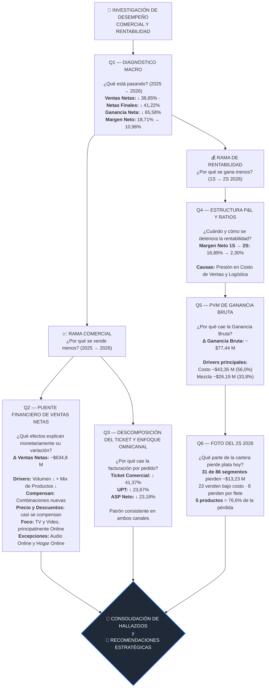
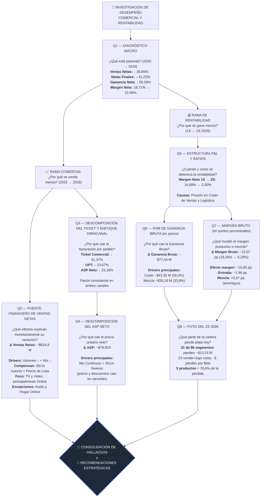

# 🔎 Investigación Analítica SQL

Esta investigación forma parte de un proyecto analítico End-to-End que se puede ver completo en el [repositorio de GitHub](https://github.com/manticafacundoelian/dbt_elt_analytics).

---

### TL;DR

En 2026 las Ventas Netas Finales cayeron 41,2% y la Ganancia Neta 65,6% ($295,7 M → $101,8 M). Pero el año promedia dos semestres muy distintos: el margen neto fue de 16,89% en el 1S y de 2,30% en el 2S.

* **Ventas (Q2–Q3):** se vendió menos y con un ticket más bajo, por volumen y mezcla, no por precios. TV y Video explica cerca del 68% de la caída.
* **Rentabilidad (Q4–Q5):** del 1S al 2S la Ganancia Bruta cayó $77,44 M, sobre todo por el costo (56,0%): el costo unitario subió en los 78 segmentos continuos (mediana +13,9%) y el precio casi no se movió (+0,2%).
* **Hoy (Q6):** 31 de los 86 segmentos pierden −$13,23 M en el 2S, contra +$8,67 M de toda la empresa. 23 venden por debajo de su costo y 8 pierden por el flete. Cinco productos concentran el 76,6% de la pérdida.
* **Qué hacer:** corregir esos cinco productos, poner un piso de margen a los lanzamientos, trasladar el costo al precio, rediseñar el envío Online de ticket bajo y seguir la cartera por cuadrantes.

[Ver Conclusiones Generales →](#-conclusiones-generales) 

---

## 📌 Introducción

Esta investigación analiza la evolución comercial y económica de un retail de tecnología entre **2024 y 2026**, con el objetivo de identificar los principales factores asociados al deterioro observado en **ventas, comportamiento comercial y rentabilidad**.

El análisis parte de un **diagnóstico macro** y avanza progresivamente desde la variación agregada de las ventas hacia sus principales determinantes comerciales y económicos.

A partir de este diagnóstico, la investigación se estructura en dos grandes ramas:

* **Rama comercial:** analiza la evolución de las Ventas Netas desde una perspectiva financiera y comercial, descomponiendo monetariamente su variación y profundizando en el comportamiento del **Ticket Comercial, el UPT y el ASP**.

* **Rama de rentabilidad:** analiza el deterioro económico del negocio a través de la **estructura del P&L**, la evolución de los costos y la descomposición de la variación de la **Ganancia Bruta mediante un puente PVM ampliado (Price–Volume–Mix-Costo-Cambios en el Portfolio)**, complementando el análisis con la rentabilidad por categoría y SKU.

El objetivo no es únicamente cuantificar la caída observada, sino **reconstruir sus principales mecanismos**, desde la evolución de las ventas y el comportamiento de los clientes hasta su impacto final sobre la rentabilidad.

---

## 🗺️ Hoja de Ruta Ejecutiva & Resumen de Diagnóstico

---

## 🔎 Investigación y Desarrollo

La investigación busca responder **seis preguntas principales de diagnóstico**, complementadas por **un análisis operativo de profundización (*Deep Dives*)**:

### Preguntas Core del Diagnóstico

#### ┌─ 🔹 Q1 — Diagnóstico Macro: ¿Qué cambió en el desempeño general del negocio?

<strong>Ver desarrollo de Q1</strong>

 

#### 🔹 Síntesis ejecutiva

En 2026, el negocio registró una fuerte contracción de las ventas y del ticket comercial, a pesar de que aumentó la cantidad de pedidos. El incremento de las devoluciones profundizó la caída de las ventas finales. En paralelo, la rentabilidad se deterioró aún más que la facturación: cayeron tanto la Ganancia Bruta como la Ganancia Neta y se redujeron sus respectivos márgenes. 

 

[Ver Consulta SQL →](./sql_business_analysis/q1_diagnostico_macro_yoy.sql)

 

#### 🔹 Resultados

| Métrica                  |       2025 |       2026 | Variación YoY |
| :----------------------- | ---------: | ---------: | ------------: |
| **Pedidos**              |      1.581 |      1.649 |    **+4,30%** |
| **Ventas Brutas**        | $1.684,4 M | $1.064,0 M |   **−36,83%** |
| **Tasa de Descuento**    |      3,00% |      6,10% |  **+3,10 pp** |
| **Ventas Netas**         | $1.633,9 M |   $999,1 M |   **−38,85%** |
| Devoluciones ($)         |    $53,7 M |    $70,3 M |   **+30,90%** |
| **Tasa de Devolución**   |      3,28% |      7,03% |  **+3,75 pp** |
| **Ventas Netas Finales** | $1.580,3 M |   $928,9 M |   **−41,22%** |
| **Ganancia Bruta**       |   $310,2 M |   $124,9 M |   **−59,75%** |
| **Margen Bruto**         |     19,63% |     13,44% |  **−6,19 pp** |
| **Ganancia Neta**        |   $295,7 M |   $101,8 M |   **−65,58%** |
| **Margen Neto**          |     18,71% |     10,96% |  **−7,75 pp** |
| **Ticket Comercial**     | $1.033.477 |   $605.891 |   **−41,37%** |

> *Nota: El Ticket Comercial se calcula sobre las Ventas Netas, antes de devoluciones, para analizar el comportamiento comercial de los pedidos independientemente de las devoluciones posteriores.*

#### 🔹 Hallazgos

#### Diagnóstico Comercial

**1. Más pedidos, pero menor facturación por pedido**

En 2026 se registraron **1.649 pedidos (+4,30% interanual)**, mientras que las Ventas Netas cayeron un **38,85%**. Al mismo tiempo, el Ticket Comercial disminuyó un **41,37%**, pasando de $1.033.477 a $605.891. El negocio recibió más pedidos, pero cada uno generó, en promedio, muchos menos ingresos. 

**2. Mayor incidencia de las devoluciones**

La Tasa de Devolución aumentó del **3,28% al 7,03% (+3,75 pp)**. Como consecuencia, la caída de las Ventas Netas Finales alcanzó el **41,22% interanual**, por encima del retroceso de las Ventas Netas (−38,85%).

#### Diagnóstico de Rentabilidad

**3. La rentabilidad se deteriora más que la facturación**

En 2026, la Ganancia Bruta cayó un **59,75%**, frente a una disminución del **38,85%** en las Ventas Netas. El Margen Bruto retrocedió del **19,63% al 13,44% (−6,19 pp)**, evidenciando un deterioro significativo de la rentabilidad antes de los costos logísticos y otros componentes posteriores.

La caída se profundizó al considerar el resultado final: la Ganancia Neta disminuyó un **65,58%** y el Margen Neto pasó del **18,71% al 10,96% (−7,75 pp)**. Estos resultados justifican investigar tanto los factores que erosionaron la ganancia bruta como su impacto en la rentabilidad final.

 

#### 🔹 Puente analítico → Ramas Comercial y de Rentabilidad

El diagnóstico identifica dos problemas relacionados, pero diferentes: una fuerte contracción de las **Ventas Netas (−38,85%)** y un deterioro aún mayor de la **Ganancia Neta (−65,58%)**. A partir de ellos, la investigación se divide en dos ramas complementarias:

**La Rama Comercial (Q2–Q3)** descompone la caída de las ventas para cuantificar el aporte de sus distintos factores y profundiza en el comportamiento del ticket mediante sus componentes: unidades por pedido (UPT) y precio promedio de venta (ASP).

**La Rama de Rentabilidad (Q4–Q6)** investiga los factores detrás del deterioro económico, con foco en la descomposición de la Ganancia Bruta y en el efecto de los costos y la composición de las ventas. Finalmente, Q6 amplía el análisis a la rentabilidad neta de los productos, incorporando los costos logísticos.

 

#### ├─ 🔹 Q2 — Descomposición de la variación de Ventas Netas: ¿Qué factores explican la caída y dónde se concentra el deterioro?

<strong>Ver desarrollo de Q2</strong>

 

#### 🔹 Síntesis ejecutiva

Las **Ventas Netas cayeron $634,8 M (−38,85 %)** entre 2025 y 2026. El deterioro se concentra en las combinaciones que ya se vendían en 2025: sus ventas disminuyeron **$765,1 M (−46,83 %)**. El principal factor fue la caída del 37,63 % de las unidades continuas (efecto Volumen, −$614,9 M), con un cambio de participación entre canales casi neutro (Mix de Canales, +$4,9 M), seguida por un Mix de Productos desfavorable (−$166,2 M). Precio de Lista y Descuentos se compensaron parcialmente, con un saldo favorable de $11,0 M, por lo que la caída no se explica por precios. Las combinaciones nuevas aportaron $130,5 M y amortiguaron parte de la caída.

Por canal, Online concentró el 60,55 % de la pérdida monetaria, principalmente por su mayor participación en las ventas de 2025. Sin embargo, Físico sufrió la mayor contracción relativa: sus Ventas Netas cayeron un 54,98 %, frente al 32,62 % de Online. La diferencia también se observa en las unidades continuas, cuya caída fue del 56,87 % en Físico y del 29,78 % en Online.

Por categoría, TV y Video, Telefonía y Computación explican prácticamente toda la caída neta (68,43 %, 16,48 % y 15,12 %, respectivamente), mientras que las restantes categorías se compensan entre sí. TV y Video concentra el mayor deterioro: representaba el 51,85 % de las ventas de 2025, pero sus unidades continuas cayeron más que el promedio en ambos canales y casi no tuvo combinaciones nuevas que compensaran la pérdida. En Online, además, la canasta se abarató (−7,19 %); en Físico no (+1,47 %), por lo que allí la caída responde a la pérdida de unidades. Computación Físico es el caso más crítico, con la mayor caída de ventas continuas de la tabla (−73,71 %), por una fuerte contracción de unidades (−71,78 %) y una canasta que además se abarató (−7,31 %). En contraste, Hogar Online creció (+11,50 %) sin combinaciones nuevas, y Audio Online aumentó sus ventas gracias a las combinaciones nuevas (+$64,3 M), pese a que las continuas retrocedieron.

 

#### 🔸 Q2.A — Puente de Ventas Netas: Nivel Empresa

[Ver Consulta SQL →](./sql_business_analysis/q2a_puente_ventas_netas_total.sql)

#### 🔹 Resultados

#### Contexto operativo y financiero

| Indicador               |       2025 |       2026 | Variación absoluta |  Variación % |
| :---------------------- | ---------: | ---------: | -----------------: | -----------: |
| **Unidades Totales**    |      4.746 |      3.778 |           **−968** | **−20,40 %** |
| Unidades Continuas      |      4.743 |      2.958 |             −1.785 |     −37,63 % |
| Unidades Nuevas         |          — |        820 |                  — |            — |
| Unidades Descontinuadas |          3 |          — |                  — |            — |
| **Ventas Brutas**       | $1.684,4 M | $1.064,0 M |      **−$620,4 M** | **−36,83 %** |
| Tasa de Descuento       |      3,0 % |      6,1 % |            +3,1 pp |            — |
| **Ventas Netas**        | $1.633,9 M |   $999,1 M |      **−$634,8 M** | **−38,85 %** |

#### Puente de Ventas Netas Total

| Efecto | Impacto 2025 → 2026 | Impacto sobre ventas 2025 |
| :-- | --: | --: |
| **Δ Ventas Netas** | **−$634,8 M** | **−38,85 %** |
| Volumen | −$614,9 M | −37,63 pp |
| Mix de Canales | +$4,9 M | +0,30 pp |
| Mix de Productos | −$166,2 M | −10,17 pp |
| Precio de Lista | +$37,8 M | +2,31 pp |
| Descuentos | −$26,8 M | −1,64 pp |
| Combinaciones Nuevas | +$130,5 M | +7,99 pp |
| Combinaciones Descontinuadas | −$0,2 M | −0,01 pp |
| **Impacto total** | **−$634,8 M** | **−38,85 pp** |

> **Volumen:** variación global de unidades continuas (−37,63 %) aplicada a la base de 2025 de cada combinación. **Mix de Canales:** cambio de participación de cada canal en las unidades continuas, valorizado a la canasta de 2025 del canal. **Mix de Productos:** cambio de composición dentro de cada canal; la interacción entre ambos cambios se asigna a este efecto (descomposición secuencial: primero canales, luego productos). **Precio de Lista y Descuentos:** se calculan sobre las unidades continuas de 2026. **Combinaciones nuevas y descontinuadas:** ventas netas de 2026 y de 2025 de cada grupo. El impacto total concilia con la variación real de Ventas Netas.

#### 🔹 Hallazgos

**1. El volumen de unidades continuas fue el principal factor de la caída**

El efecto Volumen fue de **−$614,9 M (−37,63 pp sobre las ventas de 2025)** y refleja la contracción del 37,63 % de las unidades continuas, que pasaron de 4.743 a 2.958. La caída de unidades totales fue menor (−20,40 %) porque 820 unidades provinieron de combinaciones nuevas. En conjunto, las combinaciones continuas perdieron **$765,1 M (−46,83 % de sus ventas de 2025)** por Volumen, Mix, Precio de Lista y Descuentos.

**2. El Mix de Productos profundizó el deterioro; el reparto entre canales casi no influyó**

El Mix de Productos fue de **−$166,2 M (−10,17 pp)**: las unidades continuas se desplazaron hacia combinaciones de menor valor unitario de referencia. El Mix de Canales fue de apenas **+$4,9 M (+0,30 pp)**: Online ganó participación en las unidades continuas y su canasta de 2025 tenía más valor por unidad que la de Físico, pero el efecto es marginal. La caída no responde al reparto entre canales.

**3. Las combinaciones nuevas compensaron parcialmente la contracción**

La incorporación de nuevas combinaciones producto × canal aportó **+$130,5 M (+7,99 pp)**, y amortiguó parcialmente los efectos negativos de Volumen y Mix. Las combinaciones descontinuadas tuvieron un impacto marginal (−$0,2 M, 3 unidades).

**4. Precio de Lista y Descuentos prácticamente se compensaron**

El Precio de Lista aportó **+$37,8 M** y los Descuentos restaron **−$26,8 M**: un efecto neto de aproximadamente **+$11,0 M (+0,67 pp)**. La tasa de descuento pasó de 3,0 % a 6,1 %, pero su impacto es menor frente al de Volumen y Mix: la caída no responde a los precios.

 

#### 🔸 Q2.B — Puente de Ventas Netas: Nivel Canal

[Ver Consulta SQL →](./sql_business_analysis/q2b_puente_ventas_netas_canal.sql)

#### 🔹 Resultados

#### Contexto operativo y financiero por canal

**Indicadores operativos y financieros**

| Indicador               |                                 Online |                               Físico |
| :---------------------- | -------------------------------------: | -----------------------------------: |
| Unidades Totales        |           3.368 → 3.009 (**−10,66 %**) |           1.378 → 769 (**−44,19 %**) |
| Unidades Continuas      |           3.368 → 2.365 (**−29,78 %**) |           1.375 → 593 (**−56,87 %**) |
| Unidades Nuevas         |                                    644 |                                  176 |
| Unidades Descontinuadas |                                      0 |                                    3 |
| Ventas Brutas           | $1.214,64 M → $845,08 M (**−30,43 %**) | $469,77 M → $218,93 M (**−53,40 %**) |
| Tasa de Descuento       |         2,98 % → 6,04 % (**+3,06 pp**) |       3,03 % → 6,31 % (**+3,29 pp**) |
| Ventas Netas            | $1.178,38 M → $794,01 M (**−32,62 %**) | $455,55 M → $205,10 M (**−54,98 %**) |

**Estructura de las unidades continuas**

| Indicador                                            |                                   Online |                                   Físico |
| :--------------------------------------------------- | ---------------------------------------: | ---------------------------------------: |
| Participación en unidades continuas                  |         71,01 % → 79,95 % (**+8,94 pp**) |         28,99 % → 20,05 % (**−8,94 pp**) |
| Valor unitario promedio de la canasta (precios 2025) | $349.876,03 → $288.992,73 (**−17,40 %**) | $331.193,79 → $293.739,93 (**−11,31 %**) |

> El valor unitario promedio de la canasta se calcula con los precios netos de referencia de 2025 en ambos períodos. Su variación refleja cambios en la composición de las unidades continuas, no variaciones de precios reales. La participación explica el Mix de Canales y la canasta explica el Mix de Productos.

#### Puente de Ventas Netas por Canal

| Efecto                        |         Online |         Físico |
| :---------------------------- | -------------: | -------------: |
| **Δ Ventas Netas**            | **−$384,37 M** | **−$250,44 M** |
| Volumen                       |     −$443,48 M |     −$171,38 M |
| Mix de Canales                |      +$92,55 M |      −$87,61 M |
| Mix de Productos              |     −$143,99 M |      −$22,21 M |
| Precio de Lista               |      +$30,24 M |       +$7,55 M |
| Descuentos                    |      −$20,99 M |       −$5,81 M |
| Combinaciones Nuevas          |     +$101,30 M |      +$29,17 M |
| Combinaciones Descontinuadas  |        $0,00 M |       −$0,15 M |
| **Impacto total**             | **−$384,37 M** | **−$250,44 M** |
| Diferencia de conciliación    |        $0,00 M |        $0,00 M |
| Contribución a la caída total |    **60,55 %** |    **39,45 %** |

> A nivel canal, el efecto Volumen distribuye la variación global de unidades continuas de la empresa según la participación de cada canal en 2025; por lo tanto, no representa por sí solo la contracción propia del canal. **Volumen + Mix de Canales** equivale a la variación de las unidades continuas del canal valorizada a su canasta de 2025: −$350,9 M en Online y −$259,0 M en Físico. El Mix de Productos mide el cambio de composición dentro de cada canal. Los Mix de Canales de ambos canales se compensan (+$4,9 M netos): reflejan el mismo corrimiento de participación y no deben leerse como un mérito de Online ni como un deterioro propio de Físico.

#### 🔹 Hallazgos

**1. Contracción operativa más pronunciada en Físico**

Las unidades continuas disminuyeron un **56,87 % en Físico**, frente a un **29,78 % en Online**. En pesos, la variación de unidades continuas (Volumen + Mix de Canales) fue de −$259,0 M en Físico y −$350,9 M en Online: Online pierde más en pesos por su mayor tamaño, pero Físico pierde mucho más en proporción.

**2. El corrimiento hacia Online refleja la contracción de Físico, no un crecimiento de Online**

Online aumentó su participación en las unidades continuas de la empresa del **71,01 % al 79,95 % (+8,94 pp)**, mientras que Físico perdió esa misma proporción. Online no creció: sus unidades continuas cayeron 29,78 %, pero menos que las de Físico. Por eso el Mix de Canales es +$92,55 M en Online y −$87,61 M en Físico, y a nivel empresa se compensan.

**3. La composición interna se deterioró más en Online**

El valor unitario promedio de la canasta a precios de 2025 disminuyó un **17,40 % en Online** y un **11,31 % en Físico**: dentro de las combinaciones continuas de cada canal, ganaron participación las de menor valor unitario. El Mix de Productos fue de −$143,99 M en Online y −$22,21 M en Físico. Por eso, el Mix total de Online (−$51,44 M) combina una ganancia de participación (+$92,55 M) con un deterioro de composición (−$143,99 M), mientras que el de Físico (−$109,82 M) es principalmente pérdida de participación (−$87,61 M), con poca variación de composición (−$22,21 M).

**4. Las combinaciones nuevas compensaron parcialmente la caída**

Aportaron **+$101,30 M en Online** (644 unidades) y **+$29,17 M en Físico** (176 unidades). Sin embargo, esta compensación no fue suficiente para contrarrestar los efectos negativos de Volumen y Mix en ninguno de los canales.

**5. Mayor deterioro financiero relativo en Físico, pero mayor contribución monetaria de Online**

Las Ventas Netas cayeron un **54,98 % en Físico** y un **32,62 % en Online**. Sin embargo, debido a su mayor volumen de ventas inicial, Online explicó el **60,55 % de la caída monetaria total**, frente al **39,45 %** de Físico.

 

#### 🔸 Q2.C — Ventas Netas por Categoría × Canal

[Ver Consulta SQL →](./sql_business_analysis/q2c_puente_ventas_netas_categoria_canal.sql)

#### 🔹 Resultados

#### Dónde se concentra la caída

| Categoría | Canal | Ventas Netas 2025 | Ventas Netas 2026 | Δ Ventas Netas | Variación | Contribución a la caída global |
| :-- | :-- | --: | --: | --: | --: | --: |
| **Total Empresa** | **Todos** | **$1.633,9 M** | **$999,1 M** | **−$634,8 M** | **−38,85 %** | **100,00 %** |
| TV y Video | Online | $630,3 M | $328,0 M | −$302,3 M | −47,96 % | 47,62 % |
| TV y Video | Físico | $217,0 M | $84,9 M | −$132,1 M | −60,88 % | 20,81 % |
| Telefonía | Online | $130,2 M | $57,0 M | −$73,1 M | −56,19 % | 11,52 % |
| Computación | Físico | $79,1 M | $29,0 M | −$50,1 M | −63,33 % | 7,89 % |
| Computación | Online | $164,0 M | $118,1 M | −$45,9 M | −27,99 % | 7,23 % |
| Telefonía | Físico | $49,4 M | $18,0 M | −$31,5 M | −63,68 % | 4,96 % |
| Accesorios | Online | $68,8 M | $49,7 M | −$19,1 M | −27,71 % | 3,00 % |
| Accesorios | Físico | $28,8 M | $15,9 M | −$12,9 M | −44,94 % | 2,04 % |
| Hogar | Físico | $32,2 M | $19,5 M | −$12,7 M | −39,47 % | 2,00 % |
| Audio | Físico | $49,0 M | $37,9 M | −$11,1 M | −22,64 % | 1,75 % |
| Hogar | Online | $77,7 M | $86,6 M | +$8,9 M | +11,50 % | −1,41 % |
| Audio | Online | $107,5 M | $154,6 M | +$47,1 M | +43,76 % | −7,41 % |

> La contribución se calcula respecto de la caída global de Ventas Netas: las combinaciones que crecieron presentan porcentajes negativos porque compensan parcialmente el deterioro.

#### Cómo se comporta cada combinación

La variación de Ventas Netas de cada combinación se abre en tres partes: las ventas de combinaciones continuas, las de combinaciones nuevas y las perdidas por descontinuación.

| Categoría | Canal | Unidades continuas (var. %) | Valor de la canasta (var. %) | Ventas continuas (var. %) | Δ Ventas continuas | Combinaciones nuevas |
| :-- | :-- | --: | --: | --: | --: | --: |
| **Total Empresa** | **Todos** | **−37,63 %** | **—** | **−46,83 %** | **−$765,1 M** | **+$130,5 M** |
| TV y Video | Online | −44,58 % | −7,19 % | −47,96 % | −$302,3 M | — |
| TV y Video | Físico | −62,38 % | +1,47 % | −61,33 % | −$133,1 M | +$1,0 M |
| Telefonía | Online | −60,21 % | +4,43 % | −57,54 % | −$74,9 M | +$1,7 M |
| Computación | Físico | −71,78 % | −7,31 % | −73,71 % | −$58,3 M | +$8,2 M |
| Computación | Online | −51,71 % | +5,80 % | −48,19 % | −$79,0 M | +$33,1 M |
| Telefonía | Físico | −66,18 % | +0,81 % | −65,28 % | −$32,3 M | +$0,8 M |
| Accesorios | Online | −33,87 % | +3,33 % | −30,73 % | −$21,1 M | +$2,1 M |
| Accesorios | Físico | −55,46 % | +13,92 % | −48,81 % | −$14,1 M | +$1,1 M |
| Hogar | Físico | −40,48 % | +1,70 % | −39,18 % | −$12,6 M | — |
| Audio | Físico | −56,59 % | −6,92 % | −59,55 % | −$29,2 M | +$18,1 M |
| Hogar | Online | +8,82 % | +1,64 % | +11,50 % | +$8,9 M | — |
| Audio | Online | −25,10 % | +9,87 % | −16,08 % | −$17,3 M | +$64,3 M |

> **Referencias de la empresa:** unidades continuas −37,63 % y ventas continuas −46,83 %. Una combinación con unidades continuas por debajo de −37,63 % pierde participación relativa; una por encima, la gana. La diferencia entre la variación de ventas continuas y la de unidades continuas combina dos factores: la composición de la canasta y el efecto neto de precios y descuentos. **Valor de la canasta:** valor unitario promedio de las unidades continuas, a precios netos de 2025 en ambos períodos; su variación refleja composición, no precios. Δ Ventas Netas = Δ Ventas continuas + Combinaciones nuevas + Combinaciones descontinuadas (−$0,2 M, solo en Hogar Físico, no se muestran).

#### 🔹 Hallazgos

**1. TV y Video concentra la mayor parte del deterioro, por encima de su tamaño**

La categoría perdió **$434,4 M** entre ambos canales, equivalente al **68,43 % de la caída global**, con un peso del 51,85 % de las ventas de 2025. Online explica $302,3 M (47,62 %) y Físico $132,1 M (20,81 %).

Sus unidades continuas cayeron más que el promedio de la empresa (**−44,58 % en Online y −62,38 % en Físico**, frente a −37,63 %) y prácticamente no tuvo combinaciones nuevas que compensen (+$1,0 M, frente a +$130,5 M en toda la empresa). En valor, TV y Video Online cayó casi como el conjunto de las combinaciones continuas (−47,96 % frente a −46,83 %): su peso en la caída se explica por su tamaño y por la falta de compensación. TV y Video Físico, en cambio, se deterioró mucho más (−61,33 %).

**2. Telefonía y Computación son los siguientes focos de deterioro, con dinámicas diferentes**

Telefonía perdió **$104,6 M** entre ambos canales (16,48 % de la caída global). Sus unidades continuas cayeron 60,21 % en Online y 66,18 % en Físico, y sus ventas continuas −57,54 % y −65,28 %, claramente por debajo de la referencia de la empresa (−46,83 %). Las combinaciones nuevas son marginales (+$1,7 M y +$0,8 M).

Computación perdió **$96,0 M** (15,12 %). En Físico, las ventas continuas cayeron 73,71 %, la mayor caída de la tabla, con unidades continuas −71,78 % y una canasta que además se abarató 7,31 %; las combinaciones nuevas (+$8,2 M) amortiguan solo una parte. En Online, las unidades totales crecieron un 3,61 % (+19), pero las continuas cayeron de 526 a 254 (−51,71 %) y sus ventas continuas perdieron $79,0 M. Las 291 unidades de combinaciones nuevas (+$33,1 M) redujeron la caída de Ventas Netas a $45,9 M.

**3. Audio Online y Hogar Online compensan parcialmente la caída, y las combinaciones nuevas se concentran en pocas filas**

Audio Online creció **$47,1 M** (+43,76 %), pero sus ventas continuas cayeron $17,3 M (−16,08 %), menos que el promedio de la empresa: el resultado positivo lo explican las combinaciones nuevas (+$64,3 M, 316 unidades). Sus unidades totales crecieron 37,85 %, mientras que las continuas cayeron 25,10 %.

Hogar Online creció **$8,9 M** (+11,50 %) sin combinaciones nuevas: es la única combinación cuyas ventas continuas aumentan, con 62 unidades más (+8,82 %).

Audio Online (+$64,3 M), Computación Online (+$33,1 M) y Audio Físico (+$18,1 M) concentran el 88,6 % de las ventas de combinaciones nuevas. En Audio Físico, las ventas continuas cayeron $29,2 M (−59,55 %), pero las nuevas (+$18,1 M) dejaron la caída en $11,1 M (−22,64 %).

#### Consideraciones metodológicas

* Q2.C no construye un nuevo puente aditivo: localiza la caída por categoría × canal y abre cada variación en continuas, nuevas y descontinuadas. Las causas (Volumen, Mix, Precio y Descuentos) se explican en Q2.A y Q2.B.
* La clasificación en continuas, nuevas y descontinuadas se realiza por producto × canal y luego se agrupa por categoría × canal. Una combinación nueva es un producto sin ventas en ese canal en 2025 y con ventas en 2026; no implica necesariamente un producto recién lanzado.
* Las participaciones en la caída global se calculan sobre la variación total de Ventas Netas; los porcentajes negativos corresponden a combinaciones que compensan parcialmente la caída.

 

#### 🔹 Puente analítico → Q3

Q2 mide cuánto cayeron las Ventas Netas, qué efectos pesan a nivel empresa y canal, y dónde se concentra la caída por categoría × canal.

**Q3 cambia la unidad de análisis:** pasa del valor monetario total al comportamiento por pedido, examinando la evolución del **Ticket Comercial** mediante **órdenes, UPT y ASP**, y profundizando además en la evolución de cada canal.

 

#### ├─ 🔹 Q3 — Descomposición del Ticket Comercial y Comportamiento de Compra por Canal: ¿Por qué cae la facturación por pedido?  

<strong>Ver desarrollo de Q3</strong>

 

#### 🔹 Síntesis ejecutiva

Entre 2025 y 2026, los pedidos crecieron un 4,30%, pero las Ventas Netas Comerciales cayeron un 38,85%. La explicación está en el deterioro del Ticket Comercial, que disminuyó un 41,37%: en promedio, cada pedido pasó a contener menos unidades y cada unidad generó un menor valor de venta.

Ambos componentes mostraron retrocesos de magnitud similar: las Unidades por Pedido (UPT) cayeron un 23,67% y el Precio Unitario Promedio (ASP) un 23,18%. El fenómeno también se observa en los dos canales. Aunque Online incrementó su participación en los pedidos y registró más operaciones, su ticket cayó un 42,95%. En Físico, tanto los pedidos como el ticket retrocedieron.

Por lo tanto, el deterioro del Ticket Comercial no se limita a un canal específico: se observa tanto en Online como en Físico y responde al retroceso simultáneo de las unidades por pedido y del valor promedio por unidad.

 

#### 🔸 Q3.A — Descomposición del Ticket Comercial (UPT vs. ASP)

[Ver Consulta SQL →](./sql_business_analysis/q3a_descomposicion_ticket_comercial.sql) 

#### 🔹 Resultados

**¿Cómo evolucionaron los componentes del Ticket Comercial?**

| Métrica                        |       2024 |       2025 | Var. 2025 |     2026 | Var. 2026 |
| ------------------------------ | ---------: | ---------: | --------: | -------: | --------: |
| Pedidos                        |      1.365 |      1.581 |   +15,82% |    1.649 |    +4,30% |
| Unidades Totales               |      3.946 |      4.746 |   +20,27% |    3.778 |   −20,41% |
| Ventas Netas Comerciales       | $1.290,5 M | $1.633,9 M |   +26,62% | $999,1 M |   −38,85% |
| Unidades por Pedido (UPT)      |       2,89 |       3,00 |    +3,81% |     2,29 |   −23,67% |
| Precio Unitario Promedio (ASP) |   $327.032 |   $344.275 |    +5,27% | $264.456 |   −23,18% |
| Ticket Promedio Comercial      |   $945.397 | $1.033.477 |    +9,32% | $605.891 |   −41,37% |

#### 🔹 Hallazgos

**1. El deterioro del Ticket Comercial se explica por la caída simultánea de sus dos componentes**

El Ticket Comercial disminuyó un **41,37 %**, pasando de **$1.033.477** en 2025 a **$605.891** en 2026. Esta caída respondió a dos movimientos de magnitud similar: las Unidades por Pedido (UPT) retrocedieron un **23,67 %**, mientras que el Precio Unitario Promedio (ASP) cayó un **23,18 %**. En consecuencia, los pedidos pasaron a contener menos unidades y, además, cada unidad generó un menor valor promedio.

**2. El crecimiento de los pedidos no alcanzó para sostener las ventas**

Aunque la cantidad de pedidos aumentó un **4,30 %**, las unidades totales disminuyeron un **20,41 %** y las Ventas Netas Comerciales cayeron un **38,85 %**. Esto evidencia que el crecimiento de las operaciones no se tradujo en una mayor facturación, debido al menor contenido de unidades por pedido y al retroceso del valor promedio por unidad.

 

#### 🔸 Q3.B — Comportamiento de Compra por Canal  

[Ver Consulta SQL →](./sql_business_analysis/q3b_ticket_comercial_canal.sql) 

#### 🔹 Resultados

**¿El deterioro del Ticket Comercial se concentra en algún canal?**

| Canal  |     Pedidos 2025 → 2026 |   Participación en pedidos | UPT (var. interanual) | Ticket Comercial 2025 → 2026 | Var. Ticket | ASP Neto 2025 → 2026 | Var. ASP | Tasa de Descuento 2025 → 2026 |
| ------ | ----------------------: | -------------------------: | --------------------: | ---------------------------: | ----------: | -------------------: | -------: | ----------------------------: |
| Online | 1.116 → 1.318 (+18,10%) | 70,59% → 79,93% (+9,34 pp) |               −24,35% |        $1.055.898 → $602.436 |     −42,95% |  $349.876 → $263.879 |  −24,58% |      2,98% → 6,04% (+3,06 pp) |
| Físico |     465 → 331 (−28,82%) | 29,41% → 20,07% (−9,34 pp) |               −21,60% |          $979.667 → $619.651 |     −36,75% |  $330.584 → $266.716 |  −19,32% |      3,03% → 6,31% (+3,29 pp) |

#### 🔹 Hallazgos

**1. El deterioro del Ticket Comercial se reprodujo en ambos canales**

El Ticket Comercial cayó tanto en Online (**−42,95 %**) como en Físico (**−36,75 %**). En ambos casos, el retroceso estuvo acompañado por una disminución simultánea de las Unidades por Pedido y del ASP Neto. En Online, el UPT cayó un **24,35 %** y el ASP un **24,58 %**; en Físico, las caídas fueron del **21,60 %** y **19,32 %**, respectivamente. Esto confirma que el deterioro no estuvo limitado a un canal específico.

**2. Online ganó participación en los pedidos, mientras que Físico perdió volumen**

La participación de Online en el total de pedidos pasó del **70,59 % al 79,93 %**, aumentando **9,34 puntos porcentuales**. En paralelo, sus pedidos crecieron un **18,10 %**, mientras que los de Físico disminuyeron un **28,82 %**. Sin embargo, el Ticket Comercial cayó en ambos canales, por lo que el cambio en la distribución de los pedidos no evitó el deterioro de la facturación promedio.

**3. El aumento de los descuentos acompañó la caída del ASP Neto en ambos canales**

La tasa de descuento aumentó **3,06 puntos porcentuales** en Online y **3,29 puntos porcentuales** en Físico. En el mismo período, el ASP Neto disminuyó un **24,58 %** y un **19,32 %**, respectivamente. Si bien ambos movimientos coinciden, esta tabla no permite aislar cuánto del retroceso del ASP se explica por los descuentos. Q2 lo acota: a nivel empresa, Precio de Lista y Descuentos se compensaron parcialmente, con un saldo favorable de **+$11,0 M** (Q2.A), mientras que el valor unitario de la canasta de unidades continuas, medido a precios de 2025, cayó **17,40 % en Online y 11,31 % en Físico** (Q2.B). El ASP baja sobre todo porque cambió qué se vende, no porque se cobre menos por lo mismo.

 

#### 🔹 Consideraciones metodológicas

* **Ticket Comercial:** se calcula como Ventas Netas Comerciales divididas por la cantidad de pedidos.
* **Unidades por Pedido (UPT):** representa la cantidad promedio de unidades contenidas en cada pedido.
* **Precio Unitario Promedio (ASP):** se calcula como Ventas Netas Comerciales divididas por las unidades totales.
* **Relación entre componentes:** el Ticket Comercial resulta de multiplicar UPT por ASP. Por eso, su variación refleja el efecto conjunto de ambos indicadores.
* **Análisis por canal:** las participaciones representan la distribución del total de pedidos entre Online y Físico. Las métricas de ticket y ASP se calculan para cada canal por separado.
* **Variaciones interanuales:** comparan 2025 contra 2024 y 2026 contra 2025, según corresponda. Los cambios expresados en puntos porcentuales (pp) corresponden a diferencias entre tasas o participaciones.

 

#### 🔹 Puente analítico → Rama de Rentabilidad

Q2 y Q3 cierran la rama comercial: entre 2025 y 2026 se vendió menos y con un ticket más bajo (menos unidades por pedido y menor valor por unidad), por volumen y composición de las ventas, y no por precios (Q2). Pero la Ganancia Neta cayó más que las ventas (**−65,58 %** frente a **−38,85 %**, Q1). **La Rama de Rentabilidad (Q4–Q6)** investiga por qué: parte de la estructura del P&L, descompone la caída de la Ganancia Bruta y termina con una foto de qué parte de la cartera pierde plata hoy.

 

#### ├─ 🔹 Q4 — Estructura de Rentabilidad y Ratios P&L: ¿Cómo se deterioró la rentabilidad?

<strong>Ver desarrollo de Q4</strong>

 

#### 🔹 Síntesis ejecutiva

La rentabilidad se deterioró por una **mayor absorción de las Ventas Netas Finales por parte del Costo de Ventas**, acompañada por un incremento del peso de los costos logísticos. Aunque el deterioro se observa en la comparación interanual, **la crisis se profundizó especialmente entre S1 y S2 de 2026**, cuando el Margen Neto cayó de 16,89% a 2,30%.

La **Ganancia Bruta es el principal foco de investigación**: cayó un 76,56% entre ambos semestres, reflejando el fuerte deterioro de la relación entre ingresos y costo de ventas. La mayor presión logística agravó posteriormente la caída de la Ganancia Neta.

 

#### 🔸 Q4.A — Evolución Interanual: ¿Cómo cambió la rentabilidad entre 2025 y 2026?

[Ver Consulta SQL →](./sql_business_analysis/q4_a_rentabilidad_interanual.sql)  

##### 🔹 Resultados

| Métrica                   |       2025 |     2026 | Variación 2026 |
| :------------------------ | ---------: | -------: | -------------: |
| **Ventas Netas Finales**  | $1.580,3 M | $928,9 M |    **−41,22%** |
| **Costo de Ventas**       | $1.270,0 M | $804,0 M |    **−36,69%** |
| **Costo de Ventas / VNF** |     80,37% |   86,56% |   **+6,19 pp** |
| **Ganancia Bruta**        |   $310,2 M | $124,9 M |    **−59,75%** |
| **Margen Bruto**          |     19,63% |   13,44% |   **−6,19 pp** |
| **Costo Logístico**       |    $14,5 M |  $23,1 M |    **+59,02%** |
| **Costo Logístico / VNF** |      0,92% |    2,49% |   **+1,57 pp** |
| **Ganancia Neta**         |   $295,7 M | $101,8 M |    **−65,58%** |
| **Margen Neto**           |     18,71% |   10,96% |   **−7,75 pp** |

> Para el análisis de rentabilidad se toma como base la **Venta Neta Final (VNF)**, es decir, la venta después de devoluciones aprobadas. Los ratios se calculan sobre el ingreso económico efectivamente retenido por la empresa.

##### 🔹 Hallazgos

**1. El Costo de Ventas absorbe una proporción creciente del ingreso**

Entre 2025 y 2026, el ratio Costo de Ventas / VNF aumentó **6,19 pp**, pasando de 80,37% a 86,56%. Como consecuencia, el Margen Bruto descendió de 19,63% a 13,44%.

La Ganancia Bruta cayó **59,75%**, una contracción superior a la de las Ventas Netas Finales (−41,22%). El deterioro, por lo tanto, no se limita a una menor escala de ventas: el ingreso retenido también genera una ganancia bruta proporcionalmente menor.

**2. La presión logística aumenta en un contexto de contracción comercial**

El Costo Logístico pasó de $14,5 M a $23,1 M, un incremento del **59,02%**. Su peso sobre las Ventas Netas Finales subió de 0,92% a 2,49%, es decir, **1,57 pp**.

Este incremento agrega presión sobre el resultado después de que el Costo de Ventas ya absorbió una proporción mayor del ingreso.

**3. La Ganancia Neta cae más que las ventas**

La Ganancia Neta disminuyó **65,58%**, frente a una caída del 41,22% en las Ventas Netas Finales. El Margen Neto pasó de 18,71% a 10,96%, con una reducción de **7,75 pp**.

La evolución interanual confirma un deterioro significativo de la rentabilidad, pero todavía no muestra cómo se distribuyó ese deterioro a lo largo de 2026.

 

#### 🔸 Q4.B — Evolución Semestral: ¿Cuándo se profundizó la crisis de rentabilidad en 2026?

[Ver Consulta SQL →](./sql_business_analysis/q4_b_rentabilidad_semestral.sql)  

##### 🔹 Resultados

| Métrica                   |  2026-S1 |  2026-S2 | Variación S2 vs. S1 |
| :------------------------ | -------: | -------: | ------------------: |
| **Ventas Netas Finales**  | $551,2 M | $377,6 M |         **−31,49%** |
| **Costo de Ventas**       | $450,1 M | $353,9 M |         **−21,36%** |
| **Costo de Ventas / VNF** |   81,65% |   93,72% |       **+12,07 pp** |
| **Ganancia Bruta**        | $101,1 M |  $23,7 M |         **−76,56%** |
| **Margen Bruto**          |   18,35% |    6,28% |       **−12,07 pp** |
| **Costo Logístico**       |   $8,1 M |  $15,0 M |         **+86,65%** |
| **Costo Logístico / VNF** |    1,46% |    3,98% |        **+2,52 pp** |
| **Ganancia Neta**         |  $93,1 M |   $8,7 M |         **−90,68%** |
| **Margen Neto**           |   16,89% |    2,30% |       **−14,59 pp** |

> S1 comprende enero-junio de 2026 y S2, julio-diciembre. La comparación permite identificar en qué tramo del año se intensificó el deterioro de la rentabilidad.

##### 🔹 Hallazgos

**1. El segundo semestre concentra el deterioro más severo**

Entre S1 y S2, las Ventas Netas Finales disminuyeron **31,49%**, pero la Ganancia Bruta cayó **76,56%**, pasando de $101,1 M a $23,7 M.

El Costo de Ventas pasó de representar el 81,65% al 93,72% de las ventas, un aumento de **12,07 pp**. En consecuencia, el Margen Bruto se redujo de 18,35% a 6,28%.

Al cierre de S2, por cada $100 de ingreso retenido, quedaban apenas **$6,28 de ganancia bruta** antes de cubrir los costos logísticos.

**2. El incremento de la carga logística agrava el deterioro**

El Costo Logístico aumentó de $8,1 M a $15,0 M, una suba del **86,65%**, pese a la contracción de las ventas.

Su participación sobre las Ventas Netas Finales pasó de 1,46% a 3,98%, un incremento de **2,52 pp**. Así, la logística ejerció una presión adicional sobre un margen bruto que ya se había reducido drásticamente.

**3. La rentabilidad neta queda prácticamente desarticulada**

La Ganancia Neta cayó de $93,1 M a $8,7 M, una disminución del **90,68%**. El Margen Neto pasó de 16,89% a 2,30%, perdiendo **14,59 pp**.

La magnitud de la caída evidencia que el problema no es solamente la reducción de los ingresos: en S2, la combinación de un margen bruto mucho menor y una carga logística más elevada dejó una capacidad muy limitada para generar Ganancia Neta.

 

#### 🔹 Puente analítico → Q5

El deterioro de la rentabilidad se concentra en la **Ganancia Bruta**, que cayó un 76,56% entre ambos semestres de 2026. El siguiente análisis descompone esta variación para cuantificar la contribución de los distintos componentes económicos que explican el cambio en el resultado.

 

#### ├─ 🔹 Q5 — Puente de Ganancia Bruta: ¿por qué cae más que las ventas?

<strong>Ver desarrollo de Q5</strong>

 

## 🔹 Síntesis

Q4 mostró que en el año la Ganancia Bruta cayó mucho más que las ventas: **−59,75% frente a −41,22%**. Q5 profundiza en ese deterioro y muestra que la mayor parte de la compresión del margen se concentra en el segundo semestre de 2026.

La investigación se organiza en tres niveles: primero Total Empresa, después los canales Online y Físico, y finalmente las categorías dentro de cada canal.

- **Del año al semestre:** la Ganancia Bruta anual cayó $185,36 M. De esa variación, $127,87 M corresponden al efecto escala y $57,48 M a la compresión de margen. Al comparar los márgenes de cada semestre de 2026 con el margen promedio anual de 2025, aproximadamente el **88% de esa compresión se concentra en el 2S**.
- **Total Empresa:** entre el 1S y el 2S de 2026, la Ganancia Bruta cayó **$77,44 M (−76,56%)**, pese a que las unidades totales aumentaron 5,64%. La caída se explica principalmente por el efecto Costo (−$43,35 M) y la Mezcla de Productos (−$26,40 M).
- **Canales:** Online concentra el 77,7% de la caída monetaria, mientras que Físico presenta un deterioro relativo mayor: su Ganancia Bruta cayó 80,11%, frente al 75,60% de Online.
- **Precio y costo:** en las 78 combinaciones producto × canal continuas, el costo unitario ponderado subió 15,48%, mientras que el precio neto prácticamente no cambió (+0,21%). El incremento del precio de lista (+5,43%) fue acompañado por un aumento de la tasa de descuento de 4,09% a 8,84%.
- **Categorías:** TV y Video explica el 53,1% de la caída de Ganancia Bruta; junto con Computación y Telefonía, concentra aproximadamente el 83,0%.

**Conclusión:** la caída de la Ganancia Bruta no se explica solamente por una reducción de las ventas. Durante el 2S se produjo una fuerte compresión del margen: los costos unitarios aumentaron sin un incremento equivalente del precio neto observado y, además, cambió la composición de las unidades vendidas hacia combinaciones que aportaron menos Ganancia Bruta. El deterioro se concentra especialmente en TV y Video, Computación y Telefonía.

> El puente identifica y cuantifica efectos sobre la Ganancia Bruta; no permite determinar por sí solo las causas comerciales u operativas que originaron esos cambios.

---

## 1. Investigación de Total Empresa

### 1.1. Del año al semestre: ¿cuándo se concentra el deterioro?

La comparación anual muestra que el problema excede la caída de las ventas: la Ganancia Bruta retrocedió 59,75%, mientras que las Ventas Netas Finales cayeron 41,22%.

Al desagregar 2026 por semestre, se observa que el margen se deterioró especialmente durante el segundo semestre.

| Indicador | 2025 (año) | 1S 2026 | 2S 2026 | 2026 (año) |
|---|---:|---:|---:|---:|
| **Ventas Netas Finales** | $1.580,25 M | $551,22 M | $377,64 M | $928,86 M |
| **Ganancia Bruta** | $310,22 M | $101,15 M | $23,71 M | $124,86 M |
| **Margen Bruto** | 19,63% | 18,35% | 6,28% | 13,44% |

En el análisis anual, la caída de $185,36 M de Ganancia Bruta se divide en:

| Componente anual | Efecto | Participación en la caída |
|---|---:|---:|
| Efecto escala | −$127,87 M | 69,0% |
| Compresión de margen | −$57,48 M | 31,0% |
| **Variación de Ganancia Bruta** | **−$185,36 M** | **100,0%** |

Para localizar temporalmente la compresión anual, se compara el margen de cada semestre de 2026 con el margen promedio anual de 2025:

| Indicador | 1S 2026 | 2S 2026 | Total 2026 |
|---|---:|---:|---:|
| Margen bruto | 18,35% | 6,28% | 13,44% |
| Compresión de margen frente al 19,63% de 2025 | −$7,06 M | −$50,42 M | −$57,48 M |
| Aporte a la compresión anual | 12% | 88% | 100% |

> *La compresión semestral se calcula aplicando a las ventas de cada semestre la diferencia entre su margen y el margen anual de 2025. No es una comparación interanual de cada semestre, porque no se abrió 2025 por semestres. Es una distribución de la compresión anual entre los dos períodos de 2026.*

La comparación también permite entender por qué el volumen tiene comportamientos diferentes según el período analizado. Las unidades anuales pasaron de 4.586 en 2025 a 3.535 en 2026, mientras que entre los dos semestres de 2026 aumentaron de 1.719 a 1.816. En la comparación anual pesa la reducción de actividad; en la semestral, las unidades totales prácticamente se mantienen.

En el análisis anual, el efecto Costo fue de −$64,51 M, frente a un efecto neto de Precio de aproximadamente +$10,01 M. En las combinaciones continuas entre ambos años, el costo unitario ponderado aumentó 10,16%, mientras que el precio neto lo hizo 1,25%.

Con este contexto, el análisis se concentra en explicar qué ocurrió entre el 1S y el 2S de 2026.

### 1.2. Contexto operativo y financiero

La primera comparación permite observar que la caída de la Ganancia Bruta no estuvo acompañada por una contracción de las unidades totales.

| Indicador | 1S | 2S | Variación | Variación % / pp |
|---|---:|---:|---:|---:|
| **Unidades efectivas totales** | 1.719 | 1.816 | +97 | **+5,64%** |
| Unidades de combinaciones continuas | 1.687 | 1.681 | −6 | −0,36% |
| Ventas Netas Finales | $551,22 M | $377,64 M | −$173,58 M | **−31,49%** |
| Costo de Ventas | $450,07 M | $353,93 M | −$96,14 M | **−21,36%** |
| **Ganancia Bruta** | **$101,15 M** | **$23,71 M** | **−$77,44 M** | **−76,56%** |
| **Margen Bruto** | **18,35%** | **6,28%** | **−12,07 pp** | — |

La diferencia entre unidades totales y continuas se explica por las combinaciones producto × canal presentes en un solo semestre:

| Combinaciones exclusivas | Unidades | Producto nuevo / discontinuado | Canal nuevo / cerrado de un producto que sigue |
|---|---:|---:|---:|
| **Solo 2S** | 135 | 130 | 5 |
| **Solo 1S** | 32 | 3 | 29 |

Las unidades totales incluyen las combinaciones exclusivas de cada semestre. Las unidades continuas son aquellas que registraron ventas en ambos períodos.

Por eso, aunque las unidades totales crecieron 5,64%, las unidades continuas prácticamente no variaron. La diferencia corresponde a las combinaciones que aparecen o dejan de aparecer entre semestres.

### 1.3. Like for Like: evolución de precios, descuentos y costos

El análisis Like for Like compara las mismas combinaciones producto × canal que registraron unidades en ambos semestres. Se analizaron **78 combinaciones**, que representan el 100% de las unidades continuas de ambos períodos.

| Indicador | Variación ponderada | Mediana | Distribución |
|---|---:|---:|---:|
| **Precio de lista** | **+5,43%** | +5,29% | 78 subieron / 0 bajaron |
| **Tasa de descuento** | **+4,75 pp** | +4,45 pp | 73 aumentaron / 5 disminuyeron |
| **Precio neto** | **+0,21%** | +0,22% | 40 subieron / 38 bajaron |
| **Costo unitario** | **+15,48%** | +13,93% | 78 subieron / 0 bajaron |

Evolución de la tasa de descuento:

| Indicador | 1S | 2S |
|---|---:|---:|
| Tasa de descuento ponderada | 4,09% | 8,84% |

El costo unitario aumentó en todas las combinaciones continuas. El precio de lista también subió, pero el incremento de los descuentos absorbió buena parte de esa variación. Como resultado, el precio neto ponderado prácticamente no cambió.

> *La ponderación utiliza la canasta del 2S. Para precio neto, precio de lista y costo, los pesos se construyen con las unidades del 2S y los valores unitarios del 1S. Para descuentos, se utilizan las ventas de lista del 2S. La tasa del 1S presentada aquí está recalculada sobre esa canasta y, por eso, no coincide necesariamente con la tasa real agregada del 1S. Los porcentajes LFL describen la evolución de las combinaciones comparables; no deben confundirse con los efectos monetarios del puente.*

### 1.4. Puente de variación de Ganancia Bruta

La Ganancia Bruta pasó de $101,15 M en el 1S a $23,71 M en el 2S, con una reducción de **$77,44 M (−76,56%)**.

Primero, podemos separar la variación entre escala y compresión de margen:

| Componente | Efecto | Participación en la caída |
|---|---:|---:|
| Efecto escala | −$31,85 M | 41,13% |
| Compresión de margen | −$45,59 M | 58,87% |
| **Variación de Ganancia Bruta** | **−$77,44 M** | **100,00%** |

El efecto escala representa la variación que habría tenido la Ganancia Bruta si se hubiese mantenido el margen del 1S. La compresión mide el deterioro adicional asociado a la reducción del margen, que pasó de 18,35% a 6,28%.

La descomposición detallada permite identificar qué efectos explican esa variación:

| Concepto | Efecto | Participación en la caída |
|---|---:|---:|
| **Ganancia Bruta 1S** | **$101,15 M** | |
| Efecto Volumen | −$0,34 M | 0,4% |
| Efecto Mezcla de Canales | +$0,22 M | −0,3% |
| Efecto Mezcla de Productos | −$26,40 M | 34,1% |
| Efecto Precio de Lista | +$18,92 M | −24,4% |
| Efecto Descuentos | −$18,20 M | 23,5% |
| Efecto Costo | −$43,35 M | 56,0% |
| Efecto Solo 2S | −$2,22 M | 2,9% |
| Efecto Solo 1S | −$6,06 M | 7,8% |
| **Ganancia Bruta 2S** | **$23,71 M** | |
| **Variación de Ganancia Bruta** | **−$77,44 M** | **100,0%** |

> *Los porcentajes se calculan como efecto ÷ variación total de Ganancia Bruta. Por eso, los efectos positivos que compensan parcialmente la caída tienen participación negativa. Precio de Lista + Descuentos = efecto neto de Precio de aproximadamente +$0,72 M.*

#### Hallazgos de Total Empresa

**1. La Ganancia Bruta cayó mucho más que las ventas porque también se redujo el margen**

Las Ventas Netas Finales cayeron 31,49%, pero la Ganancia Bruta retrocedió 76,56%. De los $77,44 M de caída, $31,85 M corresponden al efecto escala y $45,59 M a la compresión del margen.

**2. El volumen tuvo un efecto prácticamente neutro, pero la composición de las unidades cambió**

Las unidades continuas disminuyeron apenas 0,36%, por lo que el efecto Volumen fue de solo −$0,34 M. Sin embargo, la Mezcla de Productos restó $26,40 M.

Esto indica que el problema no estuvo tanto en la cantidad total de unidades continuas, sino en qué productos se vendieron: la composición se desplazó hacia combinaciones que aportaban menos Ganancia Bruta por unidad.

**3. El costo fue el principal efecto negativo**

El efecto Costo restó $43,35 M, equivalente al 56,0% de la caída total. El costo de ventas disminuyó 21,36%, bastante menos que las ventas netas, que cayeron 31,49%.

En las mismas combinaciones producto × canal, el costo unitario aumentó 15,48%, mientras que el precio neto ponderado prácticamente no se modificó.

**4. El incremento del precio de lista fue absorbido casi por completo por los descuentos**

El efecto Precio de Lista aportó $18,92 M, pero el efecto Descuentos restó $18,20 M. Los descuentos absorbieron aproximadamente el 96% del aporte positivo de la lista.

**5. Las combinaciones exclusivas de cada semestre también restaron Ganancia Bruta**

Las combinaciones Solo 1S restaron $6,06 M con 32 unidades. De ellas, 29 corresponden a canales que dejaron de registrar ventas de productos que continuaron en otro canal y 3 a productos sin ventas en el 2S.

Las combinaciones Solo 2S restaron $2,22 M con 135 unidades. De ellas, 130 corresponden a productos sin ventas observadas en el 1S y 5 a canales nuevos de productos que ya existían.

---

## 2. Investigación por canal

### 2.1. Contexto operativo y financiero

La caída financiera fue importante en ambos canales. Sin embargo, la evolución operativa fue diferente: Online aumentó sus unidades, mientras que Físico registró una reducción.

| Indicador | Online 1S | Online 2S | Variación | Físico 1S | Físico 2S | Variación |
|---|---:|---:|---:|---:|---:|---:|
| **Unidades efectivas** | 1.349 | 1.465 | **+8,60%** | 370 | 351 | **−5,14%** |
| Unidades continuas | 1.343 | 1.361 | +1,34% | 344 | 320 | −6,98% |
| Combinaciones solo 2S | — | 104 | — | — | 31 | — |
| Combinaciones solo 1S | 6 | — | — | 26 | — | — |
| **Ventas Netas Finales** | $435,39 M | $300,06 M | **−31,08%** | $115,83 M | $77,58 M | **−33,02%** |
| Costo de Ventas | $355,79 M | $280,63 M | −21,12% | $94,28 M | $73,30 M | −22,25% |
| **Ganancia Bruta** | **$79,60 M** | **$19,43 M** | **−75,60%** | **$21,55 M** | **$4,29 M** | **−80,11%** |
| **Margen Bruto** | 18,28% | 6,47% | −11,81 pp | 18,60% | 5,52% | −13,08 pp |

Online mantuvo un crecimiento de unidades, tanto totales como continuas. Físico, en cambio, redujo sus unidades totales y continuas. Aun así, la caída de ventas fue parecida en ambos canales y el deterioro de la Ganancia Bruta fue más fuerte en términos relativos en Físico.

### 2.2. Like for Like por canal

El análisis LFL permite comprobar si la evolución observada en el conjunto de la empresa se repite dentro de cada canal.

| Indicador | Online | Físico |
|---|---:|---:|
| Combinaciones analizables | 43 de 43 | 35 de 35 |
| Cobertura de unidades continuas | 100% | 100% |
| **Precio de lista ponderado** | **+5,45%** | **+5,36%** |
| Mediana de precio de lista | +5,07% | +5,36% |
| **Tasa de descuento 1S → 2S** | 4,09% → 8,83% | 4,07% → 8,87% |
| Variación ponderada de descuento | +4,74 pp | +4,80 pp |
| Mediana de variación de descuento | +4,58 pp | +4,31 pp |
| **Precio neto ponderado** | **+0,24%** | **+0,08%** |
| Mediana de precio neto | +0,33% | +0,11% |
| Precio neto subió / bajó | 22 / 21 | 18 / 17 |
| **Costo unitario ponderado** | **+15,57%** | **+15,11%** |
| Mediana de costo unitario | +13,55% | +14,19% |
| Costo unitario subió | 43 de 43 | 35 de 35 |

Los dos canales muestran un comportamiento muy parecido:

- El costo unitario aumentó en todas las combinaciones continuas de ambos canales.
- El precio neto tuvo variaciones muy pequeñas.
- La tasa de descuento aumentó considerablemente.

Por lo tanto, el deterioro de las variables unitarias no parece estar concentrado en un único canal: se observa tanto en Online como en Físico.

### 2.3. Puente de Ganancia Bruta por canal

Online explica el **77,7%** de la caída monetaria de la empresa, mientras que Físico explica el 22,3%.

| Concepto | Online | Físico |
|---|---:|---:|
| **Ganancia Bruta 1S** | **$79,60 M** | **$21,55 M** |
| Efecto escala | −$24,74 M | −$7,12 M |
| Compresión de margen | −$35,43 M | −$10,15 M |
| **Efecto Volumen** | −$0,28 M | −$0,06 M |
| Efecto Mezcla de Canales | +$1,33 M | −$1,11 M |
| Efecto Mezcla de Productos | −$24,02 M | −$2,38 M |
| Efecto Precio de Lista | +$15,16 M | +$3,76 M |
| Efecto Descuentos | −$14,50 M | −$3,70 M |
| **Efecto Costo** | **−$34,74 M** | **−$8,61 M** |
| Efecto Solo 2S | −$1,82 M | −$0,39 M |
| Efecto Solo 1S | −$1,30 M | −$4,76 M |
| **Ganancia Bruta 2S** | **$19,43 M** | **$4,29 M** |
| **Variación de Ganancia Bruta** | **−$60,17 M** | **−$17,26 M** |
| Participación en la caída de la empresa | **77,7%** | **22,3%** |

> *La descomposición entre escala y compresión de margen es una lectura alternativa de la variación: no se suma a los efectos individuales del puente. La suma de las escalas de ambos canales presenta una diferencia menor respecto de la escala de Total Empresa porque se calcula utilizando el margen de cada entidad por separado.*

#### Hallazgos por canal

**1. Online concentra la mayor parte de la caída monetaria**

Online explica $60,17 M de los $77,44 M de caída de la empresa. Esto se relaciona con su mayor participación en la Ganancia Bruta del 1S: representaba aproximadamente el 78,7% del resultado inicial.

**2. Físico tuvo un deterioro relativo mayor**

La Ganancia Bruta de Físico cayó 80,11%, frente a 75,60% en Online. Su margen terminó en 5,52%, por debajo del 6,47% de Online.

**3. El costo y la mezcla de productos fueron los principales efectos negativos en ambos canales**

En Online, el Costo restó $34,74 M y la Mezcla de Productos $24,02 M. En Físico, el Costo restó $8,61 M y la Mezcla de Productos $2,38 M.

**4. La mezcla de canales debe interpretarse a nivel empresa**

El efecto Mezcla de Canales fue positivo en Online (+$1,33 M) y negativo en Físico (−$1,11 M). Ambos efectos se compensan parcialmente y suman un aporte positivo de aproximadamente $0,22 M a nivel empresa.

Por eso, no deben interpretarse como dos efectos independientes de desempeño: representan una redistribución de la participación de los canales dentro de las unidades continuas.

---

## 3. Investigación por categoría × canal

Una vez identificados los efectos principales a nivel empresa y canal, el análisis por categoría permite localizar dónde se concentró la pérdida de Ganancia Bruta.

### 3.1. Ganancia Bruta y puente por categoría

| Categoría | Δ Ganancia Bruta | Variación % | % de la caída | Margen bruto 1S → 2S | Unidades (var. %) | Unidades y composición | Precio de lista | Descuentos | Costo | Solo 2S | Solo 1S |
|---|---:|---:|---:|---:|---:|---:|---:|---:|---:|---:|---:|
| **TV y Video** | **−$41,10 M** | −99,65% | **53,1%** | 15,50% → 0,12% | −52,36% | −$21,34 M | +$6,21 M | −$6,22 M | −$16,00 M | +$0,05 M | −$3,80 M |
| **Computación** | **−$16,74 M** | −72,94% | **21,6%** | 25,20% → 13,35% | −29,29% | −$9,91 M | +$2,62 M | −$2,19 M | −$5,83 M | −$0,38 M | −$1,04 M |
| **Audio** | **−$7,40 M** | −49,51% | **9,6%** | 22,02% → 6,90% | +73,70% | +$5,11 M | +$4,88 M | −$4,43 M | −$10,83 M | −$2,04 M | −$0,09 M |
| **Telefonía** | **−$6,46 M** | −79,90% | **8,3%** | 14,96% → 10,11% | −69,44% | −$4,08 M | +$0,65 M | −$0,59 M | −$1,48 M | +$0,15 M | −$1,12 M |
| **Accesorios** | **−$3,71 M** | −71,57% | **4,8%** | 17,23% → 4,68% | +7,93% | −$0,08 M | +$1,68 M | −$1,50 M | −$3,79 M | — | −$0,02 M |
| **Hogar** | **−$2,03 M** | −23,22% | **2,6%** | 20,79% → 11,43% | +40,32% | +$3,77 M | +$2,88 M | −$3,26 M | −$5,42 M | — | — |

> *Las categorías están ordenadas por su participación en la caída de la Ganancia Bruta de la empresa. "Unidades y composición" agrupa Volumen + Mezcla de Canales + Mezcla de Productos, valuados al margen unitario del 1S. Los efectos de cada fila suman su variación de Ganancia Bruta, con residuo $0,00.*

### 3.2. Precio, descuentos y costo unitario por categoría: Like for Like

| Categoría | Combinaciones analizables | Precio de lista | Descuento 1S → 2S | Precio neto | Costo unitario | Precio neto subió / combinaciones | Costo subió / combinaciones |
|---|---:|---:|---:|---:|---:|---:|---:|
| **Total Empresa** | 78 | +5,43% | 4,09% → 8,84% | +0,21% | +15,48% | 40 / 78 | 78 / 78 |
| **TV y Video** | 10 | +5,43% | 3,99% → 8,94% | −0,01% | +16,27% | 5 / 10 | 10 / 10 |
| **Computación** | 16 | +6,07% | 4,25% → 8,84% | +0,98% | +18,71% | 8 / 16 | 16 / 16 |
| **Audio** | 13 | +5,65% | 4,15% → 8,81% | +0,52% | +16,33% | 6 / 13 | 13 / 13 |
| **Telefonía** | 8 | +4,54% | 3,85% → 7,64% | +0,41% | +12,90% | 5 / 8 | 8 / 8 |
| **Accesorios** | 19 | +5,38% | 4,30% → 8,66% | +0,58% | +14,46% | 12 / 19 | 19 / 19 |
| **Hogar** | 12 | +4,88% | 4,02% → 9,07% | −0,64% | +11,63% | 4 / 12 | 12 / 12 |

El costo unitario aumentó en todas las combinaciones continuas de todas las categorías. En cambio, el precio neto tuvo variaciones mucho menores: desde −0,64% en Hogar hasta +0,98% en Computación.

Esto refuerza la lectura de que el deterioro de costos fue generalizado y no estuvo limitado a una categoría específica.

<strong>Ver detalle del puente por categoría × canal</strong>

 

| Categoría | Canal | Δ Ganancia Bruta | Variación % | % de la caída | Margen bruto 1S → 2S | Unidades 1S → 2S | Unidades y composición | Precio de lista | Descuentos | Costo | Solo 2S | Solo 1S |
|---|---|---:|---:|---:|---:|---:|---:|---:|---:|---:|---:|---:|
| TV y Video | Online | **−$32,16 M** | −98,59% | 41,5% | 15,60% → 0,51% | 201 → 97 | −$19,01 M | +$4,82 M | −$4,87 M | −$12,43 M | — | −$0,68 M |
| TV y Video | Físico | **−$8,94 M** | −103,70% | 11,6% | 15,15% → −1,31% | 53 → 24 | −$2,33 M | +$1,39 M | −$1,36 M | −$3,57 M | +$0,05 M | −$3,12 M |
| Computación | Online | **−$13,85 M** | −73,13% | 17,9% | 25,25% → 14,05% | 308 → 206 | −$9,36 M | +$2,15 M | −$1,54 M | −$4,79 M | −$0,30 M | — |
| Computación | Físico | **−$2,89 M** | −72,04% | 3,7% | 24,97% → 10,89% | 71 → 62 | −$0,55 M | +$0,47 M | −$0,65 M | −$1,04 M | −$0,08 M | −$1,04 M |
| Audio | Online | **−$5,34 M** | −46,84% | 6,9% | 21,68% → 6,77% | 225 → 410 | +$5,01 M | +$4,11 M | −$3,62 M | −$9,20 M | −$1,64 M | — |
| Audio | Físico | **−$2,06 M** | −58,11% | 2,7% | 23,18% → 7,48% | 64 → 92 | +$0,10 M | +$0,76 M | −$0,81 M | −$1,63 M | −$0,39 M | −$0,09 M |
| Telefonía | Online | **−$5,26 M** | −85,18% | 6,8% | 14,03% → 9,92% | 59 → 13 | −$3,65 M | +$0,39 M | −$0,60 M | −$0,90 M | +$0,12 M | −$0,62 M |
| Telefonía | Físico | **−$1,20 M** | −62,83% | 1,6% | 19,01% → 10,37% | 13 → 9 | −$0,43 M | +$0,26 M | +$0,01 M | −$0,57 M | +$0,03 M | −$0,50 M |
| Accesorios | Online | **−$2,20 M** | −63,57% | 2,8% | 16,82% → 4,92% | 255 → 311 | +$0,74 M | +$1,34 M | −$1,27 M | −$3,02 M | — | — |
| Accesorios | Físico | **−$1,51 M** | −87,66% | 1,9% | 18,10% → 3,65% | 98 → 70 | −$0,82 M | +$0,34 M | −$0,24 M | −$0,77 M | — | −$0,02 M |
| Hogar | Online | **−$1,37 M** | −19,53% | 1,8% | 20,56% → 11,67% | 301 → 428 | +$3,29 M | +$2,34 M | −$2,61 M | −$4,40 M | — | — |
| Hogar | Físico | **−$0,66 M** | −38,07% | 0,9% | 21,78% → 10,34% | 71 → 94 | +$0,48 M | +$0,54 M | −$0,66 M | −$1,02 M | — | — |

<strong>Ver detalle Like for Like por categoría × canal</strong>

 

| Categoría | Canal | Combinaciones analizables | Precio de lista | Descuento 1S → 2S | Precio neto | Costo unitario |
|---|---|---:|---:|---:|---:|---:|
| TV y Video | Online | 6 | +5,29% | 4,13% → 8,99% | −0,05% | +15,88% |
| TV y Video | Físico | 4 | +5,99% | 3,44% → 8,75% | +0,14% | +17,82% |
| Computación | Online | 9 | +6,34% | 4,38% → 8,47% | +1,79% | +19,74% |
| Computación | Físico | 7 | +5,07% | 3,77% → 10,20% | −1,95% | +15,09% |
| Audio | Online | 7 | +5,82% | 4,00% → 8,64% | +0,70% | +16,96% |
| Audio | Físico | 6 | +4,89% | 4,84% → 9,55% | −0,30% | +13,52% |
| Telefonía | Online | 4 | +4,61% | 3,55% → 10,04% | −2,43% | +13,61% |
| Telefonía | Físico | 4 | +4,44% | 4,28% → 4,11% | +4,60% | +11,92% |
| Accesorios | Online | 10 | +5,26% | 4,20% → 8,71% | +0,30% | +14,13% |
| Accesorios | Físico | 9 | +5,94% | 4,73% → 8,45% | +1,81% | +15,93% |
| Hogar | Online | 7 | +4,82% | 4,00% → 8,92% | −0,54% | +11,48% |
| Hogar | Físico | 5 | +5,14% | 4,11% → 9,79% | −1,10% | +12,31% |

> *Las filas con pocas unidades o combinaciones deben interpretarse con cautela: pequeñas variaciones en operaciones pueden modificar considerablemente sus porcentajes.*

### 3.3. Hallazgos por categoría

**1. TV y Video explica más de la mitad de la caída y casi se quedó sin Ganancia Bruta**

TV y Video perdió $41,10 M, equivalente al 53,1% de la caída de la empresa. Su Ganancia Bruta pasó de $41,25 M a $0,14 M (−99,65%) y su margen de 15,50% a 0,12%.

Online explica el 41,5% de la caída de la empresa (−$32,16 M) y Físico el 11,6% (−$8,94 M). En Físico, el 2S terminó con Ganancia Bruta negativa de aproximadamente $0,32 M y margen de −1,31%: las ventas no alcanzaron a cubrir el costo de ventas.

Sus principales efectos negativos fueron Unidades y composición (−$21,34 M) y Costo (−$16,00 M).

**2. Tres categorías concentran el 83,0% de la caída**

TV y Video, Telefonía y Computación eran las categorías con mayor Ganancia Bruta por unidad en el 1S:

- TV y Video: $162.383 por unidad.
- Telefonía: $112.217 por unidad.
- Computación: $60.543 por unidad.

En conjunto explican aproximadamente el 83,0% de la caída de Ganancia Bruta. Computación aportó el 21,6% de la caída y Telefonía el 8,3%.

**3. Audio y Hogar aumentaron sus unidades, pero perdieron Ganancia Bruta**

Audio aumentó sus unidades 73,70% y Hogar 40,32%. Sus efectos de Unidades y composición fueron positivos: +$5,11 M y +$3,77 M, respectivamente.

Sin embargo, esos aportes fueron más que compensados por el costo y los descuentos. La Ganancia Bruta de Audio cayó 49,51% y la de Hogar 23,22%.

En Audio también tuvieron impacto negativo las combinaciones exclusivas del 2S, que restaron $2,04 M.

**4. El aumento del costo fue generalizado y el precio neto tuvo variaciones reducidas**

El costo unitario aumentó en las 78 combinaciones continuas. Por categoría, las subas ponderadas se ubicaron entre 11,63% en Hogar y 18,71% en Computación.

En contraste, el precio neto ponderado varió entre −0,64% y +0,98%. La tasa de descuento aumentó en todas las categorías agregadas. En el detalle categoría × canal, Telefonía Físico fue la excepción: pasó de 4,28% a 4,11%.

**5. Las combinaciones exclusivas se concentran en pocas categorías**

El efecto Solo 1S fue especialmente negativo en TV y Video (−$3,80 M), Telefonía (−$1,12 M) y Computación (−$1,04 M).

El efecto Solo 2S fue más negativo en Audio (−$2,04 M), debido a combinaciones que registraron Ganancia Bruta negativa en ese semestre.

---

## 4. Detalle por producto × canal

El detalle individual de las combinaciones producto × canal no se despliega en el README. Se encuentra en el tablero de Power BI, donde se pueden ordenar y filtrar los resultados por categoría, canal y efecto.

**[PENDIENTE: enlace al tablero de Power BI]**

Los resultados agregados permiten identificar los principales patrones: el costo unitario aumentó en las 78 combinaciones continuas y las combinaciones exclusivas del 2S corresponden mayoritariamente a productos sin ventas observadas en el 1S.

---

## 🔹 Límites de interpretación

- **El puente mide efectos, no causas.** Cuantifica cuánto aporta o resta cada componente a la variación de Ganancia Bruta, pero no identifica por qué aumentaron los costos o los descuentos.
- **Se analiza Ganancia Bruta, no Ganancia Neta.** El flete y otros costos logísticos no están incluidos; se incorporan en Q6.
- **Las combinaciones continuas son producto × canal.** Una combinación que aparece en un solo semestre no implica necesariamente que el producto haya sido lanzado o discontinuado: puede tratarse de un producto que pasó a venderse por otro canal.
- **El LFL utiliza únicamente combinaciones continuas y analizables.** Las combinaciones exclusivas de cada semestre tienen efectos propios en el puente y no forman parte de la comparación LFL.
- **El análisis 1S vs. 2S es descriptivo y no está ajustado por estacionalidad.** Las diferencias entre semestres no permiten atribuir por sí solas los cambios a una decisión comercial o a una causa operativa específica.
- **Las filas con pocas unidades deben leerse con cautela.** En algunas combinaciones categoría × canal, una o dos operaciones pueden modificar considerablemente los porcentajes.
- **La transición anual utiliza el margen promedio de 2025 como referencia.** No se dispone de una apertura semestral de 2025 en este análisis.

---

## 🔹 Puente a Q6

Q4 mostró cómo evolucionó el resultado anual y Q5 explicó por qué la Ganancia Bruta cayó más que las ventas durante 2026.

El deterioro se concentró en el 2S: el costo unitario aumentó en todas las combinaciones continuas, el precio neto prácticamente no cambió y la composición de las ventas se desplazó hacia productos que dejaron menos Ganancia Bruta.

**Q6 profundiza el análisis de rentabilidad incorporando el costo logístico**, para identificar qué parte de la cartera logra cubrir sus costos una vez considerado el flete.

#### ├─ 🔹 Q5 — Puente de Ganancia Bruta: ¿por qué cae más que las ventas?

<strong>Ver desarrollo de Q5</strong>

 

#### 🔹 Síntesis

Q4 mostró que en el año la Ganancia Bruta cayó mucho más que las ventas (**−59,75%** frente a **−41,22%**) y que el golpe está en el 2S. **Q5 explica por qué cae más que las ventas** y se lee en cuatro pasos:

- **Del año al semestre:** de la caída de la Ganancia Bruta de 2026 contra 2025, la parte que corresponde a la **compresión de margen** (−$57,48 M) está casi toda en el 2S: **$50,42 M (88%)** contra $7,06 M del 1S. Por eso el análisis se concentra en cómo cambia la Ganancia Bruta **entre el 1S y el 2S de 2026**.
- **Cuánto y por qué (Q5.A):** entre el 1S y el 2S la Ganancia Bruta cayó **$77,44 M (−76,56%)**, de $101,15 M a $23,71 M, mientras las ventas netas finales cayeron 31,49% y las unidades **subieron 5,64%**. El **41,1%** (−$31,85 M) es escala (se vendió menos) y el **58,9%** (−$45,59 M) es compresión de margen (18,35% → 6,28%). En el puente, el **costo explica el 56,0%** (−$43,35 M) y la **mezcla de productos el 34,1%** (−$26,40 M); el volumen casi no cuenta (−$0,34 M).
- **Costo y precio en los mismos productos (Q5.B):** el costo unitario subió **15,48%** y el precio neto **0,21%**. El precio de lista subió 5,43%, pero la tasa de descuento pasó de 4,09% a 8,84% y los descuentos se llevaron el **96%** de lo que aportó la lista.
- **En qué categorías (Q5.C):** **TV y Video explica el 53,1%** de la caída: su Ganancia Bruta pasó de $41,25 M a $0,14 M. Con Computación y Telefonía, las tres categorías que más dejaban por unidad en el 1S concentran el **83,0%**. El producto × canal queda en Power BI (Q5.D).

**Conclusión:** la Ganancia Bruta cayó más que las ventas porque a la caída de ventas se le sumó una compresión de margen: el **costo unitario subió en todos los productos y canales que vendieron en ambos semestres sin que el precio neto lo acompañara**, y la mezcla se desplazó hacia productos que dejan menos por unidad. Todo eso se concentra en el 2S. El puente mide **efectos, no causas**: muestra cuánto resta cada uno, no por qué subió el costo.

 

#### 🔹 Del año al semestre

| | 2025 (año) | 1S 2026 | 2S 2026 | 2026 (año) |
| :--- | ---: | ---: | ---: | ---: |
| **Ventas Netas Finales** | $1.580,25 M | $551,22 M | $377,64 M | $928,86 M |
| **Ganancia Bruta** | $310,22 M | $101,15 M | $23,71 M | $124,86 M |
| **Margen Bruto** | 19,63% | 18,35% | 6,28% | 13,44% |
| **Compresión de margen vs. 2025** | — | −$7,06 M | −$50,42 M | −$57,48 M |
| **Aporte a la caída anual del margen** | — | −0,76 pp (12%) | −5,43 pp (88%) | −6,19 pp |

> *Compresión de cada semestre = ventas del semestre × (margen del semestre − margen bruto de 2025); los dos semestres suman exactamente la compresión anual de −$57,48 M (la parte de la caída anual de la Ganancia Bruta, −$185,36 M, que no se explica por vender menos). El aporte en pp pondera cada semestre por su peso en las ventas del año. **Se compara con el margen promedio de 2025**: no se abrió 2025 por semestre. En el año, la consulta anual da la misma lectura de fondo: el **69%** de la caída es escala y el resto compresión; el efecto Costo fue −$64,51 M frente a un efecto Precio de +$10,01 M, con costo unitario +10,16% y precio realizado +1,25% en los segmentos que vendieron en ambos años. [PENDIENTE: enlace a la consulta anual.]*
> *Las unidades de los dos semestres de 2026 (1.719 y 1.816) ya están por debajo del promedio semestral de 2025 (2.293), por eso el volumen pesa en la comparación anual y casi no en la de semestres.*

 

> *Notas de lectura:*
> *(1) **Base.** Pedidos entregados y neto de devoluciones: Ventas Netas Finales (Q4) y unidades efectivas (vendidas − devueltas). El precio es el realizado (Ventas Netas Finales ÷ unidades efectivas) y el costo es el COGS final por unidad. La Ganancia Bruta no incluye logística: el flete entra en Q6.*
> *(2) **Unidad de análisis: producto × canal.** Es **continua** si vendió unidades en ambos semestres, **solo 2S** si vendió únicamente en el 2S y **solo 1S** si vendió únicamente en el 1S. Precio, costo, volumen y mezcla se calculan solo con las continuas (78 combinaciones); las exclusivas de un semestre tienen su efecto propio para no contaminar a los demás. Para interpretarlas se mira el producto en todos los canales: **producto nuevo / discontinuado** (no vendió nada en el otro semestre) frente a **canal nuevo / cerrado de un producto que ya vendía o sigue vendiendo**.*
> *(3) **Escala y compresión** parten la misma caída de otra forma: escala = (ventas 2S − ventas 1S) × margen del 1S; compresión = ventas 2S × (margen 2S − margen 1S). No son efectos del puente (la escala ya incluye precio, mezcla y volumen sobre las ventas): separan cuánto cayó "por vender menos" y cuánto "por ganar menos en cada peso vendido".*
> *(4) **Los efectos son aditivos**: en cada nivel suman la variación de la Ganancia Bruta (residuo $0,00). Escala y compresión usan el margen de cada entidad, por eso Online + Físico no suma exactamente el Total (diferencia de $5.700 en la escala).*
> *(5) **Like-for-like (Q5.B):** el mismo producto en el mismo canal (continuas), ponderado con la canasta del 2S, la misma del puente: así el % ponderado × su base reproduce el efecto en pesos (precio neto, descuentos y costo). La tasa de descuento del 1S se mide sobre la canasta del 2S; por eso no coincide con la tasa real del 1S.*

<strong>Cómo se calcula cada efecto</strong>

 

Por combinación producto × canal continua (u = unidades, p = precio realizado, c = costo unitario, m = p − c, L = precio de lista unitario, d = tasa de descuento; 1 = 1S, 2 = 2S; U = unidades continuas de la empresa; U_c = unidades continuas del canal):

| Efecto | Qué mide | Fórmula |
| :--- | :--- | :--- |
| **Volumen** | Cambio del total de unidades continuas, repartido según el peso de cada combinación en el 1S y valuado a su margen unitario del 1S | (U₂ − U₁) × (u₁ ÷ U₁) × m₁ |
| **Mezcla de Canales** | Cambio de peso del canal dentro de las unidades continuas | u₁ × m₁ × (U_c2 ÷ U_c1 − U₂ ÷ U₁) |
| **Mezcla de Productos** | Cambio de composición dentro del canal (incluye la interacción) | (u₂ − U_c2 × u₁ ÷ U_c1) × m₁ |
| **Precio de Lista** | Ganancia o pérdida por cambiar el precio de lista, con la tasa de descuento del 1S | u₂ × (L₂ − L₁) × (1 − d₁) |
| **Descuentos** | Ganancia o pérdida por cambiar la tasa de descuento | −u₂ × L₂ × (d₂ − d₁) |
| **Costo** | Ganancia o pérdida por pagar distinto cada unidad | u₂ × (c₁ − c₂) |
| **Solo 2S** | Ganancia bruta de las combinaciones sin ventas en el 1S | u₂ × m₂ |
| **Solo 1S** | Ganancia bruta que dejaron de aportar las combinaciones sin ventas en el 2S | −u₁ × m₁ |

> *Mezcla de Canales + Mezcla de Productos = Mezcla; Precio de Lista + Descuentos = Precio (u₂ × (p₂ − p₁)). Por combinación, Volumen + Mezcla = (u₂ − u₁) × m₁; en Q5.C se muestran juntos como **Unidades y composición**, porque por separado el Volumen de cada fila solo refleja su tamaño y la Mezcla de Canales no tiene interpretación por fila.*

 

#### 🔸 Q5.A — Puente de Ganancia Bruta 1S → 2S 2026: Total Empresa y Canal

[Ver Consulta SQL (contexto) →](./sql_business_analysis/gb_semestral_1_contexto.sql) · [Ver Consulta SQL (puente) →](./sql_business_analysis/gb_semestral_2_puente.sql)  

#### 🔹 Resultados

#### Contexto financiero y operativo

| Indicador | 1S | 2S | Variación | Variación % |
| :--- | ---: | ---: | ---: | ---: |
| **Unidades Efectivas Totales** | 1.719 | 1.816 | +97 | **+5,64%** |
| Unidades de combinaciones continuas | 1.687 | 1.681 | −6 | −0,36% |
| **Ventas Netas Finales** | $551,22 M | $377,64 M | −$173,58 M | **−31,49%** |
| **Costo de Ventas** | $450,07 M | $353,93 M | −$96,14 M | **−21,36%** |
| **Ganancia Bruta** | $101,15 M | $23,71 M | −$77,44 M | **−76,56%** |
| **Margen Bruto** | 18,35% | 6,28% | −12,07 pp | — |

| Unidades de combinaciones exclusivas de un semestre | Unidades | Producto nuevo / discontinuado | Canal nuevo / cerrado de un producto que sigue |
| :--- | ---: | ---: | ---: |
| **Solo 2S** | 135 | 130 | 5 |
| **Solo 1S** | 32 | 3 | 29 |

> *Las unidades totales incluyen las combinaciones exclusivas de cada semestre; las unidades continuas son las que entran al Volumen y a la Mezcla (1S: 1.687 + 32 = 1.719; 2S: 1.681 + 135 = 1.816).*

#### Contexto por canal (variación 1S → 2S)

| Indicador | Total Empresa | Online | Físico |
| :--- | ---: | ---: | ---: |
| Unidades efectivas | +5,64% | +8,60% | −5,14% |
| Unidades continuas | −0,36% | +1,34% | −6,98% |
| Ventas Netas Finales | −31,49% | −31,08% | −33,02% |
| Costo de Ventas | −21,36% | −21,12% | −22,25% |
| Ganancia Bruta | −76,56% | −75,60% | −80,11% |
| Margen Bruto 1S → 2S | 18,35% → 6,28% | 18,28% → 6,47% | 18,60% → 5,52% |
| Unidades solo 2S / solo 1S | 135 / 32 | 104 / 6 | 31 / 26 |

#### Escala y compresión de margen: ¿por qué la Ganancia Bruta cae más que las ventas?

| Entidad | Var. ventas | Var. Ganancia Bruta | Margen bruto 1S → 2S | Efecto escala | Compresión de margen | Variación GB | % de la caída que es escala |
| :--- | ---: | ---: | :---: | ---: | ---: | ---: | ---: |
| **Total Empresa** | −31,49% | −76,56% | 18,35% → 6,28% | −$31,85 M | −$45,59 M | **−$77,44 M** | 41,1% |
| Online | −31,08% | −75,60% | 18,28% → 6,47% | −$24,74 M | −$35,43 M | **−$60,17 M** | 41,1% |
| Físico | −33,02% | −80,11% | 18,60% → 5,52% | −$7,12 M | −$10,15 M | **−$17,26 M** | 41,2% |

> *Escala = (ventas 2S − ventas 1S) × margen del 1S: lo que habría caído la Ganancia Bruta si el margen se hubiera mantenido. Compresión = ventas 2S × (margen 2S − margen 1S): el exceso de la caída de la Ganancia Bruta sobre la de las ventas. Escala + compresión = variación de la Ganancia Bruta.*

#### Desglose de efectos de la caída

| Concepto | Total Empresa | % de la caída | Online | Físico |
| :--- | ---: | ---: | ---: | ---: |
| **Ganancia Bruta 1S** | **$101,15 M** | | $79,60 M | $21,55 M |
| Efecto Volumen | −$0,34 M | 0,4% | −$0,28 M | −$0,06 M |
| Efecto Mezcla de Canales | +$0,22 M | −0,3% | +$1,33 M | −$1,11 M |
| Efecto Mezcla de Productos | −$26,40 M | 34,1% | −$24,02 M | −$2,38 M |
| Efecto Precio de Lista | +$18,92 M | −24,4% | +$15,16 M | +$3,76 M |
| Efecto Descuentos | −$18,20 M | 23,5% | −$14,50 M | −$3,70 M |
| Efecto Costo | −$43,35 M | 56,0% | −$34,74 M | −$8,61 M |
| Efecto Solo 2S | −$2,22 M | 2,9% | −$1,82 M | −$0,39 M |
| Efecto Solo 1S | −$6,06 M | 7,8% | −$1,30 M | −$4,76 M |
| **Ganancia Bruta 2S** | **$23,71 M** | | $19,43 M | $4,29 M |
| **Variación Ganancia Bruta** | **−$77,44 M** | **100,0%** | **−$60,17 M** | **−$17,26 M** |
| Participación en la caída de la empresa | 100,0% | | 77,7% | 22,3% |

> *% de la caída = efecto ÷ variación total de la Ganancia Bruta; los efectos positivos (Precio de Lista) restan a la caída y por eso llevan signo negativo. Precio de Lista + Descuentos = efecto Precio neto (+$0,72 M). La Mezcla de Canales de Online y Físico (+$1,33 M y −$1,11 M) se compensa entre sí: no es un mérito propio de cada canal, se lee en el total.*

#### 🔹 Hallazgos

**1. La Ganancia Bruta cayó mucho más que las ventas porque, además de vender menos, cada peso vendido dejó menos**

La Ganancia Bruta pasó de **$101,15 M a $23,71 M (−$77,44 M, −76,56%)**, mientras las Ventas Netas Finales cayeron **31,49%**. Con el margen del 1S, la caída de las ventas sola habría restado **$31,85 M**; los otros **$45,59 M** son compresión de margen: de **18,35% a 6,28% (−12,07 pp)**. El costo de ventas bajó 21,36% frente a una caída de ventas de 31,49%: los costos no acompañaron a los ingresos. Canal por canal el reparto es el mismo (41,1% escala en Online y 41,2% en Físico).

**2. Las unidades no cayeron: lo que cambió fue qué se vendió**

Las unidades efectivas **subieron 5,64%** (1.719 → 1.816) y las de las combinaciones continuas quedaron prácticamente iguales (−0,36%), de modo que el **efecto Volumen es de solo −$0,34 M**. En cambio, el **efecto Mezcla de Productos fue de −$26,40 M (34,1% de la caída)**: con unidades estables y un precio neto casi igual en los mismos productos (Q5.B), la caída de las ventas viene de qué se vendió: las unidades se desplazaron hacia productos que dejan menos Ganancia Bruta por unidad.

**3. El costo es el principal efecto y el precio no lo compensó**

El efecto Costo fue de **−$43,35 M (56,0% de la caída)** y no existe en el puente de ventas de Q2. El efecto Precio neto fue de apenas **+$0,72 M**: por cada peso recuperado con precios, el costo restó **$60**.

**4. El precio de lista subió, pero los descuentos se llevaron casi todo el aumento**

El **Precio de Lista aportó +$18,92 M** y los **Descuentos restaron $18,20 M**: los descuentos absorbieron el **96%** de lo que aportó la lista. (Q5.B muestra la tasa de descuento: 4,09% → 8,84%.)

**5. Las combinaciones exclusivas de un semestre restan, aunque con pocas unidades**

Las combinaciones **solo 1S** restaron **$6,06 M (7,8%)** con apenas **32 unidades**: 29 corresponden a un **canal cerrado de un producto que sigue vendiéndose** (25 en Físico y 4 en Online) y 3 a productos discontinuados. Las **solo 2S** restaron **$2,22 M (2,9%)**: 135 unidades, 130 de **productos nuevos**, que en conjunto dejaron Ganancia Bruta negativa en el 2S.

**6. Online concentra la mayor parte de la caída, y Físico se deterioró más en términos relativos**

Online explica el **77,7%** de la caída (−$60,17 M) y Físico el **22,3%** (−$17,26 M); Online tenía el 78,7% de la Ganancia Bruta del 1S. En términos relativos, la Ganancia Bruta de Físico cayó **80,11%** frente a **75,60%** en Online, y su margen bruto quedó en **5,52%** (6,47% en Online). El costo (−$34,74 M y −$8,61 M) y la mezcla de productos (−$24,02 M y −$2,38 M) son los efectos principales en ambos.

 

#### 🔸 Q5.B — Precio, descuentos y costo unitario like-for-like: Total Empresa y Canal

[Ver Consulta SQL →](./sql_business_analysis/gb_semestral_3_lfl.sql)  

#### 🔹 Resultados

Cobertura: **78 de 78 combinaciones continuas** entran al análisis (100% de las unidades continuas del 1S y del 2S; Online 43 y Físico 35).

| | Total Empresa | Online | Físico |
| :--- | ---: | ---: | ---: |
| **Precio de lista** (ponderado) | **+5,43%** | +5,45% | +5,36% |
| Precio de lista: mediana · subió / bajó / igual | +5,29% · 78 / 0 / 0 | +5,07% · 43 / 0 / 0 | +5,36% · 35 / 0 / 0 |
| **Tasa de descuento** 1S → 2S | 4,09% → 8,84% | 4,09% → 8,83% | 4,07% → 8,87% |
| Variación de la tasa (ponderada) | **+4,75 pp** | +4,74 pp | +4,80 pp |
| Descuento: mediana · aumentó / disminuyó / igual | +4,45 pp · 73 / 5 / 0 | +4,58 pp · 42 / 1 / 0 | +4,31 pp · 31 / 4 / 0 |
| **Precio neto** (ponderado) | **+0,21%** | +0,24% | +0,08% |
| Precio neto: mediana · subió / bajó / igual | +0,22% · 40 / 38 / 0 | +0,33% · 22 / 21 / 0 | +0,11% · 18 / 17 / 0 |
| **Costo unitario** (ponderado) | **+15,48%** | +15,57% | +15,11% |
| Costo: mediana · mínimo – máximo | +13,93% · +2,41% a +32,47% | +13,55% · +2,41% a +32,47% | +14,19% · +3,65% a +28,78% |
| Costo: subió / bajó / igual | 78 / 0 / 0 | 43 / 0 / 0 | 35 / 0 / 0 |

> *Se comparan las combinaciones producto × canal presentes en ambos semestres. La variación ponderada usa la canasta del 2S (unidades del 2S × valor unitario del 1S; para los descuentos, las ventas de lista del 2S): así reproduce el efecto en pesos del puente. La mediana es la variación central entre combinaciones, sin ponderar. El precio de lista del puente se valoriza neto de descuento, por eso el +5,43% de lista no es "% × base de lista = +$18,92 M".*

#### 🔹 Hallazgos

**1. El costo subió en todas las combinaciones, no en unas pocas**

El costo unitario subió **15,48%** (mediana 13,93%) y aumentó en **las 78 combinaciones**, con subas de entre 2,41% y 32,47%. Ninguna combinación abarató su costo. Es lo que está detrás del efecto Costo de **−$43,35 M** (Q5.A): es un fenómeno de cartera, no de un producto.

**2. El precio neto quedó prácticamente igual**

El precio realizado de los mismos productos cambió **+0,21%** (mediana +0,22%): subió en 40 combinaciones y bajó en 38. No hay una política de precios que haya trasladado el aumento del costo.

**3. El precio de lista subió, pero la tasa de descuento más que se duplicó**

El precio de lista subió **5,43%** en las 78 combinaciones, pero la tasa de descuento pasó de **4,09% a 8,84% (+4,75 pp)** y aumentó en 73 de 78. Resultado: el precio neto no se movió. En pesos, el aumento de lista aportó +$18,92 M y los descuentos restaron $18,20 M.

**4. Los dos canales muestran lo mismo**

Online y Físico tienen costo +15,57% y +15,11%, precio neto +0,24% y +0,08% y tasa de descuento de 8,83% y 8,87% en el 2S. El deterioro no es de un canal.

 

#### 🔸 Q5.C — Puente por Categoría × Canal (1S → 2S 2026): ¿Dónde se concentró?

[Ver Consulta SQL →](./sql_business_analysis/gb_semestral_4_categoria_canal.sql)  

#### 🔹 Resultados

#### Ganancia Bruta y puente por categoría

| Categoría | Δ Ganancia Bruta | Variación % | % de la caída | Margen bruto 1S → 2S | Unidades (var. %) | Unidades y composición | Precio de Lista | Descuentos | Costo | Solo 2S | Solo 1S |
| :--- | ---: | ---: | ---: | :---: | ---: | ---: | ---: | ---: | ---: | ---: | ---: |
| **Total Empresa** | **−$77,44 M** | −76,56% | 100,0% | 18,35% → 6,28% | +5,64% | −$26,53 M | +$18,92 M | −$18,20 M | −$43,35 M | −$2,22 M | −$6,06 M |
| TV y Video | **−$41,10 M** | −99,65% | 53,1% | 15,50% → 0,12% | −52,36% | −$21,34 M | +$6,21 M | −$6,22 M | −$16,00 M | +$0,05 M | −$3,80 M |
| Computación | **−$16,74 M** | −72,94% | 21,6% | 25,20% → 13,35% | −29,29% | −$9,91 M | +$2,62 M | −$2,19 M | −$5,83 M | −$0,38 M | −$1,04 M |
| Audio | **−$7,40 M** | −49,51% | 9,6% | 22,02% → 6,90% | +73,70% | +$5,11 M | +$4,88 M | −$4,43 M | −$10,83 M | −$2,04 M | −$0,09 M |
| Telefonía | **−$6,46 M** | −79,90% | 8,3% | 14,96% → 10,11% | −69,44% | −$4,08 M | +$0,65 M | −$0,59 M | −$1,48 M | +$0,15 M | −$1,12 M |
| Accesorios | **−$3,71 M** | −71,57% | 4,8% | 17,23% → 4,68% | +7,93% | −$0,08 M | +$1,68 M | −$1,50 M | −$3,79 M | — | −$0,02 M |
| Hogar | **−$2,03 M** | −23,22% | 2,6% | 20,79% → 11,43% | +40,32% | +$3,77 M | +$2,88 M | −$3,26 M | −$5,42 M | — | — |

> *Las categorías están ordenadas por su peso en la caída. "Unidades y composición" = Volumen + Mezcla (cuánto cambió la Ganancia Bruta por vender más o menos unidades y por cambiar qué se vende, valuado al margen unitario del 1S). Las columnas de efectos suman la variación de cada fila (residuo $0,00). % de la caída: sobre la variación de la Ganancia Bruta de la empresa (−$77,44 M).*

#### Precio, descuentos y costo unitario por categoría (like-for-like)

| Categoría | Combinaciones analizables | Precio de lista | Tasa de descuento 1S → 2S | Precio neto | Costo unitario | Con precio neto al alza / con costo al alza |
| :--- | ---: | ---: | :---: | ---: | ---: | :---: |
| **Total Empresa** | 78 | +5,43% | 4,09% → 8,84% | +0,21% | +15,48% | 40 / 78 de 78 |
| TV y Video | 10 | +5,43% | 3,99% → 8,94% | −0,01% | +16,27% | 5 / 10 de 10 |
| Computación | 16 | +6,07% | 4,25% → 8,84% | +0,98% | +18,71% | 8 / 16 de 16 |
| Audio | 13 | +5,65% | 4,15% → 8,81% | +0,52% | +16,33% | 6 / 13 de 13 |
| Telefonía | 8 | +4,54% | 3,85% → 7,64% | +0,41% | +12,90% | 5 / 8 de 8 |
| Accesorios | 19 | +5,38% | 4,30% → 8,66% | +0,58% | +14,46% | 12 / 19 de 19 |
| Hogar | 12 | +4,88% | 4,02% → 9,07% | −0,64% | +11,63% | 4 / 12 de 12 |

<strong>Ver el detalle por categoría × canal</strong>

 

| Categoría | Canal | Δ Ganancia Bruta | Variación % | % de la caída | Margen bruto 1S → 2S | Unidades 1S → 2S | Unidades y composición | Precio de Lista | Descuentos | Costo | Solo 2S | Solo 1S |
| :--- | :--- | ---: | ---: | ---: | :---: | :---: | ---: | ---: | ---: | ---: | ---: | ---: |
| TV y Video | Online | **−$32,16 M** | −98,59% | 41,5% | 15,60% → 0,51% | 201 → 97 | −$19,01 M | +$4,82 M | −$4,87 M | −$12,43 M | — | −$0,68 M |
| TV y Video | Físico | **−$8,94 M** | −103,70% | 11,6% | 15,15% → −1,31% | 53 → 24 | −$2,33 M | +$1,39 M | −$1,36 M | −$3,57 M | +$0,05 M | −$3,12 M |
| Computación | Online | **−$13,85 M** | −73,13% | 17,9% | 25,25% → 14,05% | 308 → 206 | −$9,36 M | +$2,15 M | −$1,54 M | −$4,79 M | −$0,30 M | — |
| Computación | Físico | **−$2,89 M** | −72,04% | 3,7% | 24,97% → 10,89% | 71 → 62 | −$0,55 M | +$0,47 M | −$0,65 M | −$1,04 M | −$0,08 M | −$1,04 M |
| Audio | Online | **−$5,34 M** | −46,84% | 6,9% | 21,68% → 6,77% | 225 → 410 | +$5,01 M | +$4,11 M | −$3,62 M | −$9,20 M | −$1,64 M | — |
| Audio | Físico | **−$2,06 M** | −58,11% | 2,7% | 23,18% → 7,48% | 64 → 92 | +$0,10 M | +$0,76 M | −$0,81 M | −$1,63 M | −$0,39 M | −$0,09 M |
| Telefonía | Online | **−$5,26 M** | −85,18% | 6,8% | 14,03% → 9,92% | 59 → 13 | −$3,65 M | +$0,39 M | −$0,60 M | −$0,90 M | +$0,12 M | −$0,62 M |
| Telefonía | Físico | **−$1,20 M** | −62,83% | 1,6% | 19,01% → 10,37% | 13 → 9 | −$0,43 M | +$0,26 M | +$0,01 M | −$0,57 M | +$0,03 M | −$0,50 M |
| Accesorios | Online | **−$2,20 M** | −63,57% | 2,8% | 16,82% → 4,92% | 255 → 311 | +$0,74 M | +$1,34 M | −$1,27 M | −$3,02 M | — | — |
| Accesorios | Físico | **−$1,51 M** | −87,66% | 1,9% | 18,10% → 3,65% | 98 → 70 | −$0,82 M | +$0,34 M | −$0,24 M | −$0,77 M | — | −$0,02 M |
| Hogar | Online | **−$1,37 M** | −19,53% | 1,8% | 20,56% → 11,67% | 301 → 428 | +$3,29 M | +$2,34 M | −$2,61 M | −$4,40 M | — | — |
| Hogar | Físico | **−$0,66 M** | −38,07% | 0,9% | 21,78% → 10,34% | 71 → 94 | +$0,48 M | +$0,54 M | −$0,66 M | −$1,02 M | — | — |

| Categoría | Canal | Combinaciones analizables | Precio de lista | Tasa de descuento 1S → 2S | Precio neto | Costo unitario |
| :--- | :--- | ---: | ---: | :---: | ---: | ---: |
| TV y Video | Online | 6 | +5,29% | 4,13% → 8,99% | −0,05% | +15,88% |
| TV y Video | Físico | 4 | +5,99% | 3,44% → 8,75% | +0,14% | +17,82% |
| Computación | Online | 9 | +6,34% | 4,38% → 8,47% | +1,79% | +19,74% |
| Computación | Físico | 7 | +5,07% | 3,77% → 10,20% | −1,95% | +15,09% |
| Audio | Online | 7 | +5,82% | 4,00% → 8,64% | +0,70% | +16,96% |
| Audio | Físico | 6 | +4,89% | 4,84% → 9,55% | −0,30% | +13,52% |
| Telefonía | Online | 4 | +4,61% | 3,55% → 10,04% | −2,43% | +13,61% |
| Telefonía | Físico | 4 | +4,44% | 4,28% → 4,11% | +4,60% | +11,92% |
| Accesorios | Online | 10 | +5,26% | 4,20% → 8,71% | +0,30% | +14,13% |
| Accesorios | Físico | 9 | +5,94% | 4,73% → 8,45% | +1,81% | +15,93% |
| Hogar | Online | 7 | +4,82% | 4,00% → 8,92% | −0,54% | +11,48% |
| Hogar | Físico | 5 | +5,14% | 4,11% → 9,79% | −1,10% | +12,31% |

> *Con pocas unidades por fila (por ejemplo, Telefonía Físico pasó de 13 a 9 unidades) una o dos operaciones mueven los porcentajes: la lectura de las filas chicas es orientativa.*

#### 🔹 Hallazgos

**1. TV y Video explica más de la mitad de la caída y casi se quedó sin ganancia**

TV y Video perdió **$41,10 M** (53,1% de la caída de la empresa): su Ganancia Bruta pasó de **$41,25 M a $0,14 M (−99,65%)** y su margen de **15,50% a 0,12%**, con unidades −52,36%. Online explica el 41,5% de la caída de la empresa (−$32,16 M) y Físico el 11,6% (−$8,94 M); en Físico el 2S terminó con **Ganancia Bruta negativa (−$0,32 M) y margen −1,31%**: se vendió por debajo del costo. Sus principales efectos son Unidades y composición (−$21,34 M) y Costo (−$16,00 M).

**2. Tres categorías concentran la caída: las que más dejaban por unidad**

TV y Video ($162.383 por unidad en el 1S), Telefonía ($112.217) y Computación ($60.543) eran las de mayor Ganancia Bruta unitaria del 1S, y juntas explican el **83,0%** de la caída. Computación aporta **21,6%** (−$16,74 M; margen 25,20% → 13,35%, unidades −29,29%) y Telefonía **8,3%** (−$6,46 M, unidades −69,44%).

**3. Audio y Hogar vendieron más unidades y aun así perdieron Ganancia Bruta**

Audio vendió **73,70% más unidades** y Hogar **40,32% más**; sus efectos de Unidades y composición son positivos (+$5,11 M y +$3,77 M), pero el costo (−$10,83 M y −$5,42 M) y los descuentos (−$4,43 M y −$3,26 M) más que lo compensan: la Ganancia Bruta de Audio cayó 49,51% y la de Hogar 23,22%. En Audio, además, las combinaciones solo 2S restan $2,04 M.

**4. El aumento de costo es general; el precio neto no acompañó en ninguna categoría**

El costo unitario subió entre **11,63% (Hogar)** y **18,71% (Computación)** según la categoría, mientras que el precio neto varió entre −0,64% y +0,98%. En todas las categorías la tasa de descuento del 2S (7,64% a 9,07%) quedó por encima de la del 1S, salvo en **Telefonía Físico**, la única fila donde baja (4,28% → 4,11%), con un efecto Descuentos positivo (+$0,01 M).

**5. Las combinaciones exclusivas de un semestre se concentran en pocas categorías**

El efecto Solo 1S fue mayor en **TV y Video (−$3,80 M)**, Telefonía (−$1,12 M) y Computación (−$1,04 M) y el Solo 2S más negativo en **Audio (−$2,04 M)**: combinaciones que en el 2S se vendieron con Ganancia Bruta negativa.

 

#### 🔸 Q5.D — Puente por Producto × Canal (detalle)

El detalle por producto × canal (78 combinaciones continuas más las exclusivas de cada semestre) no se despliega en el README: está en el **tablero de Power BI** (**[PENDIENTE: enlace al tablero]**), donde se puede ordenar y filtrar por categoría, canal y efecto. Lo que Q5.A a Q5.C ya permiten afirmar sobre los productos es que el costo subió en las 78 combinaciones continuas (Q5.B) y que las 135 unidades de combinaciones solo 2S son casi todas de productos nuevos (130). **[PENDIENTE: casos puntuales para citar (lanzamientos con Ganancia Bruta negativa, productos con mayor pérdida de unidades), a tomar del tablero para que cada cifra salga de una consulta.]**

 

#### 🔹 Límites de lectura

- **Es un puente de efectos, no de causas.** Muestra cuánto resta cada efecto, no por qué subió el costo ni por qué se otorgaron más descuentos.
- **Se mide la Ganancia Bruta, no la neta.** El flete y otros costos logísticos quedan para Q6.
- **Las filas chicas son frágiles.** En categoría × canal hay filas con pocas unidades (Telefonía Físico, 13 → 9): los porcentajes se mueven mucho con una o dos operaciones.
- **El año se compara contra el margen promedio de 2025.** "Del año al semestre" no abre 2025 por semestre.
- **Las unidades solo 1S / solo 2S no son discontinuaciones ni lanzamientos por sí solas.** Se separan en producto nuevo/discontinuado y canal nuevo/cerrado, pero el motivo (decisión comercial, quiebre de stock, estacionalidad) no sale de estos datos.

 

#### 🔹 Puente a Q6

Q4 mostró cómo se compone el resultado y Q5 por qué cayó la Ganancia Bruta: la caída de ventas pesó, pero el golpe fuerte vino de un costo unitario que subió sin que el precio lo acompañara y de una mezcla hacia productos de menor ganancia, todo concentrado en el 2S. **Q6 es la foto del 2S de 2026**: suma el flete que Q5 no mira y pregunta qué parte de la cartera hoy no cubre sus costos.

#### ├─ 🔹 Q5 — Puente de Ganancia Bruta 1S → 2S 2026: ¿Por qué cayó la Ganancia Bruta?

<strong>Ver desarrollo de Q5</strong>
  

 

#### 🔹 Síntesis

Q4 mostró que el resultado no se deteriora parejo: **la caída real de la rentabilidad está en el 2S de 2026**. **Q5 explica por qué cayó la Ganancia Bruta entre el 1S y el 2S** descomponiendo la variación en seis efectos (volumen, mezcla, precio, costo, productos nuevos y discontinuados) y la abre en cuatro niveles: empresa, canal, categoría × canal y producto × canal. Se lee en cuatro pasos:

- **Cuánto y por qué (Q5.A):** la Ganancia Bruta cayó **76,6%**, de **$101,15 M a $23,71 M (−$77,44 M)**, y el margen bruto de **18,35% a 6,28%**. El **costo explica el 56,0%** (−$43,35 M) y la **mezcla de productos el 33,8%** (−$26,19 M); el precio no compensó nada (**+$0,72 M**) y el **volumen total casi no cuenta entre semestres** (−$0,34 M, 0,4%). Sobre los mismos productos y canales, el **costo unitario subió 15,5% y el precio 0,2%**.
- **En qué canal (Q5.B):** **Online explica el 77,7%** de la caída (−$60,17 M) y **Físico el 22,3%** (−$17,26 M), casi en proporción a su peso. En los dos canales el costo es el efecto principal (subió **+15,6% en Online y +15,1% en Físico**) y el margen bruto cae **−11,8 pp en Online y −13,1 pp en Físico**.
- **En qué categorías (Q5.C):** **TV y Video explica el 53,1%** de la caída: su Ganancia Bruta se evaporó (**de $41,25 M a $0,14 M**). Con Computación y Telefonía, las tres categorías que más dejaban por unidad en el 1S concentran el **83,0%**.
- **En qué productos (Q5.D):** el costo unitario **subió en los 78 segmentos producto × canal que vendieron en ambos semestres** (mediana **+13,9%**) y el precio casi no se movió (mediana **+0,2%**). La mezcla negativa viene de **5 productos Online** que perdieron la mayor parte de sus unidades, y **dos lanzamientos** (Edifier Auriculares 32 y Dell Teclado 3) salieron con precio por debajo del costo.

**Conclusión:** la Ganancia Bruta se desplomó por dos causas distintas. Una es **generalizada: el costo unitario subió en toda la cartera y el precio no lo acompañó (56%)**. La otra es **puntual: cayeron las unidades de unos pocos productos de alto margen por unidad, sobre todo en TV y Video Online (mezcla, 34%)**. **Entre el 1S y el 2S** el volumen total no explica la caída: las unidades crecieron, pero en productos que dejan poco margen por unidad. Esto no contradice el puente anual de Q2 (2025 vs 2026), donde la pérdida de volumen de los productos establecidos sí es el efecto principal: son dos comparaciones distintas, y en la de semestres la base (1S 2026) ya tiene ese volumen más bajo.

> *Notas de lectura: (1) Todo es 2026, pedidos entregados y neto de devoluciones; 1S = enero–junio y 2S = julio–diciembre. Las unidades son efectivas (1.719 en el 1S y 1.816 en el 2S, 3.535 en total). El "precio" es el precio realizado (Ventas Netas Finales ÷ unidades efectivas), es decir, neto de descuentos y devoluciones, y el "costo" es el COGS final por unidad. (2) La unidad de análisis es el **segmento producto × canal** (94 en total). Es **continuo** si vendió unidades en ambos semestres (78 segmentos), **nuevo en 2S** si solo vendió en el 2S (8 segmentos: 3 SKUs nuevos en sus dos canales y 2 canales nuevos de SKUs que ya existían) y **discontinuado en 2S** si solo vendió en el 1S (8 segmentos: 1 SKU en sus dos canales y 6 canales de SKUs que siguen vendiéndose). Un segmento nuevo puede ser un SKU nuevo o un canal nuevo de un SKU que ya existía; la consulta lo aclara en la columna `origen_segmento`. (3) Precio, costo, volumen y mezcla se calculan solo con los continuos; los nuevos y discontinuados tienen su propio efecto, para que no contaminen a los demás. (4) La Ganancia Bruta no incluye logística: el costo de envío entra recién en Q6. (5) Este puente compara **semestres de 2026**: el 1S ya parte con el volumen bajo respecto de 2025, por eso el volumen casi no pesa acá aunque sí pese en el puente anual. (6) Los efectos son aditivos: Q5.B y Q5.C son la suma de las filas de Q5.D, y en cada nivel los seis efectos suman exactamente la variación de la Ganancia Bruta (residuo $0,00). (7) La variación de precio y de costo unitario se mide "like-for-like": compara el mismo producto en el mismo canal (segmentos continuos) y, al agregar, pondera por las unidades del 2S, igual que el puente. Así el porcentaje y el efecto en pesos tienen siempre el mismo signo.*

**Cómo se calcula cada efecto** (por segmento continuo; u = unidades, p = precio unitario, c = costo unitario, m = margen unitario = p − c; 1 = 1S, 2 = 2S):

| Efecto | Qué mide | Fórmula |
| :--- | :--- | :--- |
| **Precio** | Cuánto ganó o perdió el segmento por cobrar distinto con las mismas unidades del 2S | u₂ × (p₂ − p₁) |
| **Costo** | Cuánto ganó o perdió por pagar distinto cada unidad | u₂ × (c₁ − c₂) |
| **Volumen** | Efecto de que cambie el total de unidades de los continuos, repartido según el peso de cada segmento en el 1S, valuado al margen unitario del 1S | (U₂ − U₁) × (u₁ ÷ U₁) × m₁ |
| **Mezcla** | Efecto de que las unidades cambien de un producto a otro, valuado al margen unitario del 1S | U₂ × (u₂ ÷ U₂ − u₁ ÷ U₁) × m₁ |
| **Nuevos** | Ganancia bruta que aportan los segmentos sin ventas en el 1S | u₂ × m₂ |
| **Discontinuados** | Ganancia bruta que dejaron de aportar los segmentos sin ventas en el 2S | −u₁ × m₁ |

 

#### 🔸 Q5.A — Puente Semestral de Ganancia Bruta: Total Empresa

[Ver Consulta SQL →](./sql_business_analysis/q5a_pvm_ganancia_bruta_semestral_agregado.sql)  

#### 🔹 Resultados

#### Contexto Financiero y Operativo

| Indicador                      |   1S 2026 |   2S 2026 |  Variación | Variación % |
| :----------------------------- | --------: | --------: | ---------: | ----------: |
| **Unidades Efectivas Totales** |     1.719 |     1.816 |        +97 |  **+5,64%** |
| └ Segmentos continuos          |     1.687 |     1.681 |         −6 |      −0,36% |
| └ Segmentos nuevos             |         0 |       135 |       +135 |           — |
| └ Segmentos discontinuados     |        32 |         0 |        −32 |    −100,00% |
| **Ventas Netas Finales**       | $551,22 M | $377,64 M | −$173,58 M | **−31,49%** |
| **Ganancia Bruta**             | $101,15 M |  $23,71 M |  −$77,44 M | **−76,56%** |
| **Margen Bruto (%)**           |    18,35% |     6,28% |  −12,07 pp |           — |

#### Desglose de Efectos de la Caída

| Concepto | Monto | % Variación Total |
| :--- | ---: | ---: |
| **Ganancia Bruta 1S** | **$101,15 M** | |
| Efecto Costo | −$43,35 M | 56,0% |
| Efecto Mezcla | −$26,19 M | 33,8% |
| Efecto Descontinuados | −$6,06 M | 7,8% |
| Efecto Nuevos | −$2,22 M | 2,9% |
| Efecto Volumen | −$0,34 M | 0,4% |
| Efecto Precio | +$0,72 M | −0,9% |
| **Ganancia Bruta 2S** | **$23,71 M** | |
| **Variación Ganancia Bruta** | **−$77,44 M** | **100,0%** |

#### Precio y Costo Unitario (segmentos continuos, 1S → 2S)
| | Variación ponderada | Mediana por segmento | Segmentos con aumento |
| :--- | ---: | ---: | ---: |
| **Precio unitario** | **+0,21%** | +0,22% | 40 de 78 |
| **Costo unitario** | **+15,48%** | +13,93% | 78 de 78 |

> *Se comparan los 78 segmentos producto × canal presentes en ambos semestres (segmentos continuos). La variación ponderada considera las unidades vendidas en el 2S y permite medir el cambio de precio o costo manteniendo constante ese volumen. La mediana refleja la variación central entre los segmentos, sin ponderar por unidades. Ver el detalle por segmento en Q5.D.*

#### 🔹 Hallazgos

**1. La Ganancia Bruta cayó 76,6%, muy por encima de las ventas**

La Ganancia Bruta pasó de **$101,15 M a $23,71 M (−$77,44 M)**, mientras las ventas netas finales cayeron **31,5%** (Q4.B), pese a que las unidades vendidas crecieron **5,6%**.

**2. El costo explica el 56% de la caída y el precio apenas compensó su impacto**

El efecto costo fue de **−$43,35 M**, frente a un efecto precio de apenas **+$0,72 M**: por cada peso recuperado mediante precios, el aumento de costos restó **$60**. En los mismos productos y canales presentes en ambos semestres, el costo unitario subió **15,5%**, mientras que el precio unitario apenas aumentó **0,2%**. El costo subió en los **78 segmentos continuos**, con variaciones de entre **+2,4% y +32,5%** (mediana: **+13,9%**); el precio aumentó en solo **40 de los 78**. En los otros 38 segmentos, permaneció igual o bajó mientras el costo aumentaba.

**3. El volumen apenas explica la caída: el principal impacto estuvo en la mezcla de productos vendidos**

Las unidades vendidas aumentaron **97** (de 1.719 a 1.816), pero los segmentos continuos registraron **6 unidades menos**, de ahí un efecto volumen de apenas **−$0,34 M**. El crecimiento neto provino de **135 unidades en segmentos nuevos**, parcialmente compensadas por las **32 unidades perdidas en segmentos discontinuados**. En cambio, el efecto mezcla restó **$26,19 M (33,8% de la caída de la Ganancia Bruta)**, lo que señala un cambio en la composición de las ventas hacia segmentos menos favorables para la rentabilidad (Q5.C).

 

#### 🔸 Q5.B — Puente por Canal

[Ver Consulta SQL →](./sql_business_analysis/q5b_pvm_ganancia_bruta_semestral_canal.sql)  

#### 🔹 Resultados

### Contexto financiero y operativo

| Canal             | Unidades 1S | Unidades 2S | Var. unidades (%) | GB 1S ($M) | GB 2S ($M) | Var. GB ($M) | Var. GB (%) | Margen 1S | Margen 2S | Var. margen (pp) | Participación en la caída |
| ----------------- | ----------: | ----------: | ----------------: | ---------: | ---------: | -----------: | ----------: | --------: | --------: | ---------------: | ------------------------: |
| **Total Empresa** |       1.719 |       1.816 |           +5,64 % |     101,15 |      23,71 |       −77,44 |    −76,56 % |   18,35 % |    6,28 % |           −12,07 |                   100,0 % |
| **Online**        |       1.349 |       1.465 |           +8,60 % |      79,60 |      19,43 |       −60,17 |    −75,60 % |   18,28 % |    6,47 % |           −11,81 |                    77,7 % |
| **Físico**        |         370 |         351 |           −5,14 % |      21,55 |       4,29 |       −17,26 |    −80,11 % |   18,60 % |    5,52 % |           −13,08 |                    22,3 % |

### Puente de Ganancia Bruta por canal

| Canal         | Volumen ($M) | Mezcla ($M) | Precio ($M) | Costo ($M) | Nuevos ($M) | Discontinuados ($M) | Efecto total ($M) | Participación en la caída de GB |
| ------------- | -----------: | ----------: | ----------: | ---------: | ----------: | ------------------: | ----------------: | ------------------------------: |
| Total Empresa |        −0,34 |      −26,19 |       +0,72 |     −43,35 |       −2,22 |               −6,06 |            −77,44 |                         100,0 % |
| Online        |        −0,28 |      −22,70 |       +0,66 |     −34,74 |       −1,82 |               −1,30 |            −60,17 |                          77,7 % |
| Físico        |        −0,06 |       −3,49 |       +0,06 |      −8,61 |       −0,39 |               −4,76 |            −17,26 |                          22,3 % |

### Variación de precio y costo unitario

| Canal         | Variación ponderada del precio unitario | Variación ponderada del costo unitario |
| ------------- | --------------------------------------: | -------------------------------------: |
| Total Empresa |                                 +0,21 % |                               +15,48 % |
| Online        |                                 +0,24 % |                               +15,57 % |
| Físico        |                                 +0,08 % |                               +15,11 % |

### Variación de unidades por tipo de segmento

| Canal  | Tipo de segmento                     | Unidades 1S | Unidades 2S | Variación de unidades | Variación de unidades (%) |
| ------ | ------------------------------------ | ----------: | ----------: | --------------------: | ------------------------: |
| Online | **TOTAL CANAL**                      |   **1.349** |   **1.465** |              **+116** |               **+8,60 %** |
| Online | Continuos                            |       1.343 |       1.361 |                   +18 |                   +1,34 % |
| Online | SKU nuevo                            |           0 |         104 |                  +104 |                         — |
| Online | SKU discontinuado                    |           2 |           0 |                    −2 |                 −100,00 % |
| Online | Canal discontinuado de SKU existente |           4 |           0 |                    −4 |                 −100,00 % |
| Físico | **TOTAL CANAL**                      |     **370** |     **351** |               **−19** |               **−5,14 %** |
| Físico | Continuos                            |         344 |         320 |                   −24 |                   −6,98 % |
| Físico | SKU nuevo                            |           0 |          26 |                   +26 |                         — |
| Físico | Canal nuevo de SKU existente         |           0 |           5 |                    +5 |                         — |
| Físico | SKU discontinuado                    |           1 |           0 |                    −1 |                 −100,00 % |
| Físico | Canal discontinuado de SKU existente |          25 |           0 |                   −25 |                 −100,00 % |

> *Cada fila es la suma de los efectos de sus productos. El % de la caída es la variación de cada canal sobre la variación total (−$77,44 M). Precio y costo unit. son la variación like-for-like de los segmentos continuos, ponderada por unidades del 2S: explican los efectos precio y costo de la tabla anterior.*

#### 🔹 Hallazgos

**1. La caída afecta a ambos canales, pero el deterioro relativo fue mayor en Físico.**

Online concentra el 77,7 % de la caída total de la Ganancia Bruta (−$60,17 M), mientras que Físico explica el 22,3 % restante (−$17,26 M). La distribución es similar a la participación de cada canal en la GB del primer semestre, por lo que la mayor contribución de Online a la caída responde principalmente a su mayor peso en el negocio.

Sin embargo, la evolución relativa fue más desfavorable en Físico: su GB cayó un 80,1 %, frente al 75,6 % de Online, y su margen bruto se contrajo 13,08 puntos porcentuales, frente a 11,81 pp en Online. Además, las unidades evolucionaron en direcciones opuestas: Online creció un 8,6 %, mientras que Físico cayó un 5,1 %. Por lo tanto, la caída de la GB no puede explicarse únicamente por una reducción del volumen vendido.

**2. El aumento del costo unitario es el principal factor de deterioro en ambos canales, mientras que la mezcla perjudica especialmente a Online.**

El efecto costo representa el 57,7 % de la caída de la GB de Online (−$34,74 M) y el 49,9 % de la de Físico (−$8,61 M). En paralelo, la variación ponderada del costo unitario fue similar en ambos canales: +15,57 % en Online y +15,11 % en Físico. Los precios unitarios, en cambio, prácticamente no variaron (+0,24 % y +0,08 %, respectivamente), por lo que su contribución positiva fue insuficiente para compensar el encarecimiento de los costos.

La mezcla de productos vendidos fue el segundo factor de mayor impacto en Online, con −$22,70 M, equivalentes al 37,7 % de su caída de GB. En Físico, el efecto mezcla fue menor (−$3,49 M; 20,2 %). Esto indica que, además del costo, la composición de las unidades vendidas perjudicó especialmente el resultado de Online.

**3. En Físico, la discontinuación de canales de venta de productos existentes agravó la caída.**

Los segmentos discontinuados generaron un impacto de −$4,76 M en la GB de Físico, equivalente al 27,6 % de la caída de ese canal. La tabla auxiliar permite contextualizar este resultado: se dejaron de vender 25 unidades correspondientes a canales discontinuados de SKU que continuaron vendiéndose en algún otro canal, además de una unidad de un SKU discontinuado.

En Online, los segmentos discontinuados tuvieron un impacto menor (−$1,30 M). Allí, las unidades perdidas por discontinuaciones fueron seis en total, frente a las 26 de Físico. Por lo tanto, las discontinuaciones tuvieron un peso económico considerablemente mayor en el canal físico.

**4. La incorporación de nuevos productos y canales aportó unidades, pero no se tradujo en una contribución positiva a la Ganancia Bruta.**

Online sumó 116 unidades, de las cuales 104 correspondieron a SKU nuevos y 18 al crecimiento de los segmentos continuos. En Físico, la incorporación de SKU nuevos y de un nuevo canal para un producto existente aportó 31 unidades, pero no alcanzó para compensar la reducción de 24 unidades en los segmentos continuos y las 26 unidades asociadas a segmentos discontinuados.

Además, el efecto económico de los segmentos nuevos fue negativo en ambos canales: −$1,82 M en Online y −$0,39 M en Físico. Esto muestra que el aporte de unidades nuevas no implicó una mejora de la GB durante el segundo semestre. La expansión del volumen, por sí sola, no garantizó una contribución económica favorable.

 

#### 🔸 Q5.C — Puente por Categoría × Canal

[Ver Consulta SQL →](./sql_business_analysis/q5c_pvm_ganancia_bruta_semestral_categoria_canal.sql)  

#### 🔹 Resultados

| Categoría | Canal | GB 1S | GB 2S | Variación | MB 1S → 2S | Volumen | Mezcla | Precio | Costo | Nuevos y discont. | % de la caída |
| :--- | :--- | ---: | ---: | ---: | :---: | ---: | ---: | ---: | ---: | ---: | ---: |
| **TV y Video** | Online | $32,62 M | $0,46 M | **−$32,16 M** | 15,60% → 0,51% | −$0,11 M | −$18,89 M | −$0,04 M | −$12,43 M | −$0,68 M | 41,5% |
| **Computación** | Online | $18,93 M | $5,09 M | **−$13,85 M** | 25,25% → 14,05% | −$0,07 M | −$9,29 M | +$0,60 M | −$4,79 M | −$0,30 M | 17,9% |
| **TV y Video** | Físico | $8,62 M | −$0,32 M | **−$8,94 M** | 15,15% → −1,31% | −$0,02 M | −$2,31 M | +$0,03 M | −$3,57 M | −$3,07 M | 11,5% |
| **Audio** | Online | $11,40 M | $6,06 M | **−$5,34 M** | 21,68% → 6,77% | −$0,04 M | +$5,05 M | +$0,50 M | −$9,20 M | −$1,64 M | 6,9% |
| **Telefonía** | Online | $6,17 M | $0,91 M | **−$5,26 M** | 14,03% → 9,92% | −$0,02 M | −$3,63 M | −$0,21 M | −$0,90 M | −$0,50 M | 6,8% |
| **Computación** | Físico | $4,01 M | $1,12 M | **−$2,89 M** | 24,97% → 10,89% | −$0,01 M | −$0,54 M | −$0,18 M | −$1,04 M | −$1,12 M | 3,7% |
| **Accesorios** | Online | $3,46 M | $1,26 M | **−$2,20 M** | 16,82% → 4,92% | −$0,01 M | +$0,75 M | +$0,08 M | −$3,02 M | — | 2,8% |
| **Audio** | Físico | $3,54 M | $1,48 M | **−$2,06 M** | 23,18% → 7,48% | −$0,01 M | +$0,11 M | −$0,05 M | −$1,63 M | −$0,48 M | 2,7% |
| **Accesorios** | Físico | $1,72 M | $0,21 M | **−$1,51 M** | 18,10% → 3,65% | −$0,01 M | −$0,82 M | +$0,10 M | −$0,77 M | −$0,02 M | 2,0% |
| **Hogar** | Online | $7,01 M | $5,64 M | **−$1,37 M** | 20,56% → 11,67% | −$0,02 M | +$3,32 M | −$0,26 M | −$4,40 M | — | 1,8% |
| **Telefonía** | Físico | $1,91 M | $0,71 M | **−$1,20 M** | 19,01% → 10,37% | −$0,01 M | −$0,42 M | +$0,27 M | −$0,57 M | −$0,46 M | 1,5% |
| **Hogar** | Físico | $1,74 M | $1,08 M | **−$0,66 M** | 21,78% → 10,34% | −$0,01 M | +$0,48 M | −$0,12 M | −$1,02 M | — | 0,9% |
| **Total Empresa** | **—** | **$101,15 M** | **$23,71 M** | **−$77,44 M** | **18,35% → 6,28%** | −$0,34 M | −$26,19 M | +$0,72 M | −$43,35 M | −$8,28 M | **100,0%** |

> *"Nuevos y discont." suma los dos efectos de los segmentos que solo vendieron en uno de los semestres. En esta vista, el signo de la mezcla de cada fila solo dice si la categoría ganó o perdió unidades (Audio Online y Hogar Online ganaron unidades; TV y Video Online las perdió): se lee en el total, no fila por fila.*

**Qué hay detrás de cada efecto: unidades, margen por unidad y variación de precio y costo** (mismo orden):

| Categoría | Canal | Unid. 1S → 2S (var.) | Margen unit. 1S → 2S | Precio unit. | Costo unit. |
| :--- | :--- | :---: | :---: | ---: | ---: |
| **TV y Video** | Online | 201 → 97 (−51,7%) | $162.291 → $4.753 | −0,05% | +15,88% |
| **Computación** | Online | 308 → 206 (−33,1%) | $61.474 → $24.696 | +1,79% | +19,74% |
| **TV y Video** | Físico | 53 → 24 (−54,7%) | $162.731 → −$13.282 | +0,14% | +17,82% |
| **Audio** | Online | 225 → 410 (+82,2%) | $50.686 → $14.788 | +0,70% | +16,96% |
| **Telefonía** | Online | 59 → 13 (−78,0%) | $104.599 → $70.345 | −2,43% | +13,61% |
| **Computación** | Físico | 71 → 62 (−12,7%) | $56.507 → $18.092 | −1,95% | +15,09% |
| **Accesorios** | Online | 255 → 311 (+22,0%) | $13.584 → $4.058 | +0,30% | +14,13% |
| **Audio** | Físico | 64 → 92 (+43,8%) | $55.305 → $16.115 | −0,30% | +13,52% |
| **Accesorios** | Físico | 98 → 70 (−28,6%) | $17.589 → $3.038 | +1,81% | +15,93% |
| **Hogar** | Online | 301 → 428 (+42,2%) | $23.274 → $13.171 | −0,54% | +11,48% |
| **Telefonía** | Físico | 13 → 9 (−30,8%) | $146.793 → $78.815 | +4,60% | +11,92% |
| **Hogar** | Físico | 71 → 94 (+32,4%) | $24.523 → $11.472 | −1,10% | +12,31% |
| **Total Empresa** | **—** | **1.719 → 1.816 (+5,6%)** | **$58.842 → $13.057** | **+0,21%** | **+15,48%** |

> *Cómo leerla junto a la tabla anterior: la **mezcla** sale de cuántas unidades ganó o perdió la categoría y cuánto dejaba cada una por unidad en el 1S (columnas de unidades y de margen unit. 1S): perder unidades de un segmento de $162 mil por unidad pesa mucho más que perder unidades de uno de $14 mil. El **costo** y el **precio** salen de las dos últimas columnas. El margen unit. del 2S es el resultado de todo eso junto. Margen unit. = Ganancia Bruta ÷ unidades efectivas: a nivel categoría es un promedio que ya incluye la mezcla de productos y las unidades de segmentos nuevos y discontinuados; el efecto mezcla del puente usa el margen de cada segmento producto × canal (Q5.D), por eso la relación es de orden de magnitud y no exacta. Precio y costo unit. son la variación like-for-like de los segmentos continuos, ponderada por unidades del 2S.*

#### 🔹 Hallazgos

**1. TV y Video explica más de la mitad de la caída y su Ganancia Bruta se evaporó**

TV y Video (Online más Físico) pierde **$41,10 M, el 53,1% de la caída**: su Ganancia Bruta pasa de **$41,25 M a $0,14 M**. En Online el margen bruto baja de 15,60% a **0,51%** y en Físico de 15,15% a **−1,31%**: el Físico del 2S pierde plata incluso antes de cualquier flete. El margen por unidad pasa de unos **$162 mil** a **$4.753** en Online y a **−$13.282** en Físico.

**2. Las tres categorías que más dejaban por unidad concentran el 83% de la caída**

TV y Video, Computación y Telefonía pasan de **$72,27 M a $7,98 M** de Ganancia Bruta (**83,0% de la caída**); Accesorios, Audio y Hogar pasan de **$28,88 M a $15,74 M** (17,0%). Las primeras vendieron **42% menos unidades** (705 a 411) y las segundas **39% más** (1.014 a 1.405). Son además las tres con mayor margen por unidad en el 1S, en los dos canales: TV y Video deja unos **$162 mil** por unidad, Telefonía **$105 a $147 mil** y Computación **$57 a $61 mil**, contra **$51 a $55 mil** de Audio, **$23 a $25 mil** de Hogar y **$14 a $18 mil** de Accesorios. Lo que cuenta es el margen en pesos por unidad y no el precio ni el margen porcentual: Computación tiene el margen porcentual más alto del 1S (25%) pero deja bastante menos por unidad que TV y Video (15%), y está solo levemente por encima de Audio.

**3. La mezcla negativa se concentra en pocas combinaciones Online**

TV y Video Online (**−$18,89 M**), Computación Online (**−$9,29 M**) y Telefonía Online (**−$3,63 M**) suman **−$31,81 M** de mezcla, que Audio Online (**+$5,05 M**) y Hogar Online (**+$3,32 M**) compensan en parte porque ganaron unidades.

**4. El costo golpea a todas las categorías y el precio no lo acompañó**

El efecto costo es negativo en **las 12 combinaciones**, de −$0,57 M (Telefonía Físico) a −$12,43 M (TV y Video Online). El costo unitario subió en todas, entre **+11,5%** (Hogar Online) y **+19,7%** (Computación Online), mientras que el precio varió entre **−2,4%** (Telefonía Online) y **+4,6%** (Telefonía Físico). En Audio Online el efecto costo es el más grande (**−$9,20 M**) y supera la caída total de esa combinación (−$5,34 M), porque la mezcla (+$5,05 M) la compensa.

 

#### 🔸 Q5.D — Puente por Producto × Canal (detalle)

[Ver Consulta SQL →](./sql_business_analysis/q5d_pvm_ganancia_bruta_semestral_producto_canal.sql)  

#### 🔹 Resultados

**Los 10 segmentos con mayor caída** (de 94):

| Categoría | Producto | Canal | Unid. 1S → 2S | Efecto Volumen | Efecto Mezcla | Efecto Precio | Efecto Costo | Efecto Descont. | **Efecto total** | % de la caída |
| :--- | :--- | :--- | :---: | ---: | ---: | ---: | ---: | ---: | ---: | ---: |
| TV y Video | **TCL Monitor TV 21** | Online | 72 → 28 | −$0,05 M | −$8,92 M | −$0,99 M | −$3,69 M | — | **−$13,65 M** | 17,6% |
| TV y Video | **TCL Chromecast 25** | Online | 56 → 14 | −$0,04 M | −$8,35 M | +$0,06 M | −$1,36 M | — | **−$9,69 M** | 12,5% |
| Computación | **Acer Memoria RAM 2** | Online | 40 → 3 | −$0,02 M | −$4,53 M | +$0,01 M | −$0,08 M | — | **−$4,62 M** | 6,0% |
| Computación | **ASUS Webcam 6** | Online | 34 → 16 | −$0,02 M | −$3,10 M | −$0,01 M | −$0,96 M | — | **−$4,10 M** | 5,3% |
| TV y Video | **TCL Monitor TV 19** | Online | 9 → 13 | ≈ $0 | +$0,42 M | +$0,78 M | −$4,61 M | — | **−$3,41 M** | 4,4% |
| TV y Video | **TCL Monitor TV 21** | Físico | 17 → 9 | −$0,01 M | −$1,77 M | −$0,16 M | −$1,23 M | — | **−$3,16 M** | 4,1% |
| Computación | **Lenovo Mouse 1** | Online | 68 → 11 | −$0,01 M | −$2,62 M | +$0,07 M | −$0,37 M | — | **−$2,93 M** | 3,8% |
| TV y Video | **TCL Chromecast 25** | Físico | 13 → 0 | — | — | — | — | −$2,78 M | **−$2,78 M** | 3,6% |
| TV y Video | **Samsung Monitor TV 23** | Online | 44 → 28 | −$0,01 M | −$0,90 M | +$0,29 M | −$1,56 M | — | **−$2,18 M** | 2,8% |
| Telefonía | **Apple Cargador 12** | Online | 8 → 2 | −$0,01 M | −$1,78 M | −$0,05 M | −$0,29 M | — | **−$2,13 M** | 2,7% |
| **Subtotal 10 segmentos** | | | | | | | | | **−$48,65 M** | **62,8%** |

> *Los 94 segmentos están en la consulta, ordenados por efecto total. "% de la caída" es el efecto total del segmento sobre la variación total de Ganancia Bruta (−$77,44 M). El efecto "Nuevos" de estos 10 segmentos es cero.*

**Segmentos nuevos en el 2S** (8: 3 SKUs nuevos, cada uno en Online y Físico, y 2 canales nuevos de SKUs que ya vendían):

| Categoría | Producto | Canal | Origen | Unid. 2S | Precio unit. | Costo unit. | Margen unit. | GB 2S |
| :--- | :--- | :--- | :--- | ---: | ---: | ---: | ---: | ---: |
| Audio | **Edifier Auriculares 32** | Online | SKU nuevo | 90 | $203.784 | $222.058 | −$18.275 | −$1,64 M |
| Audio | **Edifier Auriculares 32** | Físico | SKU nuevo | 21 | $201.842 | $220.638 | −$18.796 | −$0,39 M |
| Computación | **Dell Teclado 3** | Online | SKU nuevo | 13 | $134.404 | $157.256 | −$22.852 | −$0,30 M |
| Computación | **Dell Teclado 3** | Físico | SKU nuevo | 4 | $131.547 | $161.818 | −$30.271 | −$0,12 M |
| Telefonía | **Apple Smartphone 16** | Físico | SKU nuevo | 1 | $790.057 | $755.295 | $34.762 | $0,03 M |
| Computación | **ASUS Mouse 4** | Físico | Canal nuevo de un SKU que ya vendía | 4 | $164.382 | $153.963 | $10.420 | $0,04 M |
| TV y Video | **Samsung Chromecast 24** | Físico | Canal nuevo de un SKU que ya vendía | 1 | $1.095.772 | $1.049.348 | $46.424 | $0,05 M |
| Telefonía | **Apple Smartphone 16** | Online | SKU nuevo | 1 | $874.526 | $755.295 | $119.232 | $0,12 M |

#### 🔹 Hallazgos

**1. Diez segmentos explican el 62,8% de la caída**

Los 10 segmentos con mayor deterioro acumulan **−$48,65 M**, el 62,8% de la caída total de −$77,44 M, y pertenecen a TV y Video, Computación y Telefonía. El caso más significativo es **TCL Monitor TV 21 Online**, con un efecto total de **−$13,65 M**: pasó de vender 72 unidades en el 1S a 28 en el 2S, mientras su margen unitario cayó de $203.986 a $36.931.

**2. El aumento del costo fue generalizado**

El costo unitario aumentó en los **78 segmentos producto × canal continuos**, con variaciones de entre **+2,4% y +32,5%** y una mediana del **+13,9%**. En cambio, el precio realizado tuvo una mediana de apenas **+0,2%** y aumentó en 40 de los 78 segmentos. Los 10 segmentos con mayor efecto costo concentran el **52,3%** del efecto costo total: es un fenómeno de toda la cartera, no de un puñado de productos. En **TCL Monitor TV 19 Online**, por ejemplo, el costo unitario subió un 26,7%, frente a un aumento del precio del 4,2%: pasó a vender cada unidad **$189.530 por debajo de su costo** y su margen bruto pasó del 7,3% al −12,7%.

*La variación de cada segmento está en las columnas `lfl_precio_pct` y `lfl_costo_pct` de la consulta. La mediana, el rango y los conteos están en Q5.A.*

**3. La mezcla negativa se concentra en cinco productos Online**

TCL Monitor TV 21 (72 a 28 unidades), TCL Chromecast 25 (56 a 14), Acer Memoria RAM 2 (40 a 3), ASUS Webcam 6 (34 a 16) y Lenovo Mouse 1 (68 a 11) acumulan **−$27,53 M de efecto mezcla**, equivalente al 105% del efecto mezcla neto total (−$26,19 M, Q5.A). El resto de los segmentos, en conjunto, suma **+$1,35 M** y compensa parcialmente ese impacto. La pérdida se relaciona con la fuerte reducción de las unidades vendidas de estos cinco productos entre semestres.

**4. Dos lanzamientos generaron pérdidas desde su incorporación**

**Edifier Auriculares 32** vendió 111 unidades entre Online y Físico, con precios unitarios inferiores a sus costos, y aportó aproximadamente **−$2,04 M** de Ganancia Bruta. **Dell Teclado 3** vendió 17 unidades bajo la misma condición y aportó **−$0,42 M**. En conjunto, ambos lanzamientos generaron **−$2,46 M**, mientras que los otros segmentos nuevos compensaron parcialmente esa pérdida. Edifier concentró el 82% de las unidades de los segmentos nuevos (111 de 135), por lo que una parte importante de las nuevas ventas se originó en un producto con margen unitario negativo.

**5. Los segmentos discontinuados no necesariamente representan productos retirados**

De los ocho segmentos discontinuados, seis corresponden a canales en los que un producto dejó de venderse, aunque continuó comercializándose por otro canal. Estos concentran **−$5,04 M** de los **−$6,06 M** del efecto discontinuados. El único SKU que dejó de venderse por completo fue LG Chromecast 22, en ambos canales, con un efecto de **−$1,02 M**. Como estos segmentos registraban entre 1 y 13 unidades en el 1S, la ausencia de ventas en el 2S no demuestra por sí sola una decisión comercial de discontinuación.

**Límites de la lectura**

* **Alcance explicativo:** Q5 identifica dónde se concentra el deterioro, pero no determina las causas comerciales u operativas del aumento de costos ni de la caída de unidades.
* **Valuación de la mezcla:** el efecto se mide en pesos usando los márgenes unitarios del 1S, por lo que los productos de mayor contribución por unidad tienen más peso.
* **Volúmenes reducidos:** algunos segmentos nuevos o discontinuados registran pocas unidades. Sus resultados deben interpretarse con cautela y no como evidencia suficiente de una tendencia o decisión comercial.
* **Precio realizado:** incorpora descuentos y devoluciones, por lo que no permite distinguir por sí solo entre cambios en el precio de lista y variaciones en los descuentos.
* **Alcance del puente:** el análisis corresponde a la Ganancia Bruta y no incluye la logística, cuyo impacto se estudia en Q6.

 

#### 🔹 Puente analítico → Q6

Q5 respondió **por qué cayó la Ganancia Bruta en pesos**: un costo unitario que subió en toda la cartera sin que el precio lo acompañara, y la caída de unidades de unos pocos productos de alto margen por unidad, sobre todo en TV y Video Online. **Q6 mira la cartera de 2026 con el flete incluido: qué parte pierde plata hoy, por qué vía y cuánto pesa la logística sobre el margen neto.**

 

#### ├─ 🔹 Q6 — Foto del 2S 2026: ¿Qué parte de la cartera pierde plata hoy?

<strong>Ver desarrollo de Q6</strong>
  

 

#### 🔹 Síntesis

Q4 mostró cómo se compone el resultado y Q5 por qué cayó la Ganancia Bruta. **Q6 es la foto del 2S de 2026**, el semestre más reciente, y suma el flete que Q5 no mira: **¿qué parte de la cartera pierde plata hoy, por qué vía y quién la explica?** El 1S se usa solo como punto de comparación. Se lee en tres pasos:

- **Cuánto y por qué vía (Q6.A):** **31 de los 86 segmentos producto × canal pierden plata** en el 2S. Facturan **$129,27 M (34,2% de las ventas)** y pierden **−$13,23 M**, más de lo que gana toda la empresa (**+$8,67 M**). Hay dos mecanismos: **23 segmentos venden por debajo de su costo** (C1, −$12,04 M, el 91% de la pérdida) y **8, todos Online, tienen margen bruto positivo pero el flete lo consume** (C2, −$1,20 M).
- **Dónde pesa el flete (Q6.B):** el flete pasó de **1,46% a 3,98% de las ventas** (+2,52 pp), todo en el canal Online (de 1,85% a 5,01% de sus ventas) y en las seis categorías. Solo **tres de las doce combinaciones categoría × canal** terminan en pérdida: **Accesorios Online** por el flete, **TV y Video Online y Físico** por margen bruto. Las **devoluciones subieron** (de 4,71% a 8,00% de las unidades), pero explican como máximo **0,34 pp** de esos 2,52 pp.
- **Quiénes son (Q6.C):** **seis segmentos explican el 71% de la pérdida**. **Dos lanzamientos** (Edifier Auriculares 32 y Dell Teclado 3) aportan el 27% y los **27 segmentos que ya se vendían en el 1S** el 73%; casi todos ganaban plata en el 1S. **Las devoluciones no explican C2**: 7 de los 8 productos de C2 siguen ahí aunque se les quite el flete de lo devuelto.

**Conclusión:** la pérdida del 2S está en el 36% de los segmentos y la explica sobre todo un **margen bruto negativo (91%)**, con el flete como agravante en Online. El resto de la cartera rinde como rendía la empresa entera antes: los segmentos sostenibles (C4) tienen un margen bruto de **18,90%**, frente al **18,35%** de toda la empresa en el 1S. El problema no está repartido parejo: está concentrado en pocos productos.

> *Notas de lectura: (1) Todo es 2026, pedidos entregados y neto de devoluciones; 1S = enero–junio y 2S = julio–diciembre. Se clasifica con el resultado del 2S y no con el del año, porque el año promedia un semestre sano con uno deteriorado. (2) La unidad de análisis es el segmento producto × canal, igual que en Q5. Un mismo producto puede caer en cuadrantes distintos según el canal (TP-Link Hub USB 37 es C1 en Físico y C2 en Online), por eso se cuentan segmentos y no productos. (3) Las compras en el canal Físico no tienen costo de envío, por construcción del dataset: por eso C2 solo existe en Online. (4) El envío de cada pedido se reparte entre sus productos en proporción a su valor neto de descuentos (cantidad × precio unitario × (1 − descuento)). No se reduce por devoluciones (se pagó igual), mientras que las ventas son netas de devoluciones. (5) Un segmento con ventas netas menores a medio centavo no se clasifica (por ejemplo, un producto cuyas unidades del 2S fueron todas devueltas); evita que un residuo decimal lo mande a C1 con un margen sin sentido. (6) **Controles:** el Total Empresa de Q6.A y Q6.B coincide con Q4.B (costo de ventas 93,72%, margen bruto 6,28%, flete 3,98%, margen neto 2,30%). (7) **Devoluciones:** el flete de una unidad devuelta se paga igual y queda cargado, mientras que sus ventas y su costo salen. Para ver si eso distorsiona los cuadrantes, Q6 calcula el flete de las unidades devueltas repartiendo el de cada línea parejo entre sus unidades (flete devuelto = flete × unidades devueltas ÷ unidades vendidas). No incluye el envío de vuelta, que el modelo no registra.*

**Criterio de los cuadrantes**, aplicado a cada segmento producto × canal con los montos del 2S sin redondear:

| Cuadrante | Condición |
| :--- | :--- |
| 🔴 **C1: Destructor Bruto** | Ganancia Bruta negativa: vende por debajo del costo, antes de cualquier flete |
| 🟠 **C2: Fuga Logística** | Ganancia Bruta positiva, pero Ganancia Neta (Bruta − flete) negativa |
| 🟡 **C3: Margen Neto Bajo** | Margen neto entre 0% y 10% |
| 🟢 **C4: Cartera Sostenible** | Margen neto mayor a 10% |

 

#### 🔸 Q6.A — Diagnóstico de Cartera del 2S: Cuadrantes de Salud

[Ver Consulta SQL →](./sql_business_analysis/q6a_cuadrantes_salud_2s.sql)  

#### 🔹 Resultados

| Cuadrante de Salud | Segmentos | Ventas Netas Finales | Costo de Ventas | Ganancia Bruta | Costo Logístico | Ganancia Neta | Margen Bruto % | Margen Neto % | Peso del flete | % Facturación | % del Flete | % de la Ganancia Neta |
| :--- | ---: | ---: | ---: | ---: | ---: | ---: | ---: | ---: | ---: | ---: | ---: | ---: |
| 🔴 **C1: Destructor Bruto** *(MB < 0%)* | 23 | $98,36 M | $106,45 M | −$8,09 M | $3,95 M | **−$12,04 M** | −8,23% | −12,24% | 4,01% | 26,05% | 26,25% | −138,80% |
| 🟠 **C2: Fuga Logística** *(MB ≥ 0% \| MN < 0%)* | 8 | $30,92 M | $29,19 M | +$1,73 M | $2,92 M | **−$1,20 M** | +5,58% | −3,87% | 9,45% | 8,19% | 19,43% | −13,79% |
| 🟡 **C3: Margen Neto Bajo** *(MN 0% a 10%)* | 25 | $169,93 M | $154,68 M | +$15,25 M | $6,17 M | **+$9,08 M** | +8,97% | +5,35% | 3,63% | 45,00% | 41,00% | 104,74% |
| 🟢 **C4: Cartera Sostenible** *(MN > 10%)* | 30 | $78,44 M | $63,61 M | +$14,83 M | $2,00 M | **+$12,82 M** | +18,90% | +16,35% | 2,55% | 20,77% | 13,32% | 147,85% |
| *Subtotal críticos (C1 + C2)* | 31 | $129,27 M | $135,64 M | −$6,37 M | $6,87 M | **−$13,23 M** | −4,92% | −10,24% | 5,31% | 34,23% | 45,68% | −152,59% |
| *Subtotal resto (C3 + C4)* | 55 | $248,37 M | $218,29 M | +$30,08 M | $8,17 M | **+$21,91 M** | +12,11% | +8,82% | 3,29% | 65,77% | 54,32% | 252,59% |
| **Total Empresa** | **86** | **$377,64 M** | **$353,93 M** | **+$23,71 M** | **$15,04 M** | **+$8,67 M** | **+6,28%** | **+2,30%** | **3,98%** | **100,00%** | **100,00%** | **100,00%** |

> *Los subtotales y los porcentajes de la derecha salen directo de la consulta. Los productos distintos no se suman entre cuadrantes: C1 reúne 13 productos y C2 8, y uno de ellos (TP-Link Hub USB 37) está en los dos. La Ganancia Bruta total ($23,71 M) es la misma que usa Q5 como punto de llegada.*

**Devoluciones por cuadrante**

| Cuadrante | Tasa de devolución | Flete devuelto | % del flete del cuadrante |
| :--- | ---: | ---: | ---: |
| 🔴 **C1: Destructor Bruto** *(MB < 0%)* | 8,70% | $0,34 M | 8,49% |
| 🟠 **C2: Fuga Logística** *(MB ≥ 0% \| MN < 0%)* | 6,41% | $0,21 M | 7,18% |
| 🟡 **C3: Margen Neto Bajo** *(MN 0% a 10%)* | 8,17% | $0,59 M | 9,52% |
| 🟢 **C4: Cartera Sostenible** *(MN > 10%)* | 7,80% | $0,17 M | 8,30% |
| *Subtotal críticos (C1 + C2)* | 7,84% | $0,54 M | 7,93% |
| *Subtotal resto (C3 + C4)* | 8,04% | $0,75 M | 9,22% |
| **Total Empresa** | **7,96%** | **$1,30 M** | **8,63%** |

> *Tasa de devolución = unidades devueltas ÷ unidades vendidas antes de devoluciones. Flete devuelto = parte del costo logístico que corresponde a unidades devueltas.*

#### 🔹 Hallazgos

**1. 31 de 86 segmentos pierden plata, y pierden más de lo que gana toda la empresa**

C1 y C2 son el **36% de los segmentos**, facturan **$129,27 M (34,2%)** y suman **−$13,23 M** de Ganancia Neta, contra **+$8,67 M** de toda la empresa. Los otros 55 segmentos (65,8% de las ventas) ganan **$21,91 M**, un **margen neto de 8,82%**: es **2,5 veces la ganancia neta que la empresa registró en el 2S** ($8,67 M), porque los segmentos críticos le restan $13,23 M.

**2. C1: vender por debajo del costo es el 91% de la pérdida**

Los **23 segmentos de C1 (13 productos)** pierden **−$8,09 M antes del flete**: su costo de ventas (**$106,45 M, el 108,2% de sus ventas**) supera a lo que facturan ($98,36 M), un margen bruto de −8,23%. El flete suma otros **$3,95 M** y deja una pérdida neta de **−$12,04 M (−12,24% de sus ventas)**.

**3. C2: el flete consume un margen que sí existía**

Los **8 segmentos de C2** tienen un margen bruto positivo pero flaco (**+5,58%**), y su flete equivale al **9,45% de sus ventas**: pierden **−$1,20 M (−3,87%)**. Es una pérdida chica (9% del total crítico), pero muestra que el margen no alcanzó para pagar el envío. Las devoluciones no lo explican (hallazgo 6).

**4. Casi la mitad del flete se gasta en segmentos que pierden plata**

C1 y C2 concentran el **34,2% de las ventas** y el **45,7% del costo logístico** ($6,87 M de $15,04 M): C1 usa el 26,2% y C2 el 19,4%.

**5. El núcleo sano rinde como la empresa entera rendía en el 1S, pero C3 está cerca de la línea**

**C4** (30 segmentos, 20,8% de las ventas) tiene un margen bruto de **18,90%** y uno neto de **16,35%** (el total de la empresa en el 1S fue 18,35% y 16,89%), y genera **$12,82 M, el 148% de la Ganancia Neta**. **C3**, el cuadrante más grande (**45,0% de las ventas**), deja solo **5,35% neto**: está lejos del problema de C1 pero cerca de la línea del 0%.

**6. Las devoluciones no son lo que define a C2**

C2 tiene la **tasa de devolución más baja de los cuatro cuadrantes (6,41%**, contra 7,96% de la empresa y 8,70% de C1) y solo el **7,18% de su flete ($0,21 M de $2,92 M)** corresponde a unidades devueltas. Sin ese flete, C2 pierde **−$0,99 M en lugar de −$1,20 M**. En C1 las devoluciones no cambian la clasificación, que se define antes del flete: su flete devuelto es de $0,34 M (8,49% de su flete).

 

#### 🔸 Q6.B — Peso Logístico por Categoría y Canal: 1S vs 2S

[Ver Consulta SQL →](./sql_business_analysis/q6b_logistica_categoria_canal.sql)  

#### 🔹 Resultados

| Categoría | Canal | Ventas Netas 2S | Var. ventas vs 1S | Costo Logístico 2S | Peso del flete 1S → 2S | Tasa de devolución 1S → 2S | Margen Bruto 1S → 2S | Margen Neto 1S → 2S | Ganancia Neta 2S |
| :--- | :--- | ---: | ---: | ---: | :---: | :---: | :---: | :---: | ---: |
| Accesorios | Físico | $5,83 M | −38,8% | $0,00 M | 0,00% → 0,00% | 2,97% → 5,41% | 18,10% → 3,65% | 18,10% → 3,65% | +$0,21 M |
| Accesorios | Online | $25,65 M | +24,6% | $2,65 M | 6,30% → 10,32% | 5,90% → 7,44% | 16,82% → 4,92% | 10,53% → −5,40% | **−$1,38 M** |
| Audio | Físico | $19,81 M | +29,7% | $0,00 M | 0,00% → 0,00% | 0,00% → 13,21% | 23,18% → 7,48% | 23,18% → 7,48% | +$1,48 M |
| Audio | Online | $89,52 M | +70,2% | $4,50 M | 2,57% → 5,02% | 4,66% → 10,09% | 21,68% → 6,77% | 19,11% → 1,75% | +$1,57 M |
| Computación | Físico | $10,30 M | −35,9% | $0,00 M | 0,00% → 0,00% | 8,97% → 7,46% | 24,97% → 10,89% | 24,97% → 10,89% | +$1,12 M |
| Computación | Online | $36,21 M | −51,7% | $2,03 M | 2,33% → 5,60% | 4,35% → 7,62% | 25,25% → 14,05% | 22,92% → 8,45% | +$3,06 M |
| Hogar | Físico | $10,43 M | +30,4% | $0,00 M | 0,00% → 0,00% | 5,33% → 6,00% | 21,78% → 10,34% | 21,78% → 10,34% | +$1,08 M |
| Hogar | Online | $48,31 M | +41,8% | $4,30 M | 4,59% → 8,90% | 4,75% → 4,68% | 20,56% → 11,67% | 15,97% → 2,77% | +$1,34 M |
| TV y Video | Físico | $24,37 M | −57,2% | $0,00 M | 0,00% → 0,00% | 0,00% → 11,11% | 15,15% → −1,31% | 15,15% → −1,31% | **−$0,32 M** |
| TV y Video | Online | $91,15 M | −56,4% | $1,34 M | 0,80% → 1,47% | 5,19% → 11,82% | 15,60% → 0,51% | 14,79% → −0,97% | **−$0,88 M** |
| Telefonía | Físico | $6,84 M | −31,9% | $0,00 M | 0,00% → 0,00% | 7,14% → 10,00% | 19,01% → 10,37% | 19,01% → 10,37% | +$0,71 M |
| Telefonía | Online | $9,22 M | −79,0% | $0,23 M | 0,95% → 2,45% | 4,84% → 18,75% | 14,03% → 9,92% | 13,09% → 7,48% | +$0,69 M |
| *Subtotal canal* | *Físico* | $77,58 M | −33,0% | $0,00 M | 0,00% → 0,00% | 3,90% → 8,59% | 18,60% → 5,52% | 18,60% → 5,52% | +$4,29 M |
| *Subtotal canal* | *Online* | $300,06 M | −31,1% | $15,04 M | 1,85% → 5,01% | 4,93% → 7,86% | 18,28% → 6,47% | 16,43% → 1,46% | +$4,39 M |
| **TOTAL EMPRESA** |  | **$377,64 M** | **−31,5%** | **$15,04 M** | **1,46% → 3,98%** | **4,71% → 8,00%** | **18,35% → 6,28%** | **16,89% → 2,30%** | **+$8,67 M** |

> *Peso del flete = costo logístico ÷ Ventas Netas Finales del grupo. El 1S incluye a todos los productos que vendieron en ese semestre, por eso la fila total coincide con Q4.B en las dos columnas. En negrita, las tres combinaciones con Ganancia Neta negativa. La tasa de devolución es sobre las unidades vendidas antes de devoluciones.*

#### 🔹 Hallazgos

**1. El flete casi se duplicó en pesos y pasó de 1,46% a 3,98% de las ventas**

Son **+2,52 pp** de margen neto que se van en envíos. Todo ocurre en Online, porque Físico no tiene flete: el peso del flete sobre las **ventas Online** pasó de **1,85% a 5,01%**. Mientras las ventas totales cayeron 31,5%, el flete pasó de **$8,06 M a $15,04 M** (+87%).

**2. Sube en las seis categorías Online: pesa más cuanto más barato es el producto**

El aumento va de **+0,67 pp (TV y Video)** a **+4,31 pp (Hogar)**. Hay dos razones, las dos visibles en la consulta: dentro de cada categoría el flete pesa más, y las ventas Online se movieron hacia categorías de ticket bajo (**Accesorios +24,6%, Audio +70,2%, Hogar +41,8%**, contra **TV y Video −56,4%, Computación −51,7%, Telefonía −79,0%**). El canal Online pesó lo mismo en las ventas (79,0% en el 1S y 79,5% en el 2S): no es un cambio de canal. Por unidad se paga un flete parecido (**$8.509 en Accesorios y $13.851 en TV y Video**), pero el ticket promedio va de **$82.476 a $939.738**: por eso el flete pesa **10,3%** de la venta en Accesorios, **8,9%** en Hogar y **1,5%** en TV y Video.

**3. Solo tres combinaciones pierden plata, por causas distintas**

**Accesorios Online (−$1,38 M, margen neto de −5,40%)** es un problema de flete: su margen bruto (4,92%) es menor que lo que pesa el envío (10,32%). **TV y Video Online (−$0,88 M)** y **TV y Video Físico (−$0,32 M)** son un problema de margen bruto: terminan en **0,51% y −1,31%**, con un flete de apenas 1,47% o nulo. Las tres suman **−$2,59 M**.

**4. La pérdida real no se ve a nivel categoría: se esconde dentro de combinaciones que ganan**

Nueve de las doce combinaciones tienen Ganancia Neta positiva, pero los 31 segmentos de Q6.A pierden **−$13,23 M**: el promedio de la categoría tapa a los productos que pierden. Por eso hace falta bajar al producto (Q6.C).

**5. El margen bruto cayó en las doce combinaciones; el flete agrega, no explica**

Físico, sin flete, perdió entre **8,64 y 16,46 pp** de margen neto, el mismo orden que Online (**5,61 a 17,36 pp**). El flete explica entre el **4%** (TV y Video Online) y el **33%** (Hogar Online) de la caída del margen neto de cada combinación Online, y a nivel empresa **2,52 de los 14,59 pp (17%)** (columna `pct_caida_margen_neto_por_flete`). El resto es la caída del margen bruto, que explica Q5.

**6. Las devoluciones subieron, pero explican poco del salto del flete**

La tasa de devolución pasó de **4,71% a 8,00% de las unidades** (Online de 4,93% a 7,86%, Físico de 3,90% a 8,59%) y subió en **10 de las 12 combinaciones**; es un hallazgo por sí mismo. Como el flete de lo devuelto se paga igual, infla el peso del flete: en el 2S es de **$1,30 M, el 8,63% del flete total**. Sin él, el peso del flete sería de **3,64% en lugar de 3,98%** (Online, 4,58% en lugar de 5,01%). Las devoluciones explican, **como máximo, 0,34 pp de los 2,52 pp** que subió el flete (13%): el resto no depende de ellas. Accesorios y Hogar Online siguen siendo los más pesados aun sin ese flete (**9,71%** y **8,34%**).

**7. TV y Video quedó sin margen**

Pasó de **48,3% de las ventas en el 1S a 30,6% en el 2S** (suma de las dos filas de la categoría) (sus ventas cayeron 56,6%) y su margen bruto cayó de cerca del 15% a **0,51% en Online y −1,31% en Físico**. Es la categoría que más pesaba en el 1S y la que ya no deja ganancia.

 

#### 🔸 Q6.C — Productos Críticos (C1 y C2) del 2S, con su 1S al Lado

[Ver Consulta SQL →](./sql_business_analysis/q6c_skus_criticos_2s.sql)  

#### 🔹 Resultados

| # | Cuadrante | Producto | Canal | Estado | Ventas Netas 2S | Margen Bruto 1S → 2S | Margen Neto 1S → 2S | Ganancia Neta 2S | % acumulado |
| ---: | :---: | :--- | :--- | :--- | ---: | :---: | :---: | ---: | ---: |
| 1 | 🔴 C1 | **TCL Monitor TV 19** | Online | Continuo | $19,44 M | 7,34% → −12,67% | 6,69% → −13,86% | **−$2,70 M** | 20,4% |
| 2 | 🔴 C1 | **Edifier Auriculares 32** | Online | Nuevo en 2S | $18,34 M | — → −8,97% | — → −14,44% | **−$2,65 M** | 40,4% |
| 3 | 🔴 C1 | **Anker Hub USB 36** | Online | Continuo | $6,59 M | 2,56% → −9,52% | −1,32% → −17,42% | **−$1,15 M** | 49,1% |
| 4 | 🔴 C1 | **Liliana Ventilador 47** | Online | Continuo | $6,45 M | 5,57% → −6,57% | 0,92% → −17,77% | **−$1,15 M** | 57,7% |
| 5 | 🔴 C1 | **TCL Monitor TV 19** | Físico | Continuo | $7,02 M | 7,76% → −13,22% | 7,76% → −13,22% | **−$0,93 M** | 64,7% |
| 6 | 🔴 C1 | **Edifier Auriculares 29** | Online | Continuo | $8,44 M | 12,32% → −0,60% | 7,19% → −10,36% | **−$0,87 M** | 71,3% |
| 7 | 🟠 C2 | **Anker Mousepad 34** | Online | Continuo | $3,64 M | 18,78% → 7,27% | 4,91% → −18,34% | **−$0,67 M** | 76,4% |
| 8 | 🔴 C1 | **JBL Parlante Bluetooth 27** | Online | Continuo | $3,26 M | 7,45% → −7,84% | 4,34% → −15,25% | **−$0,50 M** | 80,1% |
| 9 | 🔴 C1 | **Dell Teclado 3** | Online | Nuevo en 2S | $1,75 M | — → −17,00% | — → −25,09% | **−$0,44 M** | 83,4% |
| 10 | 🔴 C1 | **Edifier Auriculares 32** | Físico | Nuevo en 2S | $4,24 M | — → −9,31% | — → −9,31% | **−$0,39 M** | 86,4% |
| 11 | 🔴 C1 | **Samsung Smart TV 20** | Online | Continuo | $7,82 M | 13,87% → −2,44% | 12,32% → −4,53% | **−$0,35 M** | 89,1% |
| 12 | 🟠 C2 | **TP-Link Memoria USB 35** | Online | Continuo | $3,60 M | 19,11% → 5,76% | 14,48% → −5,20% | **−$0,19 M** | 90,5% |

> *Se muestran los 12 mayores de los 31 segmentos críticos, ordenados por Ganancia Neta del 2S; el % acumulado es sobre los −$13,23 M del total. Los otros 19 pierden menos de $0,18 M cada uno y suman el 9,5% restante. Las cifras por producto, por canal y por estado de los hallazgos suman filas de la consulta (columna `pct_de_la_perdida`). "Nuevo en 2S" = el segmento no tuvo unidades efectivas en el 1S, por eso no tiene margen del 1S.*

#### 🔹 Hallazgos

**1. Seis segmentos explican el 71% de la pérdida, y casi todos son Online**

**TCL Monitor TV 19 Online (−$2,70 M)**, **Edifier Auriculares 32 Online (−$2,65 M)**, **Anker Hub USB 36 Online (−$1,15 M)**, **Liliana Ventilador 47 Online (−$1,15 M)**, **TCL Monitor TV 19 Físico (−$0,93 M)** y **Edifier Auriculares 29 Online (−$0,87 M)** suman el **71,3%**. Sumando los dos canales, cinco productos explican el **76,6%**: TCL Monitor TV 19 (−$3,62 M, 27,4%), Edifier Auriculares 32 (−$3,04 M, 23,0%), Anker Hub USB 36 (10,0%), Liliana Ventilador 47 (9,4%) y Edifier Auriculares 29 (6,8%). **Online** reúne 20 de los 31 segmentos y el **84,8%** de la pérdida (−$11,23 M); **Físico**, 11 segmentos y **−$2,01 M** sin flete: la pérdida de Físico es de precio y costo.

**2. Dos lanzamientos entraron vendiendo por debajo del costo**

**Edifier Auriculares 32** y **Dell Teclado 3** (cuatro segmentos, Online y Físico) no se vendían en el 1S. Vendieron **128 unidades por $24,85 M** con margen bruto de **−8,97% y −9,31%** (Edifier) y **−17,00% y −23,01%** (Dell), y suman **−$3,60 M (27% de la pérdida)**. Son los mismos dos productos que Q5 muestra con precio por debajo del costo (Q5.D).

**3. Los 27 segmentos que ya se vendían explican el 73%, y casi todos ganaban plata en el 1S**

Pierden **−$9,63 M**. **23 de los 27 tenían margen neto positivo en el 1S** y **26 de los 27 perdieron 10 pp o más** de margen neto entre semestres. El caso más grande, **TCL Monitor TV 19 Online**, pasó de un margen bruto de **7,34% a −12,67%** y de un margen neto de **6,69% a −13,86%**. Estos productos no estaban rotos: se rompieron en el 2S.

**4. C2 es flete caro sobre ticket bajo, no devoluciones**

Para descartar que algunos productos estén en C2 por devoluciones, se les quita el flete de las unidades devueltas y se vuelve a clasificar:

| Producto (Online) | Categoría | Ticket 2S | Peso del flete 2S | Tasa de devolución 2S | Flete devuelto 2S | Margen Neto 2S | Margen Neto sin flete devuelto | Cuadrante sin flete devuelto |
| :--- | :--- | ---: | ---: | ---: | ---: | ---: | ---: | :---: |
| **Anker Mousepad 34** | Accesorios | $31.388 | 25,61% | 7,94% | $37.154 | −18,34% | −17,32% | C2 |
| **TP-Link Memoria USB 35** | Accesorios | $112.347 | 10,96% | 3,03% | $24.615 | −5,20% | −4,52% | C2 |
| **Philips Ventilador 45** | Hogar | $130.703 | 8,85% | 4,35% | $45.719 | −2,18% | −1,39% | C2 |
| **TP-Link Hub USB 37** | Accesorios | $140.726 | 6,80% | 16,67% | $9.748 | −6,21% | −5,52% | C2 |
| **ASUS Mouse 4** | Computación | $162.268 | 10,37% | 6,67% | $23.412 | −1,94% | −0,91% | C2 |
| **Samsung Monitor TV 23** | TV y Video | $331.876 | 3,92% | 9,68% | $61.599 | −0,45% | 0,21% | **C3** |
| **Logitech Funda 40** | Accesorios | $131.254 | 4,78% | 5,00% | $7.434 | −1,41% | −1,11% | C2 |
| **Atma Aspiradora 44** | Hogar | $85.010 | 11,02% | 0,00% | $0 | −0,30% | −0,30% | C2 |

> *Los ocho segmentos de C2 son Online. "Sin flete devuelto" es el margen neto y el cuadrante que tendría el segmento si no se le cargara el flete de sus unidades devueltas.*

**7 de los 8 siguen en C2.** Solo **Samsung Monitor TV 23** pasa a C3 (pierde apenas −$0,04 M y devuelve el 9,68% de sus unidades). En conjunto, C2 pierde **−$0,99 M sin ese flete, contra −$1,20 M**. Cuatro son Accesorios y dos Hogar, de ticket bajo. El mayor es **Anker Mousepad 34**: ticket de **$31.388**, un flete que pasó de **13,9% a 25,6%** de la venta y solo **$37.154 de sus $932.630 de flete (4%)** corresponden a devoluciones; sin ellos sigue perdiendo −17,32% neto. En los ocho cayó el margen bruto (**entre 9,8 y 14,2 pp**) y subió el peso del flete (**entre 0,7 y 11,7 pp**, columnas `peso_logistico_1s_pct` y `peso_logistico_2s_pct`).

**Límites de la lectura**

- **Es la foto de un semestre.** Muestra a quién le va mal hoy, no si seguirá así. Varios segmentos de la lista mueven una o dos unidades (Liliana Cafetera 50 Online, TP-Link Hub USB 39 Online, Lenovo Mouse 8 Físico): lo que pesa es el comienzo de la tabla, no la cola.
- **El flete está asignado, no medido por producto.** Se reparte por valor dentro de cada pedido y no se reduce por devoluciones. El peso por categoría refleja sobre todo el ticket de los pedidos en que se vende. El flete de las unidades devueltas es una estimación: supone que el flete de cada línea se reparte parejo entre sus unidades.
- **Los cuadrantes dependen de umbrales** (0% y 10%). Un segmento en C3 con un margen neto de 1% o 2% está a un deterioro de pasar a C2.
- **No separa precio de costo.** Que el margen bruto caiga por costo es una conclusión de Q5, no de Q6.
- **Solo ve lo que se vende hoy.** Los segmentos sin ventas en el 2S no aparecen: ya dejaron la cartera.

 

#### 🔹 Puente analítico → Conclusiones Generales

Q6 cierra la rama de Rentabilidad. Q4 mostró que el margen neto cayó de 16,89% a 2,30% entre semestres, Q5 explicó que la causa es un costo unitario que subió sin que el precio lo acompañara, y **Q6 mostró dónde está la pérdida hoy: 31 segmentos que pierden −$13,23 M, concentrados en pocos productos, con el flete como agravante en Online.** Las **Conclusiones Generales** reúnen lo que dicen las dos ramas y lo traducen en recomendaciones.

 

---
# 🔎 Investigación Analítica SQL

Esta investigación forma parte de un proyecto analítico End-to-End que se puede ver completo en el [repositorio de GitHub](https://github.com/manticafacundoelian/dbt_elt_analytics).

---

### TL;DR

En 2026 las Ventas Netas Finales cayeron 41,2% y la Ganancia Neta 65,6% ($295,7 M → $101,8 M). Pero el año promedia dos semestres muy distintos: el margen neto fue de 16,89% en el 1S y de 2,30% en el 2S.

* **Ventas (Q2–Q4):** se vendió menos y con un ticket más bajo, por volumen y mezcla, no por precios. TV y Video explica cerca del 68% de la caída.
* **Rentabilidad (Q5–Q7):** del 1S al 2S la Ganancia Bruta cayó $77,44 M, sobre todo por el costo (56,0%): el costo unitario subió en los 78 segmentos continuos (mediana +13,9%) y el precio casi no se movió (+0,2%).
* **Hoy (Q8):** 31 de los 86 segmentos pierden −$13,23 M en el 2S, contra +$8,67 M de toda la empresa. 23 venden por debajo de su costo y 8 pierden por el flete. Cinco productos concentran el 76,6% de la pérdida.
* **Qué hacer:** corregir esos cinco productos, poner un piso de margen a los lanzamientos, trasladar el costo al precio, rediseñar el envío Online de ticket bajo y seguir la cartera por cuadrantes.

[Ver Conclusiones Generales →](#-conclusiones-generales) 

---

## 📌 Introducción

Esta investigación analiza la evolución comercial y económica de un retail de tecnología entre **2024 y 2026**, con el objetivo de identificar los principales factores asociados al deterioro observado en **ventas, comportamiento comercial y rentabilidad**.

El análisis parte de un **diagnóstico macro** y avanza progresivamente desde la variación agregada de las ventas hacia sus principales determinantes comerciales y económicos.

A partir de este diagnóstico, la investigación se estructura en dos grandes ramas:

* **Rama comercial:** analiza la evolución de las Ventas Netas desde una perspectiva financiera y comercial, descomponiendo monetariamente su variación y profundizando en el comportamiento del **Ticket Comercial, el UPT y el ASP**.

* **Rama de rentabilidad:** analiza el deterioro económico del negocio a través de la **estructura del P&L**, la evolución de los costos y la descomposición de la variación de la **Ganancia Bruta mediante un puente PVM ampliado (Price–Volume–Mix-Costo-Cambios en el Portfolio)**, complementando el análisis con la rentabilidad por categoría y SKU.

El objetivo no es únicamente cuantificar la caída observada, sino **reconstruir sus principales mecanismos**, desde la evolución de las ventas y el comportamiento de los clientes hasta su impacto final sobre la rentabilidad.

---

## 🗺️ Hoja de Ruta Ejecutiva & Resumen de Diagnóstico

---

## 🔎 Investigación y Desarrollo

La investigación busca responder **siete preguntas principales de diagnóstico**, complementadas por **un análisis operativo de profundización (*Deep Dives*)**:

### Preguntas Core del Diagnóstico

#### ┌─ 🔹 Q1 — Diagnóstico Macro: ¿Qué cambió en el desempeño general del negocio?

<strong>Ver desarrollo de Q1</strong>

 

#### 🔹 Síntesis ejecutiva

En 2026, el negocio registró una fuerte contracción de las ventas y del ticket comercial, a pesar de que aumentó la cantidad de pedidos. El incremento de las devoluciones profundizó la caída de las ventas finales. En paralelo, la rentabilidad se deterioró aún más que la facturación: cayeron tanto la Ganancia Bruta como la Ganancia Neta y se redujeron sus respectivos márgenes. 

 

[Ver Consulta SQL →](./sql_business_analysis/q1_diagnostico_macro_yoy.sql)

 

#### 🔹 Resultados

| Métrica                  |       2025 |       2026 | Variación YoY |
| :----------------------- | ---------: | ---------: | ------------: |
| **Pedidos**              |      1.581 |      1.649 |    **+4,30%** |
| **Ventas Brutas**        | $1.684,4 M | $1.064,0 M |   **−36,83%** |
| **Tasa de Descuento**    |      3,00% |      6,10% |  **+3,10 pp** |
| **Ventas Netas**         | $1.633,9 M |   $999,1 M |   **−38,85%** |
| Devoluciones ($)         |    $53,7 M |    $70,3 M |   **+30,90%** |
| **Tasa de Devolución**   |      3,28% |      7,03% |  **+3,75 pp** |
| **Ventas Netas Finales** | $1.580,3 M |   $928,9 M |   **−41,22%** |
| **Ganancia Bruta**       |   $310,2 M |   $124,9 M |   **−59,75%** |
| **Margen Bruto**         |     19,63% |     13,44% |  **−6,19 pp** |
| **Ganancia Neta**        |   $295,7 M |   $101,8 M |   **−65,58%** |
| **Margen Neto**          |     18,71% |     10,96% |  **−7,75 pp** |
| **Ticket Comercial**     | $1.033.477 |   $605.891 |   **−41,37%** |

> *Nota: El Ticket Comercial se calcula sobre las Ventas Netas, antes de devoluciones, para analizar el comportamiento comercial de los pedidos independientemente de las devoluciones posteriores.*

#### 🔹 Hallazgos

#### Diagnóstico Comercial

**1. Más pedidos, pero menor facturación por pedido**

En 2026 se registraron **1.649 pedidos (+4,30% interanual)**, mientras que las Ventas Netas cayeron un **38,85%**. Al mismo tiempo, el Ticket Comercial disminuyó un **41,37%**, pasando de $1.033.477 a $605.891. El negocio recibió más pedidos, pero cada uno generó, en promedio, muchos menos ingresos. 

**2. Mayor incidencia de las devoluciones**

La Tasa de Devolución aumentó del **3,28% al 7,03% (+3,75 pp)**. Como consecuencia, la caída de las Ventas Netas Finales alcanzó el **41,22% interanual**, por encima del retroceso de las Ventas Netas (−38,85%).

#### Diagnóstico de Rentabilidad

**3. La rentabilidad se deteriora más que la facturación**

En 2026, la Ganancia Bruta cayó un **59,75%**, frente a una disminución del **38,85%** en las Ventas Netas. El Margen Bruto retrocedió del **19,63% al 13,44% (−6,19 pp)**, evidenciando un deterioro significativo de la rentabilidad antes de los costos logísticos y otros componentes posteriores.

La caída se profundizó al considerar el resultado final: la Ganancia Neta disminuyó un **65,58%** y el Margen Neto pasó del **18,71% al 10,96% (−7,75 pp)**. Estos resultados justifican investigar tanto los factores que erosionaron la ganancia bruta como su impacto en la rentabilidad final.

 

#### 🔹 Puente analítico → Ramas Comercial y de Rentabilidad

El diagnóstico identifica dos problemas relacionados, pero diferentes: una fuerte contracción de las **Ventas Netas (−38,85%)** y un deterioro aún mayor de la **Ganancia Neta (−65,58%)**. A partir de ellos, la investigación se divide en dos ramas complementarias:

**La Rama Comercial (Q2–Q4)** descompone la caída de las ventas para cuantificar el aporte de sus distintos factores y profundiza en el comportamiento del ticket mediante sus componentes: unidades por pedido (UPT) y precio promedio de venta (ASP).

**La Rama de Rentabilidad (Q5–Q8)** investiga los factores detrás del deterioro económico, con foco en la descomposición de la Ganancia Bruta y en el efecto de los costos y la composición de las ventas. Finalmente, Q8 amplía el análisis a la rentabilidad neta de los productos, incorporando los costos logísticos.

 

#### ├─ 🔹 Q2 — Descomposición de la variación de Ventas Netas: ¿Qué factores explican la caída y dónde se concentra el deterioro?

<strong>Ver desarrollo de Q2</strong>

 

#### 🔹 Síntesis ejecutiva

Las **Ventas Netas cayeron $634,8 M (−38,85 %)** entre 2025 y 2026. El deterioro se concentra en las combinaciones que ya se vendían en 2025: sus ventas disminuyeron **$765,1 M (−46,83 %)**. El principal factor fue la caída del 37,63 % de las unidades continuas (efecto Volumen, −$614,9 M), con un cambio de participación entre canales casi neutro (Mix de Canales, +$4,9 M), seguida por un Mix de Productos desfavorable (−$166,2 M). Precio de Lista y Descuentos se compensaron parcialmente, con un saldo favorable de $11,0 M, por lo que la caída no se explica por precios. Las combinaciones nuevas aportaron $130,5 M y amortiguaron parte de la caída.

Por canal, Online concentró el 60,55 % de la pérdida monetaria, principalmente por su mayor participación en las ventas de 2025. Sin embargo, Físico sufrió la mayor contracción relativa: sus Ventas Netas cayeron un 54,98 %, frente al 32,62 % de Online. La diferencia también se observa en las unidades continuas, cuya caída fue del 56,87 % en Físico y del 29,78 % en Online.

Por categoría, TV y Video, Telefonía y Computación explican prácticamente toda la caída neta (68,43 %, 16,48 % y 15,12 %, respectivamente), mientras que las restantes categorías se compensan entre sí. TV y Video concentra el mayor deterioro: representaba el 51,85 % de las ventas de 2025, pero sus unidades continuas cayeron más que el promedio en ambos canales y casi no tuvo combinaciones nuevas que compensaran la pérdida. En Online, además, la canasta se abarató (−7,19 %); en Físico no (+1,47 %), por lo que allí la caída responde a la pérdida de unidades. Computación Físico es el caso más crítico, con la mayor caída de ventas continuas de la tabla (−73,71 %), por una fuerte contracción de unidades (−71,78 %) y una canasta que además se abarató (−7,31 %). En contraste, Hogar Online creció (+11,50 %) sin combinaciones nuevas, y Audio Online aumentó sus ventas gracias a las combinaciones nuevas (+$64,3 M), pese a que las continuas retrocedieron.

 

#### 🔸 Q2.A — Puente de Ventas Netas: Nivel Empresa

[Ver Consulta SQL →](./sql_business_analysis/q2a_puente_ventas_netas_total.sql)

#### 🔹 Resultados

#### Contexto operativo y financiero

| Indicador               |       2025 |       2026 | Variación absoluta |  Variación % |
| :---------------------- | ---------: | ---------: | -----------------: | -----------: |
| **Unidades Totales**    |      4.746 |      3.778 |           **−968** | **−20,40 %** |
| Unidades Continuas      |      4.743 |      2.958 |             −1.785 |     −37,63 % |
| Unidades Nuevas         |          — |        820 |                  — |            — |
| Unidades Descontinuadas |          3 |          — |                  — |            — |
| **Ventas Brutas**       | $1.684,4 M | $1.064,0 M |      **−$620,4 M** | **−36,83 %** |
| Tasa de Descuento       |      3,0 % |      6,1 % |            +3,1 pp |            — |
| **Ventas Netas**        | $1.633,9 M |   $999,1 M |      **−$634,8 M** | **−38,85 %** |

#### Puente de Ventas Netas Total

| Efecto | Impacto 2025 → 2026 | Impacto sobre ventas 2025 |
| :-- | --: | --: |
| **Δ Ventas Netas** | **−$634,8 M** | **−38,85 %** |
| Volumen | −$614,9 M | −37,63 pp |
| Mix de Canales | +$4,9 M | +0,30 pp |
| Mix de Productos | −$166,2 M | −10,17 pp |
| Precio de Lista | +$37,8 M | +2,31 pp |
| Descuentos | −$26,8 M | −1,64 pp |
| Combinaciones Nuevas | +$130,5 M | +7,99 pp |
| Combinaciones Descontinuadas | −$0,2 M | −0,01 pp |
| **Impacto total** | **−$634,8 M** | **−38,85 pp** |

> **Volumen:** variación global de unidades continuas (−37,63 %) aplicada a la base de 2025 de cada combinación. **Mix de Canales:** cambio de participación de cada canal en las unidades continuas, valorizado a la canasta de 2025 del canal. **Mix de Productos:** cambio de composición dentro de cada canal; la interacción entre ambos cambios se asigna a este efecto (descomposición secuencial: primero canales, luego productos). **Precio de Lista y Descuentos:** se calculan sobre las unidades continuas de 2026. **Combinaciones nuevas y descontinuadas:** ventas netas de 2026 y de 2025 de cada grupo. El impacto total concilia con la variación real de Ventas Netas.

#### 🔹 Hallazgos

**1. El volumen de unidades continuas fue el principal factor de la caída**

El efecto Volumen fue de **−$614,9 M (−37,63 pp sobre las ventas de 2025)** y refleja la contracción del 37,63 % de las unidades continuas, que pasaron de 4.743 a 2.958. La caída de unidades totales fue menor (−20,40 %) porque 820 unidades provinieron de combinaciones nuevas. En conjunto, las combinaciones continuas perdieron **$765,1 M (−46,83 % de sus ventas de 2025)** por Volumen, Mix, Precio de Lista y Descuentos.

**2. El Mix de Productos profundizó el deterioro; el reparto entre canales casi no influyó**

El Mix de Productos fue de **−$166,2 M (−10,17 pp)**: las unidades continuas se desplazaron hacia combinaciones de menor valor unitario de referencia. El Mix de Canales fue de apenas **+$4,9 M (+0,30 pp)**: Online ganó participación en las unidades continuas y su canasta de 2025 tenía más valor por unidad que la de Físico, pero el efecto es marginal. La caída no responde al reparto entre canales.

**3. Las combinaciones nuevas compensaron parcialmente la contracción**

La incorporación de nuevas combinaciones producto × canal aportó **+$130,5 M (+7,99 pp)**, y amortiguó parcialmente los efectos negativos de Volumen y Mix. Las combinaciones descontinuadas tuvieron un impacto marginal (−$0,2 M, 3 unidades).

**4. Precio de Lista y Descuentos prácticamente se compensaron**

El Precio de Lista aportó **+$37,8 M** y los Descuentos restaron **−$26,8 M**: un efecto neto de aproximadamente **+$11,0 M (+0,67 pp)**. La tasa de descuento pasó de 3,0 % a 6,1 %, pero su impacto es menor frente al de Volumen y Mix: la caída no responde a los precios.

 

#### 🔸 Q2.B — Puente de Ventas Netas: Nivel Canal

[Ver Consulta SQL →](./sql_business_analysis/q2b_puente_ventas_netas_canal.sql)

#### 🔹 Resultados

#### Contexto operativo y financiero por canal

**Indicadores operativos y financieros**

| Indicador               |                                 Online |                               Físico |
| :---------------------- | -------------------------------------: | -----------------------------------: |
| Unidades Totales        |           3.368 → 3.009 (**−10,66 %**) |           1.378 → 769 (**−44,19 %**) |
| Unidades Continuas      |           3.368 → 2.365 (**−29,78 %**) |           1.375 → 593 (**−56,87 %**) |
| Unidades Nuevas         |                                    644 |                                  176 |
| Unidades Descontinuadas |                                      0 |                                    3 |
| Ventas Brutas           | $1.214,64 M → $845,08 M (**−30,43 %**) | $469,77 M → $218,93 M (**−53,40 %**) |
| Tasa de Descuento       |         2,98 % → 6,04 % (**+3,06 pp**) |       3,03 % → 6,31 % (**+3,29 pp**) |
| Ventas Netas            | $1.178,38 M → $794,01 M (**−32,62 %**) | $455,55 M → $205,10 M (**−54,98 %**) |

**Estructura de las unidades continuas**

| Indicador                                            |                                   Online |                                   Físico |
| :--------------------------------------------------- | ---------------------------------------: | ---------------------------------------: |
| Participación en unidades continuas                  |         71,01 % → 79,95 % (**+8,94 pp**) |         28,99 % → 20,05 % (**−8,94 pp**) |
| Valor unitario promedio de la canasta (precios 2025) | $349.876,03 → $288.992,73 (**−17,40 %**) | $331.193,79 → $293.739,93 (**−11,31 %**) |

> El valor unitario promedio de la canasta se calcula con los precios netos de referencia de 2025 en ambos períodos. Su variación refleja cambios en la composición de las unidades continuas, no variaciones de precios reales. La participación explica el Mix de Canales y la canasta explica el Mix de Productos.

#### Puente de Ventas Netas por Canal

| Efecto                        |         Online |         Físico |
| :---------------------------- | -------------: | -------------: |
| **Δ Ventas Netas**            | **−$384,37 M** | **−$250,44 M** |
| Volumen                       |     −$443,48 M |     −$171,38 M |
| Mix de Canales                |      +$92,55 M |      −$87,61 M |
| Mix de Productos              |     −$143,99 M |      −$22,21 M |
| Precio de Lista               |      +$30,24 M |       +$7,55 M |
| Descuentos                    |      −$20,99 M |       −$5,81 M |
| Combinaciones Nuevas          |     +$101,30 M |      +$29,17 M |
| Combinaciones Descontinuadas  |        $0,00 M |       −$0,15 M |
| **Impacto total**             | **−$384,37 M** | **−$250,44 M** |
| Diferencia de conciliación    |        $0,00 M |        $0,00 M |
| Contribución a la caída total |    **60,55 %** |    **39,45 %** |

> A nivel canal, el efecto Volumen distribuye la variación global de unidades continuas de la empresa según la participación de cada canal en 2025; por lo tanto, no representa por sí solo la contracción propia del canal. **Volumen + Mix de Canales** equivale a la variación de las unidades continuas del canal valorizada a su canasta de 2025: −$350,9 M en Online y −$259,0 M en Físico. El Mix de Productos mide el cambio de composición dentro de cada canal. Los Mix de Canales de ambos canales se compensan (+$4,9 M netos): reflejan el mismo corrimiento de participación y no deben leerse como un mérito de Online ni como un deterioro propio de Físico.

#### 🔹 Hallazgos

**1. Contracción operativa más pronunciada en Físico**

Las unidades continuas disminuyeron un **56,87 % en Físico**, frente a un **29,78 % en Online**. En pesos, la variación de unidades continuas (Volumen + Mix de Canales) fue de −$259,0 M en Físico y −$350,9 M en Online: Online pierde más en pesos por su mayor tamaño, pero Físico pierde mucho más en proporción.

**2. El corrimiento hacia Online refleja la contracción de Físico, no un crecimiento de Online**

Online aumentó su participación en las unidades continuas de la empresa del **71,01 % al 79,95 % (+8,94 pp)**, mientras que Físico perdió esa misma proporción. Online no creció: sus unidades continuas cayeron 29,78 %, pero menos que las de Físico. Por eso el Mix de Canales es +$92,55 M en Online y −$87,61 M en Físico, y a nivel empresa se compensan.

**3. La composición interna se deterioró más en Online**

El valor unitario promedio de la canasta a precios de 2025 disminuyó un **17,40 % en Online** y un **11,31 % en Físico**: dentro de las combinaciones continuas de cada canal, ganaron participación las de menor valor unitario. El Mix de Productos fue de −$143,99 M en Online y −$22,21 M en Físico. Por eso, el Mix total de Online (−$51,44 M) combina una ganancia de participación (+$92,55 M) con un deterioro de composición (−$143,99 M), mientras que el de Físico (−$109,82 M) es principalmente pérdida de participación (−$87,61 M), con poca variación de composición (−$22,21 M).

**4. Las combinaciones nuevas compensaron parcialmente la caída**

Aportaron **+$101,30 M en Online** (644 unidades) y **+$29,17 M en Físico** (176 unidades). Sin embargo, esta compensación no fue suficiente para contrarrestar los efectos negativos de Volumen y Mix en ninguno de los canales.

**5. Mayor deterioro financiero relativo en Físico, pero mayor contribución monetaria de Online**

Las Ventas Netas cayeron un **54,98 % en Físico** y un **32,62 % en Online**. Sin embargo, debido a su mayor volumen de ventas inicial, Online explicó el **60,55 % de la caída monetaria total**, frente al **39,45 %** de Físico.

 

#### 🔸 Q2.C — Ventas Netas por Categoría × Canal

[Ver Consulta SQL →](./sql_business_analysis/q2c_puente_ventas_netas_categoria_canal.sql)

#### 🔹 Resultados

#### Dónde se concentra la caída

| Categoría | Canal | Ventas Netas 2025 | Ventas Netas 2026 | Δ Ventas Netas | Variación | Contribución a la caída global |
| :-- | :-- | --: | --: | --: | --: | --: |
| **Total Empresa** | **Todos** | **$1.633,9 M** | **$999,1 M** | **−$634,8 M** | **−38,85 %** | **100,00 %** |
| TV y Video | Online | $630,3 M | $328,0 M | −$302,3 M | −47,96 % | 47,62 % |
| TV y Video | Físico | $217,0 M | $84,9 M | −$132,1 M | −60,88 % | 20,81 % |
| Telefonía | Online | $130,2 M | $57,0 M | −$73,1 M | −56,19 % | 11,52 % |
| Computación | Físico | $79,1 M | $29,0 M | −$50,1 M | −63,33 % | 7,89 % |
| Computación | Online | $164,0 M | $118,1 M | −$45,9 M | −27,99 % | 7,23 % |
| Telefonía | Físico | $49,4 M | $18,0 M | −$31,5 M | −63,68 % | 4,96 % |
| Accesorios | Online | $68,8 M | $49,7 M | −$19,1 M | −27,71 % | 3,00 % |
| Accesorios | Físico | $28,8 M | $15,9 M | −$12,9 M | −44,94 % | 2,04 % |
| Hogar | Físico | $32,2 M | $19,5 M | −$12,7 M | −39,47 % | 2,00 % |
| Audio | Físico | $49,0 M | $37,9 M | −$11,1 M | −22,64 % | 1,75 % |
| Hogar | Online | $77,7 M | $86,6 M | +$8,9 M | +11,50 % | −1,41 % |
| Audio | Online | $107,5 M | $154,6 M | +$47,1 M | +43,76 % | −7,41 % |

> La contribución se calcula respecto de la caída global de Ventas Netas: las combinaciones que crecieron presentan porcentajes negativos porque compensan parcialmente el deterioro.

#### Cómo se comporta cada combinación

La variación de Ventas Netas de cada combinación se abre en tres partes: las ventas de combinaciones continuas, las de combinaciones nuevas y las perdidas por descontinuación.

| Categoría | Canal | Unidades continuas (var. %) | Valor de la canasta (var. %) | Ventas continuas (var. %) | Δ Ventas continuas | Combinaciones nuevas |
| :-- | :-- | --: | --: | --: | --: | --: |
| **Total Empresa** | **Todos** | **−37,63 %** | **—** | **−46,83 %** | **−$765,1 M** | **+$130,5 M** |
| TV y Video | Online | −44,58 % | −7,19 % | −47,96 % | −$302,3 M | — |
| TV y Video | Físico | −62,38 % | +1,47 % | −61,33 % | −$133,1 M | +$1,0 M |
| Telefonía | Online | −60,21 % | +4,43 % | −57,54 % | −$74,9 M | +$1,7 M |
| Computación | Físico | −71,78 % | −7,31 % | −73,71 % | −$58,3 M | +$8,2 M |
| Computación | Online | −51,71 % | +5,80 % | −48,19 % | −$79,0 M | +$33,1 M |
| Telefonía | Físico | −66,18 % | +0,81 % | −65,28 % | −$32,3 M | +$0,8 M |
| Accesorios | Online | −33,87 % | +3,33 % | −30,73 % | −$21,1 M | +$2,1 M |
| Accesorios | Físico | −55,46 % | +13,92 % | −48,81 % | −$14,1 M | +$1,1 M |
| Hogar | Físico | −40,48 % | +1,70 % | −39,18 % | −$12,6 M | — |
| Audio | Físico | −56,59 % | −6,92 % | −59,55 % | −$29,2 M | +$18,1 M |
| Hogar | Online | +8,82 % | +1,64 % | +11,50 % | +$8,9 M | — |
| Audio | Online | −25,10 % | +9,87 % | −16,08 % | −$17,3 M | +$64,3 M |

> **Referencias de la empresa:** unidades continuas −37,63 % y ventas continuas −46,83 %. Una combinación con unidades continuas por debajo de −37,63 % pierde participación relativa; una por encima, la gana. La diferencia entre la variación de ventas continuas y la de unidades continuas combina dos factores: la composición de la canasta y el efecto neto de precios y descuentos. **Valor de la canasta:** valor unitario promedio de las unidades continuas, a precios netos de 2025 en ambos períodos; su variación refleja composición, no precios. Δ Ventas Netas = Δ Ventas continuas + Combinaciones nuevas + Combinaciones descontinuadas (−$0,2 M, solo en Hogar Físico, no se muestran).

#### 🔹 Hallazgos

**1. TV y Video concentra la mayor parte del deterioro, por encima de su tamaño**

La categoría perdió **$434,4 M** entre ambos canales, equivalente al **68,43 % de la caída global**, con un peso del 51,85 % de las ventas de 2025. Online explica $302,3 M (47,62 %) y Físico $132,1 M (20,81 %).

Sus unidades continuas cayeron más que el promedio de la empresa (**−44,58 % en Online y −62,38 % en Físico**, frente a −37,63 %) y prácticamente no tuvo combinaciones nuevas que compensen (+$1,0 M, frente a +$130,5 M en toda la empresa). En valor, TV y Video Online cayó casi como el conjunto de las combinaciones continuas (−47,96 % frente a −46,83 %): su peso en la caída se explica por su tamaño y por la falta de compensación. TV y Video Físico, en cambio, se deterioró mucho más (−61,33 %).

**2. Telefonía y Computación son los siguientes focos de deterioro, con dinámicas diferentes**

Telefonía perdió **$104,6 M** entre ambos canales (16,48 % de la caída global). Sus unidades continuas cayeron 60,21 % en Online y 66,18 % en Físico, y sus ventas continuas −57,54 % y −65,28 %, claramente por debajo de la referencia de la empresa (−46,83 %). Las combinaciones nuevas son marginales (+$1,7 M y +$0,8 M).

Computación perdió **$96,0 M** (15,12 %). En Físico, las ventas continuas cayeron 73,71 %, la mayor caída de la tabla, con unidades continuas −71,78 % y una canasta que además se abarató 7,31 %; las combinaciones nuevas (+$8,2 M) amortiguan solo una parte. En Online, las unidades totales crecieron un 3,61 % (+19), pero las continuas cayeron de 526 a 254 (−51,71 %) y sus ventas continuas perdieron $79,0 M. Las 291 unidades de combinaciones nuevas (+$33,1 M) redujeron la caída de Ventas Netas a $45,9 M.

**3. Audio Online y Hogar Online compensan parcialmente la caída, y las combinaciones nuevas se concentran en pocas filas**

Audio Online creció **$47,1 M** (+43,76 %), pero sus ventas continuas cayeron $17,3 M (−16,08 %), menos que el promedio de la empresa: el resultado positivo lo explican las combinaciones nuevas (+$64,3 M, 316 unidades). Sus unidades totales crecieron 37,85 %, mientras que las continuas cayeron 25,10 %.

Hogar Online creció **$8,9 M** (+11,50 %) sin combinaciones nuevas: es la única combinación cuyas ventas continuas aumentan, con 62 unidades más (+8,82 %).

Audio Online (+$64,3 M), Computación Online (+$33,1 M) y Audio Físico (+$18,1 M) concentran el 88,6 % de las ventas de combinaciones nuevas. En Audio Físico, las ventas continuas cayeron $29,2 M (−59,55 %), pero las nuevas (+$18,1 M) dejaron la caída en $11,1 M (−22,64 %).

#### Consideraciones metodológicas

* Q2.C no construye un nuevo puente aditivo: localiza la caída por categoría × canal y abre cada variación en continuas, nuevas y descontinuadas. Las causas (Volumen, Mix, Precio y Descuentos) se explican en Q2.A y Q2.B.
* La clasificación en continuas, nuevas y descontinuadas se realiza por producto × canal y luego se agrupa por categoría × canal. Una combinación nueva es un producto sin ventas en ese canal en 2025 y con ventas en 2026; no implica necesariamente un producto recién lanzado.
* Las participaciones en la caída global se calculan sobre la variación total de Ventas Netas; los porcentajes negativos corresponden a combinaciones que compensan parcialmente la caída.

 

#### 🔹 Puente analítico → Q3

Q2 mide cuánto cayeron las Ventas Netas, qué efectos pesan a nivel empresa y canal, y dónde se concentra la caída por categoría × canal.

**Q3 cambia la unidad de análisis:** pasa del valor monetario total al comportamiento por pedido, examinando la evolución del **Ticket Comercial** mediante **órdenes, UPT y ASP**, y profundizando además en la evolución de cada canal.

 

#### ├─ 🔹 Q3 — Descomposición del Ticket Comercial y Comportamiento de Compra por Canal: ¿Por qué cae la facturación por pedido?  

<strong>Ver desarrollo de Q3</strong>

 

#### 🔹 Síntesis ejecutiva

Entre 2025 y 2026, los pedidos crecieron un 4,30%, pero las Ventas Netas Comerciales cayeron un 38,85%. La explicación está en el deterioro del Ticket Comercial, que disminuyó un 41,37%: en promedio, cada pedido pasó a contener menos unidades y cada unidad generó un menor valor de venta.

Ambos componentes mostraron retrocesos de magnitud similar: las Unidades por Pedido (UPT) cayeron un 23,67% y el Precio Unitario Promedio (ASP) un 23,18%. El fenómeno también se observa en los dos canales. Aunque Online incrementó su participación en los pedidos y registró más operaciones, su ticket cayó un 42,95%. En Físico, tanto los pedidos como el ticket retrocedieron.

Por lo tanto, el deterioro del Ticket Comercial no se limita a un canal específico: se observa tanto en Online como en Físico y responde al retroceso simultáneo de las unidades por pedido y del valor promedio por unidad.

 

#### 🔸 Q3.A — Descomposición del Ticket Comercial (UPT vs. ASP)

[Ver Consulta SQL →](./sql_business_analysis/q3a_descomposicion_ticket_comercial.sql) 

#### 🔹 Resultados

**¿Cómo evolucionaron los componentes del Ticket Comercial?**

| Métrica                        |       2024 |       2025 | Var. 2025 |     2026 | Var. 2026 |
| ------------------------------ | ---------: | ---------: | --------: | -------: | --------: |
| Pedidos                        |      1.365 |      1.581 |   +15,82% |    1.649 |    +4,30% |
| Unidades Totales               |      3.946 |      4.746 |   +20,27% |    3.778 |   −20,41% |
| Ventas Netas Comerciales       | $1.290,5 M | $1.633,9 M |   +26,62% | $999,1 M |   −38,85% |
| Unidades por Pedido (UPT)      |       2,89 |       3,00 |    +3,81% |     2,29 |   −23,67% |
| Precio Unitario Promedio (ASP) |   $327.032 |   $344.275 |    +5,27% | $264.456 |   −23,18% |
| Ticket Promedio Comercial      |   $945.397 | $1.033.477 |    +9,32% | $605.891 |   −41,37% |

#### 🔹 Hallazgos

**1. El deterioro del Ticket Comercial se explica por la caída simultánea de sus dos componentes**

El Ticket Comercial disminuyó un **41,37 %**, pasando de **$1.033.477** en 2025 a **$605.891** en 2026. Esta caída respondió a dos movimientos de magnitud similar: las Unidades por Pedido (UPT) retrocedieron un **23,67 %**, mientras que el Precio Unitario Promedio (ASP) cayó un **23,18 %**. En consecuencia, los pedidos pasaron a contener menos unidades y, además, cada unidad generó un menor valor promedio.

**2. El crecimiento de los pedidos no alcanzó para sostener las ventas**

Aunque la cantidad de pedidos aumentó un **4,30 %**, las unidades totales disminuyeron un **20,41 %** y las Ventas Netas Comerciales cayeron un **38,85 %**. Esto evidencia que el crecimiento de las operaciones no se tradujo en una mayor facturación, debido al menor contenido de unidades por pedido y al retroceso del valor promedio por unidad.

 

#### 🔸 Q3.B — Comportamiento de Compra por Canal  

[Ver Consulta SQL →](./sql_business_analysis/q3b_ticket_comercial_canal.sql) 

#### 🔹 Resultados

**¿El deterioro del Ticket Comercial se concentra en algún canal?**

| Canal  |     Pedidos 2025 → 2026 |   Participación en pedidos | UPT (var. interanual) | Ticket Comercial 2025 → 2026 | Var. Ticket | ASP Neto 2025 → 2026 | Var. ASP | Tasa de Descuento 2025 → 2026 |
| ------ | ----------------------: | -------------------------: | --------------------: | ---------------------------: | ----------: | -------------------: | -------: | ----------------------------: |
| Online | 1.116 → 1.318 (+18,10%) | 70,59% → 79,93% (+9,34 pp) |               −24,35% |        $1.055.898 → $602.436 |     −42,95% |  $349.876 → $263.879 |  −24,58% |      2,98% → 6,04% (+3,06 pp) |
| Físico |     465 → 331 (−28,82%) | 29,41% → 20,07% (−9,34 pp) |               −21,60% |          $979.667 → $619.651 |     −36,75% |  $330.584 → $266.716 |  −19,32% |      3,03% → 6,31% (+3,29 pp) |

#### 🔹 Hallazgos

**1. El deterioro del Ticket Comercial se reprodujo en ambos canales**

El Ticket Comercial cayó tanto en Online (**−42,95 %**) como en Físico (**−36,75 %**). En ambos casos, el retroceso estuvo acompañado por una disminución simultánea de las Unidades por Pedido y del ASP Neto. En Online, el UPT cayó un **24,35 %** y el ASP un **24,58 %**; en Físico, las caídas fueron del **21,60 %** y **19,32 %**, respectivamente. Esto confirma que el deterioro no estuvo limitado a un canal específico.

**2. Online ganó participación en los pedidos, mientras que Físico perdió volumen**

La participación de Online en el total de pedidos pasó del **70,59 % al 79,93 %**, aumentando **9,34 puntos porcentuales**. En paralelo, sus pedidos crecieron un **18,10 %**, mientras que los de Físico disminuyeron un **28,82 %**. Sin embargo, el Ticket Comercial cayó en ambos canales, por lo que el cambio en la distribución de los pedidos no evitó el deterioro de la facturación promedio.

**3. El aumento de los descuentos acompañó la caída del ASP Neto en ambos canales**

La tasa de descuento aumentó **3,06 puntos porcentuales** en Online y **3,29 puntos porcentuales** en Físico. En el mismo período, el ASP Neto disminuyó un **24,58 %** y un **19,32 %**, respectivamente. Si bien ambos movimientos coinciden, estos resultados no permiten aislar cuánto del retroceso del ASP se explica específicamente por los descuentos, cuestión que se profundiza en Q4.

 

#### 🔹 Consideraciones metodológicas

* **Ticket Comercial:** se calcula como Ventas Netas Comerciales divididas por la cantidad de pedidos.
* **Unidades por Pedido (UPT):** representa la cantidad promedio de unidades contenidas en cada pedido.
* **Precio Unitario Promedio (ASP):** se calcula como Ventas Netas Comerciales divididas por las unidades totales.
* **Relación entre componentes:** el Ticket Comercial resulta de multiplicar UPT por ASP. Por eso, su variación refleja el efecto conjunto de ambos indicadores.
* **Análisis por canal:** las participaciones representan la distribución del total de pedidos entre Online y Físico. Las métricas de ticket y ASP se calculan para cada canal por separado.
* **Variaciones interanuales:** comparan 2025 contra 2024 y 2026 contra 2025, según corresponda. Los cambios expresados en puntos porcentuales (pp) corresponden a diferencias entre tasas o participaciones.

 

#### 🔹 Puente analítico → Q4

Q3 identifica los dos componentes que explican la caída del Ticket Comercial: menos unidades por pedido y menor valor promedio por unidad. Q4 profundiza este segundo componente para investigar qué factores explican el deterioro del ASP, distinguiendo los efectos asociados a precios, descuentos y composición de las ventas.

 

#### ├─ 🔹 Q5 — Estructura de Rentabilidad y Ratios P&L: ¿Cómo se deterioró la rentabilidad?

<strong>Ver desarrollo de Q5</strong>

 

#### 🔹 Síntesis ejecutiva

La rentabilidad se deterioró por una **mayor absorción de las Ventas Netas Finales por parte del Costo de Ventas**, acompañada por un incremento del peso de los costos logísticos. Aunque el deterioro se observa en la comparación interanual, **la crisis se profundizó especialmente entre S1 y S2 de 2026**, cuando el Margen Neto cayó de 16,89% a 2,30%.

La **Ganancia Bruta es el principal foco de investigación**: cayó un 76,56% entre ambos semestres, reflejando el fuerte deterioro de la relación entre ingresos y costo de ventas. La mayor presión logística agravó posteriormente la caída de la Ganancia Neta.

 

#### 🔸 Q5.A — Evolución Interanual: ¿Cómo cambió la rentabilidad entre 2025 y 2026?

[Ver Consulta SQL →](./sql_business_analysis/q5_a_rentabilidad_interanual.sql)  

##### 🔹 Resultados

| Métrica                   |       2025 |     2026 | Variación 2026 |
| :------------------------ | ---------: | -------: | -------------: |
| **Ventas Netas Finales**  | $1.580,3 M | $928,9 M |    **−41,22%** |
| **Costo de Ventas**       | $1.270,0 M | $804,0 M |    **−36,69%** |
| **Costo de Ventas / VNF** |     80,37% |   86,56% |   **+6,19 pp** |
| **Ganancia Bruta**        |   $310,2 M | $124,9 M |    **−59,75%** |
| **Margen Bruto**          |     19,63% |   13,44% |   **−6,19 pp** |
| **Costo Logístico**       |    $14,5 M |  $23,1 M |    **+59,02%** |
| **Costo Logístico / VNF** |      0,92% |    2,49% |   **+1,57 pp** |
| **Ganancia Neta**         |   $295,7 M | $101,8 M |    **−65,58%** |
| **Margen Neto**           |     18,71% |   10,96% |   **−7,75 pp** |

> Para el análisis de rentabilidad se toma como base la **Venta Neta Final (VNF)**, es decir, la venta después de devoluciones aprobadas. Los ratios se calculan sobre el ingreso económico efectivamente retenido por la empresa.

##### 🔹 Hallazgos

**1. El Costo de Ventas absorbe una proporción creciente del ingreso**

Entre 2025 y 2026, el ratio Costo de Ventas / VNF aumentó **6,19 pp**, pasando de 80,37% a 86,56%. Como consecuencia, el Margen Bruto descendió de 19,63% a 13,44%.

La Ganancia Bruta cayó **59,75%**, una contracción superior a la de las Ventas Netas Finales (−41,22%). El deterioro, por lo tanto, no se limita a una menor escala de ventas: el ingreso retenido también genera una ganancia bruta proporcionalmente menor.

**2. La presión logística aumenta en un contexto de contracción comercial**

El Costo Logístico pasó de $14,5 M a $23,1 M, un incremento del **59,02%**. Su peso sobre las Ventas Netas Finales subió de 0,92% a 2,49%, es decir, **1,57 pp**.

Este incremento agrega presión sobre el resultado después de que el Costo de Ventas ya absorbió una proporción mayor del ingreso.

**3. La Ganancia Neta cae más que las ventas**

La Ganancia Neta disminuyó **65,58%**, frente a una caída del 41,22% en las Ventas Netas Finales. El Margen Neto pasó de 18,71% a 10,96%, con una reducción de **7,75 pp**.

La evolución interanual confirma un deterioro significativo de la rentabilidad, pero todavía no muestra cómo se distribuyó ese deterioro a lo largo de 2026.

 

#### 🔸 Q5.B — Evolución Semestral: ¿Cuándo se profundizó la crisis de rentabilidad en 2026?

[Ver Consulta SQL →](./sql_business_analysis/q5_b_rentabilidad_semestral.sql)  

##### 🔹 Resultados

| Métrica                   |  2026-S1 |  2026-S2 | Variación S2 vs. S1 |
| :------------------------ | -------: | -------: | ------------------: |
| **Ventas Netas Finales**  | $551,2 M | $377,6 M |         **−31,49%** |
| **Costo de Ventas**       | $450,1 M | $353,9 M |         **−21,36%** |
| **Costo de Ventas / VNF** |   81,65% |   93,72% |       **+12,07 pp** |
| **Ganancia Bruta**        | $101,1 M |  $23,7 M |         **−76,56%** |
| **Margen Bruto**          |   18,35% |    6,28% |       **−12,07 pp** |
| **Costo Logístico**       |   $8,1 M |  $15,0 M |         **+86,65%** |
| **Costo Logístico / VNF** |    1,46% |    3,98% |        **+2,52 pp** |
| **Ganancia Neta**         |  $93,1 M |   $8,7 M |         **−90,68%** |
| **Margen Neto**           |   16,89% |    2,30% |       **−14,59 pp** |

> S1 comprende enero-junio de 2026 y S2, julio-diciembre. La comparación permite identificar en qué tramo del año se intensificó el deterioro de la rentabilidad.

##### 🔹 Hallazgos

**1. El segundo semestre concentra el deterioro más severo**

Entre S1 y S2, las Ventas Netas Finales disminuyeron **31,49%**, pero la Ganancia Bruta cayó **76,56%**, pasando de $101,1 M a $23,7 M.

El Costo de Ventas pasó de representar el 81,65% al 93,72% de las ventas, un aumento de **12,07 pp**. En consecuencia, el Margen Bruto se redujo de 18,35% a 6,28%.

Al cierre de S2, por cada $100 de ingreso retenido, quedaban apenas **$6,28 de ganancia bruta** antes de cubrir los costos logísticos.

**2. El incremento de la carga logística agrava el deterioro**

El Costo Logístico aumentó de $8,1 M a $15,0 M, una suba del **86,65%**, pese a la contracción de las ventas.

Su participación sobre las Ventas Netas Finales pasó de 1,46% a 3,98%, un incremento de **2,52 pp**. Así, la logística ejerció una presión adicional sobre un margen bruto que ya se había reducido drásticamente.

**3. La rentabilidad neta queda prácticamente desarticulada**

La Ganancia Neta cayó de $93,1 M a $8,7 M, una disminución del **90,68%**. El Margen Neto pasó de 16,89% a 2,30%, perdiendo **14,59 pp**.

La magnitud de la caída evidencia que el problema no es solamente la reducción de los ingresos: en S2, la combinación de un margen bruto mucho menor y una carga logística más elevada dejó una capacidad muy limitada para generar Ganancia Neta.

 

#### 🔹 Puente analítico → Q6

El deterioro de la rentabilidad se concentra en la **Ganancia Bruta**, que cayó un 76,56% entre ambos semestres de 2026. El siguiente análisis descompone esta variación para cuantificar la contribución de los distintos componentes económicos que explican el cambio en el resultado.

 

#### ├─ 🔹 Q6 — Puente de Ganancia Bruta 1S → 2S 2026: ¿Por qué cayó la Ganancia Bruta?

<strong>Ver desarrollo de Q6</strong>
  

 

#### 🔹 Síntesis

Q5 mostró que el resultado no se deteriora parejo: **la caída real de la rentabilidad está en el 2S de 2026**. **Q6 explica por qué cayó la Ganancia Bruta entre el 1S y el 2S** descomponiendo la variación en seis efectos (volumen, mezcla, precio, costo, productos nuevos y discontinuados) y la abre en cuatro niveles: empresa, canal, categoría × canal y producto × canal. Se lee en cuatro pasos:

- **Cuánto y por qué (Q6.A):** la Ganancia Bruta cayó **76,6%**, de **$101,15 M a $23,71 M (−$77,44 M)**, y el margen bruto de **18,35% a 6,28%**. El **costo explica el 56,0%** (−$43,35 M) y la **mezcla de productos el 33,8%** (−$26,19 M); el precio no compensó nada (**+$0,72 M**) y el **volumen total casi no cuenta entre semestres** (−$0,34 M, 0,4%). Sobre los mismos productos y canales, el **costo unitario subió 15,5% y el precio 0,2%**.
- **En qué canal (Q6.B):** **Online explica el 77,7%** de la caída (−$60,17 M) y **Físico el 22,3%** (−$17,26 M), casi en proporción a su peso. En los dos canales el costo es el efecto principal (subió **+15,6% en Online y +15,1% en Físico**) y el margen bruto cae **−11,8 pp en Online y −13,1 pp en Físico**.
- **En qué categorías (Q6.C):** **TV y Video explica el 53,1%** de la caída: su Ganancia Bruta se evaporó (**de $41,25 M a $0,14 M**). Con Computación y Telefonía, las tres categorías que más dejaban por unidad en el 1S concentran el **83,0%**.
- **En qué productos (Q6.D):** el costo unitario **subió en los 78 segmentos producto × canal que vendieron en ambos semestres** (mediana **+13,9%**) y el precio casi no se movió (mediana **+0,2%**). La mezcla negativa viene de **5 productos Online** que perdieron la mayor parte de sus unidades, y **dos lanzamientos** (Edifier Auriculares 32 y Dell Teclado 3) salieron con precio por debajo del costo.

**Conclusión:** la Ganancia Bruta se desplomó por dos causas distintas. Una es **generalizada: el costo unitario subió en toda la cartera y el precio no lo acompañó (56%)**. La otra es **puntual: cayeron las unidades de unos pocos productos de alto margen por unidad, sobre todo en TV y Video Online (mezcla, 34%)**. **Entre el 1S y el 2S** el volumen total no explica la caída: las unidades crecieron, pero en productos que dejan poco margen por unidad. Esto no contradice el puente anual (2025 vs 2026), donde la pérdida de volumen de los productos establecidos sí es el efecto principal: son dos comparaciones distintas, y en la de semestres la base (1S 2026) ya tiene ese volumen más bajo.

> *Notas de lectura: (1) Todo es 2026, pedidos entregados y neto de devoluciones; 1S = enero–junio y 2S = julio–diciembre. Las unidades son efectivas (1.719 en el 1S y 1.816 en el 2S, 3.535 en total). El "precio" es el precio realizado (Ventas Netas Finales ÷ unidades efectivas), es decir, neto de descuentos y devoluciones, y el "costo" es el COGS final por unidad. (2) La unidad de análisis es el **segmento producto × canal** (94 en total). Es **continuo** si vendió unidades en ambos semestres (78 segmentos), **nuevo en 2S** si solo vendió en el 2S (8 segmentos: 3 SKUs nuevos en sus dos canales y 2 canales nuevos de SKUs que ya existían) y **discontinuado en 2S** si solo vendió en el 1S (8 segmentos: 1 SKU en sus dos canales y 6 canales de SKUs que siguen vendiéndose). Un segmento nuevo puede ser un SKU nuevo o un canal nuevo de un SKU que ya existía; la consulta lo aclara en la columna `origen_segmento`. (3) Precio, costo, volumen y mezcla se calculan solo con los continuos; los nuevos y discontinuados tienen su propio efecto, para que no contaminen a los demás. (4) La Ganancia Bruta no incluye logística: el costo de envío entra recién en Q8. (5) Este puente compara **semestres de 2026**: el 1S ya parte con el volumen bajo respecto de 2025, por eso el volumen casi no pesa acá aunque sí pese en el puente anual. (6) Los efectos son aditivos: Q6.B y Q6.C son la suma de las filas de Q6.D, y en cada nivel los seis efectos suman exactamente la variación de la Ganancia Bruta (residuo $0,00). (7) La variación de precio y de costo unitario se mide "like-for-like": compara el mismo producto en el mismo canal (segmentos continuos) y, al agregar, pondera por las unidades del 2S, igual que el puente. Así el porcentaje y el efecto en pesos tienen siempre el mismo signo.*

**Cómo se calcula cada efecto** (por segmento continuo; u = unidades, p = precio unitario, c = costo unitario, m = margen unitario = p − c; 1 = 1S, 2 = 2S):

| Efecto | Qué mide | Fórmula |
| :--- | :--- | :--- |
| **Precio** | Cuánto ganó o perdió el segmento por cobrar distinto con las mismas unidades del 2S | u₂ × (p₂ − p₁) |
| **Costo** | Cuánto ganó o perdió por pagar distinto cada unidad | u₂ × (c₁ − c₂) |
| **Volumen** | Efecto de que cambie el total de unidades de los continuos, repartido según el peso de cada segmento en el 1S, valuado al margen unitario del 1S | (U₂ − U₁) × (u₁ ÷ U₁) × m₁ |
| **Mezcla** | Efecto de que las unidades cambien de un producto a otro, valuado al margen unitario del 1S | U₂ × (u₂ ÷ U₂ − u₁ ÷ U₁) × m₁ |
| **Nuevos** | Ganancia bruta que aportan los segmentos sin ventas en el 1S | u₂ × m₂ |
| **Discontinuados** | Ganancia bruta que dejaron de aportar los segmentos sin ventas en el 2S | −u₁ × m₁ |

 

#### 🔸 Q6.A — Puente Semestral de Ganancia Bruta: Total Empresa

[Ver Consulta SQL →](./sql_business_analysis/q6a_pvm_ganancia_bruta_semestral_agregado.sql)  

#### 🔹 Resultados

#### Contexto Financiero y Operativo

| Indicador                      |   1S 2026 |   2S 2026 |  Variación | Variación % |
| :----------------------------- | --------: | --------: | ---------: | ----------: |
| **Unidades Efectivas Totales** |     1.719 |     1.816 |        +97 |  **+5,64%** |
| └ Segmentos continuos          |     1.687 |     1.681 |         −6 |      −0,36% |
| └ Segmentos nuevos             |         0 |       135 |       +135 |           — |
| └ Segmentos discontinuados     |        32 |         0 |        −32 |    −100,00% |
| **Ventas Netas Finales**       | $551,22 M | $377,64 M | −$173,58 M | **−31,49%** |
| **Ganancia Bruta**             | $101,15 M |  $23,71 M |  −$77,44 M | **−76,56%** |
| **Margen Bruto (%)**           |    18,35% |     6,28% |  −12,07 pp |           — |

#### Desglose de Efectos de la Caída

| Concepto | Monto | % Variación Total |
| :--- | ---: | ---: |
| **Ganancia Bruta 1S** | **$101,15 M** | |
| Efecto Costo | −$43,35 M | 56,0% |
| Efecto Mezcla | −$26,19 M | 33,8% |
| Efecto Descontinuados | −$6,06 M | 7,8% |
| Efecto Nuevos | −$2,22 M | 2,9% |
| Efecto Volumen | −$0,34 M | 0,4% |
| Efecto Precio | +$0,72 M | −0,9% |
| **Ganancia Bruta 2S** | **$23,71 M** | |
| **Variación Ganancia Bruta** | **−$77,44 M** | **100,0%** |

#### Precio y Costo Unitario (segmentos continuos, 1S → 2S)
| | Variación ponderada | Mediana por segmento | Segmentos con aumento |
| :--- | ---: | ---: | ---: |
| **Precio unitario** | **+0,21%** | +0,22% | 40 de 78 |
| **Costo unitario** | **+15,48%** | +13,93% | 78 de 78 |

> *Se comparan los 78 segmentos producto × canal presentes en ambos semestres (segmentos continuos). La variación ponderada considera las unidades vendidas en el 2S y permite medir el cambio de precio o costo manteniendo constante ese volumen. La mediana refleja la variación central entre los segmentos, sin ponderar por unidades. Ver el detalle por segmento en Q6.D.*

#### 🔹 Hallazgos

**1. La Ganancia Bruta cayó 76,6%, muy por encima de las ventas**

La Ganancia Bruta pasó de **$101,15 M a $23,71 M (−$77,44 M)**, mientras las ventas netas finales cayeron **31,5%**, pese a que las unidades vendidas crecieron **5,6%** (Q5).

**2. El costo explica el 56% de la caída y el precio apenas compensó su impacto**

El efecto costo fue de **−$43,35 M**, frente a un efecto precio de apenas **+$0,72 M**: por cada peso recuperado mediante precios, el aumento de costos restó **$60**. En los mismos productos y canales presentes en ambos semestres, el costo unitario subió **15,5%**, mientras que el precio unitario apenas aumentó **0,2%**. El costo subió en los **78 segmentos continuos**, con variaciones de entre **+2,4% y +32,5%** (mediana: **+13,9%**); el precio aumentó en solo **40 de los 78**. En los otros 38 segmentos, permaneció igual o bajó mientras el costo aumentaba.

**3. El volumen apenas explica la caída: el principal impacto estuvo en la mezcla de productos vendidos**

Las unidades vendidas aumentaron **97** (de 1.719 a 1.816), pero los segmentos continuos registraron **6 unidades menos**, de ahí un efecto volumen de apenas **−$0,34 M**. El crecimiento neto provino de **135 unidades en segmentos nuevos**, parcialmente compensadas por las **32 unidades perdidas en segmentos discontinuados**. En cambio, el efecto mezcla restó **$26,19 M (33,8% de la caída de la Ganancia Bruta)**, lo que señala un cambio en la composición de las ventas hacia segmentos menos favorables para la rentabilidad (Q6.C).

 

#### 🔸 Q6.B — Puente por Canal

[Ver Consulta SQL →](./sql_business_analysis/q6b_pvm_ganancia_bruta_semestral_canal.sql)  

#### 🔹 Resultados

### Contexto financiero y operativo

| Canal             | Unidades 1S | Unidades 2S | Var. unidades (%) | GB 1S ($M) | GB 2S ($M) | Var. GB ($M) | Var. GB (%) | Margen 1S | Margen 2S | Var. margen (pp) | Participación en la caída |
| ----------------- | ----------: | ----------: | ----------------: | ---------: | ---------: | -----------: | ----------: | --------: | --------: | ---------------: | ------------------------: |
| **Total Empresa** |       1.719 |       1.816 |           +5,64 % |     101,15 |      23,71 |       −77,44 |    −76,56 % |   18,35 % |    6,28 % |           −12,07 |                   100,0 % |
| **Online**        |       1.349 |       1.465 |           +8,60 % |      79,60 |      19,43 |       −60,17 |    −75,60 % |   18,28 % |    6,47 % |           −11,81 |                    77,7 % |
| **Físico**        |         370 |         351 |           −5,14 % |      21,55 |       4,29 |       −17,26 |    −80,11 % |   18,60 % |    5,52 % |           −13,08 |                    22,3 % |

### Puente de Ganancia Bruta por canal

| Canal         | Volumen ($M) | Mezcla ($M) | Precio ($M) | Costo ($M) | Nuevos ($M) | Discontinuados ($M) | Efecto total ($M) | Participación en la caída de GB |
| ------------- | -----------: | ----------: | ----------: | ---------: | ----------: | ------------------: | ----------------: | ------------------------------: |
| Total Empresa |        −0,34 |      −26,19 |       +0,72 |     −43,35 |       −2,22 |               −6,06 |            −77,44 |                         100,0 % |
| Online        |        −0,28 |      −22,70 |       +0,66 |     −34,74 |       −1,82 |               −1,30 |            −60,17 |                          77,7 % |
| Físico        |        −0,06 |       −3,49 |       +0,06 |      −8,61 |       −0,39 |               −4,76 |            −17,26 |                          22,3 % |

### Variación de precio y costo unitario

| Canal         | Variación ponderada del precio unitario | Variación ponderada del costo unitario |
| ------------- | --------------------------------------: | -------------------------------------: |
| Total Empresa |                                 +0,21 % |                               +15,48 % |
| Online        |                                 +0,24 % |                               +15,57 % |
| Físico        |                                 +0,08 % |                               +15,11 % |

### Variación de unidades por tipo de segmento

| Canal  | Tipo de segmento                     | Unidades 1S | Unidades 2S | Variación de unidades | Variación de unidades (%) |
| ------ | ------------------------------------ | ----------: | ----------: | --------------------: | ------------------------: |
| Online | **TOTAL CANAL**                      |   **1.349** |   **1.465** |              **+116** |               **+8,60 %** |
| Online | Continuos                            |       1.343 |       1.361 |                   +18 |                   +1,34 % |
| Online | SKU nuevo                            |           0 |         104 |                  +104 |                         — |
| Online | SKU discontinuado                    |           2 |           0 |                    −2 |                 −100,00 % |
| Online | Canal discontinuado de SKU existente |           4 |           0 |                    −4 |                 −100,00 % |
| Físico | **TOTAL CANAL**                      |     **370** |     **351** |               **−19** |               **−5,14 %** |
| Físico | Continuos                            |         344 |         320 |                   −24 |                   −6,98 % |
| Físico | SKU nuevo                            |           0 |          26 |                   +26 |                         — |
| Físico | Canal nuevo de SKU existente         |           0 |           5 |                    +5 |                         — |
| Físico | SKU discontinuado                    |           1 |           0 |                    −1 |                 −100,00 % |
| Físico | Canal discontinuado de SKU existente |          25 |           0 |                   −25 |                 −100,00 % |

> *Cada fila es la suma de los efectos de sus productos. El % de la caída es la variación de cada canal sobre la variación total (−$77,44 M). Precio y costo unit. son la variación like-for-like de los segmentos continuos, ponderada por unidades del 2S: explican los efectos precio y costo de la tabla anterior.*

#### 🔹 Hallazgos

**1. La caída afecta a ambos canales, pero el deterioro relativo fue mayor en Físico.**

Online concentra el 77,7 % de la caída total de la Ganancia Bruta (−$60,17 M), mientras que Físico explica el 22,3 % restante (−$17,26 M). La distribución es similar a la participación de cada canal en la GB del primer semestre, por lo que la mayor contribución de Online a la caída responde principalmente a su mayor peso en el negocio.

Sin embargo, la evolución relativa fue más desfavorable en Físico: su GB cayó un 80,1 %, frente al 75,6 % de Online, y su margen bruto se contrajo 13,08 puntos porcentuales, frente a 11,81 pp en Online. Además, las unidades evolucionaron en direcciones opuestas: Online creció un 8,6 %, mientras que Físico cayó un 5,1 %. Por lo tanto, la caída de la GB no puede explicarse únicamente por una reducción del volumen vendido.

**2. El aumento del costo unitario es el principal factor de deterioro en ambos canales, mientras que la mezcla perjudica especialmente a Online.**

El efecto costo representa el 57,7 % de la caída de la GB de Online (−$34,74 M) y el 49,9 % de la de Físico (−$8,61 M). En paralelo, la variación ponderada del costo unitario fue similar en ambos canales: +15,57 % en Online y +15,11 % en Físico. Los precios unitarios, en cambio, prácticamente no variaron (+0,24 % y +0,08 %, respectivamente), por lo que su contribución positiva fue insuficiente para compensar el encarecimiento de los costos.

La mezcla de productos vendidos fue el segundo factor de mayor impacto en Online, con −$22,70 M, equivalentes al 37,7 % de su caída de GB. En Físico, el efecto mezcla fue menor (−$3,49 M; 20,2 %). Esto indica que, además del costo, la composición de las unidades vendidas perjudicó especialmente el resultado de Online.

**3. En Físico, la discontinuación de canales de venta de productos existentes agravó la caída.**

Los segmentos discontinuados generaron un impacto de −$4,76 M en la GB de Físico, equivalente al 27,6 % de la caída de ese canal. La tabla auxiliar permite contextualizar este resultado: se dejaron de vender 25 unidades correspondientes a canales discontinuados de SKU que continuaron vendiéndose en algún otro canal, además de una unidad de un SKU discontinuado.

En Online, los segmentos discontinuados tuvieron un impacto menor (−$1,30 M). Allí, las unidades perdidas por discontinuaciones fueron seis en total, frente a las 26 de Físico. Por lo tanto, las discontinuaciones tuvieron un peso económico considerablemente mayor en el canal físico.

**4. La incorporación de nuevos productos y canales aportó unidades, pero no se tradujo en una contribución positiva a la Ganancia Bruta.**

Online sumó 116 unidades, de las cuales 104 correspondieron a SKU nuevos y 18 al crecimiento de los segmentos continuos. En Físico, la incorporación de SKU nuevos y de un nuevo canal para un producto existente aportó 31 unidades, pero no alcanzó para compensar la reducción de 24 unidades en los segmentos continuos y las 26 unidades asociadas a segmentos discontinuados.

Además, el efecto económico de los segmentos nuevos fue negativo en ambos canales: −$1,82 M en Online y −$0,39 M en Físico. Esto muestra que el aporte de unidades nuevas no implicó una mejora de la GB durante el segundo semestre. La expansión del volumen, por sí sola, no garantizó una contribución económica favorable.

 

#### 🔸 Q6.C — Puente por Categoría × Canal

[Ver Consulta SQL →](./sql_business_analysis/q6c_pvm_ganancia_bruta_semestral_categoria_canal.sql)  

#### 🔹 Resultados

| Categoría | Canal | GB 1S | GB 2S | Variación | MB 1S → 2S | Volumen | Mezcla | Precio | Costo | Nuevos y discont. | % de la caída |
| :--- | :--- | ---: | ---: | ---: | :---: | ---: | ---: | ---: | ---: | ---: | ---: |
| **TV y Video** | Online | $32,62 M | $0,46 M | **−$32,16 M** | 15,60% → 0,51% | −$0,11 M | −$18,89 M | −$0,04 M | −$12,43 M | −$0,68 M | 41,5% |
| **Computación** | Online | $18,93 M | $5,09 M | **−$13,85 M** | 25,25% → 14,05% | −$0,07 M | −$9,29 M | +$0,60 M | −$4,79 M | −$0,30 M | 17,9% |
| **TV y Video** | Físico | $8,62 M | −$0,32 M | **−$8,94 M** | 15,15% → −1,31% | −$0,02 M | −$2,31 M | +$0,03 M | −$3,57 M | −$3,07 M | 11,5% |
| **Audio** | Online | $11,40 M | $6,06 M | **−$5,34 M** | 21,68% → 6,77% | −$0,04 M | +$5,05 M | +$0,50 M | −$9,20 M | −$1,64 M | 6,9% |
| **Telefonía** | Online | $6,17 M | $0,91 M | **−$5,26 M** | 14,03% → 9,92% | −$0,02 M | −$3,63 M | −$0,21 M | −$0,90 M | −$0,50 M | 6,8% |
| **Computación** | Físico | $4,01 M | $1,12 M | **−$2,89 M** | 24,97% → 10,89% | −$0,01 M | −$0,54 M | −$0,18 M | −$1,04 M | −$1,12 M | 3,7% |
| **Accesorios** | Online | $3,46 M | $1,26 M | **−$2,20 M** | 16,82% → 4,92% | −$0,01 M | +$0,75 M | +$0,08 M | −$3,02 M | — | 2,8% |
| **Audio** | Físico | $3,54 M | $1,48 M | **−$2,06 M** | 23,18% → 7,48% | −$0,01 M | +$0,11 M | −$0,05 M | −$1,63 M | −$0,48 M | 2,7% |
| **Accesorios** | Físico | $1,72 M | $0,21 M | **−$1,51 M** | 18,10% → 3,65% | −$0,01 M | −$0,82 M | +$0,10 M | −$0,77 M | −$0,02 M | 2,0% |
| **Hogar** | Online | $7,01 M | $5,64 M | **−$1,37 M** | 20,56% → 11,67% | −$0,02 M | +$3,32 M | −$0,26 M | −$4,40 M | — | 1,8% |
| **Telefonía** | Físico | $1,91 M | $0,71 M | **−$1,20 M** | 19,01% → 10,37% | −$0,01 M | −$0,42 M | +$0,27 M | −$0,57 M | −$0,46 M | 1,5% |
| **Hogar** | Físico | $1,74 M | $1,08 M | **−$0,66 M** | 21,78% → 10,34% | −$0,01 M | +$0,48 M | −$0,12 M | −$1,02 M | — | 0,9% |
| **Total Empresa** | **—** | **$101,15 M** | **$23,71 M** | **−$77,44 M** | **18,35% → 6,28%** | −$0,34 M | −$26,19 M | +$0,72 M | −$43,35 M | −$8,28 M | **100,0%** |

> *"Nuevos y discont." suma los dos efectos de los segmentos que solo vendieron en uno de los semestres. En esta vista, el signo de la mezcla de cada fila solo dice si la categoría ganó o perdió unidades (Audio Online y Hogar Online ganaron unidades; TV y Video Online las perdió): se lee en el total, no fila por fila.*

**Qué hay detrás de cada efecto: unidades, margen por unidad y variación de precio y costo** (mismo orden):

| Categoría | Canal | Unid. 1S → 2S (var.) | Margen unit. 1S → 2S | Precio unit. | Costo unit. |
| :--- | :--- | :---: | :---: | ---: | ---: |
| **TV y Video** | Online | 201 → 97 (−51,7%) | $162.291 → $4.753 | −0,05% | +15,88% |
| **Computación** | Online | 308 → 206 (−33,1%) | $61.474 → $24.696 | +1,79% | +19,74% |
| **TV y Video** | Físico | 53 → 24 (−54,7%) | $162.731 → −$13.282 | +0,14% | +17,82% |
| **Audio** | Online | 225 → 410 (+82,2%) | $50.686 → $14.788 | +0,70% | +16,96% |
| **Telefonía** | Online | 59 → 13 (−78,0%) | $104.599 → $70.345 | −2,43% | +13,61% |
| **Computación** | Físico | 71 → 62 (−12,7%) | $56.507 → $18.092 | −1,95% | +15,09% |
| **Accesorios** | Online | 255 → 311 (+22,0%) | $13.584 → $4.058 | +0,30% | +14,13% |
| **Audio** | Físico | 64 → 92 (+43,8%) | $55.305 → $16.115 | −0,30% | +13,52% |
| **Accesorios** | Físico | 98 → 70 (−28,6%) | $17.589 → $3.038 | +1,81% | +15,93% |
| **Hogar** | Online | 301 → 428 (+42,2%) | $23.274 → $13.171 | −0,54% | +11,48% |
| **Telefonía** | Físico | 13 → 9 (−30,8%) | $146.793 → $78.815 | +4,60% | +11,92% |
| **Hogar** | Físico | 71 → 94 (+32,4%) | $24.523 → $11.472 | −1,10% | +12,31% |
| **Total Empresa** | **—** | **1.719 → 1.816 (+5,6%)** | **$58.842 → $13.057** | **+0,21%** | **+15,48%** |

> *Cómo leerla junto a la tabla anterior: la **mezcla** sale de cuántas unidades ganó o perdió la categoría y cuánto dejaba cada una por unidad en el 1S (columnas de unidades y de margen unit. 1S): perder unidades de un segmento de $162 mil por unidad pesa mucho más que perder unidades de uno de $14 mil. El **costo** y el **precio** salen de las dos últimas columnas. El margen unit. del 2S es el resultado de todo eso junto. Margen unit. = Ganancia Bruta ÷ unidades efectivas: a nivel categoría es un promedio que ya incluye la mezcla de productos y las unidades de segmentos nuevos y discontinuados; el efecto mezcla del puente usa el margen de cada segmento producto × canal (Q6.D), por eso la relación es de orden de magnitud y no exacta. Precio y costo unit. son la variación like-for-like de los segmentos continuos, ponderada por unidades del 2S.*

#### 🔹 Hallazgos

**1. TV y Video explica más de la mitad de la caída y su Ganancia Bruta se evaporó**

TV y Video (Online más Físico) pierde **$41,10 M, el 53,1% de la caída**: su Ganancia Bruta pasa de **$41,25 M a $0,14 M**. En Online el margen bruto baja de 15,60% a **0,51%** y en Físico de 15,15% a **−1,31%**: el Físico del 2S pierde plata incluso antes de cualquier flete. El margen por unidad pasa de unos **$162 mil** a **$4.753** en Online y a **−$13.282** en Físico.

**2. Las tres categorías que más dejaban por unidad concentran el 83% de la caída**

TV y Video, Computación y Telefonía pasan de **$72,27 M a $7,98 M** de Ganancia Bruta (**83,0% de la caída**); Accesorios, Audio y Hogar pasan de **$28,88 M a $15,74 M** (17,0%). Las primeras vendieron **42% menos unidades** (705 a 411) y las segundas **39% más** (1.014 a 1.405). Son además las tres con mayor margen por unidad en el 1S, en los dos canales: TV y Video deja unos **$162 mil** por unidad, Telefonía **$105 a $147 mil** y Computación **$57 a $61 mil**, contra **$51 a $55 mil** de Audio, **$23 a $25 mil** de Hogar y **$14 a $18 mil** de Accesorios. Lo que cuenta es el margen en pesos por unidad y no el precio ni el margen porcentual: Computación tiene el margen porcentual más alto del 1S (25%) pero deja bastante menos por unidad que TV y Video (15%), y está solo levemente por encima de Audio.

**3. La mezcla negativa se concentra en pocas combinaciones Online**

TV y Video Online (**−$18,89 M**), Computación Online (**−$9,29 M**) y Telefonía Online (**−$3,63 M**) suman **−$31,81 M** de mezcla, que Audio Online (**+$5,05 M**) y Hogar Online (**+$3,32 M**) compensan en parte porque ganaron unidades.

**4. El costo golpea a todas las categorías y el precio no lo acompañó**

El efecto costo es negativo en **las 12 combinaciones**, de −$0,57 M (Telefonía Físico) a −$12,43 M (TV y Video Online). El costo unitario subió en todas, entre **+11,5%** (Hogar Online) y **+19,7%** (Computación Online), mientras que el precio varió entre **−2,4%** (Telefonía Online) y **+4,6%** (Telefonía Físico). En Audio Online el efecto costo es el más grande (**−$9,20 M**) y supera la caída total de esa combinación (−$5,34 M), porque la mezcla (+$5,05 M) la compensa.

 

#### 🔸 Q6.D — Puente por Producto × Canal (detalle)

[Ver Consulta SQL →](./sql_business_analysis/q6d_pvm_ganancia_bruta_semestral_producto_canal.sql)  

#### 🔹 Resultados

**Los 10 segmentos con mayor caída** (de 94):

| Categoría | Producto | Canal | Unid. 1S → 2S | Efecto Volumen | Efecto Mezcla | Efecto Precio | Efecto Costo | Efecto Descont. | **Efecto total** | % de la caída |
| :--- | :--- | :--- | :---: | ---: | ---: | ---: | ---: | ---: | ---: | ---: |
| TV y Video | **TCL Monitor TV 21** | Online | 72 → 28 | −$0,05 M | −$8,92 M | −$0,99 M | −$3,69 M | — | **−$13,65 M** | 17,6% |
| TV y Video | **TCL Chromecast 25** | Online | 56 → 14 | −$0,04 M | −$8,35 M | +$0,06 M | −$1,36 M | — | **−$9,69 M** | 12,5% |
| Computación | **Acer Memoria RAM 2** | Online | 40 → 3 | −$0,02 M | −$4,53 M | +$0,01 M | −$0,08 M | — | **−$4,62 M** | 6,0% |
| Computación | **ASUS Webcam 6** | Online | 34 → 16 | −$0,02 M | −$3,10 M | −$0,01 M | −$0,96 M | — | **−$4,10 M** | 5,3% |
| TV y Video | **TCL Monitor TV 19** | Online | 9 → 13 | ≈ $0 | +$0,42 M | +$0,78 M | −$4,61 M | — | **−$3,41 M** | 4,4% |
| TV y Video | **TCL Monitor TV 21** | Físico | 17 → 9 | −$0,01 M | −$1,77 M | −$0,16 M | −$1,23 M | — | **−$3,16 M** | 4,1% |
| Computación | **Lenovo Mouse 1** | Online | 68 → 11 | −$0,01 M | −$2,62 M | +$0,07 M | −$0,37 M | — | **−$2,93 M** | 3,8% |
| TV y Video | **TCL Chromecast 25** | Físico | 13 → 0 | — | — | — | — | −$2,78 M | **−$2,78 M** | 3,6% |
| TV y Video | **Samsung Monitor TV 23** | Online | 44 → 28 | −$0,01 M | −$0,90 M | +$0,29 M | −$1,56 M | — | **−$2,18 M** | 2,8% |
| Telefonía | **Apple Cargador 12** | Online | 8 → 2 | −$0,01 M | −$1,78 M | −$0,05 M | −$0,29 M | — | **−$2,13 M** | 2,7% |
| **Subtotal 10 segmentos** | | | | | | | | | **−$48,65 M** | **62,8%** |

> *Los 94 segmentos están en la consulta, ordenados por efecto total. "% de la caída" es el efecto total del segmento sobre la variación total de Ganancia Bruta (−$77,44 M). El efecto "Nuevos" de estos 10 segmentos es cero.*

**Segmentos nuevos en el 2S** (8: 3 SKUs nuevos, cada uno en Online y Físico, y 2 canales nuevos de SKUs que ya vendían):

| Categoría | Producto | Canal | Origen | Unid. 2S | Precio unit. | Costo unit. | Margen unit. | GB 2S |
| :--- | :--- | :--- | :--- | ---: | ---: | ---: | ---: | ---: |
| Audio | **Edifier Auriculares 32** | Online | SKU nuevo | 90 | $203.784 | $222.058 | −$18.275 | −$1,64 M |
| Audio | **Edifier Auriculares 32** | Físico | SKU nuevo | 21 | $201.842 | $220.638 | −$18.796 | −$0,39 M |
| Computación | **Dell Teclado 3** | Online | SKU nuevo | 13 | $134.404 | $157.256 | −$22.852 | −$0,30 M |
| Computación | **Dell Teclado 3** | Físico | SKU nuevo | 4 | $131.547 | $161.818 | −$30.271 | −$0,12 M |
| Telefonía | **Apple Smartphone 16** | Físico | SKU nuevo | 1 | $790.057 | $755.295 | $34.762 | $0,03 M |
| Computación | **ASUS Mouse 4** | Físico | Canal nuevo de un SKU que ya vendía | 4 | $164.382 | $153.963 | $10.420 | $0,04 M |
| TV y Video | **Samsung Chromecast 24** | Físico | Canal nuevo de un SKU que ya vendía | 1 | $1.095.772 | $1.049.348 | $46.424 | $0,05 M |
| Telefonía | **Apple Smartphone 16** | Online | SKU nuevo | 1 | $874.526 | $755.295 | $119.232 | $0,12 M |

#### 🔹 Hallazgos

**1. Diez segmentos explican el 62,8% de la caída**

Los 10 segmentos con mayor deterioro acumulan **−$48,65 M**, el 62,8% de la caída total de −$77,44 M, y pertenecen a TV y Video, Computación y Telefonía. El caso más significativo es **TCL Monitor TV 21 Online**, con un efecto total de **−$13,65 M**: pasó de vender 72 unidades en el 1S a 28 en el 2S, mientras su margen unitario cayó de $203.986 a $36.931.

**2. El aumento del costo fue generalizado**

El costo unitario aumentó en los **78 segmentos producto × canal continuos**, con variaciones de entre **+2,4% y +32,5%** y una mediana del **+13,9%**. En cambio, el precio realizado tuvo una mediana de apenas **+0,2%** y aumentó en 40 de los 78 segmentos. Los 10 segmentos con mayor efecto costo concentran el **52,3%** del efecto costo total: es un fenómeno de toda la cartera, no de un puñado de productos. En **TCL Monitor TV 19 Online**, por ejemplo, el costo unitario subió un 26,7%, frente a un aumento del precio del 4,2%: pasó a vender cada unidad **$189.530 por debajo de su costo** y su margen bruto pasó del 7,3% al −12,7%.

*La variación de cada segmento está en las columnas `lfl_precio_pct` y `lfl_costo_pct` de la consulta. La mediana, el rango y los conteos están en Q6.A.*

**3. La mezcla negativa se concentra en cinco productos Online**

TCL Monitor TV 21 (72 a 28 unidades), TCL Chromecast 25 (56 a 14), Acer Memoria RAM 2 (40 a 3), ASUS Webcam 6 (34 a 16) y Lenovo Mouse 1 (68 a 11) acumulan **−$27,53 M de efecto mezcla**, equivalente al 105% del efecto mezcla neto total (−$26,19 M, Q6.A). El resto de los segmentos, en conjunto, suma **+$1,35 M** y compensa parcialmente ese impacto. La pérdida se relaciona con la fuerte reducción de las unidades vendidas de estos cinco productos entre semestres.

**4. Dos lanzamientos generaron pérdidas desde su incorporación**

**Edifier Auriculares 32** vendió 111 unidades entre Online y Físico, con precios unitarios inferiores a sus costos, y aportó aproximadamente **−$2,04 M** de Ganancia Bruta. **Dell Teclado 3** vendió 17 unidades bajo la misma condición y aportó **−$0,42 M**. En conjunto, ambos lanzamientos generaron **−$2,46 M**, mientras que los otros segmentos nuevos compensaron parcialmente esa pérdida. Edifier concentró el 82% de las unidades de los segmentos nuevos (111 de 135), por lo que una parte importante de las nuevas ventas se originó en un producto con margen unitario negativo.

**5. Los segmentos discontinuados no necesariamente representan productos retirados**

De los ocho segmentos discontinuados, seis corresponden a canales en los que un producto dejó de venderse, aunque continuó comercializándose por otro canal. Estos concentran **−$5,04 M** de los **−$6,06 M** del efecto discontinuados. El único SKU que dejó de venderse por completo fue LG Chromecast 22, en ambos canales, con un efecto de **−$1,02 M**. Como estos segmentos registraban entre 1 y 13 unidades en el 1S, la ausencia de ventas en el 2S no demuestra por sí sola una decisión comercial de discontinuación.

> *Cómo se conecta con Q7: Q6 mide la caída **en pesos**, donde pesa la mezcla porque perder unidades de un producto que deja $200 mil por unidad cuesta mucho. Q7 mide la caída **en puntos de margen**, donde la mezcla juega a favor (+0,97 pp: esos mismos productos tenían un margen porcentual menor al promedio). Son dos lecturas de la misma caída y no se contradicen: la plata se perdió por el costo y por unos pocos productos que dejaron de venderse; el margen se perdió sobre todo por el margen propio de los productos (90,8%) y por lanzamientos que entraron a pérdida (16,2%).*

**Límites de la lectura**

* **Alcance explicativo:** Q6 identifica dónde se concentra el deterioro, pero no determina las causas comerciales u operativas del aumento de costos ni de la caída de unidades.
* **Valuación de la mezcla:** el efecto se mide en pesos usando los márgenes unitarios del 1S, por lo que los productos de mayor contribución por unidad tienen más peso. Q7 complementa esta lectura desde los puntos de margen.
* **Volúmenes reducidos:** algunos segmentos nuevos o discontinuados registran pocas unidades. Sus resultados deben interpretarse con cautela y no como evidencia suficiente de una tendencia o decisión comercial.
* **Precio realizado:** incorpora descuentos y devoluciones, por lo que no permite distinguir por sí solo entre cambios en el precio de lista y variaciones en los descuentos.
* **Alcance del puente:** el análisis corresponde a la Ganancia Bruta y no incluye la logística, cuyo impacto se estudia en Q8.

 

#### 🔹 Puente analítico → Q7

Q6 respondió **por qué cayó la Ganancia Bruta en pesos**: un costo unitario que subió en toda la cartera sin que el precio lo acompañara, y la caída de unidades de unos pocos productos de alto margen por unidad, sobre todo en TV y Video Online. **Q7 vuelve sobre el margen bruto y lo mide en puntos porcentuales: ¿qué hundió el margen, los productos o la mezcla?**

 

#### ├─ 🔹 Q7 — Margen Bruto 1S → 2S 2026: ¿Qué hundió el margen, los productos o la mezcla?

<strong>Ver desarrollo de Q7</strong>
  

 

#### 🔹 Síntesis

Q6 explicó la caída de la Ganancia Bruta **en términos monetarios**. Q7 analiza el mismo deterioro desde la perspectiva del **margen bruto porcentual**: ¿cuánto aportaron los cambios en los márgenes de los segmentos, las variaciones en la composición de las ventas y la entrada o salida de segmentos?

El margen bruto global cayó **12,07 pp, del 18,35% al 6,28%** entre el primer y el segundo semestre de 2026. La descomposición identifica cuatro contribuciones:

* **Efecto margen:** −10,95 pp. Explica el 90,8% de la caída y refleja el deterioro de los márgenes de los segmentos que vendieron en ambos semestres. En conjunto con los resultados de Q6, este efecto se asocia principalmente con la presión de los costos.
* **Efecto entrada:** −1,96 pp. Los segmentos que comenzaron a vender en el 2S redujeron el margen global, principalmente por los lanzamientos de Edifier Auriculares 32 y Dell Teclado 3, que registraron márgenes brutos negativos.
* **Efecto salida:** −0,13 pp. La desaparición de ventas de ocho segmentos tuvo una incidencia negativa reducida sobre el margen global.
* **Efecto mezcla:** +0,97 pp. Los cambios en la participación de los segmentos compensaron parcialmente el deterioro, porque la composición de las ventas evolucionó favorablemente respecto del margen global del 1S.

**¿Dónde se concentra la caída?**

* **Q7.A — Total empresa:** cuantifica las contribuciones de los cuatro efectos y explica la variación global.
* **Q7.B — Canal:** Online concentra el 77,7% de la caída, en línea con su peso en las ventas, aunque Físico registra una reducción mayor de su margen propio.
* **Q7.C — Categoría × canal:** seis combinaciones explican el 86,6% de la caída. TV y Video Online y Audio Online son las de mayor contribución negativa.
* **Q7.D — Producto × canal:** identifica los segmentos con mayor deterioro y los casos que requieren atención. Al cierre del 2S, 23 segmentos registraron margen bruto negativo y representaron el 26% de las ventas del semestre.

**Conclusión:** el deterioro del margen bruto se explica principalmente por la pérdida de rentabilidad de los segmentos que continuaron vendiendo, acompañada por el aporte negativo de los nuevos segmentos. La mezcla amortiguó parcialmente la caída, pero no alcanzó para compensarla. Q6 aporta evidencia de que el costo fue el principal factor negativo en términos monetarios, mientras que Q7 cuantifica cómo se distribuye el deterioro del margen porcentual.

> **Notas de lectura:** El análisis considera pedidos entregados y ventas netas finales, netas de devoluciones. El margen bruto se calcula como Ganancia Bruta dividida por Ventas Netas Finales. La unidad de análisis es el segmento producto × canal. Los efectos se expresan en puntos porcentuales y su suma reconcilia con la variación del margen bruto global. El efecto margen combina las variaciones de precio y costo; su interpretación económica se complementa con Q6. La logística no está incluida en Q7 y se incorpora en Q8.

 

#### 🔸 Q7.A — Descomposición Agregada del Margen Bruto: Total Empresa

[Ver Consulta SQL →](./sql_business_analysis/q7a_efecto_margen_mix_agregado.sql)  

#### 🔹 Resultados

#### Contexto Financiero y Operativo
| Indicador | 1S 2026 | 2S 2026 | Variación |
| :--- | ---: | ---: | ---: |
| **Ventas Netas Finales** | $551,22 M | $377,64 M | **−31,49%** |
| **Ganancia Bruta** | $101,15 M | $23,71 M | **−76,56%** |
| **Margen Bruto** | 18,35% | 6,28% | **−12,07 pp** |

#### Desglose de Efectos en el Margen Bruto (en puntos porcentuales)
| Componente del Margen | Puntos de Margen (pp) | % de la Caída Total |
| :--- | ---: | ---: |
| **Margen Bruto 1S 2026** | **18,35%** | — |
| **Efecto Margen** (deterioro propio de costo/precio continuo) | **−10,95 pp** | 90,8% |
| **Efecto Mezcla** (reorganización de participación en ventas) | **+0,97 pp** | −8,1% |
| **Efecto Nuevos** (incorporación de SKUs/canales nuevos) | **−1,96 pp** | 16,2% |
| **Efecto Descontinuados** (pérdida de SKUs/canales discontinuados) | **−0,13 pp** | 1,1% |
| **Margen Bruto 2S 2026** | **6,28%** | — |
| **Variación Margen Global** | **−12,07 pp** | **100,0%** |

#### 🔹 Hallazgos

**1. El margen bruto cayó 12,07 pp, de 18,35% a 6,28%**

Las ventas bajaron **31,5%** y la Ganancia Bruta **76,6%**: la Ganancia Bruta cae más que las ventas porque además de vender menos, cada peso vendido deja menos. Visto desde el costo, es el mismo movimiento que muestra Q5.B: el costo de ventas pasó de **81,65% a 93,72%** de las ventas (+12,07 pp).

**2. El 91% de la caída es margen propio de los productos, y es esencialmente costo**

El efecto margen es de **−10,95 pp (90,8%)**. Los **78 productos que se vendieron en ambos semestres perdieron margen**, ninguno quedó igual o mejor. Q6 mostró que el precio realizado casi no se movió (+$0,72 M) y que el costo unitario subió en los 78: el efecto margen es ese costo no trasladado a precio.

**3. La mezcla no empeoró el margen: lo amortiguó (+0,97 pp)**

Las ventas se movieron de productos de margen bajo el promedio de referencia (18,35%), sobre todo de **Telefonía Online (+0,71 pp)** y **TV y Video Online (+0,57 pp)**. Por eso la mezcla, que en Q6 era la segunda causa de la caída **en pesos** (−$26,19 M), acá **ayuda**: perder unidades de un producto de ticket alto cuesta plata, pero si ese producto tenía un margen porcentual bajo, mejora la tasa de margen.

**4. Los lanzamientos que entraron a pérdida restan 1,96 pp**

Los 8 segmentos nuevos restan **−1,96 pp (16,2%)**: **Edifier Auriculares 32 (−1,64 pp)** y **Dell Teclado 3 (−0,22 pp)** explican el **95%**; los otros cuatro suman −0,10 pp porque entraron con margen positivo pero menor al de referencia. La salida de los segmentos sin ventas en el 2S resta apenas **−0,13 pp**.

 

#### 🔸 Q7.B — Descomposición del Margen Bruto por Canal

[Ver Consulta SQL →](./sql_business_analysis/q7b_efecto_margen_mix_canal.sql)  

#### 🔹 Resultados

| Canal | Participación ventas | MB 1S → 2S | Var. MB (%) | Efecto Margen | Efecto Mezcla | Efecto Nuevos | Efecto Descontinuados | **Contribución Total** | % de la caída |
| :--- | :---: | :---: | ---: | ---: | ---: | ---: | ---: | ---: | ---: |
| **Online** | 78,99% → 79,46% | 18,28% → 6,47% | −64,59% | −8,85 pp | +1,03 pp | −1,50 pp | −0,06 pp | **−9,38 pp** | 77,7% |
| **Físico** | 21,01% → 20,54% | 18,60% → 5,52% | −70,31% | −2,11 pp | −0,05 pp | −0,46 pp | −0,07 pp | **−2,69 pp** | 22,3% |
| **Total Empresa** | **100,00% → 100,00%** | **18,35% → 6,28%** | **−65,78%** | **−10,95 pp** | **+0,97 pp** | **−1,96 pp** | **−0,13 pp** | **−12,07 pp** | **100,0%** |

> *Nota: La columna "Var. MB (%)" refleja la variación porcentual relativa de la tasa de margen de cada canal, mientras que las columnas de efectos expresan los puntos porcentuales (pp) aportados a la variación del margen global de la empresa (−12,07 pp).*

#### Hallazgos

1. **Online concentra el 77,7% de la caída global del margen bruto.** Su contribución fue de −9,38 pp, frente a −2,69 pp de Físico. Esta distribución es coherente con el peso de Online en las ventas, que aumentó del 78,99% al 79,46% entre semestres.

2. **Físico registró una caída mayor en su margen bruto propio.** Su margen pasó del 18,60% al 5,52%, una reducción de 13,08 pp. En Online, el margen bajó del 18,28% al 6,47%, una caída de 11,81 pp. Por lo tanto, aunque Online concentra la mayor parte del deterioro global, Físico experimentó una reducción más pronunciada de su margen porcentual.

3. **El deterioro se explica principalmente por la pérdida de margen dentro de los canales, no por una mezcla desfavorable entre ellos.** El efecto margen aportó −8,85 pp en Online y −2,11 pp en Físico. En cambio, el efecto mezcla fue favorable en Online (+1,03 pp) y prácticamente neutro en Físico (−0,05 pp). La composición de las ventas entre canales, por lo tanto, compensó parcialmente la caída en el canal Online, pero no logró revertir el resultado global.

4. **La entrada de nuevos segmentos también contribuyó negativamente, principalmente en Online.** El efecto entrada fue de −1,50 pp en este canal y de −0,46 pp en Físico. El efecto salida fue menor en ambos: −0,06 pp y −0,07 pp, respectivamente.

**Conclusión:** Online es el principal contribuyente a la caída global por su participación en las ventas, mientras que Físico experimenta un deterioro mayor de su margen propio. En ambos canales predomina el efecto margen; los cambios en la composición de las ventas entre canales no explican la caída y, en conjunto, la mezcla la amortigua parcialmente.

 

#### 🔸 Q7.C — Descomposición del Margen Bruto por Categoría y Canal

[Ver Consulta SQL →](./sql_business_analysis/q7c_efecto_margen_mix_categoria_canal.sql)  

#### 🔹 Resultados

| Categoría | Canal | Participación ventas | MB 1S → 2S | Var. MB (%) | Efecto Margen | Efecto Mezcla | Efecto Nuevos | Efecto Descontinuados | **Contribución Total** | % de la caída |
| :--- | :--- | :---: | :---: | ---: | ---: | ---: | ---: | ---: | ---: | ---: |
| **TV y Video** | Online | 37,95% → 24,14% | 15,60% → 0,51% | −96,76% | −3,78 pp | +0,57 pp | 0,00 pp | −0,06 pp | **−3,26 pp** | 27,0% |
| **Audio** | Online | 9,54% → 23,70% | 21,68% → 6,77% | −68,76% | −1,75 pp | +0,02 pp | −1,33 pp | 0,00 pp | **−3,06 pp** | 25,4% |
| **Computación** | Online | 13,60% → 9,59% | 25,25% → 14,05% | −44,37% | −1,24 pp | +0,05 pp | −0,16 pp | 0,00 pp | **−1,35 pp** | 11,2% |
| **Hogar** | Online | 6,18% → 12,79% | 20,56% → 11,67% | −43,23% | −0,91 pp | −0,08 pp | 0,00 pp | 0,00 pp | **−0,99 pp** | 8,2% |
| **TV y Video** | Físico | 10,33% → 6,45% | 15,15% → −1,31% | −108,63% | −0,98 pp | +0,03 pp | −0,04 pp | +0,05 pp | **−0,94 pp** | 7,8% |
| **Accesorios** | Online | 3,74% → 6,79% | 16,82% → 4,92% | −70,76% | −0,60 pp | −0,25 pp | 0,00 pp | 0,00 pp | **−0,86 pp** | 7,1% |
| **Audio** | Físico | 2,77% → 5,25% | 23,18% → 7,48% | −67,72% | −0,35 pp | −0,03 pp | −0,31 pp | −0,01 pp | **−0,70 pp** | 5,8% |
| **Computación** | Físico | 2,91% → 2,73% | 24,97% → 10,89% | −56,40% | −0,28 pp | +0,06 pp | −0,08 pp | −0,10 pp | **−0,40 pp** | 3,3% |
| **Hogar** | Físico | 1,45% → 2,76% | 21,78% → 10,34% | −52,51% | −0,23 pp | −0,05 pp | 0,00 pp | 0,00 pp | **−0,27 pp** | 2,2% |
| **Accesorios** | Físico | 1,73% → 1,54% | 18,10% → 3,65% | −79,85% | −0,18 pp | −0,05 pp | 0,00 pp | +0,01 pp | **−0,22 pp** | 1,8% |
| **Telefonía** | Físico | 1,82% → 1,81% | 19,01% → 10,37% | −45,46% | −0,09 pp | −0,01 pp | −0,03 pp | −0,03 pp | **−0,16 pp** | 1,3% |
| **Telefonía** | Online | 7,98% → 2,44% | 14,03% → 9,92% | −29,30% | −0,56 pp | +0,71 pp | −0,01 pp | −0,00 pp | **+0,14 pp** | −1,1% |
| **Total Empresa** | **Todos** | **100,00% → 100,00%** | **18,35% → 6,28%** | **−65,78%** | **−10,95 pp** | **+0,97 pp** | **−1,96 pp** | **−0,13 pp** | **−12,07 pp** | **100,0%** |

> *El efecto de cada fila es la suma de los efectos de sus productos. Por eso, por ejemplo, la mezcla de una combinación puede tener un signo distinto del que sugiere su margen promedio: depende de qué productos de la combinación ganaron o perdieron peso.*

#### Hallazgos

1. **La caída del margen bruto está concentrada en seis combinaciones de categoría y canal.** En conjunto, explican el 86,6% del deterioro global, con una contribución de −10,46 pp. Las principales son:

   * **TV y Video Online:** −3,26 pp.
   * **Audio Online:** −3,06 pp.
   * **Computación Online:** −1,35 pp.
   * **Hogar Online:** −0,99 pp.
   * **TV y Video Físico:** −0,94 pp.
   * **Accesorios Online:** −0,86 pp.

   Las dos primeras combinaciones, TV y Video Online y Audio Online, explican por sí solas el 52,4% de la caída global.

2. **TV y Video Online presenta el mayor aporte negativo, principalmente por el deterioro del margen de sus segmentos.** El margen bruto de la combinación pasó del 15,60% al 0,51%. Su efecto margen fue de −3,78 pp, parcialmente compensado por un efecto mezcla de +0,57 pp. El resultado total fue de −3,26 pp. Por lo tanto, el deterioro no se atribuye principalmente a un cambio desfavorable en la composición de sus ventas, sino a la pérdida de margen dentro de los segmentos.

3. **En Audio Online, la entrada de nuevos segmentos explica una parte importante del impacto negativo.** La contribución total fue de −3,06 pp. De ese resultado, −1,33 pp corresponden al efecto entrada, asociado principalmente a Edifier Auriculares 32. Los restantes −1,75 pp del efecto margen reflejan el deterioro de los segmentos que continuaron vendiendo. El margen bruto de Audio Online cayó del 21,68% al 6,77%.

4. **El efecto margen fue negativo en las doce combinaciones de categoría y canal.** Esto indica que el deterioro de los márgenes no se limitó a unas pocas categorías: estuvo presente en todas las combinaciones analizadas. Sin embargo, la contribución total no fue negativa en todos los casos, porque los efectos de mezcla, entrada y salida también influyen en el resultado.

5. **Telefonía Online fue la única combinación con una contribución total positiva.** Su aporte fue de +0,14 pp, a pesar de registrar un efecto margen negativo de −0,56 pp. El efecto mezcla, de +0,71 pp, compensó ese deterioro. La participación de Telefonía Online en las ventas bajó del 7,98% al 2,44%; como su margen en el primer semestre estaba por debajo del promedio global, la pérdida de participación favoreció el margen agregado.

**Conclusión:** el deterioro se concentra en TV y Video Online y Audio Online, aunque por mecanismos diferentes. En la primera predomina la pérdida de margen de los segmentos; en la segunda se suma el impacto de las nuevas incorporaciones, especialmente Edifier Auriculares 32. El efecto margen negativo en todas las combinaciones evidencia que el problema fue extendido, mientras que los efectos de mezcla explican algunas diferencias en la contribución final de cada categoría y canal.

 

#### 🔸 Q7.D — Descomposición por Producto × Canal (detalle)

[Ver Consulta SQL →](./sql_business_analysis/q7d_efecto_margen_mix_producto_canal.sql)  

#### 🔹 Resultados

**Los 10 segmentos con mayor contribución a la caída** (de 94):

| Categoría | Producto | Canal | Participación ventas | MB 1S → 2S | Efecto Margen | Efecto Mezcla | Efecto Nuevos | **Contribución** |
| :--- | :--- | :--- | :---: | :---: | ---: | ---: | ---: | ---: |
| TV y Video | **TCL Monitor TV 19** | Online | 2,34% → 5,15% | 7,34% → −12,67% | −0,75 pp | −0,59 pp | — | **−1,34 pp** |
| Audio | **Edifier Auriculares 32** | Online | 0,00% → 4,86% | — → −8,97% | — | — | −1,33 pp | **−1,33 pp** |
| TV y Video | **TCL Monitor TV 21** | Online | 16,52% → 9,12% | 16,13% → 3,00% | −1,68 pp | +0,65 pp | — | **−1,03 pp** |
| Hogar | **Liliana Cafetera 46** | Online | 3,68% → 7,75% | 23,74% → 14,67% | −0,52 pp | +0,03 pp | — | **−0,48 pp** |
| Audio | **Philips Barra de Sonido 28** | Online | 3,36% → 4,75% | 20,39% → 10,34% | −0,41 pp | −0,04 pp | — | **−0,45 pp** |
| Computación | **ASUS Webcam 6** | Online | 2,85% → 1,95% | 37,59% → 24,46% | −0,32 pp | −0,11 pp | — | **−0,43 pp** |
| Audio | **Sony Parlante Bluetooth 31** | Online | 2,07% → 3,22% | 26,32% → 10,39% | −0,42 pp | — | — | **−0,42 pp** |
| Accesorios | **Anker Hub USB 36** | Online | 0,61% → 1,74% | 2,56% → −9,52% | −0,14 pp | −0,25 pp | — | **−0,39 pp** |
| TV y Video | **TCL Monitor TV 19** | Físico | 2,09% → 1,86% | 7,76% → −13,22% | −0,41 pp | +0,05 pp | — | **−0,37 pp** |
| Audio | **Edifier Auriculares 29** | Online | 1,00% → 2,23% | 12,32% → −0,60% | −0,21 pp | −0,15 pp | — | **−0,36 pp** |
| **Subtotal 10 segmentos** | | | | | | | | **−6,60 pp** |

**Segmentos nuevos en el 2S** (8):

| Categoría | Producto | Canal | Participación ventas 2S | MB 2S | **Efecto entrada** |
| :--- | :--- | :--- | ---: | ---: | ---: |
| Audio | **Edifier Auriculares 32** | Online | 4,86% | −8,97% | **−1,33 pp** |
| Audio | **Edifier Auriculares 32** | Físico | 1,12% | −9,31% | **−0,31 pp** |
| Computación | **Dell Teclado 3** | Online | 0,46% | −17,00% | **−0,16 pp** |
| Computación | **Dell Teclado 3** | Físico | 0,14% | −23,01% | **−0,06 pp** |
| TV y Video | **Samsung Chromecast 24** | Físico | 0,29% | 4,24% | **−0,04 pp** |
| Telefonía | **Apple Smartphone 16** | Físico | 0,21% | 4,40% | **−0,03 pp** |
| Computación | **ASUS Mouse 4** | Físico | 0,17% | 6,34% | **−0,02 pp** |
| Telefonía | **Apple Smartphone 16** | Online | 0,23% | 13,63% | **−0,01 pp** |

> *Los 94 segmentos están en la consulta, ordenados por contribución. "Margen" = efecto del cambio de margen del propio segmento; los nuevos solo tienen efecto entrada. Un segmento nuevo resta aunque su margen sea positivo si es menor al de referencia (18,35%).*

#### Hallazgos

1. **La caída del margen está concentrada en un conjunto reducido de segmentos producto × canal.** Los diez segmentos con mayor contribución negativa acumulan −6,60 pp, equivalentes al 54,7% del deterioro global.

   | Segmento producto × canal           | Contribución al cambio del margen global |
   | ----------------------------------- | ---------------------------------------: |
   | TCL Monitor TV 19 — Online          |                                 −1,34 pp |
   | Edifier Auriculares 32 — Online     |                                 −1,33 pp |
   | TCL Monitor TV 21 — Online          |                                 −1,03 pp |
   | Liliana Cafetera 46 — Online        |                                 −0,48 pp |
   | Philips Barra de Sonido 28 — Online |                                 −0,45 pp |
   | ASUS Webcam 6 — Online              |                                 −0,43 pp |
   | Sony Parlante Bluetooth 31 — Online |                                 −0,42 pp |
   | Anker Hub USB 36 — Online           |                                 −0,39 pp |
   | TCL Monitor TV 19 — Físico          |                                 −0,37 pp |
   | Edifier Auriculares 29 — Online     |                                 −0,36 pp |
   | **Total**                           |                             **−6,60 pp** |

2. **Aumentó la presencia de segmentos con margen bruto negativo.** En el segundo semestre, 23 de los 94 segmentos analizados registraron margen bruto negativo. En conjunto, representaron el 26% de las ventas del período, aproximadamente $98,4 millones, y generaron una ganancia bruta de −$8,09 millones. Su contribución a la caída del margen global fue de −5,20 pp, equivalente al 43% del deterioro total.

   En el primer semestre solo había un segmento con margen bruto negativo: Lenovo Mouse 8 — Físico. Además, 18 segmentos continuos pasaron de un margen positivo en el primer semestre a uno negativo en el segundo.

3. **Algunos segmentos aumentaron su participación en las ventas pese a registrar márgenes negativos o cercanos a cero.** Entre los casos más relevantes se encuentran:

   * **TCL Monitor TV 19 — Online:** su participación subió del 2,34% al 5,15%, mientras que su margen pasó del 7,34% al −12,67%. El cambio de participación generó un efecto mezcla de −0,59 pp.
   * **Anker Hub USB 36 — Online:** su participación aumentó del 0,61% al 1,74%, con un margen de −9,52% en el segundo semestre. Su efecto mezcla fue de −0,25 pp.
   * **Edifier Auriculares 29 — Online:** su participación creció del 1,00% al 2,23%, pese a registrar un margen de −0,60%. Su efecto mezcla aportó −0,15 pp.

   Estos casos muestran que una mayor participación comercial no necesariamente mejora la rentabilidad: cuando crecen segmentos con márgenes negativos o muy bajos, la composición de las ventas puede deteriorar el margen global.

4. **TCL Monitor TV 21 — Online ilustra la diferencia entre perder margen y perder participación.** En Q6 fue el principal segmento en términos de pérdida monetaria de ganancia bruta, con una variación de aproximadamente −$13,65 millones; sus unidades vendidas bajaron de 72 a 28. En Q7, su contribución al cambio del margen global fue de −1,03 pp: el efecto margen aportó −1,68 pp, parcialmente compensado por un efecto mezcla de +0,65 pp. La participación de sus ventas cayó del 16,52% al 9,12%. Aunque el producto perdió participación, eso favoreció parcialmente el margen global porque su margen estaba por debajo del promedio de referencia. Sin embargo, ese efecto favorable no alcanzó para compensar su propio deterioro de margen.

5. **Las nuevas incorporaciones también explican parte de la caída, especialmente por los márgenes negativos de Edifier Auriculares 32 y Dell Teclado 3.** Los segmentos nuevos de Edifier aportaron en conjunto −1,64 pp, mientras que los de Dell contribuyeron con −0,22 pp.

   | Nuevo segmento producto × canal | Participación en ventas del 2S | Margen bruto del 2S | Efecto entrada |
   | ------------------------------- | -----------------------------: | ------------------: | -------------: |
   | Edifier Auriculares 32 — Online |                          4,86% |              −8,97% |       −1,33 pp |
   | Edifier Auriculares 32 — Físico |                          1,12% |              −9,31% |       −0,31 pp |
   | Dell Teclado 3 — Online         |                          0,46% |             −17,00% |       −0,16 pp |
   | Dell Teclado 3 — Físico         |                          0,14% |             −23,01% |       −0,06 pp |

   Edifier Auriculares 32 concentra la mayor parte del impacto negativo de las nuevas incorporaciones. Los demás segmentos nuevos tienen contribuciones individuales menores; incluso un segmento con margen positivo puede generar un efecto entrada negativo si su margen se encuentra por debajo del margen global de referencia del primer semestre.

6. **Los resultados de Q6 y Q7 se complementan, pero expresan dimensiones diferentes del deterioro.** Q6 identifica los factores detrás de la variación monetaria de la ganancia bruta: el efecto costo fue de −$43,35 millones, mientras que el efecto precio aportó +$0,72 millones. Q7 identifica cómo se distribuye el deterioro del margen porcentual entre los segmentos, la entrada y salida de segmentos y los cambios en la mezcla. La evidencia conjunta apunta a que la presión de costos fue un factor central, pero los puntos porcentuales de Q7 no deben interpretarse como equivalentes a los porcentajes de contribución monetaria de Q6. Q8 completa el análisis incorporando la logística y su impacto sobre el margen neto.

**Conclusión:** el análisis por producto y canal permite localizar los segmentos que más deterioran el margen y distinguir entre tres situaciones: pérdida de rentabilidad dentro de segmentos continuos, mayor participación de segmentos con márgenes negativos y nuevas incorporaciones que comienzan a vender por debajo del margen global de referencia. Estos casos no son equivalentes y requieren acciones distintas. En particular, los segmentos con margen negativo y participación creciente merecen una revisión prioritaria, mientras que TCL Monitor TV 21 — Online muestra que una contribución favorable de mezcla puede coexistir con un deterioro importante de la rentabilidad propia.

 

#### 🔹 Puente analítico → Q8

Q7 pasó la caída del 1S al 2S a **puntos de margen bruto**: el margen se hundió casi por completo por el costo (**−10,95 pp, 91%**) y por lanzamientos que entraron con margen negativo (**−1,96 pp**), mientras la mezcla lo amortiguó (**+0,97 pp**). **Q8 mira la cartera de 2026 con el flete incluido: qué parte pierde plata hoy, por qué vía y cuánto pesa la logística sobre el margen neto.**

 

#### ├─ 🔹 Q8 — Foto del 2S 2026: ¿Qué parte de la cartera pierde plata hoy?

<strong>Ver desarrollo de Q8</strong>
  

 

#### 🔹 Síntesis

Q5 mostró cómo se compone el resultado, Q6 por qué cayó la Ganancia Bruta en pesos y Q7 por qué cayó el margen bruto en puntos. **Q8 es la foto del 2S de 2026**, el semestre más reciente, y suma el flete que Q6 y Q7 no miran: **¿qué parte de la cartera pierde plata hoy, por qué vía y quién la explica?** El 1S se usa solo como punto de comparación. Se lee en tres pasos:

- **Cuánto y por qué vía (Q8.A):** **31 de los 86 segmentos producto × canal pierden plata** en el 2S. Facturan **$129,27 M (34,2% de las ventas)** y pierden **−$13,23 M**, más de lo que gana toda la empresa (**+$8,67 M**). Hay dos mecanismos: **23 segmentos venden por debajo de su costo** (C1, −$12,04 M, el 91% de la pérdida) y **8, todos Online, tienen margen bruto positivo pero el flete lo consume** (C2, −$1,20 M).
- **Dónde pesa el flete (Q8.B):** el flete pasó de **1,46% a 3,98% de las ventas** (+2,52 pp), todo en el canal Online (de 1,85% a 5,01% de sus ventas) y en las seis categorías. Solo **tres de las doce combinaciones categoría × canal** terminan en pérdida: **Accesorios Online** por el flete, **TV y Video Online y Físico** por margen bruto. Las **devoluciones subieron** (de 4,71% a 8,00% de las unidades), pero explican como máximo **0,34 pp** de esos 2,52 pp.
- **Quiénes son (Q8.C):** **seis segmentos explican el 71% de la pérdida**. **Dos lanzamientos** (Edifier Auriculares 32 y Dell Teclado 3) aportan el 27% y los **27 segmentos que ya se vendían en el 1S** el 73%; casi todos ganaban plata en el 1S. **Las devoluciones no explican C2**: 7 de los 8 productos de C2 siguen ahí aunque se les quite el flete de lo devuelto.

**Conclusión:** la pérdida del 2S está en el 36% de los segmentos y la explica sobre todo un **margen bruto negativo (91%)**, con el flete como agravante en Online. El resto de la cartera rinde como rendía la empresa entera antes: los segmentos sostenibles (C4) tienen un margen bruto de **18,90%**, frente al **18,35%** de toda la empresa en el 1S. El problema no está repartido parejo: está concentrado en pocos productos.

> *Notas de lectura: (1) Todo es 2026, pedidos entregados y neto de devoluciones; 1S = enero–junio y 2S = julio–diciembre. Se clasifica con el resultado del 2S y no con el del año, porque el año promedia un semestre sano con uno deteriorado. (2) La unidad de análisis es el segmento producto × canal, igual que en Q6 y Q7. Un mismo producto puede caer en cuadrantes distintos según el canal (TP-Link Hub USB 37 es C1 en Físico y C2 en Online), por eso se cuentan segmentos y no productos. (3) Las compras en el canal Físico no tienen costo de envío, por construcción del dataset: por eso C2 solo existe en Online. (4) El envío de cada pedido se reparte entre sus productos en proporción a su valor neto de descuentos (cantidad × precio unitario × (1 − descuento)). No se reduce por devoluciones (se pagó igual), mientras que las ventas son netas de devoluciones. (5) Un segmento con ventas netas menores a medio centavo no se clasifica (por ejemplo, un producto cuyas unidades del 2S fueron todas devueltas); evita que un residuo decimal lo mande a C1 con un margen sin sentido. (6) **Controles:** el Total Empresa de Q8.A y Q8.B coincide con Q5.B (costo de ventas 93,72%, margen bruto 6,28%, flete 3,98%, margen neto 2,30%), y C1 coincide con los 23 segmentos de margen bruto negativo de Q7.D (ventas $98,4 M, Ganancia Bruta −$8,09 M). (7) **Devoluciones:** el flete de una unidad devuelta se paga igual y queda cargado, mientras que sus ventas y su costo salen. Para ver si eso distorsiona los cuadrantes, Q8 calcula el flete de las unidades devueltas repartiendo el de cada línea parejo entre sus unidades (flete devuelto = flete × unidades devueltas ÷ unidades vendidas). No incluye el envío de vuelta, que el modelo no registra.*

**Criterio de los cuadrantes**, aplicado a cada segmento producto × canal con los montos del 2S sin redondear:

| Cuadrante | Condición |
| :--- | :--- |
| 🔴 **C1: Destructor Bruto** | Ganancia Bruta negativa: vende por debajo del costo, antes de cualquier flete |
| 🟠 **C2: Fuga Logística** | Ganancia Bruta positiva, pero Ganancia Neta (Bruta − flete) negativa |
| 🟡 **C3: Margen Neto Bajo** | Margen neto entre 0% y 10% |
| 🟢 **C4: Cartera Sostenible** | Margen neto mayor a 10% |

 

#### 🔸 Q8.A — Diagnóstico de Cartera del 2S: Cuadrantes de Salud

[Ver Consulta SQL →](./sql_business_analysis/q8a_cuadrantes_salud_2s.sql)  

#### 🔹 Resultados

| Cuadrante de Salud | Segmentos | Ventas Netas Finales | Costo de Ventas | Ganancia Bruta | Costo Logístico | Ganancia Neta | Margen Bruto % | Margen Neto % | Peso del flete | % Facturación | % del Flete | % de la Ganancia Neta |
| :--- | ---: | ---: | ---: | ---: | ---: | ---: | ---: | ---: | ---: | ---: | ---: | ---: |
| 🔴 **C1: Destructor Bruto** *(MB < 0%)* | 23 | $98,36 M | $106,45 M | −$8,09 M | $3,95 M | **−$12,04 M** | −8,23% | −12,24% | 4,01% | 26,05% | 26,25% | −138,80% |
| 🟠 **C2: Fuga Logística** *(MB ≥ 0% \| MN < 0%)* | 8 | $30,92 M | $29,19 M | +$1,73 M | $2,92 M | **−$1,20 M** | +5,58% | −3,87% | 9,45% | 8,19% | 19,43% | −13,79% |
| 🟡 **C3: Margen Neto Bajo** *(MN 0% a 10%)* | 25 | $169,93 M | $154,68 M | +$15,25 M | $6,17 M | **+$9,08 M** | +8,97% | +5,35% | 3,63% | 45,00% | 41,00% | 104,74% |
| 🟢 **C4: Cartera Sostenible** *(MN > 10%)* | 30 | $78,44 M | $63,61 M | +$14,83 M | $2,00 M | **+$12,82 M** | +18,90% | +16,35% | 2,55% | 20,77% | 13,32% | 147,85% |
| *Subtotal críticos (C1 + C2)* | 31 | $129,27 M | $135,64 M | −$6,37 M | $6,87 M | **−$13,23 M** | −4,92% | −10,24% | 5,31% | 34,23% | 45,68% | −152,59% |
| *Subtotal resto (C3 + C4)* | 55 | $248,37 M | $218,29 M | +$30,08 M | $8,17 M | **+$21,91 M** | +12,11% | +8,82% | 3,29% | 65,77% | 54,32% | 252,59% |
| **Total Empresa** | **86** | **$377,64 M** | **$353,93 M** | **+$23,71 M** | **$15,04 M** | **+$8,67 M** | **+6,28%** | **+2,30%** | **3,98%** | **100,00%** | **100,00%** | **100,00%** |

> *Los subtotales y los porcentajes de la derecha salen directo de la consulta. Los productos distintos no se suman entre cuadrantes: C1 reúne 13 productos y C2 8, y uno de ellos (TP-Link Hub USB 37) está en los dos. La Ganancia Bruta total ($23,71 M) es la misma que usa Q6 como punto de llegada.*

**Devoluciones por cuadrante**

| Cuadrante | Tasa de devolución | Flete devuelto | % del flete del cuadrante |
| :--- | ---: | ---: | ---: |
| 🔴 **C1: Destructor Bruto** *(MB < 0%)* | 8,70% | $0,34 M | 8,49% |
| 🟠 **C2: Fuga Logística** *(MB ≥ 0% \| MN < 0%)* | 6,41% | $0,21 M | 7,18% |
| 🟡 **C3: Margen Neto Bajo** *(MN 0% a 10%)* | 8,17% | $0,59 M | 9,52% |
| 🟢 **C4: Cartera Sostenible** *(MN > 10%)* | 7,80% | $0,17 M | 8,30% |
| *Subtotal críticos (C1 + C2)* | 7,84% | $0,54 M | 7,93% |
| *Subtotal resto (C3 + C4)* | 8,04% | $0,75 M | 9,22% |
| **Total Empresa** | **7,96%** | **$1,30 M** | **8,63%** |

> *Tasa de devolución = unidades devueltas ÷ unidades vendidas antes de devoluciones. Flete devuelto = parte del costo logístico que corresponde a unidades devueltas.*

#### 🔹 Hallazgos

**1. 31 de 86 segmentos pierden plata, y pierden más de lo que gana toda la empresa**

C1 y C2 son el **36% de los segmentos**, facturan **$129,27 M (34,2%)** y suman **−$13,23 M** de Ganancia Neta, contra **+$8,67 M** de toda la empresa. Los otros 55 segmentos (65,8% de las ventas) ganan **$21,91 M**, un **margen neto de 8,82%**: es **2,5 veces la ganancia neta que la empresa registró en el 2S** ($8,67 M), porque los segmentos críticos le restan $13,23 M.

**2. C1: vender por debajo del costo es el 91% de la pérdida**

Los **23 segmentos de C1 (13 productos)** pierden **−$8,09 M antes del flete**: su costo de ventas (**$106,45 M, el 108,2% de sus ventas**) supera a lo que facturan ($98,36 M), un margen bruto de −8,23%. El flete suma otros **$3,95 M** y deja una pérdida neta de **−$12,04 M (−12,24% de sus ventas)**. Son los mismos 23 segmentos con margen bruto negativo que detectó Q7.D.

**3. C2: el flete consume un margen que sí existía**

Los **8 segmentos de C2** tienen un margen bruto positivo pero flaco (**+5,58%**), y su flete equivale al **9,45% de sus ventas**: pierden **−$1,20 M (−3,87%)**. Es una pérdida chica (9% del total crítico), pero muestra que el margen no alcanzó para pagar el envío. Las devoluciones no lo explican (hallazgo 6).

**4. Casi la mitad del flete se gasta en segmentos que pierden plata**

C1 y C2 concentran el **34,2% de las ventas** y el **45,7% del costo logístico** ($6,87 M de $15,04 M): C1 usa el 26,2% y C2 el 19,4%.

**5. El núcleo sano rinde como la empresa entera rendía en el 1S, pero C3 está cerca de la línea**

**C4** (30 segmentos, 20,8% de las ventas) tiene un margen bruto de **18,90%** y uno neto de **16,35%** (el total de la empresa en el 1S fue 18,35% y 16,89%), y genera **$12,82 M, el 148% de la Ganancia Neta**. **C3**, el cuadrante más grande (**45,0% de las ventas**), deja solo **5,35% neto**: está lejos del problema de C1 pero cerca de la línea del 0%.

**6. Las devoluciones no son lo que define a C2**

C2 tiene la **tasa de devolución más baja de los cuatro cuadrantes (6,41%**, contra 7,96% de la empresa y 8,70% de C1) y solo el **7,18% de su flete ($0,21 M de $2,92 M)** corresponde a unidades devueltas. Sin ese flete, C2 pierde **−$0,99 M en lugar de −$1,20 M**. En C1 las devoluciones no cambian la clasificación, que se define antes del flete: su flete devuelto es de $0,34 M (8,49% de su flete).

 

#### 🔸 Q8.B — Peso Logístico por Categoría y Canal: 1S vs 2S

[Ver Consulta SQL →](./sql_business_analysis/q8b_logistica_categoria_canal.sql)  

#### 🔹 Resultados

| Categoría | Canal | Ventas Netas 2S | Var. ventas vs 1S | Costo Logístico 2S | Peso del flete 1S → 2S | Tasa de devolución 1S → 2S | Margen Bruto 1S → 2S | Margen Neto 1S → 2S | Ganancia Neta 2S |
| :--- | :--- | ---: | ---: | ---: | :---: | :---: | :---: | :---: | ---: |
| Accesorios | Físico | $5,83 M | −38,8% | $0,00 M | 0,00% → 0,00% | 2,97% → 5,41% | 18,10% → 3,65% | 18,10% → 3,65% | +$0,21 M |
| Accesorios | Online | $25,65 M | +24,6% | $2,65 M | 6,30% → 10,32% | 5,90% → 7,44% | 16,82% → 4,92% | 10,53% → −5,40% | **−$1,38 M** |
| Audio | Físico | $19,81 M | +29,7% | $0,00 M | 0,00% → 0,00% | 0,00% → 13,21% | 23,18% → 7,48% | 23,18% → 7,48% | +$1,48 M |
| Audio | Online | $89,52 M | +70,2% | $4,50 M | 2,57% → 5,02% | 4,66% → 10,09% | 21,68% → 6,77% | 19,11% → 1,75% | +$1,57 M |
| Computación | Físico | $10,30 M | −35,9% | $0,00 M | 0,00% → 0,00% | 8,97% → 7,46% | 24,97% → 10,89% | 24,97% → 10,89% | +$1,12 M |
| Computación | Online | $36,21 M | −51,7% | $2,03 M | 2,33% → 5,60% | 4,35% → 7,62% | 25,25% → 14,05% | 22,92% → 8,45% | +$3,06 M |
| Hogar | Físico | $10,43 M | +30,4% | $0,00 M | 0,00% → 0,00% | 5,33% → 6,00% | 21,78% → 10,34% | 21,78% → 10,34% | +$1,08 M |
| Hogar | Online | $48,31 M | +41,8% | $4,30 M | 4,59% → 8,90% | 4,75% → 4,68% | 20,56% → 11,67% | 15,97% → 2,77% | +$1,34 M |
| TV y Video | Físico | $24,37 M | −57,2% | $0,00 M | 0,00% → 0,00% | 0,00% → 11,11% | 15,15% → −1,31% | 15,15% → −1,31% | **−$0,32 M** |
| TV y Video | Online | $91,15 M | −56,4% | $1,34 M | 0,80% → 1,47% | 5,19% → 11,82% | 15,60% → 0,51% | 14,79% → −0,97% | **−$0,88 M** |
| Telefonía | Físico | $6,84 M | −31,9% | $0,00 M | 0,00% → 0,00% | 7,14% → 10,00% | 19,01% → 10,37% | 19,01% → 10,37% | +$0,71 M |
| Telefonía | Online | $9,22 M | −79,0% | $0,23 M | 0,95% → 2,45% | 4,84% → 18,75% | 14,03% → 9,92% | 13,09% → 7,48% | +$0,69 M |
| *Subtotal canal* | *Físico* | $77,58 M | −33,0% | $0,00 M | 0,00% → 0,00% | 3,90% → 8,59% | 18,60% → 5,52% | 18,60% → 5,52% | +$4,29 M |
| *Subtotal canal* | *Online* | $300,06 M | −31,1% | $15,04 M | 1,85% → 5,01% | 4,93% → 7,86% | 18,28% → 6,47% | 16,43% → 1,46% | +$4,39 M |
| **TOTAL EMPRESA** |  | **$377,64 M** | **−31,5%** | **$15,04 M** | **1,46% → 3,98%** | **4,71% → 8,00%** | **18,35% → 6,28%** | **16,89% → 2,30%** | **+$8,67 M** |

> *Peso del flete = costo logístico ÷ Ventas Netas Finales del grupo. El 1S incluye a todos los productos que vendieron en ese semestre, por eso la fila total coincide con Q5.B en las dos columnas. En negrita, las tres combinaciones con Ganancia Neta negativa. La tasa de devolución es sobre las unidades vendidas antes de devoluciones.*

#### 🔹 Hallazgos

**1. El flete casi se duplicó en pesos y pasó de 1,46% a 3,98% de las ventas**

Son **+2,52 pp** de margen neto que se van en envíos. Todo ocurre en Online, porque Físico no tiene flete: el peso del flete sobre las **ventas Online** pasó de **1,85% a 5,01%**. Mientras las ventas totales cayeron 31,5%, el flete pasó de **$8,06 M a $15,04 M** (+87%).

**2. Sube en las seis categorías Online: pesa más cuanto más barato es el producto**

El aumento va de **+0,67 pp (TV y Video)** a **+4,31 pp (Hogar)**. Hay dos razones, las dos visibles en la consulta: dentro de cada categoría el flete pesa más, y las ventas Online se movieron hacia categorías de ticket bajo (**Accesorios +24,6%, Audio +70,2%, Hogar +41,8%**, contra **TV y Video −56,4%, Computación −51,7%, Telefonía −79,0%**). El canal Online pesó lo mismo en las ventas (79,0% en el 1S y 79,5% en el 2S): no es un cambio de canal. Por unidad se paga un flete parecido (**$8.509 en Accesorios y $13.851 en TV y Video**), pero el ticket promedio va de **$82.476 a $939.738**: por eso el flete pesa **10,3%** de la venta en Accesorios, **8,9%** en Hogar y **1,5%** en TV y Video.

**3. Solo tres combinaciones pierden plata, por causas distintas**

**Accesorios Online (−$1,38 M, margen neto de −5,40%)** es un problema de flete: su margen bruto (4,92%) es menor que lo que pesa el envío (10,32%). **TV y Video Online (−$0,88 M)** y **TV y Video Físico (−$0,32 M)** son un problema de margen bruto: terminan en **0,51% y −1,31%**, con un flete de apenas 1,47% o nulo. Las tres suman **−$2,59 M**.

**4. La pérdida real no se ve a nivel categoría: se esconde dentro de combinaciones que ganan**

Nueve de las doce combinaciones tienen Ganancia Neta positiva, pero los 31 segmentos de Q8.A pierden **−$13,23 M**: el promedio de la categoría tapa a los productos que pierden. Por eso hace falta bajar al producto (Q8.C).

**5. El margen bruto cayó en las doce combinaciones; el flete agrega, no explica**

Físico, sin flete, perdió entre **8,64 y 16,46 pp** de margen neto, el mismo orden que Online (**5,61 a 17,36 pp**). El flete explica entre el **4%** (TV y Video Online) y el **33%** (Hogar Online) de la caída del margen neto de cada combinación Online, y a nivel empresa **2,52 de los 14,59 pp (17%)** (columna `pct_caida_margen_neto_por_flete`). El resto es el margen bruto de Q7.

**6. Las devoluciones subieron, pero explican poco del salto del flete**

La tasa de devolución pasó de **4,71% a 8,00% de las unidades** (Online de 4,93% a 7,86%, Físico de 3,90% a 8,59%) y subió en **10 de las 12 combinaciones**; es un hallazgo por sí mismo. Como el flete de lo devuelto se paga igual, infla el peso del flete: en el 2S es de **$1,30 M, el 8,63% del flete total**. Sin él, el peso del flete sería de **3,64% en lugar de 3,98%** (Online, 4,58% en lugar de 5,01%). Las devoluciones explican, **como máximo, 0,34 pp de los 2,52 pp** que subió el flete (13%): el resto no depende de ellas. Accesorios y Hogar Online siguen siendo los más pesados aun sin ese flete (**9,71%** y **8,34%**).

**7. TV y Video quedó sin margen**

Pasó de **48,3% de las ventas en el 1S a 30,6% en el 2S** (suma de las dos filas de la categoría) (sus ventas cayeron 56,6%) y su margen bruto cayó de cerca del 15% a **0,51% en Online y −1,31% en Físico**. Es la categoría que más pesaba en el 1S y la que ya no deja ganancia.

 

#### 🔸 Q8.C — Productos Críticos (C1 y C2) del 2S, con su 1S al Lado

[Ver Consulta SQL →](./sql_business_analysis/q8c_skus_criticos_2s.sql)  

#### 🔹 Resultados

| # | Cuadrante | Producto | Canal | Estado | Ventas Netas 2S | Margen Bruto 1S → 2S | Margen Neto 1S → 2S | Ganancia Neta 2S | % acumulado |
| ---: | :---: | :--- | :--- | :--- | ---: | :---: | :---: | ---: | ---: |
| 1 | 🔴 C1 | **TCL Monitor TV 19** | Online | Continuo | $19,44 M | 7,34% → −12,67% | 6,69% → −13,86% | **−$2,70 M** | 20,4% |
| 2 | 🔴 C1 | **Edifier Auriculares 32** | Online | Nuevo en 2S | $18,34 M | — → −8,97% | — → −14,44% | **−$2,65 M** | 40,4% |
| 3 | 🔴 C1 | **Anker Hub USB 36** | Online | Continuo | $6,59 M | 2,56% → −9,52% | −1,32% → −17,42% | **−$1,15 M** | 49,1% |
| 4 | 🔴 C1 | **Liliana Ventilador 47** | Online | Continuo | $6,45 M | 5,57% → −6,57% | 0,92% → −17,77% | **−$1,15 M** | 57,7% |
| 5 | 🔴 C1 | **TCL Monitor TV 19** | Físico | Continuo | $7,02 M | 7,76% → −13,22% | 7,76% → −13,22% | **−$0,93 M** | 64,7% |
| 6 | 🔴 C1 | **Edifier Auriculares 29** | Online | Continuo | $8,44 M | 12,32% → −0,60% | 7,19% → −10,36% | **−$0,87 M** | 71,3% |
| 7 | 🟠 C2 | **Anker Mousepad 34** | Online | Continuo | $3,64 M | 18,78% → 7,27% | 4,91% → −18,34% | **−$0,67 M** | 76,4% |
| 8 | 🔴 C1 | **JBL Parlante Bluetooth 27** | Online | Continuo | $3,26 M | 7,45% → −7,84% | 4,34% → −15,25% | **−$0,50 M** | 80,1% |
| 9 | 🔴 C1 | **Dell Teclado 3** | Online | Nuevo en 2S | $1,75 M | — → −17,00% | — → −25,09% | **−$0,44 M** | 83,4% |
| 10 | 🔴 C1 | **Edifier Auriculares 32** | Físico | Nuevo en 2S | $4,24 M | — → −9,31% | — → −9,31% | **−$0,39 M** | 86,4% |
| 11 | 🔴 C1 | **Samsung Smart TV 20** | Online | Continuo | $7,82 M | 13,87% → −2,44% | 12,32% → −4,53% | **−$0,35 M** | 89,1% |
| 12 | 🟠 C2 | **TP-Link Memoria USB 35** | Online | Continuo | $3,60 M | 19,11% → 5,76% | 14,48% → −5,20% | **−$0,19 M** | 90,5% |

> *Se muestran los 12 mayores de los 31 segmentos críticos, ordenados por Ganancia Neta del 2S; el % acumulado es sobre los −$13,23 M del total. Los otros 19 pierden menos de $0,18 M cada uno y suman el 9,5% restante. Las cifras por producto, por canal y por estado de los hallazgos suman filas de la consulta (columna `pct_de_la_perdida`). "Nuevo en 2S" = el segmento no tuvo unidades efectivas en el 1S, por eso no tiene margen del 1S.*

#### 🔹 Hallazgos

**1. Seis segmentos explican el 71% de la pérdida, y casi todos son Online**

**TCL Monitor TV 19 Online (−$2,70 M)**, **Edifier Auriculares 32 Online (−$2,65 M)**, **Anker Hub USB 36 Online (−$1,15 M)**, **Liliana Ventilador 47 Online (−$1,15 M)**, **TCL Monitor TV 19 Físico (−$0,93 M)** y **Edifier Auriculares 29 Online (−$0,87 M)** suman el **71,3%**. Sumando los dos canales, cinco productos explican el **76,6%**: TCL Monitor TV 19 (−$3,62 M, 27,4%), Edifier Auriculares 32 (−$3,04 M, 23,0%), Anker Hub USB 36 (10,0%), Liliana Ventilador 47 (9,4%) y Edifier Auriculares 29 (6,8%). **Online** reúne 20 de los 31 segmentos y el **84,8%** de la pérdida (−$11,23 M); **Físico**, 11 segmentos y **−$2,01 M** sin flete: la pérdida de Físico es de precio y costo.

**2. Dos lanzamientos entraron vendiendo por debajo del costo**

**Edifier Auriculares 32** y **Dell Teclado 3** (cuatro segmentos, Online y Físico) no se vendían en el 1S. Vendieron **128 unidades por $24,85 M** con margen bruto de **−8,97% y −9,31%** (Edifier) y **−17,00% y −23,01%** (Dell), y suman **−$3,60 M (27% de la pérdida)**. Son los mismos dos productos que Q6 y Q7 muestran con precio por debajo del costo.

**3. Los 27 segmentos que ya se vendían explican el 73%, y casi todos ganaban plata en el 1S**

Pierden **−$9,63 M**. **23 de los 27 tenían margen neto positivo en el 1S** y **26 de los 27 perdieron 10 pp o más** de margen neto entre semestres. El caso más grande, **TCL Monitor TV 19 Online**, pasó de un margen bruto de **7,34% a −12,67%** y de un margen neto de **6,69% a −13,86%**. Estos productos no estaban rotos: se rompieron en el 2S.

**4. C2 es flete caro sobre ticket bajo, no devoluciones**

Para descartar que algunos productos estén en C2 por devoluciones, se les quita el flete de las unidades devueltas y se vuelve a clasificar:

| Producto (Online) | Categoría | Ticket 2S | Peso del flete 2S | Tasa de devolución 2S | Flete devuelto 2S | Margen Neto 2S | Margen Neto sin flete devuelto | Cuadrante sin flete devuelto |
| :--- | :--- | ---: | ---: | ---: | ---: | ---: | ---: | :---: |
| **Anker Mousepad 34** | Accesorios | $31.388 | 25,61% | 7,94% | $37.154 | −18,34% | −17,32% | C2 |
| **TP-Link Memoria USB 35** | Accesorios | $112.347 | 10,96% | 3,03% | $24.615 | −5,20% | −4,52% | C2 |
| **Philips Ventilador 45** | Hogar | $130.703 | 8,85% | 4,35% | $45.719 | −2,18% | −1,39% | C2 |
| **TP-Link Hub USB 37** | Accesorios | $140.726 | 6,80% | 16,67% | $9.748 | −6,21% | −5,52% | C2 |
| **ASUS Mouse 4** | Computación | $162.268 | 10,37% | 6,67% | $23.412 | −1,94% | −0,91% | C2 |
| **Samsung Monitor TV 23** | TV y Video | $331.876 | 3,92% | 9,68% | $61.599 | −0,45% | 0,21% | **C3** |
| **Logitech Funda 40** | Accesorios | $131.254 | 4,78% | 5,00% | $7.434 | −1,41% | −1,11% | C2 |
| **Atma Aspiradora 44** | Hogar | $85.010 | 11,02% | 0,00% | $0 | −0,30% | −0,30% | C2 |

> *Los ocho segmentos de C2 son Online. "Sin flete devuelto" es el margen neto y el cuadrante que tendría el segmento si no se le cargara el flete de sus unidades devueltas.*

**7 de los 8 siguen en C2.** Solo **Samsung Monitor TV 23** pasa a C3 (pierde apenas −$0,04 M y devuelve el 9,68% de sus unidades). En conjunto, C2 pierde **−$0,99 M sin ese flete, contra −$1,20 M**. Cuatro son Accesorios y dos Hogar, de ticket bajo. El mayor es **Anker Mousepad 34**: ticket de **$31.388**, un flete que pasó de **13,9% a 25,6%** de la venta y solo **$37.154 de sus $932.630 de flete (4%)** corresponden a devoluciones; sin ellos sigue perdiendo −17,32% neto. En los ocho cayó el margen bruto (**entre 9,8 y 14,2 pp**) y subió el peso del flete (**entre 0,7 y 11,7 pp**, columnas `peso_logistico_1s_pct` y `peso_logistico_2s_pct`).

**Límites de la lectura**

- **Es la foto de un semestre.** Muestra a quién le va mal hoy, no si seguirá así. Varios segmentos de la lista mueven una o dos unidades (Liliana Cafetera 50 Online, TP-Link Hub USB 39 Online, Lenovo Mouse 8 Físico): lo que pesa es el comienzo de la tabla, no la cola.
- **El flete está asignado, no medido por producto.** Se reparte por valor dentro de cada pedido y no se reduce por devoluciones. El peso por categoría refleja sobre todo el ticket de los pedidos en que se vende. El flete de las unidades devueltas es una estimación: supone que el flete de cada línea se reparte parejo entre sus unidades.
- **Los cuadrantes dependen de umbrales** (0% y 10%). Un segmento en C3 con un margen neto de 1% o 2% está a un deterioro de pasar a C2.
- **No separa precio de costo.** Que el margen bruto caiga por costo es una conclusión de Q6, no de Q8.
- **Solo ve lo que se vende hoy.** Los segmentos sin ventas en el 2S no aparecen: ya dejaron la cartera.

 

#### 🔹 Puente analítico → Conclusiones Generales

Q8 cierra la rama de Rentabilidad. Q5 mostró que el margen neto cayó de 16,89% a 2,30% entre semestres, Q6 y Q7 explicaron que la causa es un costo unitario que subió sin que el precio lo acompañara, y **Q8 mostró dónde está la pérdida hoy: 31 segmentos que pierden −$13,23 M, concentrados en pocos productos, con el flete como agravante en Online.** Las **Conclusiones Generales** reúnen lo que dicen las tres ramas y lo traducen en recomendaciones.

 

### Profundización Operativa (Deep Dives)

#### ├─ 🔹 Deep Dive A — Devoluciones por Categoría: ¿Dónde se concentra el deterioro?

<strong>Ver desarrollo del Deep Dive B</strong>
  
 

[Ver Consulta SQL →](./sql_business_analysis/deep_dive_b_devoluciones_categoria.sql)  

Q1 mostró que la Tasa de Devolución consolidada casi se duplicó (3,28% → 7,03%). Este Deep Dive abre esa tasa por categoría para determinar si el deterioro es generalizado o está concentrado en categorías específicas.

#### 🔹 Resultados

| Categoría       | Devoluciones 2025 | Devoluciones 2026 | Tasa Dev. 2025 | Tasa Dev. 2026 | Δ Tasa (pp) | Tasa Dev. Unidades 2026 |
| :-------------- | -----------------: | -----------------: | --------------: | --------------: | -----------: | ------------------------: |
| **TV y Video**  |        $25,35 M |        $31,24 M |          2,99% |          7,57% |   **+4,57** |                     6,72% |
| **Audio**       |         $6,13 M |        $15,28 M |          3,91% |      **7,94%** |   **+4,02** |                 **8,24%** |
| **Computación** |         $8,22 M |         $9,55 M |          3,38% |          6,49% |   **+3,11** |                     6,23% |
| **Accesorios**  |         $3,36 M |         $3,99 M |          3,44% |          6,08% |   **+2,64** |                     6,14% |
| **Telefonía**   |         $7,07 M |         $4,90 M |          3,94% |          6,54% |   **+2,60** |                     7,84% |
| **Hogar**       |         $3,55 M |         $5,30 M |          3,23% |          5,00% |   **+1,77** |                     4,89% |
| **Total (chequeo)** | **$53,67 M** | **$70,26 M** | — | — | — | — |

> *Nota: "Tasa Dev." se mide como Devoluciones $ / Ventas Netas Comerciales de la categoría; "Tasa Dev. Unidades" mide unidades devueltas / unidades vendidas, para distinguir si el problema es de valor o de volumen devuelto.*

#### 🔹 Hallazgos

**1. TV y Video, ya la categoría más golpeada en ventas y ganancia, es también la que más empeoró en devoluciones**

Con **+4,57 pp**, TV y Video tiene el mayor deterioro de tasa de devolución de toda la empresa — un factor adicional, no cuantificado en Q3/Q5, que agrava su deterioro: no solo se vendió menos, sino que una porción creciente de lo vendido terminó devuelto.

**2. Audio tiene la tasa de devolución más alta en términos absolutos**

Con **7,94%** en 2026 (la más alta de todas las categorías) y **8,24% en unidades**, Audio confirma un problema de calidad o ajuste de expectativas que se suma a lo ya visto en Q3/Q5: es la categoría cuyo crecimiento de unidades resultó, en parte, engañoso — ahora se ve que también es la que más se devuelve.

**3. El deterioro de devoluciones es generalizado, pero de intensidad muy dispar**

Las 6 categorías empeoraron su tasa de devolución (entre +1,77 pp y +4,57 pp), sin excepciones — mismo patrón de deterioro transversal que ya se vio en Q6.1 con el margen neto.

---

## Conclusiones Generales 

---

## 🤝 Consolidación de Hallazgos

Las dos ramas responden preguntas distintas y conviene no mezclarlas. La Rama Comercial (Q2–Q4) compara 2025 con 2026 y explica por qué se vende menos y con menor ticket. La Rama de Rentabilidad (Q5–Q8) compara el 1S con el 2S de 2026 y explica por qué el mismo negocio dejó de ganar plata.

**1. El margen neto anual (10,96%) no describe al negocio: hubo un semestre sano y otro roto.**
El 1S cerró con 16,89% de margen neto y el 2S con 2,30%. La Ganancia Neta pasó de $93,1 M a $8,7 M (−90,7%) con ventas que cayeron 31,5% (Q5.B). El promedio anual esconde dónde está el problema.

**2. Las ventas cayeron por volumen y mezcla, no por precio.**
En el puente de Ventas Netas 2025 → 2026, el Volumen resta $614,9 M y el Mix $161,3 M; los SKUs nuevos (+$130,5 M) y el precio de lista (+$37,8 M) compensan una parte, y los descuentos restan $26,8 M (Q2.1). El ticket cayó 41,4% porque bajaron las unidades por pedido (−23,67%) y el valor por unidad (−23,18%) (Q3.1). A su vez, el ASP cayó sobre todo por mezcla (explica el 67,9% de la caída) y por SKUs nuevos de menor valor (36,7%), mientras que precio (+$12.779) y descuentos (−$9.088) casi se cancelan (Q4.1).

**3. Dentro de 2026 el problema es el margen, no el volumen: el costo subió y el precio no lo acompañó.**
Entre el 1S y el 2S las unidades efectivas (netas de devoluciones) subieron 5,6% (1.719 → 1.816) y, aun así, la Ganancia Bruta cayó $77,44 M. El efecto costo explica el 56,0% (−$43,35 M) y el efecto margen de los segmentos, el 90,8% de la caída del margen bruto (−10,95 de −12,07 pp) (Q6.A, Q7.A). El costo unitario subió en los 78 segmentos continuos (mediana +13,9%) y el precio realizado casi no se movió (mediana +0,2%) (Q6.D).

Esto no contradice a Q2, que señala al volumen como el gran problema: Q2 compara años (unidades vendidas −20,41%, Q3.1) y Q6 compara semestres de 2026.

**4. La mezcla cuesta pesos pero no margen, y lo que más crece es lo que menos deja.**
El mismo desplazamiento de ventas hacia productos de ticket bajo resta $26,19 M a la Ganancia Bruta (Q6.A) y suma 0,97 pp al margen (Q7.A): cada unidad deja menos pesos, pero los productos que perdieron peso tenían un margen bajo. Las unidades de TV y Video, Computación y Telefonía cayeron 41,7% y las de Accesorios, Audio y Hogar subieron 38,6% (Q6.C). Las tres categorías Online que más crecieron en ventas en el 2S (Audio +70,2%, Hogar +41,8%, Accesorios +24,6%) terminan con un margen neto de 1,75%, 2,77% y −5,40%, contra 19,11%, 15,97% y 10,53% en el 1S (Q8.B).

**5. La pérdida de hoy es concentrada y es sobre todo margen bruto negativo.**
31 de los 86 segmentos (34,2% de las ventas) pierden −$13,23 M. El 91% viene de 23 segmentos que venden por debajo del costo; el resto, de 8 segmentos Online donde el flete se come un margen bruto flaco (Q8.A). Cinco productos suman el 76,6%; los dos lanzamientos (Edifier Auriculares 32 y Dell Teclado 3), el 27%, y los otros 27 segmentos, que ya se vendían en el 1S, el 73%: 23 de esos 27 ganaban plata en el 1S (Q8.C). El resto de la cartera ($248,37 M de ventas) gana $21,91 M, que los segmentos críticos reducen a $8,67 M (Q8.A). No es un negocio roto: es una cartera con una parte rota.

TV y Video es el único foco que aparece en las dos ramas: explica cerca del 68% de la caída de ventas (Q2.3) y el 49,0% de la caída del ASP (Q4.2). En las tres preguntas de rentabilidad, los mismos focos se repiten:

| Foco | Q6 — Ganancia Bruta en pesos | Q7 — Margen bruto en puntos | Q8 — Foto del 2S |
|---|---|---|---|
| TV y Video (ambos canales) | −$41,10 M (53,1% de la caída) | −4,20 pp (Online −3,26; Físico −0,94) | Margen neto −0,97% Online y −1,31% Físico; pasó de 48,3% a 30,6% de las ventas |
| TCL Monitor TV 19 | Online −$3,41 M; costo +26,7% vs. precio +4,2% | Online −1,34 pp (1.º de 94); Físico −0,37 pp | −$3,62 M, 27,4% de la pérdida |
| Edifier Auriculares 32 + Dell Teclado 3 | −$2,46 M | −1,64 pp y −0,22 pp | −$3,60 M, 27% de la pérdida |

**6. El flete agrava pero no origina el problema, y las devoluciones no lo explican.**
El peso del flete subió de 1,46% a 3,98% de las ventas, todo en Online (1,85% → 5,01%): son 2,52 de los 14,59 pp que perdió el margen neto (17%); el resto es margen bruto (Q8.B). Las devoluciones subieron (4,71% → 8,00% de las unidades) pero explican a lo sumo 0,34 pp de esos 2,52, y 7 de los 8 segmentos de C2 siguen ahí aun sin el flete de lo devuelto (Q8.B, Q8.C). El flete es causa principal solo en Accesorios Online, donde pesa 10,32% de la venta contra un margen bruto de 4,92% (Q8.B).

**Conclusión:** en 2026 se vendió menos y con un ticket más bajo; eso es lo comercial y explica la caída de ventas. Lo que borró la ganancia fue otra cosa y ocurrió en el 2S: el costo subió en toda la cartera sin que el precio lo siguiera, y un grupo acotado de productos, con TV y Video como foco principal, pasó a vender por debajo del costo. El resto de la cartera sigue rindiendo ($21,91 M de ganancia neta, 8,82% de margen neto, Q8.A): el problema es localizable y se puede atacar producto por producto.

#### Límites del análisis

- **Describe dónde y cuánto, no por qué.** No explica por qué subió el costo ni por qué cayó el volumen: eso exige información externa (proveedores, tipo de cambio, competencia, campañas). Por eso cada recomendación indica qué validar antes.
- **"Ganancia Neta" es Ganancia Bruta menos costo logístico** (Q5.A). No incluye estructura, marketing, comisiones ni el envío de vuelta de las devoluciones, que el modelo no registra: un margen neto de 5% en este trabajo es, en términos contables, menor.
- **Compara el 2S con el 1S del mismo año** (Q5.B a Q8). No descarta estacionalidad; compararlo con el 2S de 2025 lo resolvería.
- **El deterioro previo de 2025 no se descompone.** Q1 muestra que en 2025 el margen neto ya había perdido 5,24 pp con ventas +26,62%, pero la rama de rentabilidad analiza solo 2026.
- **Flete asignado y segmentos chicos.** El flete se reparte por valor dentro de cada pedido, Físico no tiene flete por construcción y varios segmentos mueven pocas unidades (detalle en los límites de Q6 y Q8).

## 🎯 Recomendaciones Estratégicas

Están ordenadas por el tamaño del problema en el 2S. Como vara de comparación: cada punto de margen bruto equivale a $3,78 M por semestre con las ventas del 2S ($377,64 M), y la Ganancia Neta de ese semestre fue de $8,67 M. Los montos son órdenes de magnitud, no proyecciones: no consideran cómo reaccionaría la demanda.

**1. Decidir qué hacer con los cinco productos que concentran la pérdida**

- **Evidencia:** TCL Monitor TV 19 (−$3,62 M), Edifier Auriculares 32 (−$3,04 M), Anker Hub USB 36, Liliana Ventilador 47 y Edifier Auriculares 29 suman el 76,6% de los −$13,23 M (Q8.C). Todos tienen margen bruto negativo en el 2S. En TCL Monitor TV 19 Online el costo unitario subió 26,7% y el precio 4,2% (Q6.D).
- **Acción:** para cada producto, elegir entre subir el precio, renegociar el costo o discontinuar el segmento. El piso es el margen bruto de 0%: TCL Monitor TV 19 necesitaría un precio 12,67% mayor en Online y 13,22% en Físico solo para vender a su costo (es el valor absoluto de su margen bruto), antes de cubrir el flete.
- **Validar antes:** si vender bajo costo es una decisión (producto gancho, liquidación de stock) o un error de precio o de costo cargado, y cómo reaccionaría la demanda a una suba: en 2026 las unidades vendidas ya cayeron 20,41% (Q3.1).

**2. Poner un piso de margen en los lanzamientos**

- **Evidencia:** Edifier Auriculares 32 y Dell Teclado 3 entraron en el 2S con un margen bruto de −8,97% (Online) y −9,31% (Físico) el primero, y de −17,00% y −23,01% el segundo (Q7.D). Restan 1,64 pp y 0,22 pp al margen bruto global (Q7.A) y −$3,60 M de Ganancia Neta, el 27% de la pérdida (Q8.C). Edifier concentró el 82% de las unidades de los segmentos nuevos (Q6.D): una parte importante de lo nuevo se vendió con margen unitario negativo.
- **Acción:** exigir, antes del alta de un SKU, que el precio realizado esperado cubra su costo unitario. Si el lanzamiento es una apuesta de penetración, hacerla explícita, con un tope de pérdida y una fecha de revisión. Para llegar a un margen bruto de 0%, Edifier Auriculares 32 Online necesitaría un precio 8,97% mayor y Dell Teclado 3 Online, 17,00%.
- **Validar antes:** si el precio de entrada fue deliberado (penetración) o un error de carga.

**3. Trasladar el costo al precio y evitar que el aumento se devuelva en descuentos**

- **Evidencia:** el costo unitario subió en los 78 segmentos continuos (mediana +13,9%) y el precio realizado, +0,2% (Q6.D); el efecto costo explica el 56,0% de la caída de Ganancia Bruta (Q6.A) y TV y Video, Computación y Telefonía concentran el 83,0% de esa caída (Q6.C). En 2025 → 2026, la suba del precio de lista (+$37,8 M) se devolvió en gran parte en descuentos (−$26,8 M, neto +$11,0 M) y la tasa de descuento pasó de 3,00% a 6,10% (Q1, Q2.1).
- **Acción:** acordar con Compras el origen del aumento de costos y definir una regla de traslado a precio por segmento, empezando por esas tres categorías, y limitar los descuentos según el margen disponible de cada producto. Con las ventas del 2S, recuperar 2,3 pp de margen bruto (≈ $8,7 M) duplicaría la Ganancia Neta del semestre ($8,67 M).
- **Validar antes:** este análisis no mide por qué subió el costo (proveedor, tipo de cambio, error de carga) ni cuánto del aumento se puede trasladar sin perder volumen.

**4. Rediseñar el envío Online para el ticket bajo**

- **Evidencia:** el flete pasó de 1,85% a 5,01% de las ventas Online (Q8.B). Accesorios Online pierde −$1,38 M: su flete (10,32% de la venta) supera a su margen bruto (4,92%). Los 8 segmentos de C2 pierden −$1,20 M; cuatro son Accesorios y dos Hogar, y Anker Mousepad 34 tiene un ticket de $31.388 con un flete de 25,61% de la venta (Q8.C). Se paga un flete por unidad parecido entre categorías ($8.509 en Accesorios y $13.851 en TV y Video), pero el ticket va de $82.476 a $939.738 (Q8.B).
- **Acción:** probar un pedido mínimo o un envío gratis por monto, combos que sumen unidades al mismo envío, un cargo de envío en tickets muy bajos y una renegociación de tarifa con el operador logístico. El impacto es acotado: C2 es el 9% de la pérdida crítica (Q8.A), pero es el frente donde el flete es la causa principal.
- **Validar antes:** cómo responde la conversión a un mínimo o a un cargo, y que el flete por producto es asignado, no medido (Q8).

**5. Tratar las devoluciones como un frente propio**

- **Evidencia:** las devoluciones en pesos crecieron 30,90% ($53,7 M → $70,3 M) mientras las Ventas Netas caían 38,85% (Q1). La tasa pasó de 3,28% a 7,03% de las ventas en pesos (Q1) y, entre el 1S y el 2S, de 4,71% a 8,00% de las unidades, con aumento en 10 de las 12 combinaciones (Q8.B). TV y Video Online (11,82%) y Audio Online (10,09%) son las de mayor facturación Online y están entre las de tasa más alta (Q8.B).
- **Acción:** abrir las devoluciones por producto y por motivo (calidad, error de envío, arrepentimiento, descripción), empezando por esas dos combinaciones, y medir cuánto cuesta devolver, incluido el envío de vuelta, que hoy no se registra.
- **Validar antes:** este trabajo no analiza los motivos. Sí muestra que las devoluciones no explican C2 ni el grueso del salto del flete (a lo sumo 0,34 pp de 2,52 pp, Q8.B), por lo que su costo hay que medirlo por otra vía: ventas perdidas, reposición y envío de vuelta.

**6. Seguir la cartera por cuadrantes, con alerta temprana en C3**

- **Evidencia:** C3 (25 segmentos, 45,0% de las ventas) tiene un margen neto de 5,35% (Q8.A). Ese colchón es menor que el deterioro de margen propio de los segmentos continuos entre semestres (−10,95 pp, Q7.A).
- **Acción:** un tablero mensual con la clasificación C1–C4 de cada segmento (criterio de Q8), con revisión inmediata para margen bruto negativo y seguimiento para margen neto menor a 10%, junto con los indicadores de la tabla siguiente.
- **Validar antes:** definir con el negocio los umbrales; el 0% y el 10% son los de Q8, no un estándar.

Punto de partida para el seguimiento:

| Indicador | Punto de partida | Fuente |
|---|---|---|
| Segmentos con margen bruto negativo | 23 de 86 en el 2S (1 en el 1S) | Q8.A, Q7.D |
| Margen bruto | 18,35% (1S) → 6,28% (2S) | Q5.B |
| Costo unitario vs. precio realizado (mediana, segmentos continuos) | +13,9% vs. +0,2% | Q6.D |
| Tasa de descuento | 3,00% (2025) → 6,10% (2026) | Q1 |
| Peso del flete en Online | 1,85% → 5,01% | Q8.B |
| Tasa de devolución (unidades) | 4,71% → 8,00% | Q8.B |
| Ganancia Neta de C1 + C2 | −$13,23 M | Q8.A |

---

## 🧭 Metodología y criterios de análisis

Para mantener consistencia entre las distintas etapas se establecen los siguientes criterios:

### Universo de análisis

* Toda la investigación utiliza `order_status = 'delivered'` como filtro único y consistente en todas las consultas.
* Se eligió este criterio para garantizar comparabilidad entre etapas: todos los indicadores se calculan sobre el mismo universo de pedidos efectivamente entregados.
* ⚠️ **Nota sobre 2026:** a diferencia de 2024 y 2025 (años cerrados), 2026 es un año en curso y aún tiene pedidos en estados `processing` y `shipped` al momento del corte de datos. Estos pedidos no están incluidos en ninguna métrica. Por lo tanto, las variaciones interanuales reportadas para 2026 reflejan únicamente la porción de la actividad completada.

### Ventas y devoluciones

* **Ventas Brutas:** valor de los productos antes de descuentos.
* **Ventas Netas:** ventas después de descuentos y antes de devoluciones.
* **Ventas Netas Finales:** ventas netas después de devoluciones aprobadas.
* En los análisis de rentabilidad, las unidades, ingresos y costos asociados a devoluciones se ajustan para reflejar el resultado final de la operación.

### Rentabilidad

* **Ganancia Bruta** = Ventas netas finales − Costo de mercadería vendida (COGS).
* **Ganancia Neta** = Ganancia bruta − Costo logístico asignado.
* Los márgenes se calculan sobre las ventas netas finales.

### Métricas comerciales (Q2 y Q3)

Para analizar el comportamiento del ticket se utilizan:

* **Ticket Comercial** = Ventas Netas / Pedidos.
* **UPT (Units Per Transaction)** = Unidades / Pedidos.
* **ASP Comercial** = Ventas Netas / Unidades.

Estas métricas se calculan antes de devoluciones para aislar el comportamiento puramente comercial de la intención de compra.

---

#### 🔸 Q2.C — Puente de Ventas Netas por Categoría × Canal

[Ver Consulta SQL →](./sql_business_analysis/q2c_puente_ventas_netas_categoria_canal.sql)

#### 🔹 Resultados

| Categoría       | Canal  | Δ Ventas Netas | Variación % | Participación en caída global | Δ Unidades (variación %) | Efectos destacados                                            |
| :-------------- | :----- | -------------: | ----------: | ----------------------------: | -----------------------: | :------------------------------------------------------------ |
| **TV y Video**  | Online |  **−$302,3 M** |    −47,96 % |                       47,62 % |          −259 (−44,58 %) | Volumen −$237,2 M; Mix −$68,9 M                               |
| **TV y Video**  | Físico |  **−$132,1 M** |    −60,88 % |                       20,81 % |          −130 (−61,90 %) | Volumen −$81,7 M; Mix −$52,5 M                                |
| **Telefonía**   | Online |       −$73,1 M |    −56,19 % |                       11,52 % |          −113 (−59,16 %) | Volumen −$49,0 M                                              |
| **Computación** | Físico |       −$50,1 M |    −63,33 % |                        7,89 % |           −96 (−39,83 %) | Volumen −$29,8 M                                              |
| **Computación** | Online |       −$45,9 M |    −27,99 % |                        7,23 % |            +19 (+3,61 %) | Volumen −$61,7 M; Mix −$18,5 M; Nuevas combinaciones +$33,1 M |
| **Telefonía**   | Físico |       −$31,5 M |    −63,68 % |                        4,96 % |           −44 (−64,71 %) | Volumen −$18,6 M                                              |
| **Accesorios**  | Online |       −$19,1 M |    −27,71 % |                        3,00 % |          −258 (−29,83 %) | Volumen −$25,9 M                                              |
| **Accesorios**  | Físico |       −$12,9 M |    −44,94 % |                        2,04 % |          −182 (−50,98 %) | Volumen −$10,8 M                                              |
| **Hogar**       | Físico |       −$12,7 M |    −39,47 % |                        2,00 % |          −122 (−41,08 %) | Volumen −$12,1 M                                              |
| **Audio**       | Físico |       −$11,1 M |    −22,64 % |                        1,75 % |           −35 (−17,07 %) | Volumen −$18,4 M                                              |
| **Hogar**       | Online |    **+$8,9 M** |    +11,50 % |                       −1,41 % |            +62 (+8,82 %) | Mix +$37,5 M; Volumen −$29,2 M                                |
| **Audio**       | Online |   **+$47,1 M** |    +43,76 % |                       −7,41 % |          +190 (+37,85 %) | Nuevas combinaciones +$64,3 M; Mix +$21,4 M; Volumen −$40,5 M |

Para profundizar en los casos donde las unidades totales podrían ocultar dinámicas diferentes, se compara su evolución con la de los productos continuos y las nuevas combinaciones producto × canal.

| Categoría       | Canal  | Unidades continuas (2025 → 2026) | Variación de unidades continuas | Unidades de nuevas combinaciones en 2026 |
| :-------------- | :----- | -------------------------------: | ------------------------------: | ---------------------------------------: |
| **Computación** | Online |                        526 → 254 |                 −272 (−51,71 %) |                                      291 |
| **Audio**       | Online |                        502 → 376 |                 −126 (−25,10 %) |                                      316 |
| **Hogar**       | Online |                        703 → 765 |                   +62 (+8,82 %) |                                        0 |

> *Nota metodológica: la participación se calcula sobre la variación global de Ventas Netas; por eso, los cruces con crecimiento presentan valores negativos, ya que compensan la caída global. El puente se calcula globalmente a nivel de producto × canal y luego se agrupa por categoría y canal: los efectos no representan puentes independientes para cada cruce. Se muestran los componentes relevantes para interpretar los resultados, no todos los efectos del puente. La clasificación de productos continuos, nuevos y descontinuados también se realiza por producto × canal; por lo tanto, una combinación nueva no implica necesariamente un producto recién lanzado. 

#### 🔹 Hallazgos

**1. TV y Video concentra la mayor parte del deterioro comercial**

TV y Video perdió aproximadamente **$434,4 M** entre ambos canales, lo que representa el **68,43 % de la caída global de Ventas Netas**. El deterioro se concentra principalmente en Online (−$302,3 M), aunque Físico también sufrió una contracción pronunciada (−$132,1 M).

La caída combina reducciones de unidades del **44,58 % en Online y del 61,90 % en Físico**, junto con efectos negativos de Volumen y Mix. En Online, estos alcanzaron −$237,2 M y −$68,9 M, respectivamente; en Físico, −$81,7 M y −$52,5 M. El deterioro, por lo tanto, no se limita a la cantidad de unidades vendidas: también intervino la composición de los productos comercializados.

**2. Telefonía y Computación son los siguientes focos de deterioro, aunque con diferencias entre canales**

Telefonía perdió aproximadamente **$104,6 M** entre ambos canales y Computación, cerca de **$96,0 M**. En Telefonía, las Ventas Netas cayeron un 56,19 % en Online y un 63,68 % en Físico, acompañadas por reducciones de unidades en ambos canales.

Computación presenta una dinámica diferente: mientras Físico cayó un **63,33 %**, Online retrocedió un **27,99 % pese a que sus unidades totales aumentaron un 3,61 %**. Sin embargo, las unidades continuas disminuyeron de 526 a 254 (−51,71 %), mientras que las nuevas combinaciones producto × canal aportaron 291 unidades. Estas compensaron la contracción de los productos continuos y explican el aumento neto de 19 unidades totales.

En el puente de Computación Online, Volumen (−$61,7 M) y Mix (−$18,5 M) tuvieron impactos negativos, parcialmente compensados por las nuevas combinaciones (+$33,1 M), entre otros efectos. El crecimiento de las unidades totales, por lo tanto, no se tradujo en un aumento de las Ventas Netas.

**3. Audio Online y Hogar Online son las principales excepciones positivas, aunque con dinámicas distintas**

Audio Online aumentó sus Ventas Netas en **$47,1 M (+43,76 %)** y sus unidades totales en 190. Sin embargo, las unidades continuas bajaron de 502 a 376 (−25,10 %), mientras que las nuevas combinaciones aportaron 316 unidades. En el puente, estas últimas (+$64,3 M) y el Mix (+$21,4 M) compensaron el efecto negativo de Volumen (−$40,5 M), entre otros efectos.

Hogar Online creció **$8,9 M (+11,50 %)** y sumó 62 unidades. A diferencia de Audio, no registró unidades de nuevas combinaciones: el aumento correspondió íntegramente a productos continuos. En el puente, el Mix (+$37,5 M) compensó principalmente el efecto negativo de Volumen (−$29,2 M).

La comparación muestra dos dinámicas diferentes: Audio Online creció pese a la caída de unidades continuas, mientras que Hogar Online aumentó sus unidades continuas y sus Ventas Netas.

 

#### 🔹 Puente analítico → Q3

Q2 descompone la variación de las Ventas Netas a nivel empresa, canal y categoría × canal, identificando los principales efectos asociados al cambio.

**Q3 cambia la unidad de análisis:** pasa del valor monetario total al comportamiento por pedido, examinando la evolución del **Ticket Comercial** mediante **órdenes, UPT y ASP**, y profundizando además en la evolución de cada canal.

 

---

#### ├─ 🔹 Q5 — Análisis de la caída de Ganancia Bruta: evolución, factores explicativos y composición.

<strong>Ver desarrollo de Q5</strong>

 

#### 🔹 Contexto del análisis semestral

a completar

#### 🔹 Síntesis Ejecutiva

Entre el 1S y el 2S de 2026, la Ganancia Bruta cayó un **76,56% (-$77,44 M)**, pasando de $101,15 M a $23,71 M. El deterioro fue considerablemente mayor que la caída de las ventas netas (-31,49%), ya que el costo de ventas disminuyó a un ritmo menor (-21,36%). En consecuencia, el margen bruto se contrajo de 18,35% a 6,28%, una pérdida de 12,07 puntos porcentuales.

La caída no se explica por una contracción generalizada de las unidades comercializadas: las unidades continuas prácticamente se mantuvieron estables (-0,36%) y el efecto volumen fue marginal. La descomposición escala–margen muestra que predominó la compresión del margen (58,87%), por encima del efecto escala (41,13%). El problema central fue, por lo tanto, la pérdida de rentabilidad de la actividad comercial, más que una reducción de las cantidades vendidas.

Los principales factores negativos fueron el **aumento de los costos (-$43,35 M)**, el **deterioro de la mezcla de productos (-$26,40 M)** y el **incremento de los descuentos (-$18,20 M)**. El análisis Like for Like confirma una presión generalizada sobre los márgenes: los costos unitarios aumentaron un 15,48% en las 78 combinaciones continuas analizadas, mientras que el precio neto apenas creció un 0,21%. Los aumentos de precios de lista (+5,43%) fueron prácticamente neutralizados por el incremento de la tasa de descuento (+4,75 pp). De esta manera, los mayores costos no encontraron una compensación suficiente por el lado de los precios.

El deterioro atravesó ambos canales, aunque con distinta intensidad: **Online concentró el 77,71% de la pérdida de Ganancia Bruta**, mientras que Físico registró una caída relativa más pronunciada (-80,11%, frente a -75,60% en Online). Por categoría, el impacto estuvo fuertemente concentrado: **TV y Video, Computación y Telefonía explicaron en conjunto el 83,03% de la caída**. También se observó que crecer en unidades no garantizó una mayor rentabilidad: Audio y Hogar aumentaron sus volúmenes comercializados, pero igualmente redujeron su Ganancia Bruta.

En conjunto, el análisis muestra que la caída de Ganancia Bruta fue consecuencia de una combinación de **mayores costos, una composición de ventas menos favorable y descuentos más elevados**, que limitaron la capacidad de trasladar los incrementos de costos a los precios finales. El resultado fue una fuerte compresión de los márgenes, extendida a ambos canales y concentrada principalmente en unas pocas categorías.

---

#### 🔹 Investigación de Ganancia Bruta: Total Empresa

#### 🔹 Q5.A — Contexto Operativo y Financiero

| Indicador | 1S | 2S | Variación | Variación % |
|---|---:|---:|---:|---:|
| **Unidades Totales Efectivas** | 1.719 | 1.816 | +97 | +5,64% |
| Unidades Continuas | 1.687 | 1.681 | -6 | -0,36% |
| Unidades en Combinaciones Nuevas | — | 135 | — | — |
| Unidades en Combinaciones Descont. | 32 | — | — | — |
| **Ventas Netas Finales** | $551,22 M | $377,64 M | -$173,58 M | -31,49% |
| **Costo de Ventas** | $450,07 M | $353,93 M | -$96,14 M | -21,36% |
| **Ganancia Bruta** | $101,15 M | $23,71 M | -$77,44 M | -76,56% |
| **Margen Bruto** | 18,35% | 6,28% | -12,07 pp | — |

#### 🔹 Q5.B — Puente de variación de Ganancia Bruta

### Descomposición de Ganancia Bruta: Escala y margen

| Concepto | Impacto ($) | Participación en la caída (%) |
|---|---:|---:|
| Efecto Escala | -$31,85 M | 41,13% |
| Efecto Compresión del Margen | -$45,59 M | 58,87% |
| **Variación de Ganancia Bruta** | **-$77,44 M** | **100,00%** |

### Puente de Ganancia Bruta — 1S vs. 2S 2026

| Concepto | Impacto ($) | Participación en la caída (%) |
|---|---:|---:|
| **Ganancia Bruta 1S** | **$101,15 M** | |
| Efecto Volumen | -$0,34 M | 0,44% |
| Efecto Mezcla de Canales | +$0,22 M | -0,28% |
| Efecto Mezcla de Productos | -$26,40 M | 34,11% |
| Efecto Precio de Lista | +$18,92 M | -24,44% |
| Efecto Descuentos | -$18,20 M | 23,51% |
| Efecto Costo | -$43,35 M | 55,99% |
| Efecto Combinaciones Nuevas | -$2,22 M | 2,86% |
| Efecto Combinaciones Descont. | -$6,06 M | 7,83% |
| **Variación de Ganancia Bruta** | **-$77,44 M** | **100,00%** |
| **Ganancia bruta 2S** | **$23,71 M** | |

#### 🔹 Q5.C — Like for Like: evolución de precios, descuentos y costos

El análisis Like for Like compara las mismas combinaciones producto × canal que registraron unidades en ambos semestres. Se analizaron **78 combinaciones**, que representan el **100% de las unidades continuas** de ambos períodos.

Las variaciones ponderadas utilizan como referencia la composición de unidades del 2S.

| Indicador | Variación ponderada | Mediana | Comportamiento de las combinaciones |
|---|---:|---:|---:|
| **Precio de Lista** | **+5,43%** | +5,29% | 78 subieron / 0 bajaron |
| **Tasa de Descuento** | **+4,75 pp** | +4,45 pp | 73 aumentaron / 5 disminuyeron |
| **Precio Neto** | **+0,21%** | +0,22% | 40 subieron / 38 bajaron |
| **Costo Unitario** | **+15,48%** | +13,93% | 78 subieron / 0 bajaron |

**Evolución de la tasa de descuento:**

| Indicador | 1S | 2S |
|---|---:|---:|
| Tasa de descuento ponderada | 4,09% | 8,84% |

El aumento de los precios de lista (+5,43%) fue prácticamente neutralizado por el incremento de los descuentos (+4,75 pp), dejando una variación del precio neto de apenas +0,21%.

En contraste, el costo unitario aumentó un **15,48%**, con incrementos en las 78 combinaciones analizadas (rango: +2,41% a +32,47%). Esto evidencia una fuerte presión sobre los márgenes, incluso entre los productos que continuaron comercializándose en ambos semestres.

#### 🔹 Hallazgos

- **Fuerte deterioro de la rentabilidad:** la Ganancia Bruta cayó un **76,56% (-$77,44 M)** entre ambos semestres. Las ventas netas disminuyeron un 31,49%, mientras que el costo de ventas retrocedió solo un 21,36%. Como resultado, el margen bruto pasó del 18,35% al 6,28%, una contracción de **12,07 pp**.

- **La caída no estuvo acompañada por una reducción significativa de unidades continuas:** las unidades totales aumentaron un 5,64%, pero las unidades de combinaciones continuas disminuyeron apenas un 0,36%. El incremento total se explica por las 135 unidades correspondientes a combinaciones que aparecieron en el 2S, parcialmente compensadas por las 32 unidades de combinaciones que dejaron de registrar ventas. Por lo tanto, el deterioro financiero no responde a una contracción generalizada de las cantidades comercializadas.

- **Predominó la compresión del margen sobre la reducción de escala:** la descomposición escala–margen atribuye el 58,87% de la caída a la compresión del margen y el 41,13% al efecto escala. Esta última dimensión refleja la reducción de la base de ventas y no debe confundirse con el efecto volumen, que fue prácticamente neutro.

- **El costo fue el principal factor negativo del puente:** explicó un impacto de **-$43,35 M (55,99% de la caída)**. Le siguieron la mezcla de productos, con -$26,40 M (34,11%), y el efecto de los descuentos, con -$18,20 M (23,51%). En conjunto, estos tres factores concentraron la mayor parte del deterioro.

- **Los aumentos de precios de lista no alcanzaron para compensar la presión sobre los márgenes:** su efecto positivo fue de +$18,92 M, equivalente a una compensación del 24,44% de la caída. La mezcla de canales tuvo un impacto positivo prácticamente neutro (+$0,22 M), mientras que el efecto volumen también fue marginal (-$0,34 M).

- **El análisis LFL confirma la presión sobre los costos y la limitada mejora del precio neto:** las 78 combinaciones continuas registraron aumentos en sus costos unitarios, con una variación ponderada del **15,48%**. Si bien los precios de lista aumentaron un 5,43%, el incremento de la tasa de descuento (+4,75 pp) neutralizó prácticamente esa mejora, dejando una variación del precio neto de apenas +0,21%.

En síntesis, la caída de Ganancia Bruta estuvo impulsada principalmente por el aumento de los costos unitarios, el deterioro de la mezcla de productos y una mayor presión de los descuentos. Los aumentos de precios de lista no fueron suficientes para compensar estos efectos, provocando una fuerte compresión del margen bruto.

---

#### 🔹 Investigación de Ganancia Bruta: Canales

#### 🔹 Q5.A — Contexto Operativo y Financiero

| Indicador | Online 1S | Online 2S | Variación | Variación % | Físico 1S | Físico 2S | Variación | Variación % |
|---|---:|---:|---:|---:|---:|---:|---:|---:|
| **Unidades Totales Efectivas** | 1.349 | 1.465 | +116 | +8,60% | 370 | 351 | -19 | -5,14% |
| Unidades Continuas | 1.343 | 1.361 | +18 | +1,34% | 344 | 320 | -24 | -6,98% |
| Unidades en Combinaciones Nuevas | — | 104 | — | — | — | 31 | — | — |
| Unidades en Combinaciones Descont. | 6 | — | — | — | 26 | — | — | — |
| **Ventas Netas Finales** | $435,39 M | $300,06 M | -$135,33 M | -31,08% | $115,83 M | $77,58 M | -$38,24 M | -33,02% |
| **Costo de Ventas** | $355,79 M | $280,63 M | -$75,16 M | -21,12% | $94,28 M | $73,30 M | -$20,98 M | -22,25% |
| **Ganancia Bruta** | $79,60 M | $19,43 M | -$60,17 M | -75,60% | $21,55 M | $4,29 M | -$17,26 M | -80,11% |
| **Margen Bruto** | 18,28% | 6,47% | -11,81 pp | — | 18,60% | 5,52% | -13,08 pp | — |

#### 🔹 Q5.B — Puente de variación de Ganancia Bruta

**Descomposición de Ganancia Bruta: Escala y margen**

| Canal | Efecto Escala | Participación en la caída | Efecto Compresión del Margen | Participación en la caída |
|---|---:|---:|---:|---:|
| **Online** | -$24,74 M | 41,12% | -$35,43 M | 58,88% |
| **Físico** | -$7,12 M | 41,22% | -$10,15 M | 58,78% |

**Puente de Ganancia Bruta — 1S vs. 2S 2026**

| Concepto | Online Impacto ($) | Online % | Físico Impacto ($) | Físico % |
|---|---:|---:|---:|---:|
| **Ganancia Bruta 1S** | **$79,60 M** | | **$21,55 M** | |
| Efecto Volumen | -$0,28 M | 0,46% | -$0,06 M | 0,35% |
| Efecto Mezcla de Canales | +$1,33 M | -2,21% | -$1,11 M | 6,44% |
| Efecto Mezcla de Productos | -$24,02 M | 39,92% | -$2,38 M | 13,78% |
| Efecto Precio de Lista | +$15,16 M | -25,20% | +$3,76 M | -21,78% |
| Efecto Descuentos | -$14,50 M | 24,10% | -$3,70 M | 21,45% |
| Efecto Costo | -$34,74 M | 57,74% | -$8,61 M | 49,89% |
| Efecto Combinaciones Nuevas | -$1,82 M | 3,03% | -$0,39 M | 2,28% |
| Efecto Combinaciones Descont. | -$1,30 M | 2,16% | -$4,76 M | 27,60% |
| **Variación de Ganancia Bruta** | **-$60,17 M** | **100,00%** | **-$17,26 M** | **100,00%** |
| **Ganancia Bruta 2S** | **$19,43 M** | | **$4,29 M** | |

#### 🔹 Q5.C — Like for Like: evolución de precios, descuentos y costos

El análisis Like for Like compara las mismas combinaciones producto × canal que registraron unidades en ambos semestres. Se analizaron **43 combinaciones en Online y 35 en Físico**, que representan el **100% de las unidades continuas** de ambos períodos en cada canal.

Las variaciones ponderadas utilizan como referencia la composición de unidades del 2S.

| Canal | Indicador | Variación ponderada | Mediana | Comportamiento de las combinaciones |
|---|---|---:|---:|---:|
| **Online** | Precio de Lista | **+5,45%** | +5,07% | 43 subieron / 0 bajaron |
| Online | Tasa de Descuento | **+4,74 pp** | +4,58 pp | 42 aumentaron / 1 disminuyó |
| Online | Precio Neto | **+0,24%** | +0,33% | 22 subieron / 21 bajaron |
| Online | Costo Unitario | **+15,57%** | +13,55% | 43 subieron / 0 bajaron |
| **Físico** | Precio de Lista | **+5,36%** | +5,36% | 35 subieron / 0 bajaron |
| Físico | Tasa de Descuento | **+4,80 pp** | +4,31 pp | 31 aumentaron / 4 disminuyeron |
| Físico | Precio Neto | **+0,08%** | +0,11% | 18 subieron / 17 bajaron |
| Físico | Costo Unitario | **+15,11%** | +14,19% | 35 subieron / 0 bajaron |

**Evolución de la tasa de descuento:**

| Indicador | Online 1S | Online 2S | Físico 1S | Físico 2S |
|---|---:|---:|---:|---:|
| Tasa de descuento ponderada | 4,09% | 8,83% | 4,07% | 8,87% |

En ambos canales, los aumentos de precios de lista fueron prácticamente neutralizados por el incremento de los descuentos. Esto dejó variaciones del precio neto de apenas +0,24% en Online y +0,08% en Físico.

En contraste, los costos unitarios aumentaron un 15,57% en Online y un 15,11% en Físico. Todas las combinaciones analizadas registraron incrementos, con rangos de +2,41% a +32,47% en Online y de +3,65% a +28,78% en Físico.

#### 🔹 Hallazgos

- **Online concentró la mayor parte de la pérdida económica:** explicó el **77,71% de la caída de Ganancia Bruta de la empresa**, con una disminución de $60,17 M, frente a los $17,26 M de Físico (22,29%). Sin embargo, Físico registró el mayor deterioro relativo: su Ganancia Bruta cayó un 80,11%, frente al 75,60% de Online.

- **La compresión del margen predominó en ambos canales:** explicó aproximadamente el 59% de la caída de Ganancia Bruta tanto en Online como en Físico. El efecto escala representó el 41% restante. Por lo tanto, el deterioro no se explica únicamente por la reducción de la actividad comercial, sino también por el empeoramiento de la rentabilidad.

- **El costo fue el principal factor negativo en ambos canales:** generó impactos de -$34,74 M en Online (57,74% de su caída) y -$8,61 M en Físico (49,89%). La mezcla de productos tuvo una incidencia mucho mayor en Online (-$24,02 M; 39,92%) que en Físico (-$2,38 M; 13,78%).

- **Las combinaciones que dejaron de registrar ventas tuvieron mayor incidencia en Físico:** su efecto fue de -$4,76 M, equivalente al 27,60% de la caída del canal, frente a -$1,30 M (2,16%) en Online. Esto muestra una mayor incidencia de las combinaciones presentes en el 1S que no registraron ventas en el 2S.

- **La evolución de las unidades fue diferente:** Online aumentó sus unidades continuas un 1,34%, mientras que Físico las redujo un 6,98%. Aun así, ambos canales sufrieron un fuerte deterioro de rentabilidad. Los efectos volumen fueron pequeños en relación con las respectivas caídas de Ganancia Bruta.

- **La presión sobre los costos y los descuentos fue común a ambos canales:** el LFL mostró aumentos de costos unitarios cercanos al 15%, mientras que los precios netos prácticamente no variaron. Los incrementos de precios de lista fueron absorbidos casi por completo por el aumento de las tasas de descuento.

En síntesis, Online concentró la mayor pérdida absoluta de Ganancia Bruta por su mayor participación en el negocio, mientras que Físico experimentó una contracción relativa más severa. En ambos canales, el deterioro estuvo asociado principalmente al aumento de los costos, la compresión de los márgenes y una política de descuentos que neutralizó buena parte de los incrementos de precios de lista.

---

#### 🔹 Investigación de Ganancia Bruta: Categoría × Canal

#### 🔹 Q5.A — Contexto Operativo y Financiero

| Categoría | Canal | Unidades 1S | Unidades 2S | Variación unidades | Margen bruto 1S | Margen bruto 2S | Ganancia bruta 1S | Ganancia bruta 2S | Variación GB | Variación GB % |
|---|---|---:|---:|---:|---:|---:|---:|---:|---:|---:|
| **TV y Video** | Online | 201 | 97 | -51,74% | 15,60% | 0,51% | $32,62 M | $0,46 M | -$32,16 M | -98,59% |
| TV y Video | Físico | 53 | 24 | -54,72% | 15,15% | -1,31% | $8,62 M | -$0,32 M | -$8,94 M | -103,70% |
| **Computación** | Online | 308 | 206 | -33,12% | 25,25% | 14,05% | $18,93 M | $5,09 M | -$13,85 M | -73,13% |
| Computación | Físico | 71 | 62 | -12,68% | 24,97% | 10,89% | $4,01 M | $1,12 M | -$2,89 M | -72,04% |
| **Audio** | Online | 225 | 410 | +82,22% | 21,68% | 6,77% | $11,40 M | $6,06 M | -$5,34 M | -46,84% |
| Audio | Físico | 64 | 92 | +43,75% | 23,18% | 7,48% | $3,54 M | $1,48 M | -$2,06 M | -58,11% |
| **Telefonía** | Online | 59 | 13 | -77,97% | 14,03% | 9,92% | $6,17 M | $0,91 M | -$5,26 M | -85,18% |
| Telefonía | Físico | 13 | 9 | -30,77% | 19,01% | 10,37% | $1,91 M | $0,71 M | -$1,20 M | -62,83% |
| **Accesorios** | Online | 255 | 311 | +21,96% | 16,82% | 4,92% | $3,46 M | $1,26 M | -$2,20 M | -63,57% |
| Accesorios | Físico | 98 | 70 | -28,57% | 18,10% | 3,65% | $1,72 M | $0,21 M | -$1,51 M | -87,66% |
| **Hogar** | Online | 301 | 428 | +42,19% | 20,56% | 11,67% | $7,01 M | $5,64 M | -$1,37 M | -19,53% |
| Hogar | Físico | 71 | 94 | +32,39% | 21,78% | 10,34% | $1,74 M | $1,08 M | -$0,66 M | -38,07% |

#### 🔹 Q5.B — Puente de variación de Ganancia Bruta por categoría y canal

La descomposición identifica los factores que explican la variación de Ganancia Bruta en cada combinación categoría × canal. A este nivel, el efecto de unidades y composición se presenta integrado.

| Categoría | Canal | Unidades y composición | Precio de lista | Descuentos | Costo | Combinaciones solo 2S | Combinaciones solo 1S | Variación GB | % de la caída empresa |
|---|---|---:|---:|---:|---:|---:|---:|---:|---:|
| **TV y Video** | Online | -$19,01 M | +$4,82 M | -$4,87 M | -$12,43 M | $0,00 M | -$0,68 M | -$32,16 M | 41,53% |
| TV y Video | Físico | -$2,33 M | +$1,39 M | -$1,36 M | -$3,57 M | +$0,05 M | -$3,12 M | -$8,94 M | 11,55% |
| **Computación** | Online | -$9,36 M | +$2,15 M | -$1,54 M | -$4,79 M | -$0,30 M | $0,00 M | -$13,85 M | 17,88% |
| Computación | Físico | -$0,55 M | +$0,47 M | -$0,65 M | -$1,04 M | -$0,08 M | -$1,04 M | -$2,89 M | 3,73% |
| **Audio** | Online | +$5,01 M | +$4,11 M | -$3,62 M | -$9,20 M | -$1,64 M | $0,00 M | -$5,34 M | 6,90% |
| Audio | Físico | +$0,10 M | +$0,76 M | -$0,81 M | -$1,63 M | -$0,39 M | -$0,09 M | -$2,06 M | 2,66% |
| **Telefonía** | Online | -$3,65 M | +$0,39 M | -$0,60 M | -$0,90 M | +$0,12 M | -$0,62 M | -$5,26 M | 6,79% |
| Telefonía | Físico | -$0,43 M | +$0,26 M | +$0,01 M | -$0,57 M | +$0,03 M | -$0,50 M | -$1,20 M | 1,55% |
| **Accesorios** | Online | +$0,74 M | +$1,34 M | -$1,27 M | -$3,02 M | $0,00 M | $0,00 M | -$2,20 M | 2,84% |
| Accesorios | Físico | -$0,82 M | +$0,34 M | -$0,24 M | -$0,77 M | $0,00 M | -$0,02 M | -$1,51 M | 1,95% |
| **Hogar** | Online | +$3,29 M | +$2,34 M | -$2,61 M | -$4,40 M | $0,00 M | $0,00 M | -$1,37 M | 1,77% |
| Hogar | Físico | +$0,48 M | +$0,54 M | -$0,66 M | -$1,02 M | $0,00 M | $0,00 M | -$0,66 M | 0,86% |

#### 🔹 Q5.C — Like for Like: evolución de precios, descuentos y costos

El análisis Like for Like compara las mismas combinaciones producto × canal que registraron unidades en ambos semestres, dentro de cada categoría y canal.

Se analizaron **78 combinaciones**, sin combinaciones excluidas. Las variaciones ponderadas utilizan como referencia la composición de unidades del 2S.

| Categoría | Canal | Combinaciones LFL | Precio neto | Precio de lista | Descuento 1S | Descuento 2S | Costo unitario | Precio neto subió | Costo unitario subió |
|---|---|---:|---:|---:|---:|---:|---:|---:|---:|
| **TV y Video** | Online | 6 | -0,05% | +5,29% | 4,13% | 8,99% | +15,88% | 3/6 | 6/6 |
| TV y Video | Físico | 4 | +0,14% | +5,99% | 3,44% | 8,75% | +17,82% | 2/4 | 4/4 |
| **Computación** | Online | 9 | +1,79% | +6,34% | 4,38% | 8,47% | +19,74% | 6/9 | 9/9 |
| Computación | Físico | 7 | -1,95% | +5,07% | 3,77% | 10,20% | +15,09% | 2/7 | 7/7 |
| **Audio** | Online | 7 | +0,70% | +5,82% | 4,00% | 8,64% | +16,96% | 5/7 | 7/7 |
| Audio | Físico | 6 | -0,30% | +4,89% | 4,84% | 9,55% | +13,52% | 1/6 | 6/6 |
| **Telefonía** | Online | 4 | -2,43% | +4,61% | 3,55% | 10,04% | +13,61% | 1/4 | 4/4 |
| Telefonía | Físico | 4 | +4,60% | +4,44% | 4,28% | 4,11% | +11,92% | 4/4 | 4/4 |
| **Accesorios** | Online | 10 | +0,30% | +5,26% | 4,20% | 8,71% | +14,13% | 5/10 | 10/10 |
| Accesorios | Físico | 9 | +1,81% | +5,94% | 4,73% | 8,45% | +15,93% | 7/9 | 9/9 |
| **Hogar** | Online | 7 | -0,54% | +4,82% | 4,00% | 8,92% | +11,48% | 2/7 | 7/7 |
| Hogar | Físico | 5 | -1,10% | +5,14% | 4,11% | 9,79% | +12,31% | 2/5 | 5/5 |

#### 🔹 Hallazgos

- **TV y Video concentró la mayor parte del deterioro:** explicó el **53,08% de la caída de Ganancia Bruta de la empresa (-$41,10 M)**. La caída se concentró principalmente en Online (-$32,16 M; 41,53% del deterioro total), aunque Físico también tuvo un desempeño muy negativo (-$8,94 M; 11,55%). Las unidades disminuyeron más del 50% en ambos canales y el margen bruto prácticamente desapareció. En TV y Video Físico, además, el margen pasó a terreno negativo (-1,31%), con una Ganancia Bruta de -$0,32 M en el 2S.

- **Computación fue el segundo mayor contribuyente a la caída:** explicó el **21,61% (-$16,74 M)**. La disminución de unidades (-29,29%) estuvo acompañada por una fuerte reducción del margen bruto, de 25,20% a 13,35%. Los principales factores negativos fueron unidades y composición (-$9,91 M) y costo (-$5,83 M). El deterioro se observó tanto en Online como en Físico.

- **Audio muestra que vender más unidades no garantiza una mayor Ganancia Bruta:** sus unidades aumentaron un 73,70%, con crecimiento en Online (+82,22%) y Físico (+43,75%). El efecto de unidades y composición fue positivo (+$5,11 M), al igual que el precio de lista (+$4,88 M). Sin embargo, estos efectos no alcanzaron para compensar el aumento de costos (-$10,83 M), los descuentos (-$4,43 M) y el impacto de las combinaciones que aparecieron solo en el 2S (-$2,04 M). La Ganancia Bruta terminó cayendo un 49,51%.

- **Telefonía sufrió una fuerte contracción de actividad:** las unidades disminuyeron un 69,44% y la Ganancia Bruta un 79,90%. La caída se concentró especialmente en Online, donde las unidades retrocedieron un 77,97%. El efecto de unidades y composición fue de -$4,08 M, al que se sumaron los impactos de las combinaciones presentes solo en el 1S (-$1,12 M) y de los costos (-$1,48 M).

- **Accesorios y Hogar también perdieron rentabilidad pese al crecimiento de unidades:** Accesorios aumentó sus unidades un 7,93%, mientras que Hogar creció un 40,32%. En ambas categorías, los costos fueron el principal efecto negativo del puente (-$3,79 M en Accesorios y -$5,42 M en Hogar). En Hogar, el efecto positivo de unidades y composición (+$3,77 M) no alcanzó para compensar los costos y los descuentos. En Accesorios, dicho efecto fue prácticamente neutro (-$0,08 M).

- **El deterioro de los costos fue generalizado en las combinaciones continuas:** las 78 combinaciones analizadas registraron incrementos en sus costos unitarios. Las variaciones ponderadas por categoría oscilaron entre +11,63% en Hogar y +18,71% en Computación. En cambio, los aumentos de precios de lista —entre +4,54% y +6,07% por categoría— no se tradujeron en mejoras equivalentes del precio neto, debido al incremento de los descuentos.

En conjunto, **TV y Video, Computación y Telefonía explicaron aproximadamente el 83,03% de la caída total de Ganancia Bruta**. El deterioro estuvo concentrado en unas pocas categorías, pero atravesó ambos canales y tuvo como factor común la presión de los costos sobre los márgenes.

**Nota metodológica:** las combinaciones solo 1S y solo 2S representan combinaciones producto × canal que registraron unidades en un único semestre. No implican necesariamente que el producto haya sido lanzado o discontinuado: puede tratarse de un producto que continúa vendiéndose en el otro canal.

---

## 🔹 Puente a Q6

Q4 mostró cómo evolucionó el resultado anual y Q5 explicó por qué la Ganancia Bruta cayó más que las ventas durante 2026.

El deterioro se concentró en el 2S: el costo unitario aumentó en todas las combinaciones continuas, el precio neto prácticamente no cambió y la composición de las ventas se desplazó hacia productos que dejaron menos Ganancia Bruta.

**Q6 profundiza el análisis de rentabilidad incorporando el costo logístico**, para identificar qué parte de la cartera logra cubrir sus costos una vez considerado el flete.

#### ├─ 🔹 Q5 — Análisis de la caída de Ganancia Bruta: evolución, factores explicativos y composición.

<strong>Ver desarrollo de Q5</strong>

 

#### 🔹 Contexto del análisis semestral

En 2026 la Ganancia Bruta cayó **59,75%** frente a 2025 (-$185,36 M), bastante más que las Ventas Netas Finales (-41,22%) (Q4). Ese resultado anual promedia dos semestres muy distintos: el margen bruto fue de **19,63%** en 2025, **18,35%** en el 1S de 2026 y **6,28%** en el 2S. De los -$57,48 M de compresión de margen del año (la parte de la caída que excede a la de las ventas), **$50,42 M (88%)** corresponden al 2S y $7,06 M (12%) al 1S. Por eso Q5 se centra en lo que cambió entre el 1S y el 2S de 2026, que es donde se origina la brecha entre la caída de la ganancia y la de las ventas.

> *Cada semestre de 2026 se compara con el margen promedio de 2025, que no se abrió por semestre. El puente anual (2025 → 2026) da la misma lectura de fondo: efecto Costo de -$64,51 M frente a un efecto Precio de +$10,01 M.*

**Cómo se lee Q5.** El análisis baja en tres niveles, y cada uno responde una pregunta distinta:

| Nivel | Pregunta que responde |
|---|---|
| **Q5.1 Total Empresa** | ¿Cuánto cae la Ganancia Bruta, cómo se reparte la caída y qué evolución de precios, descuentos y costos la explica? |
| **Q5.2 Canales** | ¿Ocurre lo mismo en Online y Físico, con la misma intensidad, y cuánto aporta cada canal al total? |
| **Q5.3 Categoría × Canal** | ¿Dónde se pierde el margen? ¿Qué categorías pesan más por escala y cuáles por deterioro de su propio margen? |

#### 🔹 Síntesis Ejecutiva

Entre el 1S y el 2S de 2026, la Ganancia Bruta cayó un **76,56% (-$77,44 M)**, pasando de $101,15 M a $23,71 M, bastante más que las ventas netas (-31,49%). La diferencia es una compresión del margen bruto, que se contrajo de 18,35% a 6,28%, una pérdida de 12,07 puntos porcentuales.

La caída no se explica por una contracción generalizada de las unidades comercializadas: las unidades continuas prácticamente se mantuvieron estables (-0,36%) y el efecto volumen fue marginal. La descomposición escala–margen muestra que predominó la compresión del margen (58,87%), por encima del efecto escala (41,13%). El problema central fue, por lo tanto, la pérdida de rentabilidad de la actividad comercial, más que una reducción de las cantidades vendidas.

Los principales factores negativos fueron el **aumento de los costos (-$43,35 M)**, el **deterioro de la mezcla de productos (-$26,40 M)** y el **incremento de los descuentos (-$18,20 M)**, que en conjunto equivalen al 113,6% de la caída; el aumento de los precios de lista (+$18,92 M) compensó el 24,4%. El análisis Like for Like confirma la presión sobre los márgenes: los costos unitarios aumentaron un 15,48% en las 78 combinaciones continuas analizadas, mientras que el precio neto apenas creció un 0,21%, porque los aumentos de lista (+5,43%) fueron neutralizados por el incremento de la tasa de descuento (+4,75 pp).

**El mecanismo fue el mismo en ambos canales y con intensidad casi idéntica** (costo unitario +15,57% en Online y +15,11% en Físico; precio neto +0,24% y +0,08%). Online concentró el **77,71%** de la pérdida de Ganancia Bruta, en línea con su peso en la ganancia del 1S (78,70%). Físico cayó más en términos relativos (-80,11% frente a -75,60%) por las combinaciones que dejó de vender, no por un deterioro más intenso: considerando solo las combinaciones continuas, las caídas fueron -72,12% en Físico y -72,86% en Online.

**Por categoría, la escala y el margen cuentan historias distintas.** En pesos, TV y Video, Computación y Telefonía explicaron en conjunto el **83,03%** de la caída. Desde el margen, TV y Video y Audio explican el **65,97%** de la pérdida de 12,07 pp: TV y Video por su escala (48,27% de las ventas del 1S) y el colapso de su margen a 0,12%; Audio porque duplicó con creces su peso (de 12,31% a 28,96% de las ventas) mientras su margen caía de 22,02% a 6,90%. Crecer en unidades no garantizó rentabilidad: Audio y Hogar vendieron más y aun así redujeron su Ganancia Bruta.

---

#### 🔹 Q5.1 — Investigación de Ganancia Bruta: Total Empresa

#### 🔹 Q5.1.A — Contexto Operativo y Financiero

| Indicador | 1S | 2S | Variación | Variación % |
|---|---:|---:|---:|---:|
| **Unidades Totales Efectivas** | 1.719 | 1.816 | +97 | +5,64% |
| Unidades Continuas | 1.687 | 1.681 | -6 | -0,36% |
| Unidades Solo 2S | — | 135 | — | — |
| ↳ Producto nuevo | — | 130 | — | — |
| ↳ Canal nuevo de un producto que ya vendía | — | 5 | — | — |
| Unidades Solo 1S | 32 | — | — | — |
| ↳ Producto discontinuado | 3 | — | — | — |
| ↳ Canal cerrado de un producto que sigue vendiéndose | 29 | — | — | — |
| **Ventas Netas Finales** | $551,22 M | $377,64 M | -$173,58 M | -31,49% |
| **Ganancia Bruta** | $101,15 M | $23,71 M | -$77,44 M | -76,56% |
| **Margen Bruto** | 18,35% | 6,28% | -12,07 pp | — |

**Nota metodológica:** la unidad de análisis es la combinación producto × canal. *Continuas* son las que registraron unidades en ambos semestres; *Solo 2S* y *Solo 1S* son las que registraron unidades en un único semestre. Que una combinación sea Solo 2S o Solo 1S no implica que el producto haya sido lanzado o discontinuado: puede ser un producto que se empezó a vender en un canal nuevo, o que dejó de venderse en un canal pero continúa en el otro. Por eso se muestra el origen de cada una.

#### 🔹 Q5.1.B — Puente de variación de Ganancia Bruta

**Descomposición de Ganancia Bruta: Escala y margen**

| Concepto | Impacto ($) | Participación en la caída (%) |
|---|---:|---:|
| Efecto Escala | -$31,85 M | 41,13% |
| Efecto Compresión del Margen | -$45,59 M | 58,87% |
| **Variación de Ganancia Bruta** | **-$77,44 M** | **100,00%** |

**Puente de Ganancia Bruta — 1S vs. 2S 2026**

| Concepto | Impacto ($) | Participación en la caída (%) |
|---|---:|---:|
| **Ganancia Bruta 1S** | **$101,15 M** | |
| Efecto Volumen | -$0,34 M | 0,44% |
| Efecto Mezcla de Canales | +$0,22 M | -0,28% |
| Efecto Mezcla de Productos | -$26,40 M | 34,11% |
| Efecto Precio de Lista | +$18,92 M | -24,44% |
| Efecto Descuentos | -$18,20 M | 23,51% |
| Efecto Costo | -$43,35 M | 55,99% |
| Efecto Solo 2S | -$2,22 M | 2,86% |
| Efecto Solo 1S | -$6,06 M | 7,83% |
| **Variación de Ganancia Bruta** | **-$77,44 M** | **100,00%** |
| **Ganancia Bruta 2S** | **$23,71 M** | |

#### 🔹 Q5.1.C — Like for Like: evolución de precios, descuentos y costos

El análisis Like for Like compara las mismas combinaciones producto × canal que registraron unidades en ambos semestres. Se analizaron **78 combinaciones**, que representan el **100% de las unidades continuas** de ambos períodos.

Las variaciones se ponderan con la canasta del 2S, la misma que usa el puente: unidades del 2S × precio o costo unitario del 1S para el precio neto, el precio de lista y el costo, y ventas de lista del 2S para la tasa de descuento (por eso la tasa del 1S se mide con esa canasta: 4,09%, algo distinta de la tasa efectiva del 1S). Así, el porcentaje ponderado del precio neto, los descuentos y el costo, multiplicado por su base, reproduce el efecto en pesos del puente. Como prueba de robustez, con la canasta del 1S la lectura de fondo es la misma: precio neto -0,16%, costo +13,47% y tasa de descuento de 4,04% a 8,58%.

| Indicador | Variación ponderada | Mediana | Comportamiento de las combinaciones |
|---|---:|---:|---:|
| **Precio de Lista** | **+5,43%** | +5,29% | 78 subieron / 0 bajaron |
| **Tasa de Descuento** | **+4,75 pp** | +4,45 pp | 73 aumentaron / 5 disminuyeron |
| **Precio Neto** | **+0,21%** | +0,22% | 40 subieron / 38 bajaron |
| **Costo Unitario** | **+15,48%** | +13,93% | 78 subieron / 0 bajaron |

**Evolución de la tasa de descuento:**

| Indicador | 1S | 2S |
|---|---:|---:|
| Tasa de descuento ponderada | 4,09% | 8,84% |

El aumento de los precios de lista (+5,43%) fue prácticamente neutralizado por el incremento de los descuentos (+4,75 pp), dejando una variación del precio neto de apenas +0,21%. En contraste, el costo unitario aumentó un **15,48%**, con incrementos en las 78 combinaciones analizadas (rango: +2,41% a +32,47%). Esto evidencia una fuerte presión sobre los márgenes, incluso entre los productos que continuaron comercializándose en ambos semestres.

#### 🔹 Hallazgos Q5.1

- **La caída es una pérdida de rentabilidad, no de actividad:** la Ganancia Bruta cayó un **76,56% (-$77,44 M)** y el margen bruto pasó de 18,35% a 6,28% (-12,07 pp), mientras las unidades continuas variaron apenas -0,36%. La compresión del margen explica el 58,87% de la caída y la escala el 41,13%. El efecto escala refleja la reducción de la base de ventas y no debe confundirse con el efecto volumen, que fue prácticamente neutro (-$0,34 M).

- **Costo, mezcla de productos y descuentos explican más que la caída total:** el costo (-$43,35 M; 55,99%), la mezcla de productos (-$26,40 M; 34,11%) y los descuentos (-$18,20 M; 23,51%) suman 113,6% de la caída. El precio de lista compensó un 24,44% (+$18,92 M); las combinaciones Solo 2S y Solo 1S restaron un 10,69% adicional (-$8,28 M), mientras que volumen y mezcla de canales fueron marginales.

- **El LFL explica esos efectos:** el costo unitario subió un **15,48%** en las 78 combinaciones continuas y el precio neto apenas un **0,21%**, porque el aumento de lista (+5,43%) fue absorbido por una tasa de descuento que pasó de 4,09% a 8,84%. Los mayores costos no encontraron compensación suficiente en los precios.

---

#### 🔹 Q5.2 — Investigación de Ganancia Bruta: Canales

#### 🔹 Q5.2.A — Contexto Operativo y Financiero

| Indicador | Online 1S | Online 2S | Variación | Variación % | Físico 1S | Físico 2S | Variación | Variación % |
|---|---:|---:|---:|---:|---:|---:|---:|---:|
| **Unidades Totales Efectivas** | 1.349 | 1.465 | +116 | +8,60% | 370 | 351 | -19 | -5,14% |
| Unidades Continuas | 1.343 | 1.361 | +18 | +1,34% | 344 | 320 | -24 | -6,98% |
| Unidades Solo 2S | — | 104 | — | — | — | 31 | — | — |
| ↳ Producto nuevo | — | 104 | — | — | — | 26 | — | — |
| ↳ Canal nuevo de un producto que ya vendía | — | 0 | — | — | — | 5 | — | — |
| Unidades Solo 1S | 6 | — | — | — | 26 | — | — | — |
| ↳ Producto discontinuado | 2 | — | — | — | 1 | — | — | — |
| ↳ Canal cerrado de un producto que sigue vendiéndose | 4 | — | — | — | 25 | — | — | — |
| **Ventas Netas Finales** | $435,39 M | $300,06 M | -$135,33 M | -31,08% | $115,83 M | $77,58 M | -$38,24 M | -33,02% |
| **Ganancia Bruta** | $79,60 M | $19,43 M | -$60,17 M | -75,60% | $21,55 M | $4,29 M | -$17,26 M | -80,11% |
| **Margen Bruto** | 18,28% | 6,47% | -11,81 pp | — | 18,60% | 5,52% | -13,08 pp | — |

#### 🔹 Q5.2.B — Puente de variación de Ganancia Bruta

**Descomposición de Ganancia Bruta: Escala y margen**

| Canal | Efecto Escala | Participación en la caída | Efecto Compresión del Margen | Participación en la caída |
|---|---:|---:|---:|---:|
| **Online** | -$24,74 M | 41,12% | -$35,43 M | 58,88% |
| **Físico** | -$7,12 M | 41,22% | -$10,15 M | 58,78% |

**Puente de Ganancia Bruta — 1S vs. 2S 2026**

| Concepto | Online Impacto ($) | Online % | Físico Impacto ($) | Físico % |
|---|---:|---:|---:|---:|
| **Ganancia Bruta 1S** | **$79,60 M** | | **$21,55 M** | |
| Efecto Volumen | -$0,28 M | 0,46% | -$0,06 M | 0,35% |
| Efecto Mezcla de Canales | +$1,33 M | -2,21% | -$1,11 M | 6,44% |
| Efecto Mezcla de Productos | -$24,02 M | 39,92% | -$2,38 M | 13,78% |
| Efecto Precio de Lista | +$15,16 M | -25,20% | +$3,76 M | -21,78% |
| Efecto Descuentos | -$14,50 M | 24,10% | -$3,70 M | 21,45% |
| Efecto Costo | -$34,74 M | 57,74% | -$8,61 M | 49,89% |
| Efecto Solo 2S | -$1,82 M | 3,03% | -$0,39 M | 2,28% |
| Efecto Solo 1S | -$1,30 M | 2,16% | -$4,76 M | 27,60% |
| **Variación de Ganancia Bruta** | **-$60,17 M** | **100,00%** | **-$17,26 M** | **100,00%** |
| **Ganancia Bruta 2S** | **$19,43 M** | | **$4,29 M** | |

#### 🔹 Q5.2.C — Like for Like: evolución de precios, descuentos y costos

El análisis Like for Like compara las mismas combinaciones producto × canal que registraron unidades en ambos semestres. Se analizaron **43 combinaciones en Online y 35 en Físico**, que representan el **100% de las unidades continuas** de ambos períodos en cada canal. Las variaciones se ponderan con la misma canasta del 2S descripta en Q5.1.C.

| Canal | Indicador | Variación ponderada | Mediana | Comportamiento de las combinaciones |
|---|---|---:|---:|---:|
| **Online** | Precio de Lista | **+5,45%** | +5,07% | 43 subieron / 0 bajaron |
| Online | Tasa de Descuento | **+4,74 pp** | +4,58 pp | 42 aumentaron / 1 disminuyó |
| Online | Precio Neto | **+0,24%** | +0,33% | 22 subieron / 21 bajaron |
| Online | Costo Unitario | **+15,57%** | +13,55% | 43 subieron / 0 bajaron |
| **Físico** | Precio de Lista | **+5,36%** | +5,36% | 35 subieron / 0 bajaron |
| Físico | Tasa de Descuento | **+4,80 pp** | +4,31 pp | 31 aumentaron / 4 disminuyeron |
| Físico | Precio Neto | **+0,08%** | +0,11% | 18 subieron / 17 bajaron |
| Físico | Costo Unitario | **+15,11%** | +14,19% | 35 subieron / 0 bajaron |

**Evolución de la tasa de descuento:**

| Indicador | Online 1S | Online 2S | Físico 1S | Físico 2S |
|---|---:|---:|---:|---:|
| Tasa de descuento ponderada | 4,09% | 8,83% | 4,07% | 8,87% |

En ambos canales, los aumentos de precios de lista fueron prácticamente neutralizados por el incremento de los descuentos, con un precio neto de +0,24% en Online y +0,08% en Físico. Los costos unitarios aumentaron un 15,57% en Online y un 15,11% en Físico, con incrementos en todas las combinaciones analizadas (rangos de +2,41% a +32,47% en Online y de +3,65% a +28,78% en Físico).

#### 🔹 Q5.2.D — ¿Se repite el mecanismo en ambos canales?

| Pregunta | Indicador | Online | Físico |
|---|---|---:|---:|
| **¿Cuánto aporta cada canal al total?** | Peso en la Ganancia Bruta del 1S | 78,70% | 21,30% |
| | Participación en la caída de Ganancia Bruta | 77,71% | 22,29% |
| **¿Es el mismo mecanismo?** | Participación de la compresión del margen en la caída | 58,88% | 58,78% |
| | Principal factor del puente | Costo (57,74%) | Costo (49,89%) |
| **¿Con la misma intensidad?** | Costo unitario LFL | +15,57% | +15,11% |
| | Precio neto LFL | +0,24% | +0,08% |
| | Brecha costo − precio neto | 15,33 pp | 15,03 pp |
| | Tasa de descuento LFL | 4,09% → 8,83% | 4,07% → 8,87% |
| **¿Y por qué cae más Físico?** | Variación de Ganancia Bruta | -75,60% | -80,11% |
| | Variación de Ganancia Bruta solo de combinaciones continuas | -72,86% | -72,12% |
| | Efecto Solo 1S (% de la caída del canal) | 2,16% | 27,60% |

*La Ganancia Bruta de las combinaciones continuas se calcula excluyendo la de las combinaciones Solo 1S del 1S y la de las Solo 2S del 2S (fuente: puente por canal).*

#### 🔹 Hallazgos Q5.2

- **Online concentró la mayor parte de la pérdida económica, en proporción a su tamaño:** explicó el **77,71% de la caída de Ganancia Bruta de la empresa** (-$60,17 M, frente a -$17,26 M de Físico) y representaba el 78,70% de la Ganancia Bruta del 1S. Ningún canal explica la caída de manera desproporcionada.

- **El mecanismo es el mismo en los dos canales y con intensidad casi idéntica:** la compresión del margen explica cerca del 59% de la caída en ambos, el costo es el principal factor del puente y el LFL muestra costos unitarios +15,57% y +15,11% con precios netos prácticamente sin cambios (+0,24% y +0,08%). La brecha entre costo y precio neto fue de 15,33 pp en Online y 15,03 pp en Físico, y la tasa de descuento pasó de 4,09% a 8,83% en Online y de 4,07% a 8,87% en Físico.

- **Físico cae más en términos relativos por las combinaciones que dejó de vender, no por un mecanismo más fuerte:** su Ganancia Bruta bajó 80,11% frente a 75,60% en Online, pero las combinaciones Solo 1S explican el 27,60% de su caída (-$4,76 M; 25 de sus 26 unidades Solo 1S corresponden a un canal cerrado de un producto que sigue vendiéndose) y apenas el 2,16% en Online. Considerando solo combinaciones continuas, la caída es prácticamente igual: -72,12% en Físico y -72,86% en Online.

- **Las diferencias entre canales están en la composición:** la mezcla de productos pesa mucho más en Online (-$24,02 M; 39,92% de su caída) que en Físico (-$2,38 M; 13,78%). Las unidades continuas aumentaron 1,34% en Online y bajaron 6,98% en Físico, pero en ambos los efectos volumen fueron pequeños frente a la caída de Ganancia Bruta.

---

#### 🔹 Q5.3 — Investigación de Ganancia Bruta: Categoría × Canal

#### 🔹 Q5.3.A — Margen y escala por categoría

Cada categoría contribuye a la caída del margen total (-12,07 pp) por dos vías: **el deterioro de su propio margen**, ponderado por su peso en las ventas del 2S (aporte propio), y **el cambio de su peso** en las ventas, valorado contra el margen promedio del 1S (aporte composición). Los aportes de las seis categorías suman exactamente la variación del margen total.

| Categoría | Peso en ventas 1S | Peso en ventas 2S | Margen 1S | Margen 2S | Variación | Aporte propio | Aporte composición | Aporte total | % de la caída del margen |
|---|---:|---:|---:|---:|---:|---:|---:|---:|---:|
| **TV y Video** | 48,27% | 30,57% | 15,50% | 0,12% | -15,38 pp | -4,70 pp | +0,50 pp | -4,20 pp | 34,76% |
| Audio | 12,31% | 28,96% | 22,02% | 6,90% | -15,12 pp | -4,38 pp | +0,61 pp | -3,77 pp | 31,21% |
| Computación | 16,52% | 12,32% | 25,20% | 13,35% | -11,85 pp | -1,46 pp | -0,29 pp | -1,75 pp | 14,48% |
| Hogar | 7,63% | 15,56% | 20,79% | 11,43% | -9,36 pp | -1,46 pp | +0,19 pp | -1,26 pp | 10,46% |
| Accesorios | 5,46% | 8,34% | 17,23% | 4,68% | -12,55 pp | -1,05 pp | -0,03 pp | -1,08 pp | 8,94% |
| Telefonía | 9,80% | 4,25% | 14,96% | 10,11% | -4,85 pp | -0,21 pp | +0,19 pp | -0,02 pp | 0,15% |
| **Total Empresa** | **100,00%** | **100,00%** | **18,35%** | **6,28%** | **-12,07 pp** | **-13,25 pp** | **+1,18 pp** | **-12,07 pp** | **100,00%** |

Dos lecturas surgen de la tabla: el margen se perdió **dentro de las categorías** (aporte propio de -13,25 pp), y el cambio de composición entre categorías fue levemente favorable (+1,18 pp). Esta composición por categoría no debe confundirse con el efecto Mezcla de Productos del puente, que opera sobre las unidades de cada producto y se mide en pesos de Ganancia Bruta.

**Qué explica la caída de cada categoría** (puente y Like for Like a nivel categoría):

| Categoría | Variación de unidades | Variación GB | % de la caída de la empresa | Efecto principal del puente | Costo LFL | Precio neto LFL | Brecha costo − precio neto |
|---|---:|---:|---:|---|---:|---:|---:|
| **TV y Video** | -52,36% | -$41,10 M | 53,08% | Unidades y composición (-$21,34 M) y costo (-$16,00 M) | +16,27% | -0,01% | 16,28 pp |
| Audio | +73,70% | -$7,40 M | 9,55% | Costo (-$10,83 M), parcialmente compensado por unidades y composición (+$5,11 M) | +16,33% | +0,52% | 15,81 pp |
| Computación | -29,29% | -$16,74 M | 21,61% | Unidades y composición (-$9,91 M) y costo (-$5,83 M) | +18,71% | +0,98% | 17,73 pp |
| Hogar | +40,32% | -$2,03 M | 2,62% | Costo (-$5,42 M), parcialmente compensado por unidades y composición (+$3,77 M) | +11,63% | -0,64% | 12,27 pp |
| Accesorios | +7,93% | -$3,71 M | 4,79% | Costo (-$3,79 M) | +14,46% | +0,58% | 13,88 pp |
| Telefonía | -69,44% | -$6,46 M | 8,34% | Unidades y composición (-$4,08 M) | +12,90% | +0,41% | 12,49 pp |
| **Total Empresa** | **+5,64%** | **-$77,44 M** | **100,00%** | Costo (-$43,35 M) | **+15,48%** | **+0,21%** | **15,27 pp** |

*Brecha costo − precio neto: variación ponderada del costo unitario menos la del precio neto en las combinaciones continuas de la categoría.*

#### 🔹 Q5.3.B — Contexto Operativo y Financiero por categoría × canal

| Categoría | Canal | Unidades 1S | Unidades 2S | Variación unidades | Margen bruto 1S | Margen bruto 2S | Ganancia bruta 1S | Ganancia bruta 2S | Variación GB | Variación GB % |
|---|---|---:|---:|---:|---:|---:|---:|---:|---:|---:|
| **TV y Video** | Online | 201 | 97 | -51,74% | 15,60% | 0,51% | $32,62 M | $0,46 M | -$32,16 M | -98,59% |
| TV y Video | Físico | 53 | 24 | -54,72% | 15,15% | -1,31% | $8,62 M | -$0,32 M | -$8,94 M | -103,70% |
| **Computación** | Online | 308 | 206 | -33,12% | 25,25% | 14,05% | $18,93 M | $5,09 M | -$13,85 M | -73,13% |
| Computación | Físico | 71 | 62 | -12,68% | 24,97% | 10,89% | $4,01 M | $1,12 M | -$2,89 M | -72,04% |
| **Audio** | Online | 225 | 410 | +82,22% | 21,68% | 6,77% | $11,40 M | $6,06 M | -$5,34 M | -46,84% |
| Audio | Físico | 64 | 92 | +43,75% | 23,18% | 7,48% | $3,54 M | $1,48 M | -$2,06 M | -58,11% |
| **Telefonía** | Online | 59 | 13 | -77,97% | 14,03% | 9,92% | $6,17 M | $0,91 M | -$5,26 M | -85,18% |
| Telefonía | Físico | 13 | 9 | -30,77% | 19,01% | 10,37% | $1,91 M | $0,71 M | -$1,20 M | -62,83% |
| **Accesorios** | Online | 255 | 311 | +21,96% | 16,82% | 4,92% | $3,46 M | $1,26 M | -$2,20 M | -63,57% |
| Accesorios | Físico | 98 | 70 | -28,57% | 18,10% | 3,65% | $1,72 M | $0,21 M | -$1,51 M | -87,66% |
| **Hogar** | Online | 301 | 428 | +42,19% | 20,56% | 11,67% | $7,01 M | $5,64 M | -$1,37 M | -19,53% |
| Hogar | Físico | 71 | 94 | +32,39% | 21,78% | 10,34% | $1,74 M | $1,08 M | -$0,66 M | -38,07% |

#### 🔹 Q5.3.C — Puente de variación de Ganancia Bruta por categoría × canal

La descomposición identifica los factores que explican la variación de Ganancia Bruta en cada combinación categoría × canal. A este nivel, el efecto de unidades y composición (volumen y mezclas) se presenta integrado.

| Categoría | Canal | Unidades y composición | Precio de lista | Descuentos | Costo | Solo 2S | Solo 1S | Variación GB | % de la caída empresa |
|---|---|---:|---:|---:|---:|---:|---:|---:|---:|
| **TV y Video** | Online | -$19,01 M | +$4,82 M | -$4,87 M | -$12,43 M | $0,00 M | -$0,68 M | -$32,16 M | 41,53% |
| TV y Video | Físico | -$2,33 M | +$1,39 M | -$1,36 M | -$3,57 M | +$0,05 M | -$3,12 M | -$8,94 M | 11,55% |
| **Computación** | Online | -$9,36 M | +$2,15 M | -$1,54 M | -$4,79 M | -$0,30 M | $0,00 M | -$13,85 M | 17,88% |
| Computación | Físico | -$0,55 M | +$0,47 M | -$0,65 M | -$1,04 M | -$0,08 M | -$1,04 M | -$2,89 M | 3,73% |
| **Audio** | Online | +$5,01 M | +$4,11 M | -$3,62 M | -$9,20 M | -$1,64 M | $0,00 M | -$5,34 M | 6,90% |
| Audio | Físico | +$0,10 M | +$0,76 M | -$0,81 M | -$1,63 M | -$0,39 M | -$0,09 M | -$2,06 M | 2,66% |
| **Telefonía** | Online | -$3,65 M | +$0,39 M | -$0,60 M | -$0,90 M | +$0,12 M | -$0,62 M | -$5,26 M | 6,79% |
| Telefonía | Físico | -$0,43 M | +$0,26 M | +$0,01 M | -$0,57 M | +$0,03 M | -$0,50 M | -$1,20 M | 1,55% |
| **Accesorios** | Online | +$0,74 M | +$1,34 M | -$1,27 M | -$3,02 M | $0,00 M | $0,00 M | -$2,20 M | 2,84% |
| Accesorios | Físico | -$0,82 M | +$0,34 M | -$0,24 M | -$0,77 M | $0,00 M | -$0,02 M | -$1,51 M | 1,95% |
| **Hogar** | Online | +$3,29 M | +$2,34 M | -$2,61 M | -$4,40 M | $0,00 M | $0,00 M | -$1,37 M | 1,77% |
| Hogar | Físico | +$0,48 M | +$0,54 M | -$0,66 M | -$1,02 M | $0,00 M | $0,00 M | -$0,66 M | 0,86% |

#### 🔹 Q5.3.D — Like for Like: evolución de precios, descuentos y costos

El análisis Like for Like compara las mismas combinaciones producto × canal que registraron unidades en ambos semestres, dentro de cada categoría y canal. Se analizaron **78 combinaciones**, sin combinaciones excluidas. Las variaciones se ponderan con la misma canasta del 2S descripta en Q5.1.C.

| Categoría | Canal | Combinaciones LFL | Precio neto | Precio de lista | Descuento 1S | Descuento 2S | Costo unitario | Precio neto subió | Costo unitario subió |
|---|---|---:|---:|---:|---:|---:|---:|---:|---:|
| **TV y Video** | Online | 6 | -0,05% | +5,29% | 4,13% | 8,99% | +15,88% | 3/6 | 6/6 |
| TV y Video | Físico | 4 | +0,14% | +5,99% | 3,44% | 8,75% | +17,82% | 2/4 | 4/4 |
| **Computación** | Online | 9 | +1,79% | +6,34% | 4,38% | 8,47% | +19,74% | 6/9 | 9/9 |
| Computación | Físico | 7 | -1,95% | +5,07% | 3,77% | 10,20% | +15,09% | 2/7 | 7/7 |
| **Audio** | Online | 7 | +0,70% | +5,82% | 4,00% | 8,64% | +16,96% | 5/7 | 7/7 |
| Audio | Físico | 6 | -0,30% | +4,89% | 4,84% | 9,55% | +13,52% | 1/6 | 6/6 |
| **Telefonía** | Online | 4 | -2,43% | +4,61% | 3,55% | 10,04% | +13,61% | 1/4 | 4/4 |
| Telefonía | Físico | 4 | +4,60% | +4,44% | 4,28% | 4,11% | +11,92% | 4/4 | 4/4 |
| **Accesorios** | Online | 10 | +0,30% | +5,26% | 4,20% | 8,71% | +14,13% | 5/10 | 10/10 |
| Accesorios | Físico | 9 | +1,81% | +5,94% | 4,73% | 8,45% | +15,93% | 7/9 | 9/9 |
| **Hogar** | Online | 7 | -0,54% | +4,82% | 4,00% | 8,92% | +11,48% | 2/7 | 7/7 |
| Hogar | Físico | 5 | -1,10% | +5,14% | 4,11% | 9,79% | +12,31% | 2/5 | 5/5 |

#### 🔹 Hallazgos Q5.3

- **TV y Video es el principal problema por escala, no por ser la categoría de menor margen:** pesaba el 48,27% de las ventas del 1S (y el 40,8% de la Ganancia Bruta), su margen pasó de 15,50% a 0,12% (en Físico fue negativo: -1,31%) y sus unidades cayeron un 52,36%. Explicó el **53,08% de la caída de Ganancia Bruta (-$41,10 M)** y el 34,76% de la pérdida de margen (-4,20 pp). Su margen inicial no era el más bajo (Telefonía partía de 14,96%) y su mecanismo LFL no fue más intenso que el del total (costo +16,27%, precio neto -0,01%; brecha de 16,28 pp frente a 15,27 pp). En el puente, unidades y composición (-$21,34 M) y costo (-$16,00 M) explican la mayor parte, y las combinaciones Solo 1S restaron -$3,80 M.

- **Audio es la segunda causa de la pérdida de margen, aunque en pesos pese menos:** aportó el 31,21% de la caída del margen (-3,77 pp) pero solo el 9,55% de la caída de Ganancia Bruta. Duplicó con creces su peso en las ventas (de 12,31% a 28,96%) mientras su margen caía de 22,02% a 6,90%. Sus unidades crecieron un 73,70% y el efecto de unidades y composición fue positivo (+$5,11 M), junto con el precio de lista (+$4,88 M), pero no alcanzaron para compensar el costo (-$10,83 M), los descuentos (-$4,43 M) y las combinaciones Solo 2S (-$2,04 M).

- **Computación combina pérdida de escala y el mecanismo de costos más intenso:** explicó el 21,61% de la caída (-$16,74 M) y el 14,48% de la pérdida de margen (-1,75 pp). Sus unidades bajaron un 29,29% y su margen pasó de 25,20% a 13,35%. Tuvo el mayor aumento de costo unitario en el LFL (+18,71%) y la mayor brecha frente al precio neto (17,73 pp). Los principales factores del puente fueron unidades y composición (-$9,91 M) y costo (-$5,83 M).

- **Hogar y Accesorios perdieron margen por costos, aun creciendo en unidades:** sus unidades aumentaron un 40,32% y un 7,93%, y el costo fue el principal factor negativo (-$5,42 M y -$3,79 M). En Hogar, el efecto de unidades y composición (+$3,77 M) no alcanzó para compensar costos y descuentos. Aportaron -1,26 pp y -1,08 pp a la caída del margen.

- **Telefonía perdió Ganancia Bruta por escala, no por margen:** sus unidades cayeron un 69,44% y su Ganancia Bruta un 79,90%, pero casi no aportó a la caída del margen total (-0,02 pp) porque su peso en las ventas bajó de 9,80% a 4,25% y su margen cayó menos que el de las demás (de 14,96% a 10,11%). El efecto de unidades y composición fue de -$4,08 M, y las combinaciones Solo 1S restaron otros -$1,12 M.

- **El mecanismo fue generalizado y lo que diferencia a las categorías es la escala:** en todas las categorías el costo unitario LFL subió entre +11,63% (Hogar) y +18,71% (Computación) y el precio neto varió entre -0,64% y +0,98%, con brechas de entre 12,27 y 17,73 pp. TV y Video no destaca por la intensidad del mecanismo sino por su peso en la cartera y por el desplome de sus unidades. La pérdida de margen se produjo dentro de las categorías: los márgenes bajaron entre 4,85 y 15,38 pp en las seis.

En conjunto, **TV y Video, Computación y Telefonía explicaron el 83,03% de la caída de Ganancia Bruta en pesos**, mientras que **TV y Video y Audio explicaron el 65,97% de la pérdida de margen**. El deterioro estuvo concentrado en pocas categorías, atravesó ambos canales y tuvo como factor común la presión de los costos sobre márgenes que los precios netos no compensaron.

---

## 🔹 Puente a Q6

Q4 mostró cómo evolucionó el resultado anual y Q5 explicó por qué la Ganancia Bruta cayó más que las ventas durante 2026.

El deterioro se concentró en el 2S: el costo unitario aumentó en todas las combinaciones continuas, el precio neto prácticamente no cambió y la composición de las ventas se desplazó hacia productos que dejaron menos Ganancia Bruta.

**Q6 profundiza el análisis de rentabilidad incorporando el costo logístico**, para identificar qué parte de la cartera logra cubrir sus costos una vez considerado el flete.

#### ├─ 🔹 Q5 — Análisis de la caída de Ganancia Bruta: evolución, factores explicativos y composición.

#### 🔹 Respuesta corta

Entre el 1S y el 2S de 2026, la **Ganancia Bruta cayó 76,56% (-$77,44 M)** y las ventas netas 31,49%, porque el **margen bruto pasó de 18,35% a 6,28%**. No fue una caída de actividad (las unidades continuas variaron -0,36%) sino una pérdida de rentabilidad.

- **Costos que no se trasladaron a precios.** El costo unitario subió **+15,48%** en las 78 combinaciones producto × canal comparables, mientras el precio neto subió **+0,21%**: el aumento de lista (+5,43%) lo absorbió una tasa de descuento que pasó de 4,09% a 8,84%. En el puente de ganancia: costo -$43,35 M, mezcla de productos -$26,40 M y descuentos -$18,20 M.
- **Mismo mecanismo en Online y Físico.** Online explica el 77,71% de la pérdida (pesaba el 78,70%) y el costo subió +15,57% frente a +15,11%. Físico cae más en términos relativos (-80,11% frente a -75,60%) por las combinaciones que dejó de vender, no por un deterioro más intenso.
- **La pérdida está concentrada.** TV y Video explica el 53,08% de la caída por escala (48% de las ventas del 1S y margen de 15,50% a 0,12%); Audio, por margen (pasó de 12% a 29% de las ventas con un margen de 22,02% a 6,90%). Tres productos de TV y Video explican el 44,58% de la caída y 12 productos el 80,67%.
- **Productos que ya venden por debajo del costo.** En el 2S, 12 de los 48 productos tuvieron ganancia bruta negativa (-$8,08 M); en el 1S, ninguno.

*2025 fue estable (margen mensual entre 18,31% y 21,18%), por lo que no hay estacionalidad en el margen. El deterioro empieza en enero de 2026 como una rampa y se acelera en el 2S: en diciembre el costo está +31,65% sobre 2025 y el precio de lista +11,31%. Por eso el análisis se centra en la comparación 1S → 2S de 2026.*

<strong>Ver desarrollo de Q5</strong>

 

Cuatro niveles de detalle: **Q5.1** Total Empresa, **Q5.2** Canales, **Q5.3** Categoría y **Q5.4** Producto. Al final, un anexo con el contexto anual y la serie mensual completa.

<strong>Q5.1 — Total Empresa</strong>

 

#### 🔹 Q5.1.A — Contexto Operativo y Financiero

| Indicador | 1S | 2S | Variación | Variación % |
|---|---:|---:|---:|---:|
| **Unidades Totales Efectivas** | 1.719 | 1.816 | +97 | +5,64% |
| Unidades Continuas | 1.687 | 1.681 | -6 | -0,36% |
| Unidades Solo 2S | — | 135 | — | — |
| ↳ Producto nuevo | — | 130 | — | — |
| ↳ Canal nuevo de un producto que ya vendía | — | 5 | — | — |
| Unidades Solo 1S | 32 | — | — | — |
| ↳ Producto discontinuado | 3 | — | — | — |
| ↳ Canal cerrado de un producto que sigue vendiéndose | 29 | — | — | — |
| **Ventas Netas Finales** | $551,22 M | $377,64 M | -$173,58 M | -31,49% |
| **Ganancia Bruta** | $101,15 M | $23,71 M | -$77,44 M | -76,56% |
| **Margen Bruto** | 18,35% | 6,28% | -12,07 pp | — |

**Nota metodológica:** la unidad de análisis es la combinación producto × canal. *Continuas* son las que registraron unidades en ambos semestres; *Solo 2S* y *Solo 1S* son las que registraron unidades en un único semestre. Que una combinación sea Solo 2S o Solo 1S no implica que el producto haya sido lanzado o discontinuado: puede ser un producto que se empezó a vender en un canal nuevo, o que dejó de venderse en un canal pero continúa en el otro. Por eso se muestra el origen de cada una.

#### 🔹 Q5.1.B — Puente de variación de Ganancia Bruta

**Descomposición de Ganancia Bruta: Escala y margen**

| Concepto | Impacto ($) | Participación en la caída (%) |
|---|---:|---:|
| Efecto Escala | -$31,85 M | 41,13% |
| Efecto Compresión del Margen | -$45,59 M | 58,87% |
| **Variación de Ganancia Bruta** | **-$77,44 M** | **100,00%** |

**Puente de Ganancia Bruta — 1S vs. 2S 2026**

| Concepto | Impacto ($) | Participación en la caída (%) |
|---|---:|---:|
| **Ganancia Bruta 1S** | **$101,15 M** | |
| Efecto Volumen | -$0,34 M | 0,44% |
| Efecto Mezcla de Canales | +$0,22 M | -0,28% |
| Efecto Mezcla de Productos | -$26,40 M | 34,11% |
| Efecto Precio de Lista | +$18,92 M | -24,44% |
| Efecto Descuentos | -$18,20 M | 23,51% |
| Efecto Costo | -$43,35 M | 55,99% |
| Efecto Solo 2S | -$2,22 M | 2,86% |
| Efecto Solo 1S | -$6,06 M | 7,83% |
| **Variación de Ganancia Bruta** | **-$77,44 M** | **100,00%** |
| **Ganancia Bruta 2S** | **$23,71 M** | |

#### 🔹 Q5.1.C — Like for Like: evolución de precios, descuentos y costos

El análisis Like for Like compara las mismas combinaciones producto × canal que registraron unidades en ambos semestres. Se analizaron **78 combinaciones**, que representan el **100% de las unidades continuas** de ambos períodos.

Las variaciones se ponderan con la canasta del 2S, la misma que usa el puente: unidades del 2S × precio o costo unitario del 1S para el precio neto, el precio de lista y el costo, y ventas de lista del 2S para la tasa de descuento (por eso la tasa del 1S se mide con esa canasta: 4,09%, algo distinta de la tasa efectiva del 1S). Así, el porcentaje ponderado del precio neto, los descuentos y el costo, multiplicado por su base, reproduce el efecto en pesos del puente. Como prueba de robustez, con la canasta del 1S la lectura de fondo es la misma: precio neto -0,16%, costo +13,47% y tasa de descuento de 4,04% a 8,58%.

| Indicador | Variación ponderada | Mediana | Comportamiento de las combinaciones |
|---|---:|---:|---:|
| **Precio de Lista** | **+5,43%** | +5,29% | 78 subieron / 0 bajaron |
| **Tasa de Descuento** | **+4,75 pp** | +4,45 pp | 73 aumentaron / 5 disminuyeron |
| **Precio Neto** | **+0,21%** | +0,22% | 40 subieron / 38 bajaron |
| **Costo Unitario** | **+15,48%** | +13,93% | 78 subieron / 0 bajaron |

**Evolución de la tasa de descuento:**

| Indicador | 1S | 2S |
|---|---:|---:|
| Tasa de descuento ponderada | 4,09% | 8,84% |

El aumento de los precios de lista (+5,43%) fue prácticamente neutralizado por el incremento de los descuentos (+4,75 pp), dejando una variación del precio neto de apenas +0,21%. En contraste, el costo unitario aumentó un **15,48%**, con incrementos en las 78 combinaciones analizadas (rango: +2,41% a +32,47%). Esto evidencia una fuerte presión sobre los márgenes, incluso entre los productos que continuaron comercializándose en ambos semestres.

#### 🔹 Hallazgos Q5.1

- **La caída es una pérdida de rentabilidad, no de actividad:** la Ganancia Bruta cayó un **76,56% (-$77,44 M)** y el margen bruto pasó de 18,35% a 6,28% (-12,07 pp), mientras las unidades continuas variaron apenas -0,36%. La compresión del margen explica el 58,87% de la caída y la escala el 41,13%. El efecto escala refleja la reducción de la base de ventas y no debe confundirse con el efecto volumen, que fue prácticamente neutro (-$0,34 M).

- **Costo, mezcla de productos y descuentos explican más que la caída total:** el costo (-$43,35 M; 55,99%), la mezcla de productos (-$26,40 M; 34,11%) y los descuentos (-$18,20 M; 23,51%) suman 113,6% de la caída. El precio de lista compensó un 24,44% (+$18,92 M); las combinaciones Solo 2S y Solo 1S restaron un 10,69% adicional (-$8,28 M), mientras que volumen y mezcla de canales fueron marginales.

- **El LFL explica esos efectos:** el costo unitario subió un **15,48%** en las 78 combinaciones continuas y el precio neto apenas un **0,21%**, porque el aumento de lista (+5,43%) fue absorbido por una tasa de descuento que pasó de 4,09% a 8,84%. Los mayores costos no encontraron compensación suficiente en los precios.

<strong>Q5.2 — Canales</strong>

 

#### 🔹 Q5.2.A — Contexto Operativo y Financiero

| Indicador | Online 1S | Online 2S | Variación | Variación % | Físico 1S | Físico 2S | Variación | Variación % |
|---|---:|---:|---:|---:|---:|---:|---:|---:|
| **Unidades Totales Efectivas** | 1.349 | 1.465 | +116 | +8,60% | 370 | 351 | -19 | -5,14% |
| Unidades Continuas | 1.343 | 1.361 | +18 | +1,34% | 344 | 320 | -24 | -6,98% |
| Unidades Solo 2S | — | 104 | — | — | — | 31 | — | — |
| ↳ Producto nuevo | — | 104 | — | — | — | 26 | — | — |
| ↳ Canal nuevo de un producto que ya vendía | — | 0 | — | — | — | 5 | — | — |
| Unidades Solo 1S | 6 | — | — | — | 26 | — | — | — |
| ↳ Producto discontinuado | 2 | — | — | — | 1 | — | — | — |
| ↳ Canal cerrado de un producto que sigue vendiéndose | 4 | — | — | — | 25 | — | — | — |
| **Ventas Netas Finales** | $435,39 M | $300,06 M | -$135,33 M | -31,08% | $115,83 M | $77,58 M | -$38,24 M | -33,02% |
| **Ganancia Bruta** | $79,60 M | $19,43 M | -$60,17 M | -75,60% | $21,55 M | $4,29 M | -$17,26 M | -80,11% |
| **Margen Bruto** | 18,28% | 6,47% | -11,81 pp | — | 18,60% | 5,52% | -13,08 pp | — |

#### 🔹 Q5.2.B — Puente de variación de Ganancia Bruta

**Descomposición de Ganancia Bruta: Escala y margen**

| Canal | Efecto Escala | Participación en la caída | Efecto Compresión del Margen | Participación en la caída |
|---|---:|---:|---:|---:|
| **Online** | -$24,74 M | 41,12% | -$35,43 M | 58,88% |
| **Físico** | -$7,12 M | 41,22% | -$10,15 M | 58,78% |

**Puente de Ganancia Bruta — 1S vs. 2S 2026**

| Concepto | Online Impacto ($) | Online % | Físico Impacto ($) | Físico % |
|---|---:|---:|---:|---:|
| **Ganancia Bruta 1S** | **$79,60 M** | | **$21,55 M** | |
| Efecto Volumen | -$0,28 M | 0,46% | -$0,06 M | 0,35% |
| Efecto Mezcla de Canales | +$1,33 M | -2,21% | -$1,11 M | 6,44% |
| Efecto Mezcla de Productos | -$24,02 M | 39,92% | -$2,38 M | 13,78% |
| Efecto Precio de Lista | +$15,16 M | -25,20% | +$3,76 M | -21,78% |
| Efecto Descuentos | -$14,50 M | 24,10% | -$3,70 M | 21,45% |
| Efecto Costo | -$34,74 M | 57,74% | -$8,61 M | 49,89% |
| Efecto Solo 2S | -$1,82 M | 3,03% | -$0,39 M | 2,28% |
| Efecto Solo 1S | -$1,30 M | 2,16% | -$4,76 M | 27,60% |
| **Variación de Ganancia Bruta** | **-$60,17 M** | **100,00%** | **-$17,26 M** | **100,00%** |
| **Ganancia Bruta 2S** | **$19,43 M** | | **$4,29 M** | |

#### 🔹 Q5.2.C — Like for Like: evolución de precios, descuentos y costos

El análisis Like for Like compara las mismas combinaciones producto × canal que registraron unidades en ambos semestres. Se analizaron **43 combinaciones en Online y 35 en Físico**, que representan el **100% de las unidades continuas** de ambos períodos en cada canal. Las variaciones se ponderan con la misma canasta del 2S descripta en Q5.1.C.

| Canal | Indicador | Variación ponderada | Mediana | Comportamiento de las combinaciones |
|---|---|---:|---:|---:|
| **Online** | Precio de Lista | **+5,45%** | +5,07% | 43 subieron / 0 bajaron |
| Online | Tasa de Descuento | **+4,74 pp** | +4,58 pp | 42 aumentaron / 1 disminuyó |
| Online | Precio Neto | **+0,24%** | +0,33% | 22 subieron / 21 bajaron |
| Online | Costo Unitario | **+15,57%** | +13,55% | 43 subieron / 0 bajaron |
| **Físico** | Precio de Lista | **+5,36%** | +5,36% | 35 subieron / 0 bajaron |
| Físico | Tasa de Descuento | **+4,80 pp** | +4,31 pp | 31 aumentaron / 4 disminuyeron |
| Físico | Precio Neto | **+0,08%** | +0,11% | 18 subieron / 17 bajaron |
| Físico | Costo Unitario | **+15,11%** | +14,19% | 35 subieron / 0 bajaron |

**Evolución de la tasa de descuento:**

| Indicador | Online 1S | Online 2S | Físico 1S | Físico 2S |
|---|---:|---:|---:|---:|
| Tasa de descuento ponderada | 4,09% | 8,83% | 4,07% | 8,87% |

En ambos canales, los aumentos de precios de lista fueron prácticamente neutralizados por el incremento de los descuentos, con un precio neto de +0,24% en Online y +0,08% en Físico. Los costos unitarios aumentaron un 15,57% en Online y un 15,11% en Físico, con incrementos en todas las combinaciones analizadas (rangos de +2,41% a +32,47% en Online y de +3,65% a +28,78% en Físico).

#### 🔹 Q5.2.D — ¿Se repite el mecanismo en ambos canales?

| Pregunta | Indicador | Online | Físico |
|---|---|---:|---:|
| **¿Cuánto aporta cada canal al total?** | Peso en la Ganancia Bruta del 1S | 78,70% | 21,30% |
| | Participación en la caída de Ganancia Bruta | 77,71% | 22,29% |
| **¿Es el mismo mecanismo?** | Participación de la compresión del margen en la caída | 58,88% | 58,78% |
| | Principal factor del puente | Costo (57,74%) | Costo (49,89%) |
| **¿Con la misma intensidad?** | Costo unitario LFL | +15,57% | +15,11% |
| | Precio neto LFL | +0,24% | +0,08% |
| | Brecha costo − precio neto | 15,33 pp | 15,03 pp |
| | Tasa de descuento LFL | 4,09% → 8,83% | 4,07% → 8,87% |
| **¿Y por qué cae más Físico?** | Variación de Ganancia Bruta | -75,60% | -80,11% |
| | Variación de Ganancia Bruta solo de combinaciones continuas | -72,86% | -72,12% |
| | Efecto Solo 1S (% de la caída del canal) | 2,16% | 27,60% |

*La Ganancia Bruta de las combinaciones continuas se calcula excluyendo la de las combinaciones Solo 1S del 1S y la de las Solo 2S del 2S (fuente: puente por canal).*

#### 🔹 Hallazgos Q5.2

- **Online concentró la mayor parte de la pérdida económica, en proporción a su tamaño:** explicó el **77,71% de la caída de Ganancia Bruta de la empresa** (-$60,17 M, frente a -$17,26 M de Físico) y representaba el 78,70% de la Ganancia Bruta del 1S. Ningún canal explica la caída de manera desproporcionada.

- **El mecanismo es el mismo en los dos canales y con intensidad casi idéntica:** la compresión del margen explica cerca del 59% de la caída en ambos, el costo es el principal factor del puente y el LFL muestra costos unitarios +15,57% y +15,11% con precios netos prácticamente sin cambios (+0,24% y +0,08%). La brecha entre costo y precio neto fue de 15,33 pp en Online y 15,03 pp en Físico, y la tasa de descuento pasó de 4,09% a 8,83% en Online y de 4,07% a 8,87% en Físico.

- **Físico cae más en términos relativos por las combinaciones que dejó de vender, no por un mecanismo más fuerte:** su Ganancia Bruta bajó 80,11% frente a 75,60% en Online, pero las combinaciones Solo 1S explican el 27,60% de su caída (-$4,76 M; 25 de sus 26 unidades Solo 1S corresponden a un canal cerrado de un producto que sigue vendiéndose) y apenas el 2,16% en Online. Considerando solo combinaciones continuas, la caída es prácticamente igual: -72,12% en Físico y -72,86% en Online.

- **Las diferencias entre canales están en la composición:** la mezcla de productos pesa mucho más en Online (-$24,02 M; 39,92% de su caída) que en Físico (-$2,38 M; 13,78%). Las unidades continuas aumentaron 1,34% en Online y bajaron 6,98% en Físico, pero en ambos los efectos volumen fueron pequeños frente a la caída de Ganancia Bruta.

<strong>Q5.3 — Categoría</strong>

 

#### 🔹 Q5.3.A — Margen y escala por categoría

Cada categoría contribuye a la caída del margen total (-12,07 pp) por dos vías: **el deterioro de su propio margen**, ponderado por su peso en las ventas del 2S (aporte propio), y **el cambio de su peso** en las ventas, valorado contra el margen promedio del 1S (aporte composición). Los aportes de las seis categorías suman exactamente la variación del margen total.

| Categoría | Peso en ventas 1S | Peso en ventas 2S | Margen 1S | Margen 2S | Variación | Aporte propio | Aporte composición | Aporte total | % de la caída del margen |
|---|---:|---:|---:|---:|---:|---:|---:|---:|---:|
| **TV y Video** | 48,28% | 30,59% | 15,50% | 0,12% | -15,38 pp | -4,70 pp | +0,50 pp | -4,20 pp | 34,79% |
| Audio | 12,31% | 28,95% | 22,02% | 6,90% | -15,12 pp | -4,38 pp | +0,61 pp | -3,77 pp | 31,20% |
| Computación | 16,52% | 12,32% | 25,20% | 13,35% | -11,85 pp | -1,46 pp | -0,29 pp | -1,75 pp | 14,48% |
| Hogar | 7,63% | 15,55% | 20,79% | 11,43% | -9,36 pp | -1,45 pp | +0,19 pp | -1,26 pp | 10,45% |
| Accesorios | 5,46% | 8,34% | 17,23% | 4,68% | -12,55 pp | -1,05 pp | -0,03 pp | -1,08 pp | 8,93% |
| Telefonía | 9,80% | 4,25% | 14,96% | 10,11% | -4,85 pp | -0,21 pp | +0,19 pp | -0,02 pp | 0,15% |
| **Total Empresa** | **100,00%** | **100,00%** | **18,35%** | **6,28%** | **-12,07 pp** | **-13,25 pp** | **+1,18 pp** | **-12,07 pp** | **100,00%** |

Dos lecturas surgen de la tabla: el margen se perdió **dentro de las categorías** (aporte propio de -13,25 pp), y el cambio de composición entre categorías fue levemente favorable (+1,18 pp). Esta composición por categoría no debe confundirse con el efecto Mezcla de Productos del puente, que opera sobre las unidades de cada producto y se mide en pesos de Ganancia Bruta.

#### 🔹 Q5.3.B — Puente de variación de Ganancia Bruta por categoría

A este nivel, el efecto de unidades y composición (volumen y mezclas) se presenta integrado: separar el volumen de la mezcla por categoría no agrega información, porque el volumen es la parte proporcional al cambio de unidades de toda la empresa, que fue mínimo.

| Categoría | Unidades y composición | Precio de lista | Descuentos | Costo | Solo 2S | Solo 1S | Variación GB | % de la caída empresa |
|---|---:|---:|---:|---:|---:|---:|---:|---:|
| **TV y Video** | -$21,34 M | +$6,21 M | -$6,22 M | -$16,00 M | +$0,05 M | -$3,80 M | -$41,10 M | 53,08% |
| Audio | +$5,11 M | +$4,88 M | -$4,43 M | -$10,83 M | -$2,04 M | -$0,09 M | -$7,40 M | 9,55% |
| Computación | -$9,91 M | +$2,62 M | -$2,19 M | -$5,83 M | -$0,38 M | -$1,04 M | -$16,74 M | 21,61% |
| Hogar | +$3,77 M | +$2,88 M | -$3,26 M | -$5,42 M | $0,00 M | $0,00 M | -$2,03 M | 2,62% |
| Accesorios | -$0,08 M | +$1,68 M | -$1,50 M | -$3,79 M | $0,00 M | -$0,02 M | -$3,71 M | 4,79% |
| Telefonía | -$4,08 M | +$0,65 M | -$0,59 M | -$1,48 M | +$0,15 M | -$1,12 M | -$6,46 M | 8,34% |
| **Total Empresa** | **-$26,53 M** | **+$18,92 M** | **-$18,20 M** | **-$43,35 M** | **-$2,22 M** | **-$6,06 M** | **-$77,44 M** | **100,00%** |

#### 🔹 Q5.3.C — Like for Like por categoría: evolución de precios, descuentos y costos

El análisis Like for Like compara las mismas combinaciones producto × canal que registraron unidades en ambos semestres, agrupadas por categoría. Se analizaron **78 combinaciones**, sin combinaciones excluidas, ponderadas con la misma canasta del 2S descripta en Q5.1.C. La brecha es la variación ponderada del costo unitario menos la del precio neto.

| Categoría | Combinaciones LFL | Precio neto | Precio de lista | Descuento 1S | Descuento 2S | Costo unitario | Brecha costo − precio neto |
|---|---:|---:|---:|---:|---:|---:|---:|
| **TV y Video** | 10 | -0,01% | +5,43% | 3,99% | 8,94% | +16,27% | 16,28 pp |
| Audio | 13 | +0,52% | +5,65% | 4,15% | 8,81% | +16,33% | 15,81 pp |
| Computación | 16 | +0,98% | +6,07% | 4,25% | 8,84% | +18,71% | 17,73 pp |
| Hogar | 12 | -0,64% | +4,88% | 4,02% | 9,07% | +11,63% | 12,27 pp |
| Accesorios | 19 | +0,58% | +5,38% | 4,30% | 8,66% | +14,46% | 13,88 pp |
| Telefonía | 8 | +0,41% | +4,54% | 3,85% | 7,64% | +12,90% | 12,49 pp |
| **Total Empresa** | **78** | **+0,21%** | **+5,43%** | **4,09%** | **8,84%** | **+15,48%** | **15,27 pp** |

#### 🔹 Hallazgos Q5.3

- **TV y Video es el principal problema por escala, no por ser la categoría de menor margen:** pesaba el 48,28% de las ventas del 1S (y el 40,8% de la Ganancia Bruta), su margen pasó de 15,50% a 0,12% (en Físico fue negativo: -1,31%) y sus unidades continuas cayeron un 49,58%. Explicó el **53,08% de la caída de Ganancia Bruta (-$41,10 M)** y el 34,79% de la pérdida de margen (-4,20 pp). Su margen inicial no era el más bajo (Telefonía partía de 14,96%) y su mecanismo LFL no fue más intenso que el del total (costo +16,27%, precio neto -0,01%; brecha de 16,28 pp frente a 15,27 pp). En el puente, unidades y composición (-$21,34 M) y costo (-$16,00 M) explican la mayor parte, y las combinaciones Solo 1S restaron -$3,80 M.

- **Audio es la segunda causa de la pérdida de margen, aunque en pesos pese menos:** aportó el 31,20% de la caída del margen (-3,77 pp) pero solo el 9,55% de la caída de Ganancia Bruta. Duplicó con creces su peso en las ventas (de 12,31% a 28,95%) mientras su margen caía de 22,02% a 6,90%. Sus unidades continuas crecieron un 36,24% y el efecto de unidades y composición fue positivo (+$5,11 M), junto con el precio de lista (+$4,88 M), pero no alcanzaron para compensar el costo (-$10,83 M), los descuentos (-$4,43 M) y las combinaciones Solo 2S (-$2,04 M): el producto lanzado en el 2S, Edifier Auriculares 32, vendió 111 unidades con margen negativo (-9,03%).

- **Computación combina pérdida de escala y el mecanismo de costos más intenso:** explicó el 21,61% de la caída (-$16,74 M) y el 14,48% de la pérdida de margen (-1,75 pp). Sus unidades continuas bajaron un 33,78% y su margen pasó de 25,20% a 13,35%. Tuvo el mayor aumento de costo unitario en el LFL (+18,71%) y la mayor brecha frente al precio neto (17,73 pp). Los principales factores del puente fueron unidades y composición (-$9,91 M) y costo (-$5,83 M).

- **Hogar y Accesorios perdieron margen por costos, aun creciendo en unidades:** sus unidades continuas aumentaron un 40,32% y un 8,55%, y el costo fue el principal factor negativo (-$5,42 M y -$3,79 M). En Hogar, el efecto de unidades y composición (+$3,77 M) no alcanzó para compensar costos y descuentos. Aportaron -1,26 pp y -1,08 pp a la caída del margen.

- **Telefonía perdió Ganancia Bruta por escala, no por margen:** sus unidades continuas cayeron un 69,70% y su Ganancia Bruta un 79,90%, pero casi no aportó a la caída del margen total (-0,02 pp) porque su peso en las ventas bajó de 9,80% a 4,25% y su margen cayó menos que el de las demás (de 14,96% a 10,11%). El efecto de unidades y composición fue de -$4,08 M, y las combinaciones Solo 1S restaron otros -$1,12 M.

- **El mecanismo fue generalizado y lo que diferencia a las categorías es la escala:** en todas las categorías el costo unitario LFL subió entre +11,63% (Hogar) y +18,71% (Computación) y el precio neto varió entre -0,64% y +0,98%, con brechas de entre 12,27 y 17,73 pp. TV y Video no destaca por la intensidad del mecanismo sino por su peso en la cartera y por el desplome de sus unidades. La pérdida de margen se produjo dentro de las categorías: los márgenes bajaron entre 4,85 y 15,38 pp en las seis.

En conjunto, **TV y Video, Computación y Telefonía explicaron el 83,03% de la caída de Ganancia Bruta en pesos**, mientras que **TV y Video y Audio explicaron el 65,99% de la pérdida de margen**. El deterioro estuvo concentrado en pocas categorías, atravesó ambos canales y tuvo como factor común la presión de los costos sobre márgenes que los precios netos no compensaron.

<strong>Q5.4 — Producto</strong>

 

Se analizan los 48 productos que vendieron en 2026, con sus canales sumados. Como en categoría, el efecto de unidades y composición se presenta integrado, y las unidades se comparan sobre combinaciones continuas.

#### 🔹 Q5.4.A — ¿Cuántos productos concentran la caída?

De los 48 productos, **43 empeoraron** su Ganancia Bruta y **5 mejoraron** (+$2,20 M en conjunto). La caída está muy concentrada: los 3 primeros productos explican el **44,58%**, los 10 primeros el **76,18%** y 12 productos el **80,67%** (con 18 se llega al 90,41%). El porcentaje acumulado supera 100% al final de la lista porque los productos que mejoraron compensan parte de la caída.

| # | Producto | Categoría | Variación GB | % de la caída | % acumulado | Unidades continuas (var.) | Margen 1S → 2S | Principal factor |
|---:|---|---|---:|---:|---:|---:|---|---|
| 1 | TCL Monitor TV 21 | TV y Video | -$16,82 M | 21,72% | 21,72% | -58,43% | 16,38% → 3,61% | Unidades y composición (-$10,75 M) |
| 2 | TCL Chromecast 25 | TV y Video | -$12,47 M | 16,11% | 37,82% | -75,00% | 14,96% → 7,89% | Unidades y composición (-$8,39 M) |
| 3 | TCL Monitor TV 19 | TV y Video | -$5,24 M | 6,76% | 44,58% | +5,88% | 7,54% → -12,82% | Costo (-$5,91 M) |
| 4 | Acer Memoria RAM 2 | Computación | -$5,22 M | 6,75% | 51,33% | -87,23% | 30,09% → 24,69% | Unidades y composición (-$5,08 M) |
| 5 | ASUS Webcam 6 | Computación | -$5,14 M | 6,64% | 57,97% | -52,94% | 37,59% → 24,46% | Unidades y composición (-$3,12 M) |
| 6 | Lenovo Mouse 1 | Computación | -$3,66 M | 4,73% | 62,70% | -80,00% | 14,32% → 4,44% | Unidades y composición (-$3,13 M) |
| 7 | Philips Barra de Sonido 28 | Audio | -$2,99 M | 3,86% | 66,56% | -20,55% | 20,52% → 10,47% | Costo (-$2,45 M) |
| 8 | Samsung Monitor TV 23 | TV y Video | -$2,78 M | 3,59% | 70,15% | -44,64% | 17,67% → 3,88% | Costo (-$1,72 M) |
| 9 | Apple Cargador 12 | Telefonía | -$2,62 M | 3,39% | 73,54% | -75,00% | 29,22% → 13,08% | Unidades y composición (-$1,78 M) |
| 10 | Edifier Auriculares 32 | Audio | -$2,04 M | 2,63% | 76,18% | — | — → -9,03% | Solo 2S (-$2,04 M) |

Los tres primeros son de TV y Video. TCL Monitor TV 21 explica por sí solo el 21,72% de la caída de toda la empresa: perdió 52 de sus 89 unidades continuas y dejaba $207.513 de margen por unidad. TCL Monitor TV 19, en cambio, no perdió unidades (+5,88%): su problema es el costo, que subió 24,67% con un precio neto que apenas subió 2,26%, y pasó de 7,54% de margen a -12,82%.

#### 🔹 Q5.4.B — ¿Qué productos explican el efecto de unidades y composición?

Las unidades continuas casi no se movieron (1.687 a 1.681), así que el efecto de unidades y composición (-$26,53 M) no viene de vender menos en general, sino de **qué productos perdieron unidades**. Agrupando los 44 productos continuos en tres tramos de igual tamaño según su margen unitario del 1S:

| Margen unitario del 1S | Productos | Rango de margen unitario | Unidades continuas 1S | Unidades continuas 2S | Variación | Efecto unidades y composición |
|---|---:|---|---:|---:|---:|---:|
| **Alto** | 15 | $69.868 a $354.742 | 457 | 348 | -23,85% | -$26,28 M |
| Medio | 14 | $22.800 a $56.830 | 640 | 724 | +13,13% | +$0,56 M |
| Bajo | 15 | $2.998 a $21.224 | 590 | 609 | +3,22% | -$0,81 M |
| **Total continuos** | **44** | | **1.687** | **1.681** | **-0,36%** | **-$26,53 M** |

Los 15 productos de mayor margen unitario perdieron 109 unidades y explican prácticamente todo el efecto (-$26,28 M de -$26,53 M). Los otros 29 ganaron 103 unidades, pero como cada una dejaba mucho menos margen, apenas compensaron. Los dos productos que más pesan son TCL Monitor TV 21 y TCL Chromecast 25 (-$10,75 M y -$8,39 M), con un margen unitario de alrededor de $200.000.

#### 🔹 Q5.4.C — Productos que vendieron por debajo del costo

En el 1S ningún producto tuvo Ganancia Bruta negativa. En el 2S fueron **12 de 48 productos**, con 469 de las 1,816 unidades del semestre (25,8%) y una Ganancia Bruta conjunta de **-$8,08 M**.

- **Diez ya existían:** su costo unitario subió entre +2,41% y +24,67% mientras su precio neto quedó prácticamente igual (entre -1,33% y +4,81%, salvo TP-Link Hub USB 39, que además bajó 13,02%). El caso más pesado es TCL Monitor TV 19: pasó de +$1,84 M de ganancia bruta en el 1S a -$3,39 M en el 2S.
- **Dos se lanzaron en el 2S con margen negativo:** Edifier Auriculares 32 (111 unidades, margen -9,03%) y Dell Teclado 3 (17 unidades, -18,39%) restaron -$2,46 M.

Ver los 12 productos

 

| Producto | Categoría | Estado | Unidades 2S | Margen 2S | Ganancia bruta 2S | Costo LFL | Precio neto LFL |
|---|---|---|---:|---:|---:|---:|---:|
| TCL Monitor TV 19 | TV y Video | Continuo | 18 | -12,82% | -$3,39 M | +24,67% | +2,26% |
| Edifier Auriculares 32 | Audio | Solo 2S | 111 | -9,03% | -$2,04 M | — | — |
| Anker Hub USB 36 | Accesorios | Continuo | 84 | -9,55% | -$0,80 M | +13,96% | +0,98% |
| Liliana Ventilador 47 | Hogar | Continuo | 88 | -6,79% | -$0,53 M | +11,45% | -1,33% |
| Dell Teclado 3 | Computación | Solo 2S | 17 | -18,39% | -$0,42 M | — | — |
| Samsung Smart TV 20 | TV y Video | Continuo | 19 | -2,78% | -$0,32 M | +20,18% | +1,22% |
| JBL Parlante Bluetooth 27 | Audio | Continuo | 23 | -6,69% | -$0,29 M | +16,84% | +1,33% |
| Motorola Smartphone 11 | Telefonía | Continuo | 4 | -5,41% | -$0,14 M | +12,01% | +1,36% |
| Lenovo Mouse 8 | Computación | Continuo | 4 | -8,05% | -$0,07 M | +8,42% | -0,86% |
| Edifier Auriculares 29 | Audio | Continuo | 99 | -0,67% | -$0,07 M | +16,27% | +1,32% |
| TP-Link Hub USB 39 | Accesorios | Continuo | 1 | -7,28% | -$0,01 M | +2,41% | -13,02% |
| Liliana Cafetera 50 | Hogar | Continuo | 1 | -1,12% | -$604 | +17,55% | +4,81% |

#### 🔹 Q5.4.D — Costos y descuentos entre productos

Entre los 44 productos continuos con LFL, el aumento del costo unitario va de **+2,41%** (TP-Link Hub USB 39) a **+25,44%** (HP Teclado 9), con una mediana de +13,73%. No se explica por el margen unitario del producto (correlación de Spearman de 0,14) ni por la categoría, cuyos promedios van de +11,63% a +18,71%. Tampoco se observa que los mayores aumentos de la tasa de descuento hayan comprado volumen: la correlación entre el aumento del descuento y la variación de unidades continuas es de 0,06. Con 44 productos esto es un indicio y no una prueba.

#### 🔹 Hallazgos Q5.4

- **La pérdida está concentrada en pocos productos:** 3 productos de TV y Video explican el 44,58% de la caída, 12 el 80,67% y 18 el 90,41%. Solo 5 de los 48 productos mejoraron.
- **El efecto de unidades y composición es una caída de unidades en los productos de mayor margen unitario:** los 15 productos con más margen por unidad perdieron 23,85% de sus unidades y explican -$26,28 M de los -$26,53 M, mientras el resto ganó unidades de bajo margen.
- **Un cuarto de las unidades del 2S se vendió por debajo del costo:** 12 productos y -$8,08 M. Diez ya existían y no trasladaron el aumento de costo a precios; dos se lanzaron con margen negativo.

## 🔹 Puente a Q6

Q4 mostró cómo evolucionó el resultado anual y Q5 explicó por qué la Ganancia Bruta cayó más que las ventas durante 2026.

El deterioro se concentró en el 2S: el costo unitario aumentó en todas las combinaciones continuas, el precio neto prácticamente no cambió y la composición de las ventas se desplazó hacia productos que dejaron menos Ganancia Bruta.

**Q6 profundiza el análisis de rentabilidad incorporando el costo logístico**, para identificar qué parte de la cartera logra cubrir sus costos una vez considerado el flete.

<strong>Anexo — Contexto anual y serie mensual</strong>

 

**Contexto anual**

En 2026 la Ganancia Bruta cayó **59,75%** frente a 2025 (-$185,36 M), bastante más que las Ventas Netas Finales (-41,22%) (Q4). Ese resultado anual promedia dos semestres muy distintos: el margen bruto fue de **19,63%** en 2025, **18,35%** en el 1S de 2026 y **6,28%** en el 2S. De los -$57,48 M de compresión de margen del año (la parte de la caída que excede a la de las ventas), **$50,42 M (88%)** corresponden al 2S y $7,06 M (12%) al 1S. Por eso Q5 se centra en lo que cambió entre el 1S y el 2S de 2026, que es donde se origina la brecha entre la caída de la ganancia y la de las ventas. La serie mensual que sigue lo confirma.

> *Cada semestre de 2026 se compara con el margen promedio de 2025, que no se abrió por semestre. El puente anual (2025 → 2026) da la misma lectura de fondo: efecto Costo de -$64,51 M frente a un efecto Precio de +$10,01 M.*

La serie mensual justifica el corte semestral:

- **2025 fue estable.** El margen mensual se movió entre 18,31% y 21,18% (1S25: 19,65%; 2S25: 19,62%), la tasa de descuento entre 2,69% y 3,20%, y el costo y el precio de lista no variaron. No hay estacionalidad en margen ni en descuentos, así que el deterioro de 2026 no responde a un patrón propio del segundo semestre.
- **El deterioro es una rampa que empieza en enero de 2026.** En el 1S26 el costo unitario subió entre +1,2 y +1,9 pp por mes sobre el nivel de 2025 y el precio de lista entre +0,6 y +0,8 pp; el margen se mantuvo entre 17% y 19%, con un mínimo de 17,06% en junio.
- **En el 2S26 se acelera.** El costo sube entre +2,6 y +4,7 pp por mes hasta +31,65% en diciembre, mientras el precio de lista sube entre +0,9 y +1,3 pp hasta +11,31%. La tasa de descuento salta de 4,67% en junio a 10,26% en septiembre y baja a 6,71% en diciembre. El margen cae de 17,06% en junio a 0,98% en noviembre.

El corte 1S/2S captura así el tramo más empinado de la rampa: el 1S26 ya incluye parte del deterioro (costo promedio +4,32% sobre 2025) y el 2S26 es el período en que el margen colapsa (6,28%).

| Período | Unidades | Ventas netas | Ganancia bruta | Margen bruto | Tasa de descuento | Índice de costo | Índice de precio de lista | Cobertura del índice |
|---|---:|---:|---:|---:|---:|---:|---:|---:|
| 1S25 | 1.522 | $511,07 M | $100,40 M | 19,65% | 2,88% | 0,00% | 0,00% | 100,0% |
| 2S25 | 3.064 | $1.069,19 M | $209,81 M | 19,62% | 3,04% | 0,00% | 0,00% | 100,0% |
| 1S26 | 1.719 | $551,22 M | $101,15 M | 18,35% | 4,05% | +4,32% | +2,28% | 83,7% |
| 2S26 | 1.816 | $377,64 M | $23,71 M | 6,28% | 8,82% | +20,34% | +7,87% | 73,5% |
| **2025** | 4.586 | $1.580,25 M | $310,22 M | 19,63% | 2,99% | 0,00% | 0,00% | 100,0% |
| **2026** | 3.535 | $928,86 M | $124,86 M | 13,44% | 6,05% | +10,16% | +4,33% | 78,4% |

*Los índices valúan la canasta de cada período a los costos y precios de lista promedio de 2025, por producto × canal, de modo que aíslan la variación de costo y de lista de la mezcla de productos. Cubren entre el 70% y el 100% de las unidades de cada mes: los productos nuevos de 2026 no tienen referencia en 2025.*

**Una salvedad sobre el volumen.** El 2S25 tuvo el doble de unidades que el 1S25 (3.064 contra 1.522), y el 2S26 (1.816) quedó un 40,7% por debajo del 2S25. Frente al 2S25 las ventas netas caen 64,7% y no el 31,5% del 1S→2S, por lo que el efecto escala de Q5.1 subestima la caída de actividad respecto de un segundo semestre comparable. Con un solo año previo no se puede distinguir estacionalidad de crecimiento. La conclusión sobre el margen no depende de esto.

Ver serie mensual completa

 

| Mes | Unidades | Ventas netas | Ganancia bruta | Margen bruto | Tasa de descuento | Índice de costo | Índice de precio de lista | Cobertura del índice |
|---|---:|---:|---:|---:|---:|---:|---:|---:|
| ene-25 | 164 | $41,61 M | $8,81 M | 21,18% | 2,95% | 0,00% | 0,00% | 100,0% |
| feb-25 | 262 | $106,16 M | $19,44 M | 18,31% | 2,94% | 0,00% | 0,00% | 100,0% |
| mar-25 | 189 | $79,18 M | $15,78 M | 19,93% | 2,78% | 0,00% | 0,00% | 100,0% |
| abr-25 | 246 | $74,99 M | $14,87 M | 19,82% | 2,69% | 0,00% | 0,00% | 100,0% |
| may-25 | 322 | $101,87 M | $20,65 M | 20,27% | 2,90% | 0,00% | 0,00% | 100,0% |
| jun-25 | 339 | $107,26 M | $20,86 M | 19,45% | 2,99% | 0,00% | 0,00% | 100,0% |
| jul-25 | 440 | $169,87 M | $33,03 M | 19,45% | 3,09% | 0,00% | 0,00% | 100,0% |
| ago-25 | 399 | $166,19 M | $31,58 M | 19,00% | 3,11% | 0,00% | 0,00% | 100,0% |
| sep-25 | 427 | $123,68 M | $24,96 M | 20,18% | 3,11% | 0,00% | 0,00% | 100,0% |
| oct-25 | 471 | $170,50 M | $32,45 M | 19,03% | 2,86% | 0,00% | 0,00% | 100,0% |
| nov-25 | 406 | $155,24 M | $30,67 M | 19,76% | 2,78% | 0,00% | 0,00% | 100,0% |
| dic-25 | 921 | $283,71 M | $57,12 M | 20,13% | 3,20% | 0,00% | 0,00% | 100,0% |
| ene-26 | 228 | $76,00 M | $14,28 M | 18,80% | 4,11% | +1,17% | +0,64% | 100,0% |
| feb-26 | 258 | $102,53 M | $19,54 M | 19,06% | 4,31% | +2,36% | +1,29% | 97,3% |
| mar-26 | 340 | $92,68 M | $16,64 M | 17,96% | 3,77% | +3,56% | +1,94% | 85,6% |
| abr-26 | 267 | $78,99 M | $14,77 M | 18,69% | 3,71% | +4,84% | +2,61% | 78,3% |
| may-26 | 358 | $122,63 M | $22,54 M | 18,38% | 3,84% | +6,32% | +3,33% | 72,1% |
| jun-26 | 268 | $78,39 M | $13,37 M | 17,06% | 4,67% | +8,25% | +4,14% | 75,4% |
| jul-26 | 290 | $86,46 M | $10,45 M | 12,08% | 6,88% | +11,73% | +5,28% | 70,7% |
| ago-26 | 317 | $68,73 M | $5,74 M | 8,35% | 9,67% | +15,80% | +6,54% | 72,9% |
| sep-26 | 296 | $52,74 M | $3,31 M | 6,28% | 10,26% | +19,92% | +7,79% | 81,8% |
| oct-26 | 361 | $67,36 M | $2,57 M | 3,81% | 10,18% | +24,65% | +9,13% | 70,1% |
| nov-26 | 372 | $71,40 M | $0,70 M | 0,98% | 8,82% | +29,01% | +10,38% | 74,5% |
| dic-26 | 180 | $30,94 M | $0,95 M | 3,06% | 6,71% | +31,65% | +11,31% | 70,0% |

---

#### ├─ 🔹 Q5 — ¿Qué explica y dónde se concentra el deterioro de la Ganancia Bruta durante el segundo semestre de 2026?

<strong>Ver desarrollo de Q5</strong>

 

####  ¿Por qué el análisis se realiza entre 1S y 2S de 2026?

En 2026, la Ganancia Bruta cayó **59,75%** frente a 2025 (-$185,36 M), bastante más que las Ventas Netas Finales (-41,22%) (Q4). Sin embargo, el resultado anual oculta una evolución muy desigual: el margen bruto pasó de **19,63% en 2025 a 18,35% en el 1S de 2026 y 6,28% en el 2S**.

De los -$57,48 M atribuidos a la compresión del margen en el análisis anual, **$50,42 M (88%) corresponden al 2S**, frente a $7,06 M (12%) al 1S. Esto permite identificar dónde se concentró el deterioro de la rentabilidad durante 2026 y justifica profundizar en la comparación semestral.

La evolución mensual refuerza esta lectura: durante 2025 el margen se mantuvo relativamente estable (entre 18,31% y 21,18%), mientras que en 2026 comenzó a deteriorarse desde enero y la caída se aceleró durante el segundo semestre. En diciembre, el costo unitario se ubicó un **31,65% por encima de 2025**, frente a un aumento del precio de lista del 11,31%.

> *Como referencia, el análisis anual atribuyó el 68,99% de la caída de Ganancia Bruta al efecto escala y el 31,01% a la compresión del margen. El puente anual también mostró una incidencia negativa del costo (-$64,51 M), parcialmente compensada por el efecto positivo del precio (+$10,01 M). Cada semestre de 2026 se compara con el margen promedio de 2025, ya que el análisis anual no se desagregó semestralmente.*

#### 🔸 Síntesis Ejecutiva 

Entre el 1S y el 2S de 2026, la Ganancia Bruta cayó un **76,56% (-$77,44 M)**, pasando de $101,15 M a $23,71 M, bastante más que las ventas netas (-31,49%). La diferencia es una compresión del margen bruto, que se contrajo de 18,35% a 6,28%, una pérdida de 12,07 puntos porcentuales.

La caída no se explica por una contracción generalizada de las unidades comercializadas: las unidades continuas prácticamente se mantuvieron estables (-0,36%) y el efecto volumen fue marginal. La descomposición escala–margen muestra que predominó la compresión del margen (58,87%), por encima del efecto escala (41,13%). El problema central fue, por lo tanto, la pérdida de rentabilidad de la actividad comercial, más que una reducción de las cantidades vendidas.

Los principales factores negativos fueron el **aumento de los costos (-$43,35 M)**, el **deterioro de la mezcla de productos (-$26,40 M)** y el **incremento de los descuentos (-$18,20 M)**, que en conjunto equivalen al 113,6% de la caída; el aumento de los precios de lista (+$18,92 M) compensó el 24,4%. El análisis Like for Like confirma la presión sobre los márgenes: los costos unitarios aumentaron un 15,48% en las 78 combinaciones continuas analizadas, mientras que el precio neto apenas creció un 0,21%, porque los aumentos de lista (+5,43%) fueron neutralizados por el incremento de la tasa de descuento (+4,75 pp).

**El mecanismo fue el mismo en ambos canales y con intensidad casi idéntica** (costo unitario +15,57% en Online y +15,11% en Físico; precio neto +0,24% y +0,08%). Online concentró el **77,71%** de la pérdida de Ganancia Bruta, en línea con su peso en la ganancia del 1S (78,70%). Físico cayó más en términos relativos (-80,11% frente a -75,60%) por las combinaciones que dejó de vender, no por un deterioro más intenso: considerando solo las combinaciones continuas, las caídas fueron -72,12% en Físico y -72,86% en Online.

**Por categoría, la escala y el margen cuentan historias distintas.** En pesos, TV y Video, Computación y Telefonía explicaron en conjunto el **83,03%** de la caída. Desde el margen, TV y Video y Audio explican el **65,97%** de la pérdida de 12,07 pp: TV y Video por su escala (48,27% de las ventas del 1S) y el colapso de su margen a 0,12%; Audio porque duplicó con creces su peso (de 12,31% a 28,96% de las ventas) mientras su margen caía de 22,02% a 6,90%. Crecer en unidades no garantizó rentabilidad: Audio y Hogar vendieron más y aun así redujeron su Ganancia Bruta.

---

<strong>Ver consultas, resultados y hallazgos</strong>

 

#### 🔹 Q5.A — ¿Qué pasó? Actividad y rentabilidad (1S vs. 2S 2026):

####  🔸 Consulta

Acá poner ver consulta que lleve al archivo de la query

####  🔸 Resultados

#### Desempeño Comercial y Rentabilidad 

| Entidad | Indicador | 1S 2026 | 2S 2026 | Variación | Variación % |
| :--- | :--- | ---: | ---: | ---: | ---: |
| **Total Empresa** | **Unidades Totales Efectivas** | **1.719** | **1.816** | **+97** | **+5,64%** |
| | **Ventas Netas Finales** | **$551,22 M** | **$377,64 M** | **-$173,58 M** | **-31,49%** |
| | **Ganancia Bruta** | **$101,15 M** | **$23,71 M** | **-$77,44 M** | **-76,56%** |
| | **Margen Bruto** | **18,35%** | **6,28%** | **-12,07 pp** | — |
| **Online** | Unidades Totales Efectivas | 1.349 | 1.465 | +116 | +8,60% |
| | Ventas Netas Finales | $435,39 M | $300,06 M | -$135,33 M | -31,08% |
| | Ganancia Bruta | $79,60 M | $19,43 M | -$60,17 M | -75,60% |
| | Margen Bruto | 18,28% | 6,47% | -11,81 pp | — |
| **Físico** | Unidades Totales Efectivas | 370 | 351 | -19 | -5,14% |
| | Ventas Netas Finales | $115,83 M | $77,58 M | -$38,24 M | -33,02% |
| | Ganancia Bruta | $21,55 M | $4,29 M | -$17,26 M | -80,11% |
| | Margen Bruto | 18,60% | 5,52% | -13,08 pp | — |

#### Dinámica y Composición de Unidades 

| Desglose de Unidades | Total Empresa | Online | Físico |
| :--- | ---: | ---: | ---: |
| **Unidades 1S 2026** | **1.719** | **1.349** | **370** |
| **Unidades 2S 2026** | **1.816** | **1.465** | **351** |
| **Variación Total (u. / %)** | **+97 (+5,64%)** | **+116 (+8,60%)** | **-19 (-5,14%)** |
| **Unidades Continuas (1S → 2S)** | **1.687 → 1.681** | **1.343 → 1.361** | **344 → 320** |
| Variación de Continuas (u. / %) | -6 (-0,36%) | +18 (+1,34%) | -24 (-6,98%) |
| **Unidades en combinaciones solo 2S** | **135** | **104** | **31** |
| ↳ Producto nuevo | 130 | 104 | 26 |
| ↳ Canal nuevo (producto existente) | 5 | 0 | 5 |
| **Unidades en combinaciones solo 1S** | **32** | **6** | **26** |
| ↳ Producto discontinuado | 3 | 2 | 1 |
| ↳ Canal cerrado (producto existente) | 29 | 4 | 25 |

> **Nota metodológica:** La unidad de análisis es la combinación `producto × canal`. Las combinaciones continuas registraron unidades en ambos semestres; las combinaciones solo 1S o solo 2S aparecen en un único período. Estas últimas no implican necesariamente productos discontinuados o nuevos: también pueden corresponder a productos que dejaron de venderse en un canal o comenzaron a comercializarse en otro.

####  🔸 Hallazgos Q5.A

- **Cayó la rentabilidad, no la actividad:** las ventas bajaron un 31,49% y la Ganancia Bruta un **76,56% (-$77,44 M)** porque el margen pasó de 18,35% a 6,28% (-12,07 pp). Las unidades totales incluso subieron (+97; +5,64%) y las continuas variaron apenas -0,36%: el aumento proviene de combinaciones que solo vendieron en el 2S (135 unidades, 130 de producto nuevo), por encima de las 32 que solo vendieron en el 1S.
- **Ambos canales perdieron rentabilidad en magnitud similar:** el margen cayó de 18,28% a 6,47% en Online (-11,81 pp) y de 18,60% a 5,52% en Físico (-13,08 pp). Online aportaba el 78,70% de la Ganancia Bruta del 1S ($79,60 M de $101,15 M), por eso concentra la mayor parte de la pérdida en pesos (77,71%).
- **La diferencia de actividad entre canales está en Físico:** vendió menos unidades (-5,14%; -6,98% en las continuas) y concentra los cierres de canal (25 de las 29 unidades de combinaciones cerradas), mientras Online creció +8,60%.

---

#### 🔹 Q5.B — ¿Qué factores explican la caída? Puente de Ganancia Bruta:

####  🔸 Consulta

Acá poner ver consulta que lleve al archivo de la query

####  🔸 Resultados

#### Descomposición de Ganancia Bruta: Escala y Margen 

| Entidad | Efecto Escala | Participación en la caída | Efecto Compresión del Margen | Participación en la caída |
| :--- | ---: | ---: | ---: | ---: |
| **Total Empresa** | **-$31,85 M** | **41,13%** | **-$45,59 M** | **58,87%** |
| Online | -$24,74 M | 41,12% | -$35,43 M | 58,88% |
| Físico | -$7,12 M | 41,22% | -$10,15 M | 58,78% |

#### Puente detallado de Ganancia Bruta (1S vs. 2S 2026)

| Concepto | Total Empresa Impacto | Total Empresa % | Online Impacto | Online % | Físico Impacto | Físico % |
| :--- | ---: | ---: | ---: | ---: | ---: | ---: |
| **Ganancia Bruta 1S** | **$101,15 M** | | **$79,60 M** | | **$21,55 M** | |
| Efecto Volumen | -$0,34 M | 0,44% | -$0,28 M | 0,46% | -$0,06 M | 0,35% |
| Efecto Mezcla de Canales | +$0,22 M | -0,28% | +$1,33 M | -2,21% | -$1,11 M | 6,44% |
| Efecto Mezcla de Productos | -$26,40 M | 34,11% | -$24,02 M | 39,92% | -$2,38 M | 13,78% |
| Efecto Precio de Lista | +$18,92 M | -24,44% | +$15,16 M | -25,20% | +$3,76 M | -21,78% |
| Efecto Descuentos | -$18,20 M | 23,51% | -$14,50 M | 24,10% | -$3,70 M | 21,45% |
| Efecto Costo | -$43,35 M | 55,99% | -$34,74 M | 57,74% | -$8,61 M | 49,89% |
| Efecto Solo 2S | -$2,22 M | 2,86% | -$1,82 M | 3,03% | -$0,39 M | 2,28% |
| Efecto Solo 1S | -$6,06 M | 7,83% | -$1,30 M | 2,16% | -$4,76 M | 27,60% |
| **Variación de Ganancia Bruta** | **-$77,44 M** | **100,00%** | **-$60,17 M** | **100,00%** | **-$17,26 M** | **100,00%** |
| **Ganancia Bruta 2S** | **$23,71 M** | | **$19,43 M** | | **$4,29 M** | |

####  🔸 Hallazgos Q5.B

- **Costo, mezcla de productos y descuentos explican más que la caída total:** el costo (-$43,35 M; 55,99%), la mezcla de productos (-$26,40 M; 34,11%) y los descuentos (-$18,20 M; 23,51%) suman el 113,6% de la caída. El precio de lista aportó +$18,92 M, pero los descuentos lo neutralizaron casi por completo (neto +$0,72 M), así que los precios no compensaron el aumento del costo. Solo 2S y Solo 1S restaron un 10,69% adicional (-$8,28 M).
- **El volumen no es parte del problema:** el efecto volumen fue -$0,34 M (0,44%) y la mezcla de canales +$0,22 M. El efecto escala de la descomposición (41,13%) refleja el arrastre proporcional de menores ventas sobre la ganancia y no debe confundirse con el efecto volumen del puente.
- **El mecanismo es el mismo en ambos canales, con una diferencia de composición:** el costo es el principal efecto en los dos (57,74% en Online y 49,89% en Físico) y la división escala–margen es casi idéntica (41,12% / 58,88% frente a 41,22% / 58,78%). Online concentra el efecto de mezcla de productos (-$24,02 M, 91% del total de la empresa), mientras que en Físico pesa el cierre de combinaciones (Solo 1S: -$4,76 M, 27,60% de su caída), lo que explica que caiga más en términos relativos (-80,11% frente a -75,60%).

---

#### 🔹 Q5.C — ¿Se confirma con precios y costos? Validación Like-for-Like:

####  🔸 Consulta

Acá poner ver consulta que lleve al archivo de la query

####  🔸 Resultados

El análisis Like-for-Like compara las mismas combinaciones `producto × canal` que registraron unidades en ambos semestres. Se analizaron **78 combinaciones**, distribuidas en **43 de Online y 35 de Físico**, que representan el **100% de las unidades continuas** de ambos períodos.

Las variaciones se ponderan con la canasta del 2S, la misma utilizada en el puente: unidades del 2S × precio o costo unitario del 1S para el precio neto, el precio de lista y el costo; y ventas de lista del 2S para la tasa de descuento. Por este motivo, la tasa de descuento del 1S se mide sobre esa misma canasta y puede diferir de la tasa efectiva observada en dicho semestre.

De esta manera, las variaciones ponderadas permiten vincular los cambios porcentuales con los efectos monetarios identificados en el puente. Como prueba de robustez, utilizando la canasta del 1S la lectura general se mantiene: precio neto -0,16%, costo unitario +13,47% y tasa de descuento de 4,04% a 8,58%.

#### Evolución de precios, descuentos y costos

| Entidad | Indicador | Variación ponderada | Mediana | Comportamiento de las combinaciones |
| :--- | :--- | ---: | ---: | :--- |
| **Total Empresa** | **Precio de Lista** | **+5,43%** | +5,29% | 78 subieron / 0 bajaron |
| | **Tasa de Descuento** | **+4,75 pp** | +4,45 pp | 73 aumentaron / 5 disminuyeron |
| | **Precio Neto** | **+0,21%** | +0,22% | 40 subieron / 38 bajaron |
| | **Costo Unitario** | **+15,48%** | +13,93% | 78 subieron / 0 bajaron |
| **Online** | Precio de Lista | +5,45% | +5,07% | 43 subieron / 0 bajaron |
| | Tasa de Descuento | +4,74 pp | +4,58 pp | 42 aumentaron / 1 disminuyó |
| | Precio Neto | +0,24% | +0,33% | 22 subieron / 21 bajaron |
| | Costo Unitario | +15,57% | +13,55% | 43 subieron / 0 bajaron |
| **Físico** | Precio de Lista | +5,36% | +5,36% | 35 subieron / 0 bajaron |
| | Tasa de Descuento | +4,80 pp | +4,31 pp | 31 aumentaron / 4 disminuyeron |
| | Precio Neto | +0,08% | +0,11% | 18 subieron / 17 bajaron |
| | Costo Unitario | +15,11% | +14,19% | 35 subieron / 0 bajaron |

#### Evolución de la Tasa de Descuento

| Entidad | Tasa de Descuento 1S | Tasa de Descuento 2S | Variación |
| :--- | ---: | ---: | ---: |
| **Total Empresa** | **4,09%** | **8,84%** | **+4,75 pp** |
| Online | 4,09% | 8,83% | +4,74 pp |
| Físico | 4,07% | 8,87% | +4,80 pp |

####  🔸 Hallazgos Q5.C

- **El costo subió en todas las combinaciones:** +15,48% ponderado (mediana +13,93%) y ninguna de las 78 combinaciones bajó. Que el promedio ponderado supere a la mediana indica que los aumentos fueron algo mayores en las combinaciones de más peso.
- **El aumento de lista fue absorbido por los descuentos:** el precio de lista subió +5,43% en las 78 combinaciones, pero la tasa de descuento pasó de 4,09% a 8,84% (+4,75 pp; aumentó en 73 de 78). El resultado fue un precio neto de +0,21%, con 40 combinaciones que subieron y 38 que bajaron: no hubo una mejora de precio sistemática que acompañara al costo.
- **Los canales no muestran diferencias en el mecanismo:** costo +15,57% en Online y +15,11% en Físico; precio neto +0,24% y +0,08%; tasa de descuento +4,74 pp y +4,80 pp. Las 78 combinaciones representan el 100% de las unidades continuas, por lo que la lectura no depende de una muestra parcial.

---

#### 🔹 Q5.D — ¿Dónde se concentra el problema?

aca iria todo loq ue hagamos de categoria y/o producto
