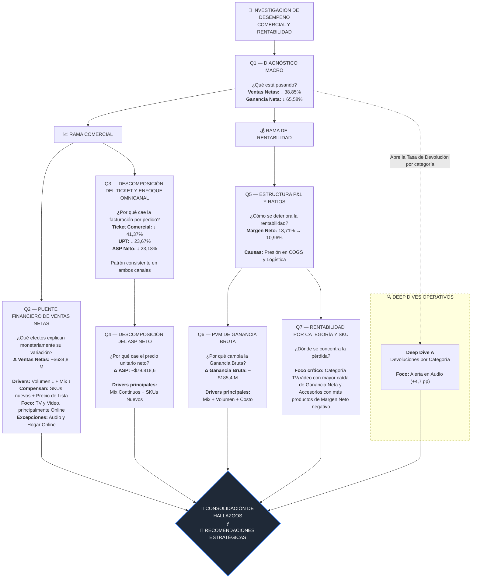

# 🔎 Investigación Analítica SQL

Esta investigación forma parte de un proyecto analítico End-to-End que se puede ver completo en: https://github.com/manticafacundoelian/dbt_elt_analytics

---

> **TL;DR:** Entre 2025 y 2026, la Ganancia Neta cayó **−65,58%**, casi el doble que las Ventas Netas (−38,85%). No es un problema de pedidos sino de Ticket Comercial —por UPT y ASP combinados— y de rentabilidad, donde la pérdida de volumen pesa más que el propio encarecimiento de costos. La investigación descarta las explicaciones más obvias —precio y descuentos, que casi se cancelan entre sí— y aísla la causa real en una sola categoría (**TV y Video**, 51,7% de toda la caída) y **3 productos puntuales**. El diagnóstico se sostiene en 3 puentes financieros con reconciliación exacta ($0,00 de residuo) y cierra con recomendaciones accionables priorizadas.

[Ver Conclusiones Generales →](#-conclusiones-generales) 

---

## 📌 Introducción

Esta investigación analiza la evolución comercial y económica de un retail de tecnología entre **2024 y 2026**, con el objetivo de identificar los principales factores asociados al deterioro observado en **ventas, comportamiento comercial y rentabilidad**.

El análisis parte de un **diagnóstico macro** y avanza progresivamente desde la variación agregada de las ventas hacia sus principales determinantes comerciales y económicos.

A partir de este diagnóstico, la investigación se estructura en dos grandes ramas:

* **Rama comercial:** analiza la evolución de las Ventas Netas desde una perspectiva financiera y comercial, descomponiendo monetariamente su variación y profundizando en el comportamiento del **Ticket Comercial, el UPT y el ASP**.

* **Rama de rentabilidad:** analiza el deterioro económico del negocio a través de la **estructura del P&L**, la evolución de los costos y la descomposición de la variación de la **Ganancia Bruta mediante un puente PVM ampliado (Price–Volume–Mix-Costo-Cambios en el Portfolio)**, complementando el análisis con la rentabilidad por categoría y SKU.

El objetivo no es únicamente cuantificar la caída observada, sino **reconstruir sus principales mecanismos**, desde la evolución de las ventas y el comportamiento de los clientes hasta su impacto final sobre la rentabilidad.

---

## 🗺️ Hoja de Ruta Ejecutiva & Resumen de Diagnóstico

---

## 🔎 Investigación y Desarrollo

La investigación busca responder **siete preguntas principales de diagnóstico**, complementadas por **un análisis operativo de profundización (*Deep Dives*)**:

### Preguntas Core del Diagnóstico

#### ┌─ 🔹 Q1 — Diagnóstico Macro: ¿Qué cambió en el desempeño general del negocio?

<strong>Ver desarrollo de Q1</strong>
  

   

#### 🔹 Síntesis

El diagnóstico muestra, por un lado, una fuerte contracción de las Ventas Netas y del Ticket Comercial y, por otro, un deterioro de la rentabilidad que ya se había manifestado durante 2025.

 

[Ver Consulta SQL →](./sql_business_analysis/q1_diagnostico_macro_yoy.sql) 
 

#### 🔹 Resultados 

| Métrica                    |       2024 |       2025 |     YoY 2025 |       2026 |     YoY 2026 |
| :------------------------- | ---------: | ---------: | -----------: | ---------: | -----------: |
| **Pedidos**                |      1.365 |      1.581 |  **+15,82%** |      1.649 |   **+4,30%** |
| **Ventas Brutas**          | $1.316,5 M | $1.684,4 M |  **+27,95%** | $1.064,0 M |  **−36,83%** |
| **Tasa de Descuento (%)**  |      1,98% |      3,00% | **+1,02 pp** |      6,10% | **+3,10 pp** | 
| **Ventas Netas**           | $1.290,5 M | $1.633,9 M |  **+26,62%** |   $999,1 M |  **−38,85%** |
| Devoluciones ($)           |    $37,2 M |    $53,7 M |  **+44,45%** |    $70,3 M |  **+30,90%** |
| **Tasa de Devolución (%)** |      2,88% |      3,28% | **+0,40 pp** |      7,03% | **+3,75 pp** |
| **Ventas Netas Finales**   | $1.253,3 M | $1.580,3 M |  **+26,09%** |   $928,9 M |  **−41,22%** |
| **Ganancia Neta**          |   $300,1 M |   $295,7 M |   **−1,47%** |   $101,8 M |  **−65,58%** |
| **Margen Neto (%)**        |     23,95% |     18,71% | **−5,24 pp** |     10,96% | **−7,75 pp** |
| **Ticket Comercial**       |   $945.397 | $1.033.477 |   **+9,32%** |   $605.891 |  **−41,37%** |

> *Nota: El Ticket Comercial se calcula sobre Ventas Netas, antes de devoluciones, para analizar el comportamiento comercial de las órdenes independientemente de las devoluciones posteriores.*

#### 🔹 Hallazgos

#### Diagnóstico Comercial

**1. Crecimiento en pedidos con caída de facturación**

En 2026 se registraron **1.649 pedidos (+4,30% YoY)**, mientras que las Ventas Netas cayeron un **−38,85%**.

**2. Contracción del Ticket Comercial**

La caída de ingresos se acompaña de una reducción significativa del ticket promedio, que disminuyó un **−41,37%**, pasando de **$1.033.477 a $605.891**.

**3. Mayor incidencia de devoluciones**

La Tasa de Devolución aumentó de **3,28% a 7,03% (+3,75 pp)**, profundizando la caída de las Ventas Netas Finales hasta un **−41,22%**.

#### Diagnóstico de Rentabilidad

**4. La ganancia cae más que las ventas**

En 2026, la Ganancia Neta cayó un **−65,58%**, frente a una caída del **−38,85%** en Ventas Netas. Como consecuencia, el Margen Neto se redujo del **18,71% al 10,96% (−7,75 pp)**.

**5. Deterioro de rentabilidad previo**

El problema de rentabilidad antecede a la caída de facturación de 2026. En 2025, a pesar de un crecimiento del **+26,62%** en Ventas Netas, la Ganancia Neta cayó un **−1,47%** y el Margen Neto perdió **−5,24 pp**.

 

#### 🔹 Puente analítico → Ramas Comercial y de Rentabilidad

El diagnóstico muestra, por un lado, una fuerte contracción de las **Ventas Netas** (−38,85%) y, por otro, una caída de la **Ganancia Neta** proporcionalmente mayor (−65,58%). Estas dos variables abren dos líneas de indagación independientes:

**La Rama Comercial (Q2–Q4)** cuantifica monetariamente esta caída y profundiza en cómo se manifestó en el comportamiento por pedido — Ticket, UPT y ASP.

**La Rama de Rentabilidad (Q5–Q7)** analiza la estructura de costos y descompone la Ganancia Bruta para explicar por qué el resultado económico se deterioró más que las ventas.

 

#### ├─ 🔹 Q2 — Puente Financiero de Ventas Netas: ¿Qué efectos explican monetariamente su variación?

<strong>Ver desarrollo de Q2</strong>
  

 

#### 🔹 Síntesis

Las **Ventas Netas disminuyeron $634,8 M entre 2025 y 2026**, explicadas principalmente por una fuerte contracción del **Volumen**, seguida por un efecto negativo de **Mix**.

Frente a estos efectos adversos, el **Precio** y, especialmente, la incorporación de **SKUs Nuevos**, actuaron como factores de compensación. Los **Descuentos** profundizaron parcialmente la caída, mientras que el efecto de los **SKUs Descontinuados fue prácticamente nulo**.

La apertura por **canal** muestra que el mayor deterioro absoluto se concentra en **Online**, aunque **Físico** presenta un impacto particularmente fuerte del Mix. Al cruzar **categoría × canal**, la contracción queda fuertemente concentrada en **TV y Video**, especialmente Online, seguida por **Telefonía y Computación**.

En contraste, **Audio Online** y **Hogar Online** presentan una evolución positiva, mostrando que el deterioro no fue homogéneo en todo el negocio.

 

#### 🔸 Q2.1 — Puente agregado total

[Ver Consulta SQL →](./sql_business_analysis/q2.1_puente_ventas_netas_total.sql)  

#### 🔹 Resultados

| Efecto                        | Impacto 2025 → 2026 |
| :---------------------------- | ------------------: |
| **Δ Ventas Netas**            |       **−$634,8 M** |
| Volumen                       |           −$614,9 M |
| Mix                           |           −$161,3 M |
| Precio                        |            +$37,8 M |
| Descuentos                    |            −$26,8 M |
| SKUs Nuevos                   |           +$130,5 M |
| SKUs Descontinuados           |             −$0,2 M |
| **Impacto total**             |       **−$634,8 M** |

> *Nota: El puente atribuye la variación de Ventas Netas entre 2025 y 2026 a efectos de **Volumen y Mix sobre SKUs continuos**, **Precio de Lista**, **Descuentos** y **cambios en el portafolio**, considerando **SKUs Nuevos y SKUs Descontinuados como efectos directos**. El impacto total coincide exactamente con la variación observada, confirmando la conciliación del puente.*

#### 🔹 Hallazgos

**1. El Volumen explica la mayor parte de la caída**

El efecto Volumen alcanzó **−$614,9 M**, siendo ampliamente el principal factor de deterioro. La contracción de las unidades comercializadas explica, por sí sola, una parte sustancial de la caída de Ventas Netas.

**2. El Mix también tuvo un impacto negativo relevante**

El Mix de los **SKUs continuos** aportó **−$161,3 M**, mostrando que el deterioro no se explica únicamente por vender menos unidades. También cambió desfavorablemente la composición de las ventas entre los productos que permanecieron activos en ambos períodos.

**3. Los nuevos SKUs compensaron parcialmente la contracción**

La incorporación de **SKUs nuevos aportó +$130,5 M**, convirtiéndose en el principal factor positivo del puente. Si bien este efecto no alcanzó para revertir la caída generada por Volumen y Mix, sí compensó una parte significativa del deterioro.

**4. El Precio de Lista aportó una compensación adicional**

El aumento del **Precio de Lista generó +$37,8 M**, contribuyendo positivamente a las Ventas Netas y amortiguando parcialmente los efectos negativos.

**5. Los Descuentos profundizaron la caída**

El efecto de los **Descuentos fue de −$26,8 M**, contrarrestando parte del beneficio obtenido por los mayores precios de lista.

**6. Los SKUs descontinuados tuvieron un impacto marginal**

El efecto asociado a los **SKUs descontinuados fue de apenas −$0,2 M**, por lo que prácticamente no tuvo incidencia sobre la variación total.

 

#### 🔸 Q2.2 — Puente por canal

[Ver Consulta SQL →](./sql_business_analysis/q2.2_puente_ventas_netas_canal.sql)  

#### 🔹 Resultados

| Canal | Ventas 2025 | Ventas 2026 | Δ Ventas | Impacto Volumen | Impacto Mix | Impacto Precio | Impacto Descuentos | SKUs Nuevos | SKUs Descontinuados | Impacto Total |
| :--- | ---: | ---: | ---: | ---: | ---: | ---: | ---: | ---: | ---: | ---: |
| **Online** | $1,178.4M | $794.0M | -$384.4M | -$443.5M | -$51.4M | +$30.2M | -$20.9M | +$101.3M | $0.00M | -$384.4M |
| **Físico** | $455.5M | $205.1M | -$250.4M | -$171.4M | -$109.8M | +$7.6M | -$5.8M | +$29.2M | -$0.2M | -$250.4M |

#### 🔹 Hallazgos

**1. Online concentra la mayor caída absoluta**

El canal Online redujo sus Ventas Netas en **$384,4 M**, frente a una caída de **$250,4 M en Físico**, por lo que concentra la mayor parte del deterioro agregado.

**2. El Volumen domina en ambos canales**

El principal efecto negativo en Online fue el **Volumen (−$443,5 M)**, mientras que en Físico alcanzó **−$171,4 M**.

Esto confirma que la contracción de unidades comercializadas constituye el principal problema comercial en ambos canales.

**3. Físico presenta un deterioro de Mix especialmente fuerte**

El Mix tuvo un impacto de **−$109,8 M en Físico**, más del doble del observado en Online (**−$51,4 M**).

Esto indica que el canal físico no solo perdió volumen, sino que también experimentó un cambio particularmente desfavorable en la composición de los productos vendidos.

**4. Los nuevos SKUs compensaron parcialmente la caída**

La incorporación de nuevos productos aportó **+$101,3 M en Online** y **+$29,2 M en Físico**, funcionando como un factor de compensación frente a la contracción del Volumen y otros efectos negativos.

El aporte fue relevante en ambos canales, aunque insuficiente para revertir la caída de Ventas Netas.

 

#### 🔹 Q2.3 — Puente por categoría × canal

[Ver Consulta SQL →](./sql_business_analysis/q2.3_puente_ventas_netas_categoria_canal.sql)  

#### 🔹 Resultados

| Categoría       | Canal    |  Δ Ventas Netas | Principal efecto negativo |
| :-------------- | :------- | ------------: | :------------------------ |
| **TV y Video**  | Online   | **−$302,3 M** | Volumen −$237,2 M         |
| **TV y Video**  | Físico   | **−$132,1 M** | Volumen −$81,7 M          |
| **Telefonía**   | Online   |  **−$73,1 M** | Volumen −$49,0 M          |
| **Computación** | Físico   |  **−$50,1 M** | Volumen −$29,8 M          |
| **Computación** | Online   |  **−$45,9 M** | Volumen −$61,7 M          |
| **Telefonía**   | Físico   |  **−$31,5 M** | Volumen −$18,6 M          |
| **Accesorios**  | Online   |  **−$19,1 M** | Volumen −$25,9 M          |
| **Accesorios**  | Físico   |  **−$12,9 M** | Volumen −$10,8 M          |
| **Hogar**       | Físico   |  **−$12,7 M** | Volumen −$12,1 M          |
| **Audio**       | Físico   |  **−$11,1 M** | Volumen −$18,4 M          |
| **Hogar**       | Online   |   **+$8,9 M** | Mix +$37,5 M              |
| **Audio**       | Online   |  **+$47,1 M** | SKUs nuevos +$64,3 M      |

#### 🔹 Hallazgos

**1. TV y Video concentra el principal deterioro**

TV y Video presenta una caída conjunta de aproximadamente **$434,4 M** entre ambos canales, explicando cerca de **68% de la contracción total de Ventas Netas**.

El mayor deterioro se encuentra en **Online**, con **−$302,3 M**, seguido por **Físico** con **−$132,1 M**.

**2. La caída de TV y Video combina Volumen y Mix**

En TV y Video Online, el Volumen aportó **−$237,2 M** y el Mix **−$68,9 M**. En Físico, ambos efectos también fueron negativos, con **−$81,7 M de Volumen** y **−$52,5 M de Mix**.

Por lo tanto, el deterioro de esta categoría no responde únicamente a una menor cantidad vendida, sino también a una composición menos favorable de las ventas.

**3. Telefonía y Computación constituyen el segundo foco de deterioro**

Telefonía cayó tanto en Online (**−$73,1 M**) como en Físico (**−$31,5 M**), mientras que Computación disminuyó **−$45,9 M en Online** y **−$50,1 M en Físico**.

En estos cruces, el Volumen representa el principal factor negativo y se combina con efectos desfavorables de Mix.

**4. Audio Online y Hogar Online funcionan como excepciones positivas**

Mientras prácticamente todos los demás cruces categoría × canal presentan caídas, **Audio Online creció $47,1 M** y **Hogar Online $8,9 M**.

En Audio Online, el crecimiento estuvo impulsado principalmente por **SKUs nuevos (+$64,3 M)** y un **Mix favorable (+$21,4 M)**, que compensaron la caída de Volumen.

En Hogar Online, el principal impulsor fue el **Mix (+$37,5 M)**, que compensó una caída de Volumen de **−$29,2 M**.

 

#### 🔹 Puente analítico → Q3

Q2 cuantifica **dónde y por qué monetariamente se movió la Venta Neta**, pasando del resultado agregado a su distribución por **canal** y finalmente a la combinación de **categoría × canal**.

El diagnóstico muestra que la contracción está dominada por una fuerte caída del **Volumen**, acompañada por un deterioro del **Mix**, mientras que la incorporación de nuevos SKUs y los mayores precios de lista compensaron parcialmente el impacto negativo.

**Q3 cambia la unidad de análisis:** pasa del valor monetario total al comportamiento por pedido, descomponiendo la evolución del **Ticket Comercial** mediante **órdenes, UPT y ASP**, y profundizando además en la evolución de cada canal.

 

#### ├─ 🔹 Q3 — Descomposición del Ticket y Comportamiento Omnicanal: ¿Por qué cae la facturación por pedido?

<strong>Ver desarrollo de Q3</strong>
  

 

#### 🔹 Síntesis

La **facturación por pedido cayó** entre 2025 y 2026 porque los clientes compraron **menos unidades por pedido** y cada unidad generó un **menor valor promedio**, dando como resultado una caída del Ticket Comercial.

Ambos fenómenos se reprodujeron transversalmente en **Online y Físico**, lo que indica que el deterioro responde principalmente a un **cambio en el comportamiento comercial**, más que a un problema asociado exclusivamente a un canal.

 

#### 🔸 Q3.1 — Descomposición del Ticket (UPT vs. ASP)

[Ver Consulta SQL →](./sql_business_analysis/q3.1_descomposicion_ticket.sql) 
 

#### 🔹 Resultados

| Métrica                       |       2024 |       2025 |    YoY 2025 |     2026 |    YoY 2026 |
| :---------------------------- | ---------: | ---------: | ----------: | -------: | ----------: |
| **Pedidos**                   |      1.365 |      1.581 | **+15,82%** |    1.649 |  **+4,30%** |
| **Unidades Totales**          |      3.946 |      4.746 | **+20,27%** |    3.778 | **−20,41%** |
| **Ventas Netas**              | $1.290,5 M | $1.633,9 M | **+26,62%** | $999,1 M | **−38,85%** |
| **Unidades por Pedido (UPT)** |       2,89 |       3,00 |  **+3,81%** |     2,29 | **−23,67%** |
| **ASP Comercial**             |   $327.032 |   $344.275 |  **+5,27%** | $264.456 | **−23,18%** |
| **Ticket Comercial**          |   $945.397 | $1.033.477 |  **+9,32%** | $605.891 | **−41,37%** |

> *Nota: **Ticket Comercial = UPT × ASP**, donde UPT representa las unidades promedio por pedido y ASP el valor promedio por unidad.*

#### 🔹 Hallazgos

**1. El ticket cae por dos vías simultáneas**

Entre 2025 y 2026, el Ticket Comercial disminuyó **41,37%**. La descomposición muestra una caída prácticamente equivalente en sus dos componentes: **UPT −23,67%** y **ASP −23,18%**.

Esto indica que en 2026 los clientes compraron **menos unidades por pedido y, además, a un menor valor promedio por unidad**.

 

#### 🔸 Q3.2 — Comportamiento Omnicanal

[Ver Consulta SQL →](./sql_business_analysis/q3.2_comportamiento_omnicanal.sql) 
 

#### 🔹 Resultados

| Canal | Pedidos 2025 | Pedidos 2026 | YoY Pedidos | Part. Pedidos 2025 | Part. Pedidos 2026 | Ticket 2025 | Ticket 2026 | YoY Ticket | ASP 2025 | ASP 2026 | YoY ASP | Tasa Descto. 2025 | Tasa Descto. 2026 | Δ Descto. (pp) |
| --- | --- | --- | --- | --- | --- | --- | --- | --- | --- | --- | --- | --- | --- | --- |
| **Online** | 1.116 | 1.318 | **+18,10%** | 70,59% | 79,93% | $1.055.898 | $602.436 | **−42,95%** | $349.876 | $263.879 | **−24,58%** | 2,98% | 6,04% | **+3,06 pp** |
| **Físico** | 465 | 331 | **−28,82%** | 29,41% | 20,07% | $979.667 | $619.651 | **−36,75%** | $330.584 | $266.716 | **−19,32%** | 3,03% | 6,31% | **+3,29 pp** |

#### 🔹 Hallazgos

**1. El deterioro del ticket se reproduce en ambos canales**

El Ticket Comercial cayó **42,95% en Online** y **36,75% en Físico**. La magnitud es diferente, pero el patrón es consistente: **ambos canales pierden valor por pedido**.

**2. UPT y ASP caen simultáneamente en ambos canales**

En Online, el UPT disminuyó **24,35%** y el ASP **24,58%**. En Físico, las caídas fueron de **21,60%** y **19,32%**, respectivamente.

Esto refuerza el hallazgo de Q3.1: la contracción del ticket no responde a un único componente ni a un único canal.

**3. El mix de canales cambia, pero no explica por sí solo el deterioro**

La participación de Online aumentó de **70,59% a 79,93%**, mientras Físico cayó de **29,41% a 20,07%**. Sin embargo, el ticket se deterioró dentro de **ambos canales**, por lo que el cambio de participación no explica por sí solo la caída del ticket total.

**4. Los descuentos aumentaron en ambos canales de manera similar**

La tasa de descuento aumentó **+3,06 pp en Online** y **+3,29 pp en Físico**.

 

#### 🔹 Puente analítico → Q4

Q3 identifica **qué está pasando con el valor por pedido**: los clientes compran menos unidades y cada unidad genera un menor valor promedio.

**Q4 profundiza el segundo componente —el ASP Neto— para determinar qué factores explican la caída del valor promedio por unidad.**

 

#### ├─ 🔹 Q4 — Descomposición del ASP Neto: ¿Por qué cae el valor promedio por unidad?

<strong>Ver desarrollo de Q4</strong>
  

 

#### 🔹 Síntesis

La caída del **ASP** responde principalmente a un cambio en la **composición de los productos vendidos** y a la incorporación de **SKUs nuevos con valores unitarios inferiores al promedio previo**.

Los efectos de **Precio de Lista y Descuentos** tuvieron un impacto secundario en términos netos, por lo que el deterioro del valor promedio por unidad se concentra principalmente en el **mix y la renovación del portafolio**.

 

#### 🔸 Q4.1 — Puente Agregado (Mix + Precio + Descuento + Nuevos + Descontinuados)

[Ver Consulta SQL →](./sql_business_analysis/q4_1_descomposicion_asp_agregada.sql) 
 

#### 🔹 Resultados

| Métrica                    |       2025 |       2026 |            Δ |
| :-------------------------- | ---------: | ---------: | -----------: |
| **ASP Comercial**           |   $344.275 |   $264.456 | **−$79.819** |
| **SKUs Continuos**          |         37 |         37 |             — |
| **SKUs Nuevos**             |          — |         11 |             — |
| **SKUs Descontinuados**     |          0 |          — |             — |

**Descomposición del Δ ASP ($79.819 de caída):**

| Efecto                          |    Impacto ($) | % del Δ Total |
| :------------------------------- | --------------: | -------------: |
| **Mix**         |     −$54.180,70 |    **67,9%** |
| **SKUs Nuevos**                  |     −$29.328,29 |    **36,7%** |
| **Precio**                       |      $12.778,52 |   **−16,0%** |
| **Descuentos**                   |      −$9.088,17 |    **11,4%** |
| **SKUs Descontinuados**          |           $0,00 |        0,0% |
| **Chequeo de Residuo y % Total**   |     **$0,00** ✅ |      100,0% |

> *Nota metodológica: el efecto Mix se valúa a precio del año base (2025) y los efectos Precio y Descuento se ponderan con el volumen del año actual (2026). Esta convención asegura que el puente cierre exacto (residuo $0), a costa de que la interacción entre cambio de mix y cambio de precio quede incluida dentro del efecto Precio.*

#### 🔹 Hallazgos

**1. La caída del ASP es principalmente un problema de mix, no de precios**

El efecto **Mix explica el 67,9%** de la caída, y los **SKUs Nuevos otro 36,7%**. Juntos superan el 100% del Δ, porque **Precio (+$12.778,52) y Descuento (−$9.088,17) casi se cancelan entre sí** (saldo neto: +$3.690,35). En otras palabras: la política de precios y descuentos, en neto, no explica la caída; el problema está en qué se vendió, no en cuánto se cobró por lo mismo.

**2. No hubo bajas de catálogo**

Los **0 SKUs descontinuados** confirman que toda la caída se explica por mix y por lanzamientos, no por pérdida de líneas existentes.

 

#### 🔸 Q4.2 — Puente por Categoría

[Ver Consulta SQL →](./sql_business_analysis/q4_2_descomposicion_asp_categoria.sql) 
 

#### 🔹 Resultados

| Categoría | Unid. 2025 | Unid. 2026 | Part. 2025 | Part. 2026 | Δ Part. (pp) | Mix | Precio | Descuento | Nuevos | Total | % contribución al Δ ASP |
| :--- | ---: | ---: | ---: | ---: | ---: | ---: | ---: | ---: | ---: | ---: | ---: |
| **TV y Video** | 791 | 402 | 16,67% | 10,64% | **−6,03** | −40.717,38 | 5.642,40 | −4.004,87 | 0,00 | **−39.079,85** | **49,0%** |
| **Computación** | 767 | 690 | 16,16% | 18,26% | +2,10 | −15.885,31 | 1.348,05 | −971,26 | −17.671,74 | **−33.180,25** | **41,6%** |
| **Telefonía** | 259 | 102 | 5,46% | 2,70% | −2,76 | −13.908,97 | 830,43 | −300,51 | 438,49 | **−12.940,57** | **16,2%** |
| **Audio** | 707 | 862 | 14,90% | 22,82% | +7,92 | 3.587,54 | 2.000,85 | −1.397,46 | −9.056,35 | **−4.865,42** | **6,1%** |
| **Accesorios** | 1.222 | 782 | 25,75% | 20,70% | −5,05 | 338,66 | 1.115,33 | −851,29 | −3.038,69 | **−2.435,99** | **3,1%** |
| **Hogar** | 1.000 | 940 | 21,07% | 24,88% | +3,81 | 12.404,76 | 1.841,45 | −1.562,78 | 0,00 | **+12.683,43** | **−15,9%** |
| **Total (chequeo)** | — | — | — | — | — | — | — | — | — | **−79.818,65** ✅ | 100,0% |

#### 🔹 Hallazgos

**1. Dos categorías explican el 90,6% de la caída, por mecanismos opuestos**

**TV y Video** (−49,0%) presenta una caída dominada por el efecto Mix: perdió 6 puntos de share, sin ningún SKU nuevo, y ni precio ni descuento lo compensan. **Computación** (−41,6%), en cambio, **ganó participación** (+2,10 pp) pero ven presionado su ASP por la incorporación de SKUs nuevos, que entraron por debajo del promedio (−$17.671,74). El mismo patrón se repite en **Audio**, que ganó +7,92 pp de share (la mayor suba de todas) y aun así cae, arrastrada por sus lanzamientos.

**2. Hogar es la única categoría que empuja el ASP hacia arriba**

Ganó share (+3,81 pp) con mix positivo (+$12.404,76) y sin lanzamientos, el espejo exacto de TV y Video.
 

#### 🔸 Q4.3 — Bridge por SKU (Detalle y Ranking de Impacto)

[Ver Consulta SQL →](./sql_business_analysis/q4_3_descomposicion_asp_sku.sql) 
 

#### 🔹 Resultados — Top 5 Mayor Impacto Negativo

| Producto | Categoría | Estado | Δ Part. (pp) | Mix | Precio | Descuento | Nuevos | Total |
| :--- | :--- | :--- | ---: | ---: | ---: | ---: | ---: | ---: |
| TCL Monitor TV 21 | TV y Video | Continuo | −2,616 | −20.173,53 | 2.265,13 | −1.530,49 | 0,00 | **−19.438,89** |
| Acer Memoria RAM 2 | Computación | Continuo | −3,132 | −11.108,52 | 197,11 | −95,52 | 0,00 | **−11.006,93** |
| Lenovo Mouse 1 | Computación | Continuo | −4,073 | −10.436,40 | 332,19 | −189,48 | 0,00 | **−10.293,69** |
| TCL Chromecast 25 | TV y Video | Continuo | −1,342 | −9.111,00 | 1.173,26 | −905,27 | 0,00 | **−8.843,01** |
| Acer Notebook 7 | Computación | Nuevo 2026 | +4,579 | 0,00 | 0,00 | 0,00 | −8.347,11 | **−8.347,11** |

#### 🔹 Resultados — Top 5 Mayor Impacto Positivo

| Producto | Categoría | Estado | Δ Part. (pp) | Mix | Precio | Descuento | Nuevos | Total |
| :--- | :--- | :--- | ---: | ---: | ---: | ---: | ---: | ---: |
| Liliana Cafetera 46 | Hogar | Continuo | +6,315 | 12.338,22 | 1.171,32 | −1.043,51 | 0,00 | **12.466,03** |
| ASUS Webcam 6 | Computación | Continuo | +1,167 | 7.423,10 | 406,13 | −391,52 | 0,00 | **7.437,70** |
| Philips Barra de Sonido 28 | Audio | Continuo | +0,013 | 3.595,60 | 793,89 | −469,45 | 0,00 | **3.920,04** |
| Samsung Monitor TV 23 | TV y Video | Continuo | +0,365 | 3.313,49 | 487,24 | −353,18 | 0,00 | **3.447,55** |
| Logitech Funda 40 | Accesorios | Continuo | +0,561 | 1.273,05 | 121,81 | −90,70 | 0,00 | **1.304,16** |

> *Detalle completo de los 48 SKUs disponible en la salida de la consulta SQL vinculada arriba.*

#### 🔹 Hallazgos

**1. El impacto está muy concentrado, y el caso extremo confirma Q3.2**

Los 5 productos de mayor impacto negativo explican el **72,6%** de la caída total. El más extremo, **TCL Monitor TV 21**, perdió más de la mitad de sus unidades (295 → 136) y explica por sí solo el **24,4%** de la caída del ASP — la manifestación a nivel producto de la pérdida de mix que ya vimos en TV y Video.  
 

#### 🔹 Puente analítico → Cierre de la Rama Comercial

Q4 completa el diagnóstico comercial: la caída del ASP se explica principalmente por **Mix** y por la incorporación de **SKUs nuevos a precios por debajo del promedio**, no por la política de precios o descuentos.

Con esto, la **Rama Comercial queda completa**. La **Rama de Rentabilidad (Q5–Q7)**, abierta en paralelo desde el diagnóstico inicial, analiza cómo estos mismos fenómenos de ventas se tradujeron en el deterioro del resultado económico.

 

#### ├─ 🔹 Q5 — Estructura de Rentabilidad y Ratios P&L: ¿Cómo se deterioró la rentabilidad?

<strong>Ver desarrollo de Q5</strong>

 

#### 🔹 Síntesis

La rentabilidad se deterioró por una **mayor absorción de las Ventas Netas Finales por parte del Costo de Ventas**, acompañada por un incremento del peso de los costos logísticos. Aunque el deterioro se observa en la comparación interanual, **la crisis se profundizó especialmente entre S1 y S2 de 2026**, cuando el Margen Neto cayó de 16,89% a 2,30%.

La **Ganancia Bruta es el principal foco de investigación**: cayó un 76,56% entre ambos semestres, reflejando el fuerte deterioro de la relación entre ingresos y costo de ventas. La mayor presión logística agravó posteriormente la caída de la Ganancia Neta.

 

#### 🔸 Q5.A — Evolución Interanual: ¿Cómo cambió la rentabilidad entre 2025 y 2026?

[Ver Consulta SQL →](./sql_business_analysis/q5_a_rentabilidad_interanual.sql)  

##### 🔹 Resultados

| Métrica                   |       2025 |     2026 | Variación 2026 |
| :------------------------ | ---------: | -------: | -------------: |
| **Ventas Netas Finales**  | $1.580,3 M | $928,9 M |    **−41,22%** |
| **Costo de Ventas**       | $1.270,0 M | $804,0 M |    **−36,69%** |
| **Costo de Ventas / VNF** |     80,37% |   86,56% |   **+6,19 pp** |
| **Ganancia Bruta**        |   $310,2 M | $124,9 M |    **−59,75%** |
| **Margen Bruto**          |     19,63% |   13,44% |   **−6,19 pp** |
| **Costo Logístico**       |    $14,5 M |  $23,1 M |    **+59,02%** |
| **Costo Logístico / VNF** |      0,92% |    2,49% |   **+1,57 pp** |
| **Ganancia Neta**         |   $295,7 M | $101,8 M |    **−65,58%** |
| **Margen Neto**           |     18,71% |   10,96% |   **−7,75 pp** |

> Para el análisis de rentabilidad se toma como base la **Venta Neta Final (VNF)**, es decir, la venta después de devoluciones aprobadas. Los ratios se calculan sobre el ingreso económico efectivamente retenido por la empresa.

##### 🔹 Hallazgos

**1. El Costo de Ventas absorbe una proporción creciente del ingreso**

Entre 2025 y 2026, el ratio Costo de Ventas / VNF aumentó **6,19 pp**, pasando de 80,37% a 86,56%. Como consecuencia, el Margen Bruto descendió de 19,63% a 13,44%.

La Ganancia Bruta cayó **59,75%**, una contracción superior a la de las Ventas Netas Finales (−41,22%). El deterioro, por lo tanto, no se limita a una menor escala de ventas: el ingreso retenido también genera una ganancia bruta proporcionalmente menor.

**2. La presión logística aumenta en un contexto de contracción comercial**

El Costo Logístico pasó de $14,5 M a $23,1 M, un incremento del **59,02%**. Su peso sobre las Ventas Netas Finales subió de 0,92% a 2,49%, es decir, **1,57 pp**.

Este incremento agrega presión sobre el resultado después de que el Costo de Ventas ya absorbió una proporción mayor del ingreso.

**3. La Ganancia Neta cae más que las ventas**

La Ganancia Neta disminuyó **65,58%**, frente a una caída del 41,22% en las Ventas Netas Finales. El Margen Neto pasó de 18,71% a 10,96%, con una reducción de **7,75 pp**.

La evolución interanual confirma un deterioro significativo de la rentabilidad, pero todavía no muestra cómo se distribuyó ese deterioro a lo largo de 2026.

 

#### 🔸 Q5.B — Evolución Semestral: ¿Cuándo se profundizó la crisis de rentabilidad en 2026?

[Ver Consulta SQL →](./sql_business_analysis/q5_b_rentabilidad_semestral.sql)  

##### 🔹 Resultados

| Métrica                   |  2026-S1 |  2026-S2 | Variación S2 vs. S1 |
| :------------------------ | -------: | -------: | ------------------: |
| **Ventas Netas Finales**  | $551,2 M | $377,6 M |         **−31,49%** |
| **Costo de Ventas**       | $450,1 M | $353,9 M |         **−21,36%** |
| **Costo de Ventas / VNF** |   81,65% |   93,72% |       **+12,07 pp** |
| **Ganancia Bruta**        | $101,1 M |  $23,7 M |         **−76,56%** |
| **Margen Bruto**          |   18,35% |    6,28% |       **−12,07 pp** |
| **Costo Logístico**       |   $8,1 M |  $15,0 M |         **+86,65%** |
| **Costo Logístico / VNF** |    1,46% |    3,98% |        **+2,52 pp** |
| **Ganancia Neta**         |  $93,1 M |   $8,7 M |         **−90,68%** |
| **Margen Neto**           |   16,89% |    2,30% |       **−14,59 pp** |

> S1 comprende enero-junio de 2026 y S2, julio-diciembre. La comparación permite identificar en qué tramo del año se intensificó el deterioro de la rentabilidad.

##### 🔹 Hallazgos

**1. El segundo semestre concentra el deterioro más severo**

Entre S1 y S2, las Ventas Netas Finales disminuyeron **31,49%**, pero la Ganancia Bruta cayó **76,56%**, pasando de $101,1 M a $23,7 M.

El Costo de Ventas pasó de representar el 81,65% al 93,72% de las ventas, un aumento de **12,07 pp**. En consecuencia, el Margen Bruto se redujo de 18,35% a 6,28%.

Al cierre de S2, por cada $100 de ingreso retenido, quedaban apenas **$6,28 de ganancia bruta** antes de cubrir los costos logísticos.

**2. El incremento de la carga logística agrava el deterioro**

El Costo Logístico aumentó de $8,1 M a $15,0 M, una suba del **86,65%**, pese a la contracción de las ventas.

Su participación sobre las Ventas Netas Finales pasó de 1,46% a 3,98%, un incremento de **2,52 pp**. Así, la logística ejerció una presión adicional sobre un margen bruto que ya se había reducido drásticamente.

**3. La rentabilidad neta queda prácticamente desarticulada**

La Ganancia Neta cayó de $93,1 M a $8,7 M, una disminución del **90,68%**. El Margen Neto pasó de 16,89% a 2,30%, perdiendo **14,59 pp**.

La magnitud de la caída evidencia que el problema no es solamente la reducción de los ingresos: en S2, la combinación de un margen bruto mucho menor y una carga logística más elevada dejó una capacidad muy limitada para generar Ganancia Neta.

 

#### 🔹 Puente analítico → Q6

El deterioro de la rentabilidad se concentra en la **Ganancia Bruta**, que cayó un 76,56% entre ambos semestres de 2026. El siguiente análisis descompone esta variación para cuantificar la contribución de los distintos componentes económicos que explican el cambio en el resultado.

 

#### ├─ 🔹 Q6 — Puente de Ganancia Bruta 1S → 2S 2026: ¿Por qué cayó la Ganancia Bruta?

<strong>Ver desarrollo de Q6</strong>
  

 

#### 🔹 Síntesis

La Ganancia Bruta cayó **76,6% entre el 1S y el 2S de 2026**, de $101,15 M a $23,71 M (−$77,44 M), y el margen bruto retrocedió de 18,35% a 6,28%.

El deterioro se explica principalmente por dos efectos: **el costo, con una contribución negativa de $43,35 M (56,0% de la caída), y la mezcla de productos, con −$26,19 M (33,8%)**. El efecto precio fue levemente positivo (+$0,72 M), mientras que el volumen tuvo una incidencia marginal (−$0,34 M).

La descomposición por canal y categoría muestra que el deterioro alcanza a ambos canales y se concentra en **TV y Video, Computación y Telefonía**, que reúnen el 83,0% de la caída. A nivel de producto, la presión del costo se extiende a todos los segmentos continuos analizados, mientras que el efecto negativo de mezcla se concentra en unos pocos productos de ticket alto, principalmente de TV y Video Online.

Además, dos lanzamientos registraron precios realizados inferiores a sus costos unitarios, generando pérdidas desde su incorporación.

**Conclusión:** la caída de la Ganancia Bruta combina una presión generalizada de los costos con una pérdida de contribución de productos de alto valor. El crecimiento de las unidades vendidas no alcanzó para compensar ambos efectos.

 

#### 🔸 Q6.A — Puente Agregado: Total Empresa

[Ver Consulta SQL →](./sql_business_analysis/q6a_pvm_ganancia_bruta_semestral_agregado.sql)  

#### 🔹 Resultados

| Concepto | Monto | % de la variación |
| :--- | ---: | ---: |
| **Ganancia Bruta 1S** | **$101,15 M** | |
| Efecto costo | −$43,35 M | 56,0% |
| Efecto mezcla | −$26,19 M | 33,8% |
| Efecto discontinuados | −$6,06 M | 7,8% |
| Efecto nuevos | −$2,22 M | 2,9% |
| Efecto volumen | −$0,34 M | 0,4% |
| Efecto precio | +$0,72 M | −0,9% |
| **Ganancia Bruta 2S** | **$23,71 M** | |
| **Variación** | **−$77,44 M** | **100,0%** |

| Indicador | 1S 2026 | 2S 2026 | Variación |
| :--- | ---: | ---: | ---: |
| Unidades efectivas | 1.719 | 1.816 | +5,6% |
| Precio promedio por unidad | $320.661 | $207.952 | −35,1% |
| Costo promedio por unidad | $261.819 | $194.895 | −25,6% |
| Margen Bruto | 18,35% | 6,28% | −12,07 pp |

> *Los efectos suman exactamente la variación (un centavo de diferencia en la consulta es el redondeo de cada efecto a dos decimales). El precio y el costo promedio por unidad incluyen cambios de mezcla: para el efecto de precio y de costo "puros" mirar la tabla de efectos.*

#### 🔹 Hallazgos

**1. La Ganancia Bruta cayó un 76,6% y el margen bruto perdió 12,07 pp**

La Ganancia Bruta pasó de **$101,15 M a $23,71 M (−$77,44 M)** y el margen bruto, del **18,35% al 6,28%**. Las ventas cayeron un **31,5%**, pese a que las unidades efectivas aumentaron un **5,6%**.

**2. El costo fue el principal factor negativo**

El efecto costo restó **$43,35 M (56,0% de la caída)**, mientras que el efecto precio aportó apenas **$0,72 M**. La contribución positiva del precio fue insuficiente para compensar el impacto negativo del costo.

**3. La caída se explica principalmente por la composición de las ventas**

Aunque las unidades efectivas aumentaron en 97, los segmentos continuos registraron una reducción de 6 unidades. El crecimiento neto provino de **135 unidades en segmentos nuevos**, parcialmente compensadas por la pérdida de 32 unidades en segmentos discontinuados. El efecto mezcla restó **$26,19 M (33,8% de la caída)**, reflejando la menor contribución de los productos vendidos en el segundo semestre.

**4. Los promedios por unidad no reflejan por sí solos los cambios de precio y costo**

El precio promedio por unidad cayó un **35,1%** y el costo promedio, un **25,6%**. Sin embargo, ambos indicadores también están afectados por los cambios en la composición de las ventas. El efecto precio del puente, que aísla la variación de precio en los segmentos continuos, fue positivo en **$0,72 M**.

 

#### 🔸 Q6.B — Puente por Canal

[Ver Consulta SQL →](./sql_business_analysis/q6b_pvm_ganancia_bruta_semestral_canal.sql)  

#### 🔹 Resultados

| Canal | GB 1S | GB 2S | Variación | MB 1S → 2S | Volumen | Mezcla | Precio | Costo | Nuevos | Discont. | % de la caída |
| :--- | ---: | ---: | ---: | :---: | ---: | ---: | ---: | ---: | ---: | ---: | ---: |
| **Online** | $79,60 M | $19,43 M | **−$60,17 M** | 18,28% → 6,47% | −$0,28 M | −$22,70 M | +$0,66 M | −$34,74 M | −$1,82 M | −$1,30 M | 77,7% |
| **Físico** | $21,55 M | $4,29 M | **−$17,26 M** | 18,60% → 5,52% | −$0,06 M | −$3,49 M | +$0,06 M | −$8,61 M | −$0,39 M | −$4,76 M | 22,3% |
| **Total Empresa** | **$101,15 M** | **$23,71 M** | **−$77,44 M** | **18,35% → 6,28%** | −$0,34 M | −$26,19 M | +$0,72 M | −$43,35 M | −$2,22 M | −$6,06 M | **100,0%** |

> *Cada fila es la suma de los efectos de sus productos. El % de la caída es la variación de cada canal sobre la variación total (−$77,44 M).*

#### 🔹 Hallazgos

**1. La caída afecta a ambos canales, aunque Online concentra la mayor pérdida monetaria**

Online explica el **77,7% de la caída de la Ganancia Bruta (−$60,17 M)** y Físico el **22,3% (−$17,26 M)**, en proporciones similares a su participación en la Ganancia Bruta del 1S. Sin embargo, el margen bruto retrocedió más en Físico: **−13,08 pp**, frente a **−11,81 pp en Online**. El deterioro, por lo tanto, no se limita al canal de mayor volumen.

**2. El costo es el principal efecto negativo en ambos canales, pero los factores secundarios difieren**

En Online, el costo restó **$34,74 M** y la mezcla, **$22,70 M**. En Físico, el costo también fue el principal efecto negativo (**−$8,61 M**), seguido por los segmentos discontinuados (**−$4,76 M**) y la mezcla (**−$3,49 M**). La mayor incidencia de los discontinuados en Físico se relaciona con que **6 de los 8 segmentos que dejaron de vender en el 2S corresponden a ese canal**, como se detalla en Q6.D.

 

#### 🔸 Q6.C — Puente por Categoría × Canal

[Ver Consulta SQL →](./sql_business_analysis/q6c_pvm_ganancia_bruta_semestral_categoria_canal.sql)  

#### 🔹 Resultados

| Categoría | Canal | GB 1S | GB 2S | Variación | MB 1S → 2S | Volumen | Mezcla | Precio | Costo | Nuevos y discont. | % de la caída |
| :--- | :--- | ---: | ---: | ---: | :---: | ---: | ---: | ---: | ---: | ---: | ---: |
| **TV y Video** | Online | $32,62 M | $0,46 M | **−$32,16 M** | 15,60% → 0,51% | −$0,11 M | −$18,89 M | −$0,04 M | −$12,43 M | −$0,68 M | 41,5% |
| **Computación** | Online | $18,93 M | $5,09 M | **−$13,85 M** | 25,25% → 14,05% | −$0,07 M | −$9,29 M | +$0,60 M | −$4,79 M | −$0,30 M | 17,9% |
| **TV y Video** | Físico | $8,62 M | −$0,32 M | **−$8,94 M** | 15,15% → −1,31% | −$0,02 M | −$2,31 M | +$0,03 M | −$3,57 M | −$3,07 M | 11,5% |
| **Audio** | Online | $11,40 M | $6,06 M | **−$5,34 M** | 21,68% → 6,77% | −$0,04 M | +$5,05 M | +$0,50 M | −$9,20 M | −$1,64 M | 6,9% |
| **Telefonía** | Online | $6,17 M | $0,91 M | **−$5,26 M** | 14,03% → 9,92% | −$0,02 M | −$3,63 M | −$0,21 M | −$0,90 M | −$0,50 M | 6,8% |
| **Computación** | Físico | $4,01 M | $1,12 M | **−$2,89 M** | 24,97% → 10,89% | −$0,01 M | −$0,54 M | −$0,18 M | −$1,04 M | −$1,12 M | 3,7% |
| **Accesorios** | Online | $3,46 M | $1,26 M | **−$2,20 M** | 16,82% → 4,92% | −$0,01 M | +$0,75 M | +$0,08 M | −$3,02 M | — | 2,8% |
| **Audio** | Físico | $3,54 M | $1,48 M | **−$2,06 M** | 23,18% → 7,48% | −$0,01 M | +$0,11 M | −$0,05 M | −$1,63 M | −$0,48 M | 2,7% |
| **Accesorios** | Físico | $1,72 M | $0,21 M | **−$1,51 M** | 18,10% → 3,65% | −$0,01 M | −$0,82 M | +$0,10 M | −$0,77 M | −$0,02 M | 2,0% |
| **Hogar** | Online | $7,01 M | $5,64 M | **−$1,37 M** | 20,56% → 11,67% | −$0,02 M | +$3,32 M | −$0,26 M | −$4,40 M | — | 1,8% |
| **Telefonía** | Físico | $1,91 M | $0,71 M | **−$1,20 M** | 19,01% → 10,37% | −$0,01 M | −$0,42 M | +$0,27 M | −$0,57 M | −$0,46 M | 1,5% |
| **Hogar** | Físico | $1,74 M | $1,08 M | **−$0,66 M** | 21,78% → 10,34% | −$0,01 M | +$0,48 M | −$0,12 M | −$1,02 M | — | 0,9% |
| **Total Empresa** | **—** | **$101,15 M** | **$23,71 M** | **−$77,44 M** | **18,35% → 6,28%** | −$0,34 M | −$26,19 M | +$0,72 M | −$43,35 M | −$8,28 M | **100,0%** |

> *"Nuevos y discont." suma los dos efectos de los segmentos que solo vendieron en uno de los semestres. En esta vista, el signo de la mezcla de cada fila solo dice si la categoría ganó o perdió unidades (Audio Online y Hogar Online ganaron unidades; TV y Video Online las perdió): se lee en el total, no fila por fila.*

#### 🔹 Hallazgos

**1. TV y Video concentra el 53,1% de la caída y prácticamente pierde toda su Ganancia Bruta**

La categoría perdió **$41,10 M**, al pasar de **$41,25 M a $0,14 M** entre semestres. El deterioro se observa en ambos canales: el margen bruto de Online cayó del 15,60% al 0,51%, mientras que Físico pasó del 15,15% al −1,31%, registrando pérdidas brutas en el 2S.

**2. Las categorías de mayor ticket concentran el 83% de la caída**

TV y Video, Computación y Telefonía pasaron de **$72,27 M a $7,98 M** de Ganancia Bruta y explican el **83,0% del deterioro**. En conjunto, sus unidades efectivas cayeron un 41,7% (de 705 a 411), mientras que Accesorios, Audio y Hogar aumentaron sus unidades un 38,6% (de 1.014 a 1.405). Este desplazamiento ayuda a explicar la pérdida de contribución por mezcla.

**3. El efecto mezcla negativo se concentra en tres combinaciones Online**

TV y Video Online (**−$18,89 M**), Computación Online (**−$9,29 M**) y Telefonía Online (**−$3,63 M**) acumulan **−$31,81 M de efecto mezcla**. Parte de ese impacto se compensa con Audio Online (**+$5,05 M**) y Hogar Online (**+$3,32 M**), que registraron efectos de mezcla positivos.

**4. El costo tiene un efecto negativo en las 12 combinaciones de categoría y canal**

El efecto costo fue negativo en todas las combinaciones, desde **−$0,57 M en Telefonía Físico hasta −$12,43 M en TV y Video Online**. En Audio Online alcanzó **−$9,20 M**, superando la caída total de esa combinación (−$5,34 M) porque los efectos positivos de mezcla y precio compensaron parcialmente su impacto.

 

#### 🔸 Q6.D — Puente por Producto × Canal (detalle)

[Ver Consulta SQL →](./sql_business_analysis/q6d_pvm_ganancia_bruta_semestral_producto_canal.sql)  

#### 🔹 Resultados

**Los 10 segmentos con mayor caída** (de 94):

| Categoría | Producto | Canal | Unid. 1S → 2S | Volumen | Mezcla | Precio | Costo | Discont. | **Efecto total** |
| :--- | :--- | :--- | :---: | ---: | ---: | ---: | ---: | ---: | ---: |
| TV y Video | **TCL Monitor TV 21** | Online | 72 → 28 | −$0,05 M | −$8,92 M | −$0,99 M | −$3,69 M | — | **−$13,65 M** |
| TV y Video | **TCL Chromecast 25** | Online | 56 → 14 | −$0,04 M | −$8,35 M | +$0,06 M | −$1,36 M | — | **−$9,69 M** |
| Computación | **Acer Memoria RAM 2** | Online | 40 → 3 | −$0,02 M | −$4,53 M | +$0,01 M | −$0,08 M | — | **−$4,62 M** |
| Computación | **ASUS Webcam 6** | Online | 34 → 16 | −$0,02 M | −$3,10 M | −$0,01 M | −$0,96 M | — | **−$4,10 M** |
| TV y Video | **TCL Monitor TV 19** | Online | 9 → 13 | ≈ $0 | +$0,42 M | +$0,78 M | −$4,61 M | — | **−$3,41 M** |
| TV y Video | **TCL Monitor TV 21** | Físico | 17 → 9 | −$0,01 M | −$1,77 M | −$0,16 M | −$1,23 M | — | **−$3,16 M** |
| Computación | **Lenovo Mouse 1** | Online | 68 → 11 | −$0,01 M | −$2,62 M | +$0,07 M | −$0,37 M | — | **−$2,93 M** |
| TV y Video | **TCL Chromecast 25** | Físico | 13 → 0 | — | — | — | — | −$2,78 M | **−$2,78 M** |
| TV y Video | **Samsung Monitor TV 23** | Online | 44 → 28 | −$0,01 M | −$0,90 M | +$0,29 M | −$1,56 M | — | **−$2,18 M** |
| Telefonía | **Apple Cargador 12** | Online | 8 → 2 | −$0,01 M | −$1,78 M | −$0,05 M | −$0,29 M | — | **−$2,13 M** |
| **Subtotal 10 segmentos** | | | | | | | | | **−$48,65 M** |

> *Los 94 segmentos están en la consulta, ordenados por efecto total. El efecto "Nuevos" de estos 10 segmentos es cero.*

**Segmentos nuevos en el 2S** (8: 3 SKUs nuevos, cada uno en Online y Físico, y 2 canales nuevos de SKUs que ya vendían):

| Categoría | Producto | Canal | Origen | Unid. 2S | Precio unit. | Costo unit. | Margen unit. | GB 2S |
| :--- | :--- | :--- | :--- | ---: | ---: | ---: | ---: | ---: |
| Audio | **Edifier Auriculares 32** | Online | SKU nuevo | 90 | $203.784 | $222.058 | −$18.275 | −$1,64 M |
| Audio | **Edifier Auriculares 32** | Físico | SKU nuevo | 21 | $201.842 | $220.638 | −$18.796 | −$0,39 M |
| Computación | **Dell Teclado 3** | Online | SKU nuevo | 13 | $134.404 | $157.256 | −$22.852 | −$0,30 M |
| Computación | **Dell Teclado 3** | Físico | SKU nuevo | 4 | $131.547 | $161.818 | −$30.271 | −$0,12 M |
| Telefonía | **Apple Smartphone 16** | Físico | SKU nuevo | 1 | $790.057 | $755.295 | $34.762 | $0,03 M |
| Computación | **ASUS Mouse 4** | Físico | Canal nuevo de un SKU que ya vendía | 4 | $164.382 | $153.963 | $10.420 | $0,04 M |
| TV y Video | **Samsung Chromecast 24** | Físico | Canal nuevo de un SKU que ya vendía | 1 | $1.095.772 | $1.049.348 | $46.424 | $0,05 M |
| Telefonía | **Apple Smartphone 16** | Online | SKU nuevo | 1 | $874.526 | $755.295 | $119.232 | $0,12 M |

#### 🔹 Hallazgos

**1. Diez segmentos explican el 62,8% de la caída**

Los 10 segmentos con mayor deterioro acumulan **−$48,65 M** y pertenecen a TV y Video, Computación y Telefonía. El caso más significativo es **TCL Monitor TV 21 Online**, con un efecto total de **−$13,65 M**: pasó de vender 72 unidades en el 1S a 28 en el 2S, mientras su margen unitario cayó de $203.986 a $36.931.

**2. El aumento del costo fue generalizado**

El costo unitario aumentó en los **78 segmentos producto × canal continuos analizados**, con variaciones de entre **+2,4% y +32,5%** y una mediana del **+13,9%**. En cambio, el precio realizado tuvo una mediana de apenas **+0,2%** y aumentó en 40 de los 78 segmentos. Esto indica que la presión sobre los costos alcanzó a toda la cartera de segmentos continuos, no solamente a los de mayor impacto. En **TCL Monitor TV 19 Online**, por ejemplo, el costo unitario subió un 26,7%, frente a un aumento del precio del 4,2%; el margen bruto pasó del 7,3% al −12,7%.

**3. La mezcla negativa se concentra en cinco productos Online**

TCL Monitor TV 21, TCL Chromecast 25, Acer Memoria RAM 2, ASUS Webcam 6 y Lenovo Mouse 1 acumulan **−$27,53 M de efecto mezcla**, equivalente al 105% del efecto mezcla total negativo. La pérdida se relaciona con la fuerte reducción de sus unidades vendidas entre semestres. El resto de los segmentos compensa parcialmente ese impacto.

**4. Dos lanzamientos generaron pérdidas desde su incorporación**

**Edifier Auriculares 32** vendió 111 unidades entre Online y Físico, con precios unitarios inferiores a sus costos, y aportó aproximadamente **−$2,04 M** de Ganancia Bruta. **Dell Teclado 3** vendió 17 unidades bajo la misma condición y aportó **−$0,42 M**. En conjunto, ambos lanzamientos generaron **−$2,46 M**, mientras que los otros segmentos nuevos compensaron parcialmente esa pérdida. Edifier concentró el 82% de las unidades de los segmentos nuevos, por lo que una parte importante de las nuevas ventas se originó en un producto con margen unitario negativo.

**5. Los segmentos discontinuados no necesariamente representan productos retirados**

De los ocho segmentos discontinuados, seis corresponden a canales en los que un producto dejó de venderse, aunque continuó comercializándose por otro canal. Estos concentran **−$5,04 M** de los **−$6,06 M** del efecto discontinuados. El único SKU que dejó de venderse por completo fue LG Chromecast 22, en ambos canales, con un efecto de **−$1,02 M**. Como estos segmentos registraban entre 1 y 13 unidades en el 1S, la ausencia de ventas en el 2S no demuestra por sí sola una decisión comercial de discontinuación.

**Límites de la lectura**

* **Alcance explicativo:** Q6 identifica dónde se concentra el deterioro, pero no determina las causas comerciales u operativas del aumento de costos ni de la caída de unidades.
* **Valuación de la mezcla:** el efecto se mide en pesos usando los márgenes unitarios del 1S, por lo que los productos de mayor contribución por unidad tienen más peso. Q8 complementa esta lectura desde los puntos de margen.
* **Volúmenes reducidos:** algunos segmentos nuevos o discontinuados registran pocas unidades. Sus resultados deben interpretarse con cautela y no como evidencia suficiente de una tendencia o decisión comercial.
* **Precio realizado:** incorpora descuentos y devoluciones, por lo que no permite distinguir por sí solo entre cambios en el precio de lista y variaciones en los descuentos.
* **Alcance del puente:** el análisis corresponde a la Ganancia Bruta y no incluye la logística, cuyo impacto se estudia en Q8.

 

#### 🔹 Puente analítico → Q7

Q6 explicó **cómo se descompone la caída de la Ganancia Bruta en términos monetarios**: el costo fue el principal factor negativo, seguido por la mezcla de productos, mientras que el efecto precio compensó parcialmente la caída.

**Q7 aborda la misma evolución desde otra perspectiva: la rentabilidad porcentual.** Analiza cómo varió el margen bruto entre semestres y cuánto contribuyeron los distintos efectos a esa variación en puntos porcentuales.

 

#### ├─ 🔹 Q7 — Margen Bruto 1S → 2S 2026: ¿Qué hundió el margen, los productos o la mezcla?

<strong>Ver desarrollo de Q7</strong>
  

 

#### 🔹 Síntesis

Q6 explicó la caída de la Ganancia Bruta **en términos monetarios**. Q7 analiza el mismo deterioro desde la perspectiva del **margen bruto porcentual**: ¿cuánto aportaron los cambios en los márgenes de los segmentos, las variaciones en la composición de las ventas y la entrada o salida de segmentos?

El margen bruto global cayó **12,07 pp, del 18,35% al 6,28%** entre el primer y el segundo semestre de 2026. La descomposición identifica cuatro contribuciones:

* **Efecto margen:** −10,95 pp. Explica el 90,8% de la caída y refleja el deterioro de los márgenes de los segmentos que vendieron en ambos semestres. En conjunto con los resultados de Q6, este efecto se asocia principalmente con la presión de los costos.
* **Efecto entrada:** −1,96 pp. Los segmentos que comenzaron a vender en el 2S redujeron el margen global, principalmente por los lanzamientos de Edifier Auriculares 32 y Dell Teclado 3, que registraron márgenes brutos negativos.
* **Efecto salida:** −0,13 pp. La desaparición de ventas de ocho segmentos tuvo una incidencia negativa reducida sobre el margen global.
* **Efecto mezcla:** +0,97 pp. Los cambios en la participación de los segmentos compensaron parcialmente el deterioro, porque la composición de las ventas evolucionó favorablemente respecto del margen global del 1S.

**¿Dónde se concentra la caída?**

* **Q7.A — Total empresa:** cuantifica las contribuciones de los cuatro efectos y explica la variación global.
* **Q7.B — Canal:** Online concentra el 77,7% de la caída, en línea con su peso en las ventas, aunque Físico registra una reducción mayor de su margen propio.
* **Q7.C — Categoría × canal:** seis combinaciones explican el 86,6% de la caída. TV y Video Online y Audio Online son las de mayor contribución negativa.
* **Q7.D — Producto × canal:** identifica los segmentos con mayor deterioro y los casos que requieren atención. Al cierre del 2S, 23 segmentos registraron margen bruto negativo y representaron el 26% de las ventas del semestre.

**Conclusión:** el deterioro del margen bruto se explica principalmente por la pérdida de rentabilidad de los segmentos que continuaron vendiendo, acompañada por el aporte negativo de los nuevos segmentos. La mezcla amortiguó parcialmente la caída, pero no alcanzó para compensarla. Q6 aporta evidencia de que el costo fue el principal factor negativo en términos monetarios, mientras que Q7 cuantifica cómo se distribuye el deterioro del margen porcentual.

> **Notas de lectura:** El análisis considera pedidos entregados y ventas netas finales, netas de devoluciones. El margen bruto se calcula como Ganancia Bruta dividida por Ventas Netas Finales. La unidad de análisis es el segmento producto × canal. Los efectos se expresan en puntos porcentuales y su suma reconcilia con la variación del margen bruto global. El efecto margen combina las variaciones de precio y costo; su interpretación económica se complementa con Q6. La logística no está incluida en Q7 y se incorpora en Q8.

 

#### 🔸 Q7.A — Descomposición Agregada: Total Empresa

[Ver Consulta SQL →](./sql_business_analysis/q7a_efecto_margen_mix_agregado.sql)  

#### 🔹 Resultados

| Concepto | Puntos de margen | % de la variación |
| :--- | ---: | ---: |
| **Margen Bruto 1S** | **18,35%** | |
| Efecto margen (margen propio de los productos) | −10,95 pp | 90,8% |
| Efecto entrada (productos nuevos) | −1,96 pp | 16,2% |
| Efecto salida (productos sin ventas en el 2S) | −0,13 pp | 1,1% |
| Efecto mezcla | +0,97 pp | −8,1% |
| **Margen Bruto 2S** | **6,28%** | |
| **Variación** | **−12,07 pp** | **100,0%** |

| Indicador | 1S 2026 | 2S 2026 | Variación |
| :--- | ---: | ---: | ---: |
| Ventas Netas Finales | $551,22 M | $377,64 M | −31,5% |
| Ganancia Bruta | $101,15 M | $23,71 M | −76,6% |
| Margen Bruto | 18,35% | 6,28% | −12,07 pp |

#### 🔹 Hallazgos

**1. El margen bruto cayó 12,07 pp, de 18,35% a 6,28%**

Las ventas bajaron **31,5%** y la Ganancia Bruta **76,6%**: la Ganancia Bruta cae más que las ventas porque además de vender menos, cada peso vendido deja menos. Visto desde el costo, es el mismo movimiento que muestra Q5.B: el costo de ventas pasó de **81,65% a 93,72%** de las ventas (+12,07 pp).

**2. El 91% de la caída es margen propio de los productos, y es esencialmente costo**

El efecto margen es de **−10,95 pp (90,8%)**. Los **78 productos que se vendieron en ambos semestres perdieron margen**, ninguno quedó igual o mejor. Q6 mostró que el precio realizado casi no se movió (+$0,72 M) y que el costo unitario subió en los 78: el efecto margen es ese costo no trasladado a precio.

**3. La mezcla no empeoró el margen: lo amortiguó (+0,97 pp)**

Las ventas se movieron de productos de margen bajo el promedio de referencia (18,35%), sobre todo de **Telefonía Online (+0,71 pp)** y **TV y Video Online (+0,57 pp)**. Por eso la mezcla, que en Q6 era la segunda causa de la caída **en pesos** (−$26,19 M), acá **ayuda**: perder unidades de un producto de ticket alto cuesta plata, pero si ese producto tenía un margen porcentual bajo, mejora la tasa de margen.

**4. Los lanzamientos que entraron a pérdida restan 1,96 pp**

Los 8 segmentos nuevos restan **−1,96 pp (16,2%)**: **Edifier Auriculares 32 (−1,64 pp)** y **Dell Teclado 3 (−0,22 pp)** explican el **95%**; los otros cuatro suman −0,10 pp porque entraron con margen positivo pero menor al de referencia. La salida de los segmentos sin ventas en el 2S resta apenas **−0,13 pp**.

 

#### 🔸 Q7.B — Descomposición por Canal

[Ver Consulta SQL →](./sql_business_analysis/q7b_efecto_margen_mix_canal.sql)  

#### 🔹 Resultados

| Canal | Participación ventas | MB 1S → 2S | Margen | Mezcla | Entrada | Salida | **Contribución** | % de la caída |
| :--- | :---: | :---: | ---: | ---: | ---: | ---: | ---: | ---: |
| **Online** | 78,99% → 79,46% | 18,28% → 6,47% | −8,85 pp | +1,03 pp | −1,50 pp | −0,06 pp | **−9,38 pp** | 77,7% |
| **Físico** | 21,01% → 20,54% | 18,60% → 5,52% | −2,11 pp | −0,05 pp | −0,46 pp | −0,07 pp | **−2,69 pp** | 22,3% |
| **Total Empresa** | 100,00% → 100,00% | 18,35% → 6,28% | −10,95 pp | +0,97 pp | −1,96 pp | −0,13 pp | **−12,07 pp** | **100,0%** |

> *Cada fila es la contribución del canal a la variación del margen global (−12,07 pp), no el cambio de su propio margen: los márgenes propios de cada canal están en la columna "MB 1S → 2S".*

#### Hallazgos

1. **Online concentra el 77,7% de la caída global del margen bruto.** Su contribución fue de −9,38 pp, frente a −2,69 pp de Físico. Esta distribución es coherente con el peso de Online en las ventas, que aumentó del 78,99% al 79,46% entre semestres.

2. **Físico registró una caída mayor en su margen bruto propio.** Su margen pasó del 18,60% al 5,52%, una reducción de 13,08 pp. En Online, el margen bajó del 18,28% al 6,47%, una caída de 11,81 pp. Por lo tanto, aunque Online concentra la mayor parte del deterioro global, Físico experimentó una reducción más pronunciada de su margen porcentual.

3. **El deterioro se explica principalmente por la pérdida de margen dentro de los canales, no por una mezcla desfavorable entre ellos.** El efecto margen aportó −8,85 pp en Online y −2,11 pp en Físico. En cambio, el efecto mezcla fue favorable en Online (+1,03 pp) y prácticamente neutro en Físico (−0,05 pp). La composición de las ventas entre canales, por lo tanto, compensó parcialmente la caída en el canal Online, pero no logró revertir el resultado global.

4. **La entrada de nuevos segmentos también contribuyó negativamente, principalmente en Online.** El efecto entrada fue de −1,50 pp en este canal y de −0,46 pp en Físico. El efecto salida fue menor en ambos: −0,06 pp y −0,07 pp, respectivamente.

**Conclusión:** Online es el principal contribuyente a la caída global por su participación en las ventas, mientras que Físico experimenta un deterioro mayor de su margen propio. En ambos canales predomina el efecto margen; los cambios en la composición de las ventas entre canales no explican la caída y, en conjunto, la mezcla la amortigua parcialmente.

 

#### 🔸 Q7.C — Descomposición por Categoría × Canal

[Ver Consulta SQL →](./sql_business_analysis/q7c_efecto_margen_mix_categoria_canal.sql)  

#### 🔹 Resultados

| Categoría | Canal | Participación ventas | MB 1S → 2S | Margen | Mezcla | Entrada | Salida | **Contribución** | % de la caída |
| :--- | :--- | :---: | :---: | ---: | ---: | ---: | ---: | ---: | ---: |
| **TV y Video** | Online | 37,95% → 24,14% | 15,60% → 0,51% | −3,78 pp | +0,57 pp | — | −0,06 pp | **−3,26 pp** | 27,0% |
| **Audio** | Online | 9,54% → 23,70% | 21,68% → 6,77% | −1,75 pp | +0,02 pp | −1,33 pp | — | **−3,06 pp** | 25,4% |
| **Computación** | Online | 13,60% → 9,59% | 25,25% → 14,05% | −1,24 pp | +0,05 pp | −0,16 pp | — | **−1,35 pp** | 11,2% |
| **Hogar** | Online | 6,18% → 12,79% | 20,56% → 11,67% | −0,91 pp | −0,08 pp | — | — | **−0,99 pp** | 8,2% |
| **TV y Video** | Físico | 10,33% → 6,45% | 15,15% → −1,31% | −0,98 pp | +0,03 pp | −0,04 pp | +0,05 pp | **−0,94 pp** | 7,8% |
| **Accesorios** | Online | 3,74% → 6,79% | 16,82% → 4,92% | −0,60 pp | −0,25 pp | — | — | **−0,86 pp** | 7,1% |
| **Audio** | Físico | 2,77% → 5,25% | 23,18% → 7,48% | −0,35 pp | −0,03 pp | −0,31 pp | −0,01 pp | **−0,70 pp** | 5,8% |
| **Computación** | Físico | 2,91% → 2,73% | 24,97% → 10,89% | −0,28 pp | +0,06 pp | −0,08 pp | −0,10 pp | **−0,40 pp** | 3,3% |
| **Hogar** | Físico | 1,45% → 2,76% | 21,78% → 10,34% | −0,23 pp | −0,05 pp | — | — | **−0,27 pp** | 2,2% |
| **Accesorios** | Físico | 1,73% → 1,54% | 18,10% → 3,65% | −0,18 pp | −0,05 pp | — | +0,01 pp | **−0,22 pp** | 1,8% |
| **Telefonía** | Físico | 1,82% → 1,81% | 19,01% → 10,37% | −0,09 pp | −0,01 pp | −0,03 pp | −0,03 pp | **−0,16 pp** | 1,3% |
| **Telefonía** | Online | 7,98% → 2,44% | 14,03% → 9,92% | −0,56 pp | +0,71 pp | −0,01 pp | — | **+0,14 pp** | −1,1% |
| **Total Empresa** | **—** | 100,00% → 100,00% | 18,35% → 6,28% | −10,95 pp | +0,97 pp | −1,96 pp | −0,13 pp | **−12,07 pp** | **100,0%** |

> *El efecto de cada fila es la suma de los efectos de sus productos. Por eso, por ejemplo, la mezcla de una combinación puede tener un signo distinto del que sugiere su margen promedio: depende de qué productos de la combinación ganaron o perdieron peso.*

#### Hallazgos

1. **La caída del margen bruto está concentrada en seis combinaciones de categoría y canal.** En conjunto, explican el 86,6% del deterioro global, con una contribución de −10,46 pp. Las principales son:

   * **TV y Video Online:** −3,26 pp.
   * **Audio Online:** −3,06 pp.
   * **Computación Online:** −1,35 pp.
   * **Hogar Online:** −0,99 pp.
   * **TV y Video Físico:** −0,94 pp.
   * **Accesorios Online:** −0,86 pp.

   Las dos primeras combinaciones, TV y Video Online y Audio Online, explican por sí solas el 52,4% de la caída global.

2. **TV y Video Online presenta el mayor aporte negativo, principalmente por el deterioro del margen de sus segmentos.** El margen bruto de la combinación pasó del 15,60% al 0,51%. Su efecto margen fue de −3,78 pp, parcialmente compensado por un efecto mezcla de +0,57 pp. El resultado total fue de −3,26 pp. Por lo tanto, el deterioro no se atribuye principalmente a un cambio desfavorable en la composición de sus ventas, sino a la pérdida de margen dentro de los segmentos.

3. **En Audio Online, la entrada de nuevos segmentos explica una parte importante del impacto negativo.** La contribución total fue de −3,06 pp. De ese resultado, −1,33 pp corresponden al efecto entrada, asociado principalmente a Edifier Auriculares 32. Los restantes −1,75 pp del efecto margen reflejan el deterioro de los segmentos que continuaron vendiendo. El margen bruto de Audio Online cayó del 21,68% al 6,77%.

4. **El efecto margen fue negativo en las doce combinaciones de categoría y canal.** Esto indica que el deterioro de los márgenes no se limitó a unas pocas categorías: estuvo presente en todas las combinaciones analizadas. Sin embargo, la contribución total no fue negativa en todos los casos, porque los efectos de mezcla, entrada y salida también influyen en el resultado.

5. **Telefonía Online fue la única combinación con una contribución total positiva.** Su aporte fue de +0,14 pp, a pesar de registrar un efecto margen negativo de −0,56 pp. El efecto mezcla, de +0,71 pp, compensó ese deterioro. La participación de Telefonía Online en las ventas bajó del 7,98% al 2,44%; como su margen en el primer semestre estaba por debajo del promedio global, la pérdida de participación favoreció el margen agregado.

**Conclusión:** el deterioro se concentra en TV y Video Online y Audio Online, aunque por mecanismos diferentes. En la primera predomina la pérdida de margen de los segmentos; en la segunda se suma el impacto de las nuevas incorporaciones, especialmente Edifier Auriculares 32. El efecto margen negativo en todas las combinaciones evidencia que el problema fue extendido, mientras que los efectos de mezcla explican algunas diferencias en la contribución final de cada categoría y canal.

 

#### 🔸 Q7.D — Descomposición por Producto × Canal (detalle)

[Ver Consulta SQL →](./sql_business_analysis/q7d_efecto_margen_mix_producto_canal.sql)  

#### 🔹 Resultados

**Los 10 segmentos con mayor contribución a la caída** (de 94):

| Categoría | Producto | Canal | Participación ventas | MB 1S → 2S | Margen | Mezcla | Entrada | **Contribución** |
| :--- | :--- | :--- | :---: | :---: | ---: | ---: | ---: | ---: |
| TV y Video | **TCL Monitor TV 19** | Online | 2,34% → 5,15% | 7,34% → −12,67% | −0,75 pp | −0,59 pp | — | **−1,34 pp** |
| Audio | **Edifier Auriculares 32** | Online | 0,00% → 4,86% | — → −8,97% | — | — | −1,33 pp | **−1,33 pp** |
| TV y Video | **TCL Monitor TV 21** | Online | 16,52% → 9,12% | 16,13% → 3,00% | −1,68 pp | +0,65 pp | — | **−1,03 pp** |
| Hogar | **Liliana Cafetera 46** | Online | 3,68% → 7,75% | 23,74% → 14,67% | −0,52 pp | +0,03 pp | — | **−0,48 pp** |
| Audio | **Philips Barra de Sonido 28** | Online | 3,36% → 4,75% | 20,39% → 10,34% | −0,41 pp | −0,04 pp | — | **−0,45 pp** |
| Computación | **ASUS Webcam 6** | Online | 2,85% → 1,95% | 37,59% → 24,46% | −0,32 pp | −0,11 pp | — | **−0,43 pp** |
| Audio | **Sony Parlante Bluetooth 31** | Online | 2,07% → 3,22% | 26,32% → 10,39% | −0,42 pp | — | — | **−0,42 pp** |
| Accesorios | **Anker Hub USB 36** | Online | 0,61% → 1,74% | 2,56% → −9,52% | −0,14 pp | −0,25 pp | — | **−0,39 pp** |
| TV y Video | **TCL Monitor TV 19** | Físico | 2,09% → 1,86% | 7,76% → −13,22% | −0,41 pp | +0,05 pp | — | **−0,37 pp** |
| Audio | **Edifier Auriculares 29** | Online | 1,00% → 2,23% | 12,32% → −0,60% | −0,21 pp | −0,15 pp | — | **−0,36 pp** |
| **Subtotal 10 segmentos** | | | | | | | | **−6,60 pp** |

**Segmentos nuevos en el 2S** (8):

| Categoría | Producto | Canal | Participación ventas 2S | MB 2S | **Efecto entrada** |
| :--- | :--- | :--- | ---: | ---: | ---: |
| Audio | **Edifier Auriculares 32** | Online | 4,86% | −8,97% | **−1,33 pp** |
| Audio | **Edifier Auriculares 32** | Físico | 1,12% | −9,31% | **−0,31 pp** |
| Computación | **Dell Teclado 3** | Online | 0,46% | −17,00% | **−0,16 pp** |
| Computación | **Dell Teclado 3** | Físico | 0,14% | −23,01% | **−0,06 pp** |
| TV y Video | **Samsung Chromecast 24** | Físico | 0,29% | 4,24% | **−0,04 pp** |
| Telefonía | **Apple Smartphone 16** | Físico | 0,21% | 4,40% | **−0,03 pp** |
| Computación | **ASUS Mouse 4** | Físico | 0,17% | 6,34% | **−0,02 pp** |
| Telefonía | **Apple Smartphone 16** | Online | 0,23% | 13,63% | **−0,01 pp** |

> *Los 94 segmentos están en la consulta, ordenados por contribución. "Margen" = efecto del cambio de margen del propio segmento; los nuevos solo tienen efecto entrada. Un segmento nuevo resta aunque su margen sea positivo si es menor al de referencia (18,35%).*

#### Hallazgos

1. **La caída del margen está concentrada en un conjunto reducido de segmentos producto × canal.** Los diez segmentos con mayor contribución negativa acumulan −6,60 pp, equivalentes al 54,7% del deterioro global.

   | Segmento producto × canal           | Contribución al cambio del margen global |
   | ----------------------------------- | ---------------------------------------: |
   | TCL Monitor TV 19 — Online          |                                 −1,34 pp |
   | Edifier Auriculares 32 — Online     |                                 −1,33 pp |
   | TCL Monitor TV 21 — Online          |                                 −1,03 pp |
   | Liliana Cafetera 46 — Online        |                                 −0,48 pp |
   | Philips Barra de Sonido 28 — Online |                                 −0,45 pp |
   | ASUS Webcam 6 — Online              |                                 −0,43 pp |
   | Sony Parlante Bluetooth 31 — Online |                                 −0,42 pp |
   | Anker Hub USB 36 — Online           |                                 −0,39 pp |
   | TCL Monitor TV 19 — Físico          |                                 −0,37 pp |
   | Edifier Auriculares 29 — Online     |                                 −0,36 pp |
   | **Total**                           |                             **−6,60 pp** |

2. **Aumentó la presencia de segmentos con margen bruto negativo.** En el segundo semestre, 23 de los 94 segmentos analizados registraron margen bruto negativo. En conjunto, representaron el 26% de las ventas del período, aproximadamente $98,4 millones, y generaron una ganancia bruta de −$8,09 millones. Su contribución a la caída del margen global fue de −5,20 pp, equivalente al 43% del deterioro total.

   En el primer semestre solo había un segmento con margen bruto negativo: Lenovo Mouse 8 — Físico. Además, 18 segmentos continuos pasaron de un margen positivo en el primer semestre a uno negativo en el segundo.

3. **Algunos segmentos aumentaron su participación en las ventas pese a registrar márgenes negativos o cercanos a cero.** Entre los casos más relevantes se encuentran:

   * **TCL Monitor TV 19 — Online:** su participación subió del 2,34% al 5,15%, mientras que su margen pasó del 7,34% al −12,67%. El cambio de participación generó un efecto mezcla de −0,59 pp.
   * **Anker Hub USB 36 — Online:** su participación aumentó del 0,61% al 1,74%, con un margen de −9,52% en el segundo semestre. Su efecto mezcla fue de −0,25 pp.
   * **Edifier Auriculares 29 — Online:** su participación creció del 1,00% al 2,23%, pese a registrar un margen de −0,60%. Su efecto mezcla aportó −0,15 pp.

   Estos casos muestran que una mayor participación comercial no necesariamente mejora la rentabilidad: cuando crecen segmentos con márgenes negativos o muy bajos, la composición de las ventas puede deteriorar el margen global.

4. **TCL Monitor TV 21 — Online ilustra la diferencia entre perder margen y perder participación.** En Q6 fue el principal segmento en términos de pérdida monetaria de ganancia bruta, con una variación de aproximadamente −$13,65 millones; sus unidades vendidas bajaron de 72 a 28. En Q7, su contribución al cambio del margen global fue de −1,03 pp: el efecto margen aportó −1,68 pp, parcialmente compensado por un efecto mezcla de +0,65 pp. La participación de sus ventas cayó del 16,52% al 9,12%. Aunque el producto perdió participación, eso favoreció parcialmente el margen global porque su margen estaba por debajo del promedio de referencia. Sin embargo, ese efecto favorable no alcanzó para compensar su propio deterioro de margen.

5. **Las nuevas incorporaciones también explican parte de la caída, especialmente por los márgenes negativos de Edifier Auriculares 32 y Dell Teclado 3.** Los segmentos nuevos de Edifier aportaron en conjunto −1,64 pp, mientras que los de Dell contribuyeron con −0,22 pp.

   | Nuevo segmento producto × canal | Participación en ventas del 2S | Margen bruto del 2S | Efecto entrada |
   | ------------------------------- | -----------------------------: | ------------------: | -------------: |
   | Edifier Auriculares 32 — Online |                          4,86% |              −8,97% |       −1,33 pp |
   | Edifier Auriculares 32 — Físico |                          1,12% |              −9,31% |       −0,31 pp |
   | Dell Teclado 3 — Online         |                          0,46% |             −17,00% |       −0,16 pp |
   | Dell Teclado 3 — Físico         |                          0,14% |             −23,01% |       −0,06 pp |

   Edifier Auriculares 32 concentra la mayor parte del impacto negativo de las nuevas incorporaciones. Los demás segmentos nuevos tienen contribuciones individuales menores; incluso un segmento con margen positivo puede generar un efecto entrada negativo si su margen se encuentra por debajo del margen global de referencia del primer semestre.

6. **Los resultados de Q6 y Q7 se complementan, pero expresan dimensiones diferentes del deterioro.** Q6 identifica los factores detrás de la variación monetaria de la ganancia bruta: el efecto costo fue de −$43,35 millones, mientras que el efecto precio aportó +$0,72 millones. Q7 identifica cómo se distribuye el deterioro del margen porcentual entre los segmentos, la entrada y salida de segmentos y los cambios en la mezcla. La evidencia conjunta apunta a que la presión de costos fue un factor central, pero los puntos porcentuales de Q7 no deben interpretarse como equivalentes a los porcentajes de contribución monetaria de Q6. Q8 completa el análisis incorporando la logística y su impacto sobre el margen neto.

**Conclusión:** el análisis por producto y canal permite localizar los segmentos que más deterioran el margen y distinguir entre tres situaciones: pérdida de rentabilidad dentro de segmentos continuos, mayor participación de segmentos con márgenes negativos y nuevas incorporaciones que comienzan a vender por debajo del margen global de referencia. Estos casos no son equivalentes y requieren acciones distintas. En particular, los segmentos con margen negativo y participación creciente merecen una revisión prioritaria, mientras que TCL Monitor TV 21 — Online muestra que una contribución favorable de mezcla puede coexistir con un deterioro importante de la rentabilidad propia.

 

#### 🔹 Puente analítico → Q8

Q7 pasó la caída del 1S al 2S a **puntos de margen bruto**: el margen se hundió casi por completo por el costo (**−10,95 pp, 91%**) y por lanzamientos que entraron con margen negativo (**−1,96 pp**), mientras la mezcla lo amortiguó (**+0,97 pp**). **Q8 mira la cartera de 2026 con el flete incluido: qué parte pierde plata hoy, por qué vía y cuánto pesa la logística sobre el margen neto.**

 

### Profundización Operativa (Deep Dives)

#### ├─ 🔹 Deep Dive A — Devoluciones por Categoría: ¿Dónde se concentra el deterioro?

<strong>Ver desarrollo del Deep Dive B</strong>
  
 

[Ver Consulta SQL →](./sql_business_analysis/deep_dive_b_devoluciones_categoria.sql)  

Q1 mostró que la Tasa de Devolución consolidada casi se duplicó (3,28% → 7,03%). Este Deep Dive abre esa tasa por categoría para determinar si el deterioro es generalizado o está concentrado en categorías específicas.

#### 🔹 Resultados

| Categoría       | Devoluciones 2025 | Devoluciones 2026 | Tasa Dev. 2025 | Tasa Dev. 2026 | Δ Tasa (pp) | Tasa Dev. Unidades 2026 |
| :-------------- | -----------------: | -----------------: | --------------: | --------------: | -----------: | ------------------------: |
| **TV y Video**  |        $25,35 M |        $31,24 M |          2,99% |          7,57% |   **+4,57** |                     6,72% |
| **Audio**       |         $6,13 M |        $15,28 M |          3,91% |      **7,94%** |   **+4,02** |                 **8,24%** |
| **Computación** |         $8,22 M |         $9,55 M |          3,38% |          6,49% |   **+3,11** |                     6,23% |
| **Accesorios**  |         $3,36 M |         $3,99 M |          3,44% |          6,08% |   **+2,64** |                     6,14% |
| **Telefonía**   |         $7,07 M |         $4,90 M |          3,94% |          6,54% |   **+2,60** |                     7,84% |
| **Hogar**       |         $3,55 M |         $5,30 M |          3,23% |          5,00% |   **+1,77** |                     4,89% |
| **Total (chequeo)** | **$53,67 M** | **$70,26 M** | — | — | — | — |

> *Nota: "Tasa Dev." se mide como Devoluciones $ / Ventas Netas Comerciales de la categoría; "Tasa Dev. Unidades" mide unidades devueltas / unidades vendidas, para distinguir si el problema es de valor o de volumen devuelto.*

#### 🔹 Hallazgos

**1. TV y Video, ya la categoría más golpeada en ventas y ganancia, es también la que más empeoró en devoluciones**

Con **+4,57 pp**, TV y Video tiene el mayor deterioro de tasa de devolución de toda la empresa — un factor adicional, no cuantificado en Q3/Q5, que agrava su deterioro: no solo se vendió menos, sino que una porción creciente de lo vendido terminó devuelto.

**2. Audio tiene la tasa de devolución más alta en términos absolutos**

Con **7,94%** en 2026 (la más alta de todas las categorías) y **8,24% en unidades**, Audio confirma un problema de calidad o ajuste de expectativas que se suma a lo ya visto en Q3/Q5: es la categoría cuyo crecimiento de unidades resultó, en parte, engañoso — ahora se ve que también es la que más se devuelve.

**3. El deterioro de devoluciones es generalizado, pero de intensidad muy dispar**

Las 6 categorías empeoraron su tasa de devolución (entre +1,77 pp y +4,57 pp), sin excepciones — mismo patrón de deterioro transversal que ya se vio en Q6.1 con el margen neto.

---

## Conclusiones Generales

## 🤝 Consolidación de Hallazgos

Las siete preguntas centrales y el Deep Dive, leídas en conjunto, arman una sola historia contada desde tres ángulos distintos —el monto total ($), el valor por unidad (ASP) y la salud actual de cada categoría—, que convergen todas en el mismo origen: **TV y Video**, con dos complicaciones adicionales que operan en paralelo en **Audio/Computación** y en **Accesorios**.

#### La Cascada P&L completa

Q1 planteó la pregunta, Q5 mostró los ratios, Q6 descompuso la Ganancia Bruta. Uniendo los tres, la cascada completa —de Ventas Brutas a Ganancia Neta— cierra así:

| Concepto | 2025 | 2026 | Var. YoY |
| :--- | ---: | ---: | ---: |
| Ventas Brutas | $1.684,4 M | $1.064,0 M | **−36,83%** |
| (−) Descuentos comerciales | $50,5 M | $64,9 M | +28,50% |
| **Ventas Netas Comerciales** | **$1.633,9 M** | **$999,1 M** | **−38,85%** |
| (−) Devoluciones | $53,7 M | $70,3 M | +30,90% |
| **Ventas Netas Finales** | **$1.580,3 M** | **$928,9 M** | **−41,22%** |
| (−) Costo de Ventas (COGS) | $1.270,0 M | $804,0 M | −36,69% |
| **Ganancia Bruta** | **$310,22 M** | **$124,86 M** | **−59,75%** |
| (−) Costo Logístico | $14,52 M | $23,09 M | +59,05% |
| **Ganancia Neta** | **$295,70 M** | **$101,77 M** | **−65,58%** |
| **Margen Neto** | **18,71%** | **10,96%** | **−7,75 pp** |

> *La línea de Costo Logístico es una resta aritmética directa, no una descomposición PVM: Q6 explica exclusivamente la variación de la Ganancia Bruta, y el rol de la logística en el paso a Ganancia Neta está cubierto por Q5 (consolidado) y Q7.1 (por categoría).*

#### Tres puentes, tres lentes sobre la misma caída

La investigación construyó tres descomposiciones monetarias distintas, y cada una responde una pregunta diferente:

| Puente | Mide | Mix | Precio/Descuento | Volumen/Nuevos |
| :--- | :--- | ---: | ---: | ---: |
| **Q2 — Ventas Netas** ($ totales) | −$634,8 M | −$204,7 M | +$48,3 M / −$34,3 M | −$333,3 M / −$110,8 M |
| **Q4 — ASP** ($ por unidad) | −$79.819 | −$54.180,70 | +$12.778,52 / −$9.088,17 | — / −$29.328,29 |
| **Q6 — Ganancia Bruta** ($ de rentabilidad) | −$185,36 M | −$23,41 M (Mix) | +$9,88 M (Precio) | −$122,44 M (Volumen) / +$15,17 M (Nuevos) |

Las tres cuentan la misma historia con unidades distintas: el **Mix** y el **Volumen** del negocio ya existente son los responsables centrales en las tres lecturas, mientras que **Precio y Descuentos** casi se cancelan entre sí en todos los casos, y los **lanzamientos 2026** ayudan a sostener el monto total y la Ganancia Bruta, pero no evitan que el ASP caiga.

#### Radiografía por categoría: cuatro problemas distintos, no uno solo

**TV y Video — el epicentro, en franco deterioro.** Lidera cada bridge de la investigación: la caída del ASP (Q4, −49,0%), la caída de Ganancia Bruta (Q6, −$100,88 M, 54,4% del total), el peor deterioro de tasa de devolución (Deep Dive A, +4,57 pp) y, por sobre todo, **más de la mitad de toda la caída de Ganancia Neta de la empresa** (Q7.1, −$100,22 M, 51,68%). Conserva el 37,70% de la ganancia neta del año, pero ya opera en pérdida en el segundo semestre (−1,04%). Toda la investigación converge en los mismos 2-3 productos: **TCL Monitor TV 21, TCL Chromecast 25 y TCL Monitor TV 19**.

**Audio y Computación — crecimiento que esconde tres problemas, no uno.** Ganan participación de mercado (Q4) gracias a sus lanzamientos 2026, que sostienen su Ganancia Bruta (Q6). Pero Audio tiene la **tasa de devolución más alta de la empresa** (Deep Dive A, 7,94%/8,24% en unidades), y **3 de sus 11 lanzamientos conjuntos dan margen neto negativo** (Q7.2: Dell Teclado 3 −24,61%, Edifier Auriculares 32 −13,48%, Lenovo Mouse 8 −3,52%). El crecimiento es real, pero no homogéneo ni sin costo.

**Accesorios — el problema estructural, no coyuntural.** Es la única categoría, junto a TV y Video, con margen negativo en el 2° semestre (Q7.1, −3,72%), pero su deterioro combina el **segundo peor aumento de COGS (+8,27 pp)** y el **peor aumento de costo logístico (+3,55 pp, 6,40% sobre ventas)** de toda la empresa — consecuencia directa de operar con el menor ticket promedio del catálogo. Dos de sus propios productos ya dan pérdida (Anker Hub USB 36, Anker Mousepad 34), y el resto opera con márgenes estructuralmente ajustados.

**Hogar — la única excepción positiva.** Es la única categoría con efecto Mix favorable tanto en Ventas Netas (implícito en Q2) como en Ganancia Bruta (Q6, +$8,55 M), sin lanzamientos de por medio — el espejo exacto de TV y Video. También empeoró en devolución y costo, como el resto, pero partiendo de una base sana.

**Un patrón transversal, fuera de las categorías.** El deterioro comercial no es un problema de canal: Online y Físico caen de forma casi idéntica en Ticket, UPT y ASP (Q3.2), y la suba de la tasa de descuento es prácticamente igual en ambos (+3,06 pp y +3,29 pp). El corrimiento de pedidos hacia Online (de 70,59% a 79,93% de participación) no compensa la pérdida de valor por operación en ningún canal.

**Una señal de alerta adicional: el deterioro se acelera dentro del año.** Más allá de TV y Video y Accesorios a nivel categoría, varios productos puntuales muestran una caída de margen mucho más severa en el 2° semestre que en el promedio anual — el caso más marcado es **Liliana Cafetera 50** (−33,11% en el 2S vs. −13,62% en el año completo), lo que sugiere que el deterioro de 2026 todavía no tocó piso.

## 🎯 Recomendaciones Estratégicas

1. **Investigar de inmediato los 3 SKUs de TV y Video** (TCL Monitor TV 21, TV 19 y Chromecast 25): son, a la vez, el problema de precio (Q4), de ganancia (Q6), de devoluciones (Deep Dive A) y de margen neto (Q7) más grande de la empresa. Son responsables, ellos solos, de más de la mitad de toda la caída de Ganancia Neta (Q7.1). Cualquier causa raíz identificada ahí (calidad, competencia, pricing) tiene el mayor apalancamiento posible sobre el resultado total.

2. **Auditar los 3 lanzamientos 2026 con margen negativo** (Dell Teclado 3, Edifier Auriculares 32, Lenovo Mouse 8): decidir si se ajusta precio, se renegocia costo de abastecimiento o se discontinúan, antes de escalar más lanzamientos con el mismo criterio comercial que hoy sostiene el volumen total pero no siempre la rentabilidad.

3. **Rediseñar estructuralmente Accesorios**, no producto por producto: con el mayor costo logístico relativo de la empresa (6,40% sobre ventas) y el segundo peor deterioro de COGS, la solución pasa por renegociar condiciones de envío para productos de bajo ticket o reconsiderar el mix de la categoría en su conjunto.

4. **Resolver la causa de devoluciones en Audio** antes de seguir escalando la categoría: con la tasa más alta de la empresa (7,94%/8,24% en unidades), sostener su crecimiento sin atacar esto es agrandar un problema, no una oportunidad.

5. **Monitorear de cerca la tendencia del 2° semestre**, no solo el cierre anual: casos como TV y Video y Liliana Cafetera 50 muestran que el promedio del año puede esconder un deterioro que ya es mucho peor en los meses recientes. Un tablero con corte semestral o trimestral evitaría que la próxima corrección llegue tarde.

6. **Documentar y replicar lo que hizo bien Hogar**: es el único caso de mix favorable sin lanzamientos de por medio, tanto en ventas como en ganancia — entender esa dinámica puede aportar una palanca de recuperación de bajo riesgo para otras categorías.

### Alcance y limitaciones

Esta investigación reconstruye el **qué** y el **por dónde** del deterioro con reconciliación matemática exacta en sus tres bridges (Q2, Q4 y Q6, todos con residuo $0,00). No cubre, y queda como trabajo futuro: **causas de raíz cualitativas** (por qué cayó la demanda de TV y Video, por qué suben las devoluciones de Audio — esta investigación cuantifica el efecto, no la causa comercial u operativa de fondo); **elasticidad precio-volumen** (no se estima si una suba de precio en Hogar sostendría su volumen); y **granularidad estacional completa** (el corte de 2° semestre en Q7 es un indicio de tendencia, no un análisis mensual). Estas limitaciones no invalidan las conclusiones: acotan dónde termina el diagnóstico y empieza la decisión de negocio.

---

## 🧭 Metodología y criterios de análisis

Para mantener consistencia entre las distintas etapas se establecen los siguientes criterios:

### Universo de análisis

* Toda la investigación utiliza `order_status = 'delivered'` como filtro único y consistente en todas las consultas.
* Se eligió este criterio para garantizar comparabilidad entre etapas: todos los indicadores se calculan sobre el mismo universo de pedidos efectivamente entregados.
* ⚠️ **Nota sobre 2026:** a diferencia de 2024 y 2025 (años cerrados), 2026 es un año en curso y aún tiene pedidos en estados `processing` y `shipped` al momento del corte de datos. Estos pedidos no están incluidos en ninguna métrica. Por lo tanto, las variaciones interanuales reportadas para 2026 reflejan únicamente la porción de la actividad completada.

### Ventas y devoluciones

* **Ventas Brutas:** valor de los productos antes de descuentos.
* **Ventas Netas:** ventas después de descuentos y antes de devoluciones.
* **Ventas Netas Finales:** ventas netas después de devoluciones aprobadas.
* En los análisis de rentabilidad, las unidades, ingresos y costos asociados a devoluciones se ajustan para reflejar el resultado final de la operación.

### Rentabilidad

* **Ganancia Bruta** = Ventas netas finales − Costo de mercadería vendida (COGS).
* **Ganancia Neta** = Ganancia bruta − Costo logístico asignado.
* Los márgenes se calculan sobre las ventas netas finales.

### Métricas comerciales (Q2 y Q3)

Para analizar el comportamiento del ticket se utilizan:

* **Ticket Comercial** = Ventas Netas / Pedidos.
* **UPT (Units Per Transaction)** = Unidades / Pedidos.
* **ASP Comercial** = Ventas Netas / Unidades.

Estas métricas se calculan antes de devoluciones para aislar el comportamiento puramente comercial de la intención de compra.

